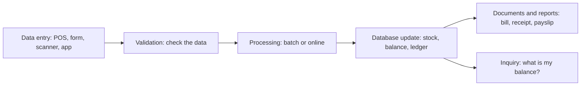
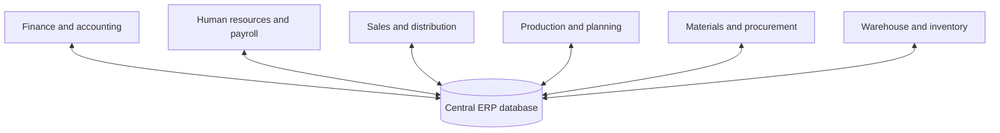
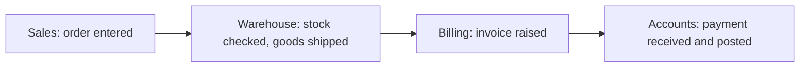

**In one line:** <mark>A TPS records the routine transactions of a business; an ERP is an integrated, real-time system on one shared database that supports the core processes of the whole organisation</mark>. ERP brings one version of the truth, at the price of high cost and hard implementation. <Cite id="note-tps-fais-erp-wiki-tps" /> <Cite id="note-tps-fais-erp-wiki-erp" />

<Box kind="key">

**Key points to write (TPS, ERP, advantages and drawbacks):**

- <mark>TPS captures, processes, stores and reports routine transactions</mark> (sales, payments, bookings, payroll).
- TPS activities: <mark>data entry, validation, processing, database update, documents and reports</mark>; **batch** versus **online** processing.
- <mark>ERP is an integrated, real-time software system on one shared database for the whole organisation</mark>.
- ERP modules: finance, HR, sales, procurement, production, inventory.
- <mark>Advantages: one version of the truth, data entered once, real-time reports, better coordination, inventory and cost control</mark>.
- <mark>Drawbacks: very high cost, long complex implementation, process change, staff resistance, heavy customisation</mark>.
- Give examples: TPS ATM withdrawal; ERP SAP, Oracle.

</Box>

## Core answer (5 marks, fits every question here)

<Box kind="definition">

A **transaction processing system (TPS)** is an information system that captures, processes, stores and reports the routine transactions of a business, such as sales, payments, bookings and payroll, so that the firm's records are always up to date. <Cite id="note-tps-fais-erp-wiki-tps" /> <Cite id="crm-rainer-iis" />

**Enterprise resource planning (ERP)** is an integrated, real-time software system, built on one shared database, that supports the core business processes of a whole organisation (finance, HR, supply chain, manufacturing, sales) and lets every department see and use the same data. <Cite id="note-tps-fais-erp-wiki-erp" /> <Cite id="note-tps-fais-erp-oracle-erp" />

</Box>

| Point | TPS | ERP |
|---|---|---|
| Main job | Record routine events | Integrate all departments' processes |
| Scope | One event or function | Whole firm |
| Database | Often separate per function | One shared database |
| Example | ATM withdrawal, ticket booking, supermarket bill | SAP, Oracle, Microsoft Dynamics |

**Advantages of ERP in one line:** one version of the truth, data entered once, real-time reports. **Drawbacks:** high cost, complex implementation, process change. <Cite id="note-tps-fais-erp-tp-erp" />

**Conclusion:** <mark>the TPS records the business, and ERP joins all departments on one database for integrated, real-time information</mark>.

## Extended answer (10 marks): add these

### 1. TPS in detail

- **Why needed:** every other system depends on correct records; the TPS is the main source of data for FAIS, MIS, ERP and decision support. <Cite id="it-impact-society-tp-mis" />
- **Steps:** data entry, **validation** (reject errors), processing, database update, documents and reports (and inquiries). <Cite id="note-tps-fais-erp-includehelp-tps" />
- **Batch versus online processing:**

| Point | Batch | Online (real-time) |
|---|---|---|
| Timing | Collected, processed later in a group | Each transaction processed at once |
| Result | Not immediate | Instant confirmation |
| Example | Monthly payroll, bank interest posting | ATM withdrawal, train ticket booking |

<Cite id="note-tps-fais-erp-wiki-batch" /> <Cite id="note-tps-fais-erp-wiki-oltp" />

- **Characteristics:** speed and high volume; accuracy and integrity (the **ACID** rules: atomic, consistent, isolated, durable); high availability; security and audit trail; structured inputs. <Cite id="note-tps-fais-erp-wiki-acid" />
- **Limits:** it only records and reports; it does not analyse or predict.

### 2. ERP in detail

**Why needed:** when every department keeps its own system, the same customer or item is stored many times, numbers do not match and orders are re-typed. ERP puts data in one place, entered once and used by all. <Cite id="note-tps-fais-erp-sap-india" />

**History:** MRP (material requirements planning) in factories, then MRP II, then ERP in the 1990s adding finance and HR, then web-based and cloud ERP. <Cite id="note-tps-fais-erp-wiki-mrp" />

**Main modules:** finance and accounting, human resources, sales and distribution, procurement, production and planning, inventory and warehouse, supply chain and CRM. <Cite id="note-tps-fais-erp-ms-erp" />

**How ERP supports a process (order-to-cash):** order entered by sales, stock checked and goods shipped by the warehouse, invoice raised by billing, payment posted by accounts, with no re-typing.

### 3. Advantages and drawbacks of ERP

| Advantages | Drawbacks |
|---|---|
| One shared database gives one version of the truth | Very high cost: licences, hardware, consultants, training |
| Data entered once: less duplicate work and fewer errors | Long, complex implementation (months or years) |
| Real-time reports and faster decisions | The firm often has to change its processes to fit the software |
| Better coordination, shorter delivery and cycle times | Staff resistance and heavy training needs |
| Better inventory, cost and cash control | Heavy customisation causes delays and bugs |
| Better customer service and forecasting | Hard to link with other systems; dependence on one vendor |
| Standard, secure, auditable processes | If it fails, the whole firm is affected; benefits take time |
| Scales with the firm | Poor data quality is copied everywhere |

<Cite id="note-tps-fais-erp-tpoint-erp-adv" /> <Cite id="note-tps-fais-erp-tp-erp" />

**Implementation approaches:** *big bang* (whole firm on one date, quick but risky), *phased* (module by module, safer but slower) and *parallel* (old and new together, safe but double work). Key risks are weak planning, poor understanding of process change and too much customisation.

**Real use:** SAP, Oracle and Microsoft Dynamics are leading products for large and mid-size firms; Walmart-type retailers link stores, warehouses, suppliers and finance on one planning system.

## Fit it to each question

- **"Write short notes on (1) TPS (2) ERP."** (10 marks) <PYQ id="2022-12-ce/q4a" />: write two short notes: TPS (definition, five-step diagram, batch versus online, example) from **section 1**, then ERP (definition, module diagram, modules, order-to-cash example and a few benefits) from **section 2**. About half a page each.
- **"Identify advantages and drawbacks of businesses implementation which uses an enterprise resource planning system."** (10 marks) <PYQ id="2024-05-ce/q4b" />: one-line definition of ERP, the ERP module diagram, then **section 3 in full** (advantages and drawbacks table with a firm example) and the implementation approaches and risks line.

## Exam tips

- **Draw both diagrams**: the five TPS steps and the ERP shared-database hub.
- For "short notes", keep each note equal in length: definition, diagram, key points, example.
- In the ERP table, write at least **six advantages and six drawbacks**, and name a product (SAP, Oracle).
