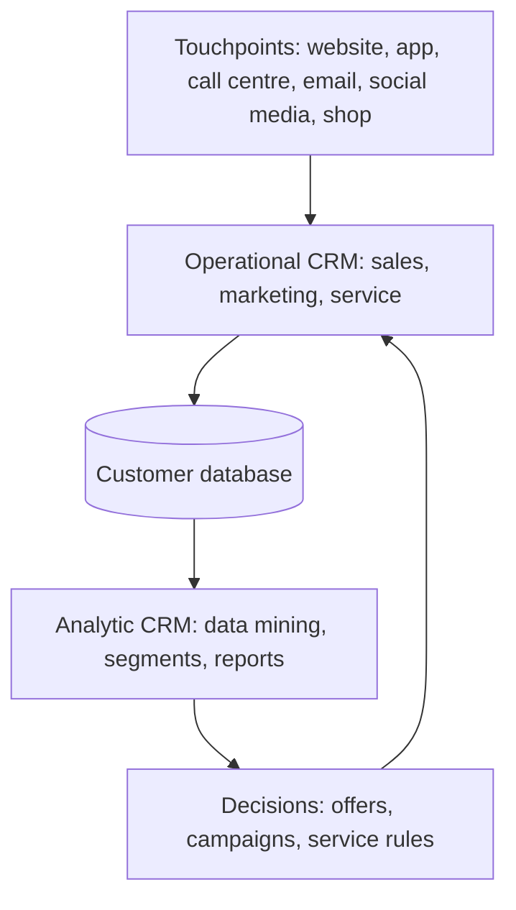
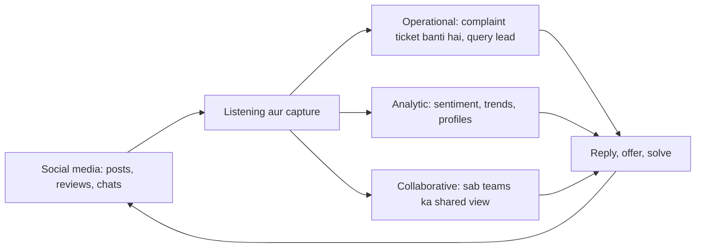

**Ek line mein:** <mark>CRM ek strategy hai, information systems ke support se, jo customer ki saari information ek jagah laati hai taaki firm customers ko acquire, serve aur retain kar sake</mark>. Types hain **operational, analytic, marketing aur collaborative**, aur social media se aata hai **social CRM**. <Cite id="crm-rainer-iis" /> <Cite id="crm-wiki-crm" />

<Box kind="key">

**Har CRM question mein ye points likho:**

- <mark>CRM ek strategy aur information systems ka set hai</mark> (sirf software nahi), jo har touchpoint se customer data **ek database** mein laata hai.
- Goals: <mark>acquire, enhance (serve aur zyada becho), retain</mark> customers.
- <mark>Operational CRM</mark> daily front-office kaam chalata hai: sales force automation, marketing automation, customer service.
- <mark>Analytic CRM</mark> customer data ko study karta hai: segmentation, data mining, lifetime value, churn.
- <mark>Marketing CRM</mark> campaigns aur loyalty programmes plan karta hai; **collaborative CRM** teams aur partners ke beech customer data share karta hai.
- <mark>Social CRM</mark>: firm social media pe sunti aur reply karti hai, do-tarfa public baat.
- Har type ka ek **real example** (Flipkart ticket, Amazon recommendations, Zomato offer, car maker with dealer).

</Box>

## Core answer (5 marks, yahan ke har question ke liye)

<Box kind="definition">

**Customer relationship management (CRM)** is a strategy, supported by information systems, that gathers all the information about a firm's customers and their contacts with the firm in one place, so every part of the firm can treat each customer well and the firm can keep and grow its customers. <Cite id="crm-rainer-iis" /> <Cite id="crm-ibm" />

</Box>

**Kyun chahiye:** badi firm mein customer kai logon se baat karta hai (sales, support, delivery, billing). Har koi alag notes rakhe to customer wahi kahani baar baar sunata hai aur complaints bhool jaati hain. CRM har customer ki **ek shared picture** deta hai. Naya customer jodna purane ko rokne se kaafi mehnga hota hai. <Cite id="crm-gfg-intro" />

**Kaise kaam karta hai:** <Cite id="crm-gfg-intro" />

1. **Collect:** har touchpoint se data (website, calls, email, shop, social media).
2. **Store:** ek customer database mein.
3. **Analyse:** patterns dhoondho.
4. **Act:** personal offer, sahi agent, better product. Customer ki reaction naya data ban jaati hai.

**CRM ke types (short):**

| Type | Kaam | Example |
|---|---|---|
| Operational | Daily customer kaam (leads, tickets) | Flipkart support ticket |
| Analytic | Customer data mein patterns | Amazon recommendations |
| Marketing | Campaigns aur loyalty offers plan karta hai | Zomato lunch offer |
| Collaborative | Teams aur partners ke beech customer data share | Car maker aur uska dealer |

<Cite id="crm-techtarget-types" /> <Cite id="crm-tpoint-types" />

**Conclusion:** <mark>CRM bikhre hue customer contacts ko ek shared record bana deta hai</mark> aur use customers ko behtar serve karne aur zyada der rokne ke liye use karta hai.

## Extended answer (10 marks): ye add karo

### 1. CRM ke types detail mein

**Operational CRM.** Software jo daily front-office kaam automate karta hai. Teen parts: **sales force automation** (leads, contacts, follow-up reminders), **marketing automation** (scheduled campaigns, response tracking) aur **customer service and support** (har complaint ek ticket, agent ko route; call centre, IVR, live chat, chatbot). *Example:* Amazon support agent ko aapke orders aur refund history ek saath dikhti hai. <Cite id="crm-wiki-sfa" /> <Cite id="crm-rainer-iis" />

**Analytic CRM.** Stored customer data ko study karta hai decisions ke liye: **segmentation** (similar behaviour ke groups), **data mining** (saath kharide jaane wale products), **customer lifetime value** aur churn prediction. **Cross-selling** (related product) aur **upselling** (better version) mein bhi madad. *Example:* "customers who bought this also bought". <Cite id="crm-wiki-clv" />

**Marketing CRM.** Customer data se sahi customer, offer, channel aur time chunta hai: targeted emails, coupons, **loyalty programmes**. Kai books mein ye operational CRM ke andar aata hai aur insight ke liye analytic CRM use karta hai. *Example:* Zomato un logon ko lunch offer bhejta hai jo noon ko order karte hain. <Cite id="crm-tp-quick-guide" />

**Collaborative CRM.** Sales, support, marketing aur bahar ke partners (dealers, suppliers) ko ek customer record share karne deta hai. *Example:* car maker, dealer aur service centre ko same repair history dikhti hai. <Cite id="crm-techtarget-types" />

| Point | Operational | Analytic | Marketing | Collaborative |
|---|---|---|---|---|
| Main aim | Daily kaam chalana | Customers ko samajhna | Campaigns se jodna aur rokna | Teams ke beech data share |
| Users | Sales, support | Analysts, managers | Marketing team | Sab departments, partners |
| Time view | Abhi | Past aur future | Planned campaigns | Chalta hua teamwork |

### 2. CRM mein social computing ka role

**Social CRM** social media (Facebook, Instagram, X, WhatsApp, review sites) ko CRM channel ki tarah use karta hai. Firm sirf message nahi bhejti: wo **sunti** hai, public mein reply karti hai aur contact CRM record mein likhti hai. <Cite id="crm-wiki-social-crm" /> <Cite id="crm-techtarget-social" />

1. **Fast public support:** bank ya airline ko tweet ka jawab minutes mein.
2. **Listening:** reviews aur hashtags se pasand-napasand, survey ke bina.
3. **Customers ek doosre ki madad karte hain** communities mein; ideas crowdsourcing se.
4. **Personal marketing** public interests se.
5. **Chat channels aur chatbots** 24 x 7 help ke liye.
6. **Early warning** jab gusse wale posts badhein.

**Risk:** kharab experience public mein tezi se failta hai, private data leak ho sakta hai, fake reviews gumraah karte hain. <Cite id="crm-gfg-ecrm" />

| Point | Traditional CRM | Social CRM |
|---|---|---|
| Baat kaun control karta hai | Firm | Firm aur customers saath |
| Direction | Zyadatar one-way | Two-way, many-to-many |
| Channels | Phone, email, shop | Social networks, chat, reviews |
| Visibility aur speed | Private, ghante ya din | Aksar public, minutes |

### 3. CRM ke benefits aur limits

**Benefits:** behtar service, loyalty, cross-selling se zyada sales, kam wasted marketing, customer ka ek view. **Limits:** cost, kharab data ("garbage in, garbage out"), staff data nahi bharta, privacy issues. <Cite id="crm-ibm" />

## Har question mein kaise fit karein

- **"What do you mean by CRM? Give its types and relate the role of SC on CRM."** (10 marks) <PYQ id="2022-12-ce/q3a" />: definition, chhota why, types (section 1 short mein), phir **section 2 poora**: social CRM, diagram, chhe points aur traditional-versus-social table.
- **"Explain CRM. Describe the different types of CRM with example."** (10 marks) <PYQ id="2023-12-ce/q3b" /> <PYQ id="2025-05-ce/q4a" />: core answer (definition, why, chaar steps, diagram) plus **section 1** (har type uske example ke saath) aur comparison table. Social CRM sirf do lines.

## Exam tips

- **CRM structure diagram** aur four-type table draw karo; pehle syllabus ke teen (operational, analytic, marketing), phir collaborative extra.
- Likho ki <mark>CRM ek strategy aur process hai, sirf software nahi</mark>.
- Operational (daily kaam) aur analytic (data study) ko alag rakho, aur har type ka company example do.

Exam mein English mein likho.
