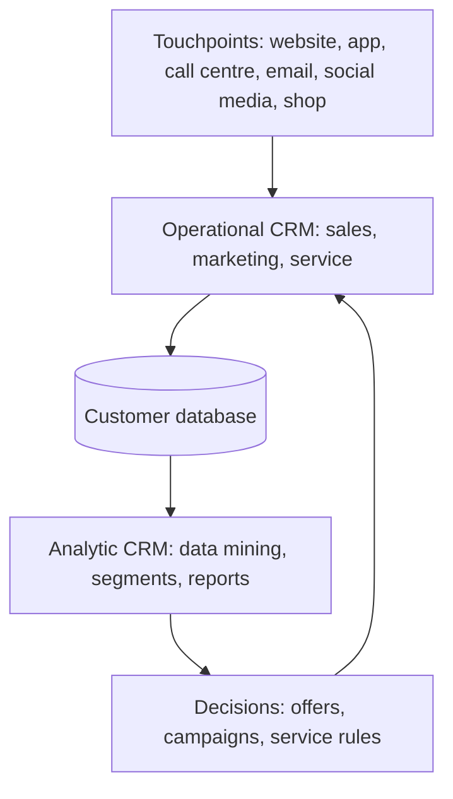
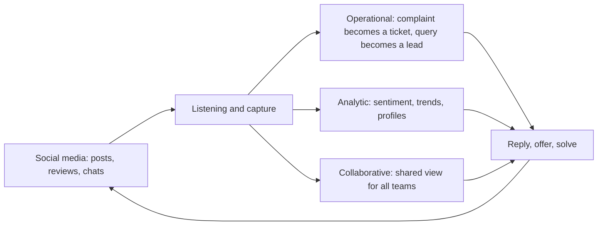

**In one line:** <mark>CRM is a strategy, supported by information systems, that collects all customer information in one place so the firm can acquire, serve and retain customers</mark>. Its types are **operational, analytic, marketing and collaborative**, and social media adds **social CRM**. <Cite id="crm-rainer-iis" /> <Cite id="crm-wiki-crm" />

<Box kind="key">

**Key points to write (any CRM question):**

- <mark>CRM is a strategy and a set of information systems</mark> (not only software) that gathers customer data from every touchpoint into **one database**.
- Goals: <mark>acquire, enhance (serve and sell more), retain</mark> customers.
- <mark>Operational CRM</mark> runs daily front-office work: sales force automation, marketing automation, customer service.
- <mark>Analytic CRM</mark> studies customer data: segmentation, data mining, lifetime value, churn.
- <mark>Marketing CRM</mark> plans campaigns and loyalty programmes; **collaborative CRM** shares customer data across teams and partners.
- <mark>Social CRM</mark>: the firm listens and replies on social media, a two-way public talk.
- One **real example** for each type (Flipkart ticket, Amazon recommendations, Zomato offer, car maker with dealer).

</Box>

## Core answer (5 marks, fits every question here)

<Box kind="definition">

**Customer relationship management (CRM)** is a strategy, supported by information systems, that gathers all the information about a firm's customers and their contacts with the firm in one place, so every part of the firm can treat each customer well and the firm can keep and grow its customers. <Cite id="crm-rainer-iis" /> <Cite id="crm-ibm" />

</Box>

**Why it is needed:** in a big firm a customer talks to many people (sales, support, delivery, billing). If each keeps separate notes, the customer repeats the same story and complaints are forgotten. CRM gives **one shared picture** of each customer. Winning a new customer also costs far more than keeping one. <Cite id="crm-gfg-intro" />

**How it works:** <Cite id="crm-gfg-intro" />

1. **Collect** data from every touchpoint (website, calls, email, shop, social media).
2. **Store** it in one customer database.
3. **Analyse** it to find patterns.
4. **Act**: personal offer, right agent, better product. The reaction becomes new data.

**Types of CRM (short):**

| Type | Job | Example |
|---|---|---|
| Operational | Runs daily customer work (leads, tickets) | Flipkart support ticket |
| Analytic | Finds patterns in customer data | Amazon recommendations |
| Marketing | Plans campaigns and loyalty offers | Zomato lunch offer |
| Collaborative | Shares customer data across teams and partners | Car maker with its dealer |

<Cite id="crm-techtarget-types" /> <Cite id="crm-tpoint-types" />

**Conclusion:** <mark>CRM turns scattered customer contacts into one shared record</mark> and uses it to serve customers better and keep them longer.

## Extended answer (10 marks): add these

### 1. Types of CRM in detail

**Operational CRM.** Software that automates daily front-office work. It has three parts: **sales force automation** (leads, contacts, follow-up reminders), **marketing automation** (scheduled campaigns, response tracking) and **customer service and support** (every complaint is a ticket routed to an agent; call centre, IVR, live chat, chatbot). *Example:* an Amazon support agent sees your orders and refund history at once. <Cite id="crm-wiki-sfa" /> <Cite id="crm-rainer-iis" />

**Analytic CRM.** Studies stored customer data to support decisions: **segmentation** (groups with similar behaviour), **data mining** (products bought together), **customer lifetime value** and churn prediction. It also helps **cross-selling** (a related product) and **upselling** (a better version). *Example:* "customers who bought this also bought". <Cite id="crm-wiki-clv" />

**Marketing CRM.** Uses customer data to choose the right customer, offer, channel and time: targeted emails, coupons, **loyalty programmes**. In many books it sits inside operational CRM and uses analytic CRM for insight. *Example:* Zomato sends a lunch offer to people who order at noon. <Cite id="crm-tp-quick-guide" />

**Collaborative CRM.** Lets sales, support, marketing and outside partners (dealers, suppliers) share one customer record. *Example:* car maker, dealer and service centre see the same repair history. <Cite id="crm-techtarget-types" />

| Point | Operational | Analytic | Marketing | Collaborative |
|---|---|---|---|---|
| Main aim | Run daily work | Understand customers | Win and keep through campaigns | Share data across teams |
| Users | Sales, support | Analysts, managers | Marketing team | All departments, partners |
| Time view | Now | Past and future | Planned campaigns | Ongoing teamwork |

### 2. Role of social computing in CRM

**Social CRM** uses social media (Facebook, Instagram, X, WhatsApp, review sites) as a CRM channel. The firm does not only send messages: it **listens**, answers in public and records the contact in the CRM record. <Cite id="crm-wiki-social-crm" /> <Cite id="crm-techtarget-social" />

1. **Fast public support:** a tweet to a bank or airline is answered in minutes.
2. **Listening:** reviews and hashtags show likes and dislikes without a survey.
3. **Customers help each other** in communities; ideas through crowdsourcing.
4. **Personal marketing** from public interests.
5. **Chat channels and chatbots** for 24 x 7 help.
6. **Early warning** when angry posts rise.

**Risk:** a bad experience spreads publicly and quickly, private data can leak, fake reviews mislead. <Cite id="crm-gfg-ecrm" />

| Point | Traditional CRM | Social CRM |
|---|---|---|
| Who controls the talk | The firm | Firm and customers together |
| Direction | Mostly one-way | Two-way, many-to-many |
| Channels | Phone, email, shop | Social networks, chat, reviews |
| Visibility and speed | Private, hours or days | Often public, minutes |

### 3. Benefits and limits of CRM

**Benefits:** better service, loyalty, more sales through cross-selling, less wasted marketing, one view of the customer. **Limits:** cost, poor data ("garbage in, garbage out"), staff not entering data, privacy issues. <Cite id="crm-ibm" />

## Fit it to each question

- **"What do you mean by CRM? Give its types and relate the role of SC on CRM."** (10 marks) <PYQ id="2022-12-ce/q3a" />: definition, short why, types (section 1 in brief), then **section 2 in full**: social CRM, the diagram, the six points and the traditional-versus-social table.
- **"Explain CRM. Describe the different types of CRM with example."** (10 marks) <PYQ id="2023-12-ce/q3b" /> <PYQ id="2025-05-ce/q4a" />: core answer (definition, why, four steps, diagram) plus **section 1** (each type with its example) and the comparison table. Social CRM in two lines only.

## Exam tips

- **Draw the CRM structure diagram** and the four-type table; name the syllabus three first (operational, analytic, marketing), then collaborative as extra.
- Write that <mark>CRM is a strategy and process, not only software</mark>.
- Keep operational (runs daily work) and analytic (studies data) clearly apart, and give a company example for each type.
