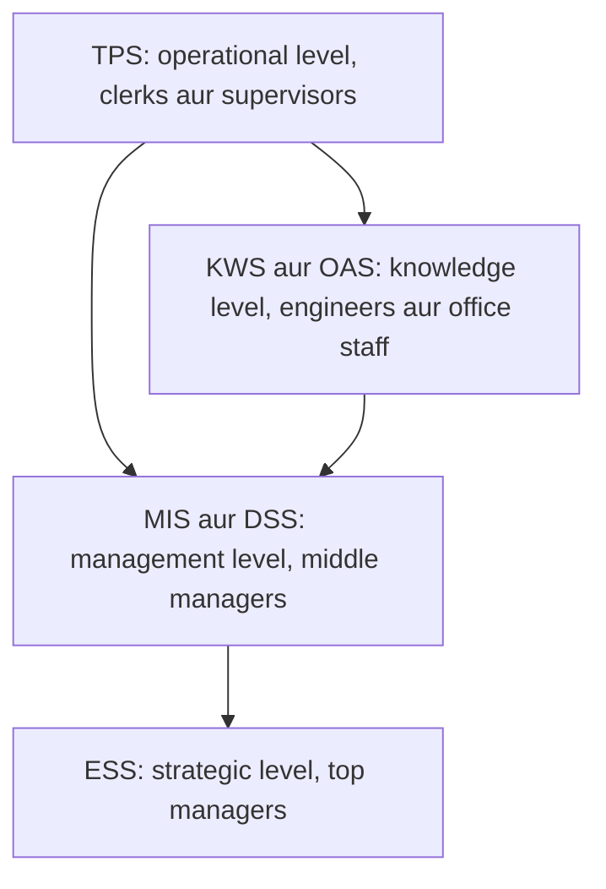

**Ek line mein:** <mark>Alag managers ko alag information chahiye, isliye firm har level ke liye alag information system use karti hai: TPS, OAS/KWS, MIS, DSS, ESS aur expert systems</mark>. <Cite id="is-fundamentals-gfg-types" />

<Box kind="key">

**Har "types" question mein ye points likho:**

- <mark>Information system = people + hardware + software + data + procedures</mark> jo information collect, process, store aur share karte hain.
- <mark>Chaar levels: operational (TPS), knowledge (OAS, KWS), management (MIS, DSS), strategic (ESS)</mark>.
- **TPS** daily transactions record karta hai; **MIS** summary reports deta hai; **DSS** "what if" ka jawab deta hai; **ESS** CEO ko dashboard deta hai.
- <mark>Level jitna upar, detail kam, decisions kam structured, users kam</mark>.
- <mark>TPS ka data MIS aur DSS ko feed karta hai, wo ESS ko</mark>.
- MIS ke types report ke hisaab se: <mark>periodic, exception, demand, ad-hoc</mark>; function ke hisaab se: finance, marketing, HR, production.

</Box>

## Core answer (5 marks, yahan ke har question ke liye)

<Box kind="definition">

A **Management Information System (MIS)** is a planned system for collecting, storing and sending information so that managers can plan, control and decide. An **information system (IS)** is a set of people, hardware, software, data and procedures that collects, processes, stores and shares information. <Cite id="is-fundamentals-tp-mis" /> <Cite id="is-fundamentals-wiki-is" />

</Box>

**Kyun kai types:** clerk ko har ek transaction chahiye, lekin CEO ko ek page ka summary. Isliye firm ke har level ka apna system hota hai. <Cite id="is-fundamentals-gfg-types" />

| Type | Level | Users | Output | Example |
|---|---|---|---|---|
| TPS | Operational | Clerks | Detailed records | ATM, billing |
| OAS / KWS | Knowledge | Office staff, engineers | Documents, designs | Email, CAD |
| MIS | Management | Middle managers | Periodic reports | Monthly sales report |
| DSS | Management | Managers | What-if analysis | Loan analysis |
| ESS | Strategic | Top executives | Dashboards | CEO dashboard |

**Conclusion:** <mark>types aapas mein linked hain: TPS ka data MIS aur DSS ko deta hai, wo ESS ko</mark>. <Cite id="is-fundamentals-pearson-laudon" />

## Extended answer (10 marks): ye add karo

### 1. Saat types ki explanation

1. **Transaction Processing System (TPS):** roz ke routine transactions batch ya real time mein record karta hai. Example: SBI ATM withdrawal.
2. **Office Automation System (OAS):** email, documents, scheduling jaise office kaam mein help. Example: Microsoft Office.
3. **Knowledge Work System (KWS):** engineers aur designers ko naya knowledge banane mein help. Example: CAD software.
4. **MIS:** TPS data ko regular summary aur exception reports mein badalta hai. Example: Flipkart ka daily sales-by-city report.
5. **DSS:** managers data aur models pe what-if questions test karte hain. Example: price cut ka effect.
6. **ESS:** top executives ko drill-down wala dashboard aur outside data deta hai. Example: CEO dashboard (revenue, profit, market share). <Cite id="is-fundamentals-tp-ess" />
7. **Expert system:** if-then rules se expert ki soch copy karta hai. Example: medical diagnosis help.

### 2. MIS ke types (report aur function ke hisaab se)

| Report ke hisaab se | Kya deta hai | Example |
|---|---|---|
| Periodic | Fixed time, fixed format | Region-wise monthly sales |
| Exception | Sirf unusual cases | Stock reorder level se neeche |
| Demand | Manager maange tab | Ek product ki aaj ki sales |
| Ad-hoc | Ek baar ka special question | Pichhle monsoon mein umbrella sales |

Function ke hisaab se: **finance, marketing, human resource, production** MIS. Har ek ek central database se feed hone wala subsystem hai. <Cite id="is-fundamentals-gfg-mis" /> <Cite id="is-fundamentals-wiki-mis" />

### 3. Upar jaate hue types kaise badalte hain

| Point | Operational | Management | Strategic |
|---|---|---|---|
| Decision type | Structured | Semi-structured | Unstructured |
| Data | Detailed, current | Summaries | Trends + outside data |
| Time view | Daily | Hafte, mahine | Saalon |
| Users | Bahut | Kam | Bahut kam |

## Har question mein kaise fit karein

- **"What are the different types of MIS?"** (5 marks) <PYQ id="2022-12-ce/q1a" />: core answer, phir section 2 ke dono MIS classifications (report aur function) ek-ek example ke saath.
- **"What are types IS? Explain with example."** (10 marks) <PYQ id="2024-05-ce/q4a" />: definition, pyramid diagram, section 1 ke saat types har ek example ke saath, phir table.

## Exam tips

- **Pyramid hamesha draw karo**; aadhe marks usi se aate hain.
- **Har type ka ek real example** do (ATM, CAD, Flipkart report, CEO dashboard).
- Question mein "MIS" ho to report aur function types bhi likho, sirf pyramid nahi.

Exam mein English mein likho.
