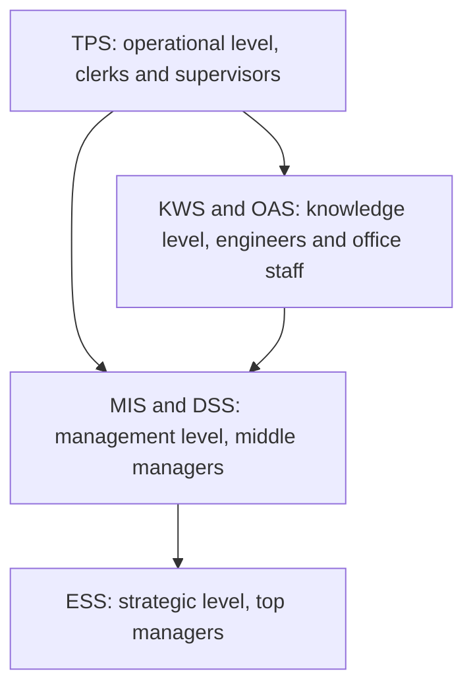

**In one line:** <mark>Different managers need different information, so a firm uses a different information system for each level: TPS, OAS/KWS, MIS, DSS, ESS and expert systems</mark>. <Cite id="is-fundamentals-gfg-types" />

<Box kind="key">

**Key points to write (any "types" question):**

- <mark>Information system = people + hardware + software + data + procedures</mark> that collect, process, store and share information.
- <mark>Four levels: operational (TPS), knowledge (OAS, KWS), management (MIS, DSS), strategic (ESS)</mark>.
- **TPS** records daily transactions; **MIS** gives summary reports; **DSS** answers "what if"; **ESS** gives the CEO a dashboard.
- <mark>Higher level = less detail, less structured decisions, fewer users</mark>.
- <mark>TPS data feeds MIS and DSS, which feed ESS</mark>.
- MIS types by report: <mark>periodic, exception, demand, ad-hoc</mark>; by function: finance, marketing, HR, production.

</Box>

## Core answer (5 marks, fits every question here)

<Box kind="definition">

A **Management Information System (MIS)** is a planned system for collecting, storing and sending information so that managers can plan, control and decide. An **information system (IS)** is a set of people, hardware, software, data and procedures that collects, processes, stores and shares information. <Cite id="is-fundamentals-tp-mis" /> <Cite id="is-fundamentals-wiki-is" />

</Box>

**Why many types:** a clerk needs every single transaction, but the CEO needs a one-page summary. So each level of the firm gets its own system. <Cite id="is-fundamentals-gfg-types" />

| Type | Level | Users | Output | Example |
|---|---|---|---|---|
| TPS | Operational | Clerks | Detailed records | ATM, billing |
| OAS / KWS | Knowledge | Office staff, engineers | Documents, designs | Email, CAD |
| MIS | Management | Middle managers | Periodic reports | Monthly sales report |
| DSS | Management | Managers | What-if analysis | Loan analysis |
| ESS | Strategic | Top executives | Dashboards | CEO dashboard |

**Conclusion:** <mark>the types are linked: TPS data feeds MIS and DSS, which feed the ESS</mark>. <Cite id="is-fundamentals-pearson-laudon" />

## Extended answer (10 marks): add these

### 1. The seven types explained

1. **Transaction Processing System (TPS):** records routine daily transactions in batch or real time. Example: an SBI ATM withdrawal.
2. **Office Automation System (OAS):** supports office work such as email, documents and scheduling. Example: Microsoft Office.
3. **Knowledge Work System (KWS):** helps engineers and designers create new knowledge. Example: CAD software.
4. **MIS:** turns TPS data into regular summary and exception reports. Example: Flipkart's daily sales-by-city report.
5. **DSS:** lets managers test what-if questions on data and models. Example: effect of a price cut.
6. **ESS:** gives top executives a drillable dashboard with outside data. Example: CEO dashboard of revenue, profit, market share. <Cite id="is-fundamentals-tp-ess" />
7. **Expert system:** copies an expert's reasoning with if-then rules. Example: medical diagnosis help.

### 2. Types of MIS (by report and by function)

| By report | What it gives | Example |
|---|---|---|
| Periodic | Fixed time, fixed format | Monthly sales by region |
| Exception | Only unusual cases | Stock below reorder level |
| Demand | When a manager asks | Today's sales of one product |
| Ad-hoc | One-time special question | Umbrella sales last monsoon |

By function: **finance, marketing, human resource, production** MIS. Each is a subsystem fed from one central database. <Cite id="is-fundamentals-gfg-mis" /> <Cite id="is-fundamentals-wiki-mis" />

### 3. How the types differ as you go up

| Point | Operational | Management | Strategic |
|---|---|---|---|
| Decision type | Structured | Semi-structured | Unstructured |
| Data | Detailed, current | Summaries | Trends plus outside data |
| Time view | Daily | Weeks, months | Years |
| Users | Many | Fewer | Very few |

## Fit it to each question

- **"What are the different types of MIS?"** (5 marks) <PYQ id="2022-12-ce/q1a" />: core answer, then write the two MIS classifications from section 2 (by report and by function) with one example each.
- **"What are types IS? Explain with example."** (10 marks) <PYQ id="2024-05-ce/q4a" />: definition, pyramid diagram, the seven types of section 1 each with an example, then the table.

## Exam tips

- **Always draw** the pyramid; it carries half the marks.
- Give **one real example per type** (ATM, CAD, Flipkart report, CEO dashboard).
- If the question says "MIS", also write the report and function types, not only the pyramid.
