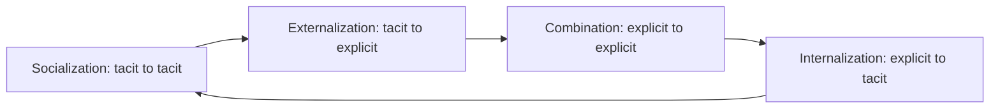

**Ek line mein:** <mark>Knowledge ke do main types hain, explicit aur tacit, aur Nonaka ka SECI model unhe badalne ke chaar modes dikhata hai: socialization, externalization, combination aur internalization</mark>. <Cite id="knowledge-management-wiki-seci" />

<Box kind="key">

**Ye points likho:**

- <mark>Explicit knowledge likha, store aur share kiya ja sakta hai (manuals, reports)</mark>.
- <mark>Tacit knowledge logon ke dimaag aur haathon mein personal know-how hai (feel, judgment, skill)</mark>.
- <mark>SECI: Socialization (tacit to tacit), Externalization (tacit to explicit), Combination (explicit to explicit), Internalization (explicit to tacit)</mark>.
- Knowledge **spiral** mein badhta hai: har round mein richer knowledge.
- Nonaka ek shared space **Ba** bhi batate hain jahan conversion hota hai.
- Examples: nurse ko shadow karna, troubleshooting guide, merged reports, manual se seekhna.

</Box>

## Core answer (5 marks, yahan ke har question ke liye)

<Box kind="definition">

**Knowledge** is information combined with experience and understanding so that you know what to do. **Explicit knowledge** can be put into words, numbers or diagrams and recorded; **tacit knowledge** is personal know-how built from experience. <Cite id="knowledge-management-wiki-seci" /> <Cite id="knowledge-management-wiki-tacit" />

</Box>

Cycling ka manual explicit hai, lekin cycle pe balance banana tacit hai.

| Point | Tacit knowledge | Explicit knowledge |
|---|---|---|
| Kahan rehta hai | Logon ke dimaag aur skills mein | Documents aur databases mein |
| Likha ja sakta hai? | Mushkil ya aadha | Haan, aasaani se |
| Sharing | Face to face, mentoring | Padhna, email, search |
| Example | Doctor ka diagnostic judgment | Hospital ki treatment guideline |
| Main risk | Insaan jaaye to kho jaata hai | Purana ho jaata hai |

<Cite id="knowledge-management-tp-tacit-explicit" />

**Conclusion:** <mark>explicit aur tacit knowledge chaar modes se ek doosre mein badalte rehte hain, aur organizations ko chaaron support karne chahiye</mark>.

## Extended answer (10 marks): ye add karo

### 1. Chaar modes ki explanation

1. **Socialization (tacit to tacit):** log saath dekhkar aur practice karke experience seedha share karte hain. Example: naya nurse senior nurse ko shadow karta hai.
2. **Externalization (tacit to explicit):** know-how words, models ya pictures mein aata hai. Example: engineer bees saal ke experience se troubleshooting guide likhta hai.
3. **Combination (explicit to explicit):** maujooda explicit pieces merge hoke naya explicit knowledge. Example: branch sales reports milakar ek national report.
4. **Internalization (explicit to tacit):** insaan explicit knowledge se seekhta hai aur practice se use apni skill bana leta hai. Example: naya employee manual follow karta hai jab tak kaam aadat na ban jaye.

### 2. Spiral aur Ba

Internalization ke baad insaan ke paas richer tacit knowledge hota hai, jo wo phir socialization se share karta hai, isliye har round mein knowledge badhta hai. Nonaka us shared space ko **Ba** kehte hain. <Cite id="knowledge-management-nonaka-hbr" />

### 3. Iceberg view

Kuch sources **implicit knowledge** bhi jodte hain: abhi likha nahi gaya lekin likha ja sakta hai. Data, information, knowledge aur wisdom (DIKW) ek seedhi hain; knowledge information se upar hai. <Cite id="knowledge-management-wiki-dikw" />

## Har question mein kaise fit karein

- **"Illustrate the different types of knowledge and explain four modes of knowledge conversion"** (10 marks) <PYQ id="2023-05-ce/q5b" />: definition, tacit vs explicit table, SECI diagram, section 1 chaar examples ke saath, spiral aur Ba, iceberg image.

## Exam tips

- **SECI loop draw karo** aur har arrow pe "tacit to explicit" likho.
- **Har mode ka ek example**, workplace wala (nurse, engineer, branch report).
- Order **S, E, C, I** likho aur kaho ki ye spiral hai.

Exam mein English mein likho.
