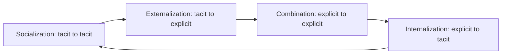

**In one line:** <mark>Knowledge is of two main types, explicit and tacit, and Nonaka's SECI model shows four modes of converting them: socialization, externalization, combination and internalization</mark>. <Cite id="knowledge-management-wiki-seci" />

<Box kind="key">

**Key points to write:**

- <mark>Explicit knowledge can be written, stored and shared (manuals, reports)</mark>.
- <mark>Tacit knowledge is personal know-how in people's heads and hands (feel, judgment, skill)</mark>.
- <mark>SECI: Socialization (tacit to tacit), Externalization (tacit to explicit), Combination (explicit to explicit), Internalization (explicit to tacit)</mark>.
- Knowledge **spirals**: each round gives richer knowledge.
- Nonaka also names a shared space **Ba** where conversion happens.
- Examples: nurse shadowing, troubleshooting guide, merged reports, learning from a manual.

</Box>

## Core answer (5 marks, fits every question here)

<Box kind="definition">

**Knowledge** is information combined with experience and understanding so that you know what to do. **Explicit knowledge** can be put into words, numbers or diagrams and recorded; **tacit knowledge** is personal know-how built from experience. <Cite id="knowledge-management-wiki-seci" /> <Cite id="knowledge-management-wiki-tacit" />

</Box>

A cycling manual is explicit, but balancing on a bicycle is tacit.

| Point | Tacit knowledge | Explicit knowledge |
|---|---|---|
| Where it lives | In people's minds and skills | In documents and databases |
| Written down? | Hard or partly | Yes, easily |
| Sharing | Face to face, mentoring | Reading, e-mail, search |
| Example | A doctor's diagnostic judgment | A hospital's treatment guideline |
| Main risk | Lost when the person leaves | Becomes outdated |

<Cite id="knowledge-management-tp-tacit-explicit" />

**Conclusion:** <mark>explicit and tacit knowledge keep converting into each other through the four modes, and organizations should support all four</mark>.

## Extended answer (10 marks): add these

### 1. The four modes explained

1. **Socialization (tacit to tacit):** people share experience directly by watching and practising together. Example: a new nurse shadows a senior nurse.
2. **Externalization (tacit to explicit):** know-how is put into words, models or pictures. Example: an engineer writes a troubleshooting guide from twenty years of experience.
3. **Combination (explicit to explicit):** existing explicit pieces are merged into new explicit knowledge. Example: branch sales reports are combined into one national report.
4. **Internalization (explicit to tacit):** a person learns from explicit knowledge and, through practice, makes it their own skill. Example: a new employee follows a manual until the work becomes second nature.

### 2. The spiral and Ba

After internalization the person has richer tacit knowledge, which they share again through socialization, so knowledge grows each round. Nonaka calls the shared space where this happens **Ba**. <Cite id="knowledge-management-nonaka-hbr" />

### 3. Iceberg view

Some sources add **implicit knowledge**: not yet written down but could be. Data, information, knowledge and wisdom (DIKW) form a ladder; knowledge sits above information. <Cite id="knowledge-management-wiki-dikw" />

## Fit it to each question

- **"Illustrate the different types of knowledge and explain four modes of knowledge conversion"** (10 marks) <PYQ id="2023-05-ce/q5b" />: definition, tacit versus explicit table, SECI diagram, section 1 with four examples, spiral and Ba, iceberg image.

## Exam tips

- **Draw** the SECI loop and write "tacit to explicit" on each arrow.
- Give **one example per mode**, a workplace one (nurse, engineer, branch report).
- Write the order **S, E, C, I** and say it is a spiral.
