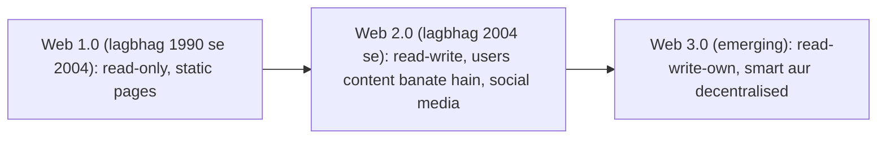

**Ek line mein:** <mark>Web 1.0 read-only web hai, Web 2.0 read-write social web hai, aur Web 3.0 smart, decentralised web hai jo machines ke samajhne aur users ke owner hone ke liye bana hai</mark>. <Cite id="social-computing-gfg-web-versions" /> <Cite id="social-computing-av-web2-web3" />

<Box kind="key">

**Web 1.0 / 2.0 / 3.0 mein ye points likho:**

- <mark>Web 1.0: read-only, static pages, kuch hi publishers</mark>. Example: shuruaati company brochure sites, Yahoo directory.
- <mark>Web 2.0: read-write, users content banate hain, social media, interactive pages (Ajax)</mark>. Example: Facebook, YouTube, Wikipedia.
- <mark>Web 3.0: read-write-own, semantic aur decentralised, AI aur blockchain</mark>. Example: semantic search, Ethereum apps, smart assistants.
- **Web 3.0 ke do meanings:** **Semantic Web** (machines ke liye meaning wala data) aur **Web3** (blockchain, user ownership).
- In pe compare karo: content kaun banata hai, pages, data control, technology, communication, examples, weak point.
- One-line verdict: <mark>Web 2.0 ne web ko social banaya; Web 3.0 use meaningful aur user-owned banana chahta hai</mark>.

</Box>

## Core answer (5 marks, yahan ke har question ke liye)

<Box kind="definition">

The web has grown in stages called **Web 1.0, 2.0 and 3.0**. The numbers are a way of speaking, not software releases. Web 2.0 became a popular term through Tim O'Reilly around 2004. Web 3.0 has no single agreed definition and is still emerging. <Cite id="social-computing-oreilly-web2" /> <Cite id="social-computing-wiki-web2" />

</Box>

| Point | Web 2.0 | Web 3.0 |
|---|---|---|
| Nickname | Read-write, social web | Read-write-own, smart aur decentralised web |
| Content | Users aur companies saath | Users, machines aur AI ki madad se |
| Data control | Bade platforms (Facebook, Google) | User (Web3 view mein) |
| Technology | Ajax, JavaScript, blogs, wikis, social networks, cloud | Semantic tags, AI, blockchain, smart contracts |
| Communication | Two-way, many-to-many | Machine-to-machine aur peer-to-peer bhi |
| Examples | Facebook, YouTube, Wikipedia | Semantic search, Ethereum apps, smart assistants |
| Weak point | Privacy loss, data platforms ke paas | Complex, slow, abhi early, rules saaf nahi |

<Cite id="social-computing-gfg-web-versions" /> <Cite id="social-computing-av-web2-web3" />

**Conclusion:** <mark>Web 2.0 ne web ko social banaya; Web 3.0 use meaningful aur user-owned banana chahta hai</mark>.

## Extended answer (10 marks): ye add karo

### 1. Web 1.0, read-only web

Pages **static** hote hain: sabke liye same aur sirf owner badalta hai. Kuch log publish karte hain, bahut log padhte hain. Dial-up internet common tha, isliye pages halke the. Example: shuruaati company brochure sites, Yahoo directory. <Cite id="social-computing-gfg-web-versions" />

### 2. Web 2.0, read-write social web

Users post, comment, like, upload, edit aur share karte hain. Pages bina reload ke respond karte hain **Ajax** ki wajah se (page background mein chhota data fetch karta hai). Site ek platform hai aur users ka content uski value hai. Examples: Facebook, YouTube, Wikipedia, X, Instagram, Flipkart reviews. <Cite id="social-computing-wiki-ajax" /> <Cite id="social-computing-oreilly-web2" />

### 3. Web 3.0, agla web (do meanings)

1. **Semantic Web** (Tim Berners-Lee ka idea): data clear **meaning** ke saath publish hota hai, taaki machines use samajh aur jod sakein. "Goa ki Rs 5000 se sasti flights agle Friday" jaisi search kai sites ka data jodke answer ho sakti hai. <Cite id="social-computing-wiki-semantic-web" /> <Cite id="social-computing-w3c-semantic-web" />
2. **Web3** (decentralised web): **blockchain** pe bana (kai computers ka shared record jo badalna bahut mushkil hai); users apna data, identity aur digital assets khud rakhte hain, kuch badi companies nahi. Examples: Ethereum apps, NFTs. Critics kehte hain ki iska bahut hissa hype hai ya practice mein abhi bhi centralised. <Cite id="social-computing-wiki-web3" /> <Cite id="social-computing-ethereum-web3" />

Dono meanings **AI** bhi use karte hain, jo aapko dikhne wali cheez personalise karta hai.

### 4. Poori comparison table

| Point | Web 1.0 | Web 2.0 | Web 3.0 |
|---|---|---|---|
| Nickname | Read-only web | Read-write, social web | Read-write-own, smart web |
| Content kaun banata hai | Kuch publishers | Users aur companies | Users, machines aur AI |
| Pages | Static | Dynamic, interactive | Intelligent, personalised |
| Data control | Site owner | Bade platforms | User (Web3 view) |
| Technology | HTML, simple servers | Ajax, blogs, wikis, cloud | Semantic tags, AI, blockchain |
| Communication | One-way | Two-way, many-to-many | Machine-to-machine, peer-to-peer bhi |
| Example | Brochure sites, Yahoo directory | Facebook, YouTube, Wikipedia | Semantic search, Ethereum apps |
| Weak point | Interaction nahi | Privacy loss | Complex, early, rules saaf nahi |

<Cite id="social-computing-gfg-web-versions" />

## Har question mein kaise fit karein

- **"Analyse briefly to highlight the difference between Web 2.0 and Web 3.0?"** (5 marks) <PYQ id="2022-12-ce/q1c" />: **core answer**: har ki ek line, do-column table chhe-saat rows ke saath, aur one-line verdict. Web 3.0 ke do meanings ek sentence mein.
- **"Compare and contrast Web 1.0, 2.0, 3.0 with example."** (10 marks) <PYQ id="2023-12-ce/q6b" />: stage diagram, phir **sections 1 se 3** (har ke liye example ke saath chhota paragraph) aur **poori three-column table**; end mein conclusion.

## Exam tips

- **Teen-stage diagram draw karo** aur har web ke neeche ek real example do.
- Likho ki Web 3.0 ki **koi ek definition nahi** hai aur dono meanings ke naam lo; examiners ko ye pasand aata hai.
- Web 3.0 ko limits ke bina "better" mat kaho: uska weak point likho (complex, early, rules saaf nahi).

Exam mein English mein likho.
