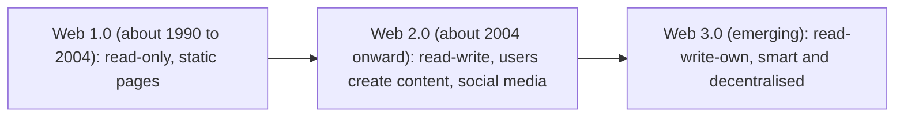

**In one line:** <mark>Web 1.0 is the read-only web, Web 2.0 is the read-write social web, and Web 3.0 is the smart, decentralised web that is meant to be understood by machines and owned by users</mark>. <Cite id="social-computing-gfg-web-versions" /> <Cite id="social-computing-av-web2-web3" />

<Box kind="key">

**Key points to write (Web 1.0 / 2.0 / 3.0):**

- <mark>Web 1.0: read-only, static pages, a few publishers</mark>. Example: early company brochure sites, Yahoo directory.
- <mark>Web 2.0: read-write, users create content, social media, interactive pages (Ajax)</mark>. Example: Facebook, YouTube, Wikipedia.
- <mark>Web 3.0: read-write-own, semantic and decentralised, AI and blockchain</mark>. Example: semantic search, Ethereum apps, smart assistants.
- **Two meanings of Web 3.0:** the **Semantic Web** (data with meaning for machines) and **Web3** (blockchain, user ownership).
- Compare on: content maker, pages, data control, technology, communication, examples, weak point.
- One-line verdict: <mark>Web 2.0 made the web social; Web 3.0 aims to make it meaningful and user-owned</mark>.

</Box>

## Core answer (5 marks, fits every question here)

<Box kind="definition">

The web has grown in stages called **Web 1.0, 2.0 and 3.0**. The numbers are a way of speaking, not software releases. Web 2.0 became a popular term through Tim O'Reilly around 2004. Web 3.0 has no single agreed definition and is still emerging. <Cite id="social-computing-oreilly-web2" /> <Cite id="social-computing-wiki-web2" />

</Box>

| Point | Web 2.0 | Web 3.0 |
|---|---|---|
| Nickname | Read-write, social web | Read-write-own, smart and decentralised web |
| Content | Users and companies together | Users, with machines and AI helping |
| Data control | Big platforms (Facebook, Google) | User (in the Web3 view) |
| Technology | Ajax, JavaScript, blogs, wikis, social networks, cloud | Semantic tags, AI, blockchain, smart contracts |
| Communication | Two-way, many-to-many | Machine-to-machine and peer-to-peer too |
| Examples | Facebook, YouTube, Wikipedia | Semantic search, Ethereum apps, smart assistants |
| Weak point | Privacy loss, data owned by platforms | Complex, slow, still early, unclear rules |

<Cite id="social-computing-gfg-web-versions" /> <Cite id="social-computing-av-web2-web3" />

**Conclusion:** <mark>Web 2.0 made the web social; Web 3.0 aims to make it meaningful and user-owned</mark>.

## Extended answer (10 marks): add these

### 1. Web 1.0, the read-only web

Pages are **static**: the same for everyone and changed only by the owner. A few people publish, many read. Dial-up internet was common, so pages were light. Example: early company brochure sites, the Yahoo directory. <Cite id="social-computing-gfg-web-versions" />

### 2. Web 2.0, the read-write social web

Users post, comment, like, upload, edit and share. Pages respond without reloading because of **Ajax** (the page fetches small pieces of data in the background). The site is a platform and users' content is its value. Examples: Facebook, YouTube, Wikipedia, X, Instagram, Flipkart reviews. <Cite id="social-computing-wiki-ajax" /> <Cite id="social-computing-oreilly-web2" />

### 3. Web 3.0, the next web (two meanings)

1. **Semantic Web** (Tim Berners-Lee's idea): data is published with a clear **meaning**, so machines can understand and connect it. A search for "flights to Goa cheaper than Rs 5000 next Friday" can then be answered by combining data from many sites. <Cite id="social-computing-wiki-semantic-web" /> <Cite id="social-computing-w3c-semantic-web" />
2. **Web3** (decentralised web): built on **blockchain** (a shared record kept by many computers and very hard to change); users own their data, identity and digital assets instead of a few big companies. Examples: Ethereum apps, NFTs. Critics say much of it is hype or still centralised in practice. <Cite id="social-computing-wiki-web3" /> <Cite id="social-computing-ethereum-web3" />

Both meanings also use **AI** to personalise what you see.

### 4. Full comparison table

| Point | Web 1.0 | Web 2.0 | Web 3.0 |
|---|---|---|---|
| Nickname | Read-only web | Read-write, social web | Read-write-own, smart web |
| Who makes content | A few publishers | Users and companies | Users, with machines and AI |
| Pages | Static | Dynamic, interactive | Intelligent, personalised |
| Data control | Site owner | Big platforms | User (Web3 view) |
| Technology | HTML, simple servers | Ajax, blogs, wikis, cloud | Semantic tags, AI, blockchain |
| Communication | One-way | Two-way, many-to-many | Machine-to-machine, peer-to-peer too |
| Example | Brochure sites, Yahoo directory | Facebook, YouTube, Wikipedia | Semantic search, Ethereum apps |
| Weak point | No interaction | Privacy loss | Complex, early, unclear rules |

<Cite id="social-computing-gfg-web-versions" />

## Fit it to each question

- **"Analyse briefly to highlight the difference between Web 2.0 and Web 3.0?"** (5 marks) <PYQ id="2022-12-ce/q1c" />: the **core answer**: one line each, the two-column table with six to seven rows, and the one-line verdict. Mention the two meanings of Web 3.0 in one sentence.
- **"Compare and contrast Web 1.0, 2.0, 3.0 with example."** (10 marks) <PYQ id="2023-12-ce/q6b" />: the stage diagram, then **sections 1 to 3** (a short paragraph with an example for each) and the **full three-column table**; end with the conclusion.

## Exam tips

- **Draw the three-stage diagram** and give one real example under each web.
- Say that Web 3.0 has **no single definition** and name both meanings; examiners like this.
- Do not call Web 3.0 "better" without limits: add its weak point (complex, early, unclear rules).
