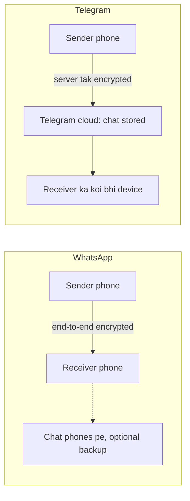

**Ek line mein:** Dono mobile messaging apps hain, lekin <mark>WhatsApp mein end-to-end encryption default on hai aur chats phone pe rehti hain, jabki Telegram chats apne cloud mein rakhta hai aur end-to-end encryption sirf optional Secret Chats mein hai</mark>, aur Telegram bade groups, channels, bots aur badi files ke liye zyada strong hai. <Cite id="e-commerce-whatsapp-security" /> <Cite id="e-commerce-telegram-faq" />

<Box kind="key">

**WhatsApp versus Telegram mein ye points likho:**

- **Question mein jo parameters diye hain** unpe compare karo: multimedia, security, privacy, storage, data usage, notifications.
- <mark>Security: WhatsApp mein end-to-end encryption default; Telegram ki cloud chats end-to-end encrypted nahi, sirf Secret Chats hain</mark>.
- <mark>Privacy: WhatsApp phone number ko ID banata hai; Telegram number chhupa sakta hai aur username use kar sakta hai</mark>.
- <mark>Storage: WhatsApp chats phone pe store karta hai (optional backup); Telegram chats apne cloud mein rakhta hai, isliye kisi bhi device pe khulti hain</mark>.
- Multimedia: dono photos, video, voice, documents aur calls bhejte hain; Telegram mein **channels, bots, polls** aur bahut bade groups extra hain.
- End mein **one-line verdict** do aur numbers ke liye "about" likho, kyunki updates se badalte hain.

</Box>

## Core answer (5 marks, yahan ke har question ke liye)

<Box kind="definition">

**WhatsApp** (owned by Meta) and **Telegram** (Telegram Messenger) are mobile messaging apps used for chat, calls and sharing media. Firms also use them to talk to customers, which makes them part of m-commerce and social computing. <Cite id="e-commerce-wiki-whatsapp" /> <Cite id="e-commerce-wiki-telegram" />

</Box>

| Parameter | WhatsApp | Telegram |
|---|---|---|
| Multimedia | Photos, videos, voice notes, documents, voice aur video calls, status | Wahi, plus channels, bots, polls, stickers aur badi files |
| Security | Chats aur calls ke liye end-to-end encryption default on | Cloud chats device aur server ke beech encrypted; end-to-end sirf optional Secret Chats mein |
| Privacy | Phone number hi ID; privacy settings se dikhna limit | Number chhupa sakte hain, username use |
| Storage | Chats phone pe; Google Drive ya iCloud pe optional backup | Chats Telegram ke cloud mein, kisi bhi device pe khulti hain |
| Data usage | Moderate; low-data call setting; auto-download control | Moderate; detailed auto-download aur cache controls |
| Notifications | Per chat mute, custom tones | Per chat mute, custom tones, silent aur scheduled messages |

<Cite id="e-commerce-telegram-faq" /> <Cite id="e-commerce-whatsapp-security" />

**Conclusion:** <mark>WhatsApp chat ke liye simple private default hai; Telegram bade groups, channels, badi files aur bots ke liye strong hai</mark>, lekin uski normal chats end-to-end encrypted nahi hain.

## Extended answer (10 marks): ye add karo

### 1. Aur parameters

| Parameter | WhatsApp | Telegram |
|---|---|---|
| Owner | Meta | Telegram Messenger |
| File size | Per file 2 GB tak | Per file 2 GB tak (paid users ko zyada) |
| Groups | Bade groups aur Communities jo kai groups jodte hain | Bahut bade groups, aur channels jinme member limit nahi |
| Multi-device | Phone plus companion devices | Kai devices pe poora independent use |
| Business use | WhatsApp Business app aur API, catalogues | Broadcast aur automation ke liye channels aur bots |

<Cite id="social-computing-whatsapp-2gb" /> <Cite id="social-computing-whatsapp-communities" /> <Cite id="e-commerce-wiki-telegram" />

### 2. Security samjho

**End-to-end encryption (E2EE)** matlab keys sirf do phones ke paas hoti hain, isliye company bhi message nahi padh sakti. WhatsApp ise saari chats ke liye default use karta hai. Telegram sirf Secret Chats mein; normal chats Telegram ke servers tak encrypted jaati hain aur wahin store hoti hain. <Cite id="web-mis-2-whatsapp-whitepaper" /> <Cite id="e-commerce-telegram-e2e" /> <Cite id="social-computing-wiki-e2ee" />

### 3. Kab kya use karein

| Need | Behtar choice | Reason |
|---|---|---|
| Customer ke saath private chat | WhatsApp | Default encrypted, sabke paas hai |
| Hazaron followers ko broadcast | Telegram | Channels mein member limit nahi |
| Automatic replies aur order bots | Telegram | Strong bot support |
| Shop catalogue aur business profile | WhatsApp Business | Catalogue aur API |
| Naye device pe chats turant | Telegram | Cloud storage |

**Verdict:** <mark>need ke hisaab se chuno: privacy aur simplicity (WhatsApp) ya scale, bots aur cloud access (Telegram)</mark>. Figures updates se badalte hain, isliye exam mein "about" likho.

## Har question mein kaise fit karein

- **"Compare between mobile applications like WhatsApp and Telegram on various parameters like multimedia, security, privacy, storage, data usage, notifications etc."** (5 marks) <PYQ id="2023-05-ce/q1b" /> <PYQ id="2024-12-ce/q1b" />: **core table** likho jisme question ke saare chhe parameters hon (har row mein dono apps ki ek-ek line), time ho to encryption diagram, aur one-line verdict.

## Exam tips

- **Question mein jo parameters hain sab cover karo**, usi order mein, table rows ki tarah.
- Sabse bada marks point **security** hai: WhatsApp E2EE default, Telegram sirf Secret Chats mein.
- Exact figures ko fixed mat likho; "about" ya "up to" likho.

Exam mein English mein likho.
