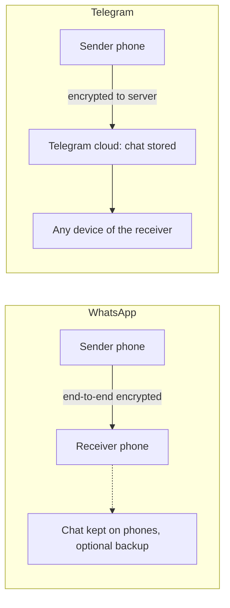

**In one line:** Both are mobile messaging apps, but <mark>WhatsApp has end-to-end encryption on by default and keeps chats on the phone, while Telegram keeps chats in its cloud with end-to-end encryption only in optional Secret Chats</mark>, and Telegram is stronger for big groups, channels, bots and large files. <Cite id="e-commerce-whatsapp-security" /> <Cite id="e-commerce-telegram-faq" />

<Box kind="key">

**Key points to write (WhatsApp versus Telegram):**

- Compare on the **parameters the question names**: multimedia, security, privacy, storage, data usage, notifications.
- <mark>Security: WhatsApp end-to-end encryption by default; Telegram cloud chats are not end-to-end encrypted, only Secret Chats are</mark>.
- <mark>Privacy: WhatsApp uses your phone number as ID; Telegram can hide the number and use a username</mark>.
- <mark>Storage: WhatsApp stores chats on the phone (optional backup); Telegram stores chats in its cloud, so they open on any device</mark>.
- Multimedia: both send photos, video, voice, documents and calls; Telegram adds **channels, bots, polls** and very large groups.
- End with a **one-line verdict** and say "about" for numbers, because they change with updates.

</Box>

## Core answer (5 marks, fits every question here)

<Box kind="definition">

**WhatsApp** (owned by Meta) and **Telegram** (Telegram Messenger) are mobile messaging apps used for chat, calls and sharing media. Firms also use them to talk to customers, which makes them part of m-commerce and social computing. <Cite id="e-commerce-wiki-whatsapp" /> <Cite id="e-commerce-wiki-telegram" />

</Box>

| Parameter | WhatsApp | Telegram |
|---|---|---|
| Multimedia | Photos, videos, voice notes, documents, voice and video calls, status | Same, plus channels, bots, polls, stickers and large files |
| Security | End-to-end encryption on by default for chats and calls | Cloud chats encrypted between device and server; end-to-end only in optional Secret Chats |
| Privacy | Phone number is the ID; privacy settings can limit who sees it | Can hide the number and use a username |
| Storage | Chats kept on the phone; optional backup to Google Drive or iCloud | Chats kept in Telegram's cloud, open on any device |
| Data usage | Moderate; low-data call setting; auto-download control | Moderate; detailed auto-download and cache controls |
| Notifications | Mute per chat, custom tones | Mute per chat, custom tones, silent and scheduled messages |

<Cite id="e-commerce-telegram-faq" /> <Cite id="e-commerce-whatsapp-security" />

**Conclusion:** <mark>WhatsApp is the simple private default for chat; Telegram is stronger for large groups, channels, big files and bots</mark>, but its normal chats are not end-to-end encrypted.

## Extended answer (10 marks): add these

### 1. More parameters

| Parameter | WhatsApp | Telegram |
|---|---|---|
| Owner | Meta | Telegram Messenger |
| File size | Up to 2 GB per file | Up to 2 GB per file (more for paid users) |
| Groups | Large groups and Communities that link many groups | Very large groups, and channels with no member limit |
| Multi-device | Phone plus companion devices | Full independent use on many devices |
| Business use | WhatsApp Business app and API, catalogues | Channels and bots for broadcast and automation |

<Cite id="social-computing-whatsapp-2gb" /> <Cite id="social-computing-whatsapp-communities" /> <Cite id="e-commerce-wiki-telegram" />

### 2. Security explained

**End-to-end encryption (E2EE)** means only the two phones hold the keys, so even the company cannot read the message. WhatsApp uses it for all chats by default. Telegram uses it only in Secret Chats; ordinary chats are encrypted on the way to Telegram's servers and stored there. <Cite id="web-mis-2-whatsapp-whitepaper" /> <Cite id="e-commerce-telegram-e2e" /> <Cite id="social-computing-wiki-e2ee" />

### 3. Which to use when

| Need | Better choice | Reason |
|---|---|---|
| Private chat with a customer | WhatsApp | Encrypted by default, everyone has it |
| Broadcast to thousands of followers | Telegram | Channels have no member limit |
| Automatic replies and order bots | Telegram | Strong bot support |
| Shop catalogue and business profile | WhatsApp Business | Catalogue and API |
| Access chats on a new device quickly | Telegram | Cloud storage |

**Verdict:** <mark>choose by need: privacy and simplicity (WhatsApp) or scale, bots and cloud access (Telegram)</mark>. Figures change with updates, so say "about" in the exam.

## Fit it to each question

- **"Compare between mobile applications like WhatsApp and Telegram on various parameters like multimedia, security, privacy, storage, data usage, notifications etc."** (5 marks) <PYQ id="2023-05-ce/q1b" /> <PYQ id="2024-12-ce/q1b" />: write the **core table** with all six named parameters (each row one line for both apps), the encryption diagram if time allows, and the one-line verdict.

## Exam tips

- **Cover every parameter named in the question**, in the same order, as table rows.
- The biggest marks point is **security**: WhatsApp E2EE by default, Telegram only in Secret Chats.
- Do not quote exact figures as fixed; write "about" or "up to".
