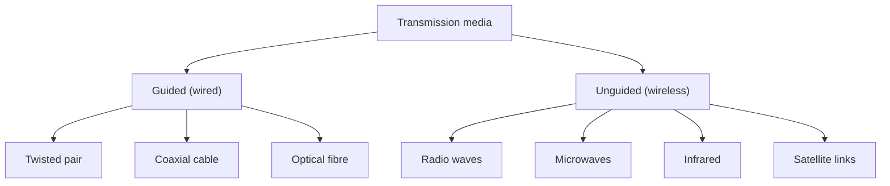
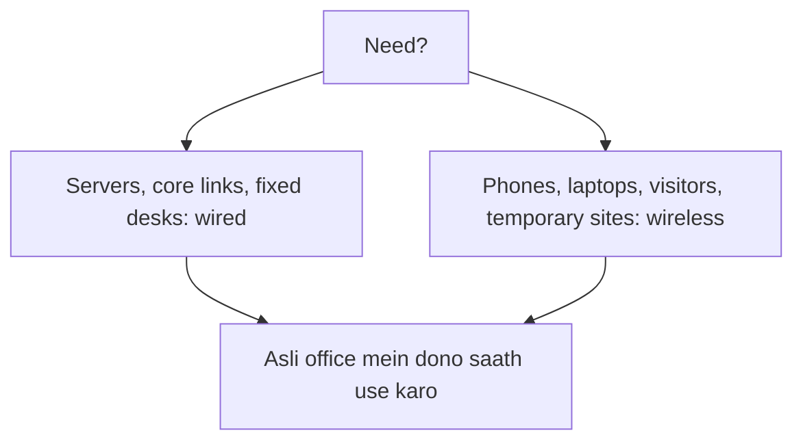

**Ek line mein:** <mark>Wired technology data physical cables (twisted pair, coaxial, optical fibre) se bhejti hai; wireless technology data ko radio waves ya doosre signals ki tarah hawa mein bhejti hai</mark>. Wired tez, steady aur zyada secure hai; wireless mobile, jaldi aur sasti set up hoti hai. <Cite id="networks-wireless-gfg-wired-wireless" />

<Box kind="key">

**Wired versus wireless mein ye points likho:**

- <mark>Medium: wired = physical cable (copper ya fibre); wireless = hawa (radio, microwave, infrared, satellite)</mark>.
- <mark>Speed aur reliability: wired high aur steady; wireless aam taur pe kam aur distance aur interference se badalti hai</mark>.
- <mark>Mobility: wired socket se bandha; wireless mein range ke andar chal sakte hain</mark>.
- <mark>Installation aur cost: wired lagana slow aur mehnga; wireless jaldi aur sasta badhta hai</mark>.
- <mark>Security: wired behtar (physical access chahiye); wireless intercept ho sakta hai, isliye encryption chahiye</mark>.
- Standards: wired ke liye **Ethernet (IEEE 802.3)**, wireless ke liye **Wi-Fi (IEEE 802.11)**, Bluetooth, cellular. Har ka ek **example**.

</Box>

## Core answer (5 marks, yahan ke har question ke liye)

<Box kind="definition">

**Wired technology** connects devices with physical cables (twisted pair, coaxial cable, optical fibre) that carry the signal. **Wireless technology** connects devices without cables: data travels as electromagnetic waves (radio, microwave, infrared, satellite) through the air. <Cite id="networks-wireless-gfg-guided-unguided" /> <Cite id="networks-wireless-wiki-wireless-network" />

</Box>

| Point | Wired | Wireless |
|---|---|---|
| Medium | Physical cable (copper ya fibre) | Hawa (radio, microwave, infrared, satellite) |
| Speed | High aur steady | Aam taur pe kam, distance aur noise se badalti hai |
| Mobility | Socket se bandha | Range mein chalne ki azaadi |
| Installation | Slow aur mehnga: cables bichhane padte hain | Jaldi aur sasta: access point lagao |
| Reliability | High, interference kam | Walls, mausam aur doosre devices se asar |
| Security | Behtar: physical access chahiye | Kamzor: signal intercept ho sakta hai, encryption chahiye |
| Expand karne ka cost | Har naye point ke liye zyada cable | Naye user ke liye bahut kam extra cost |
| Standard | Ethernet (IEEE 802.3) | Wi-Fi (IEEE 802.11), Bluetooth, cellular |
| Example | LAN socket pe office desktop | Campus Wi-Fi pe phone |

<Cite id="networks-wireless-gfg-wired-wireless" /> <Cite id="networks-wireless-gfg-guided-unguided" /> <Cite id="networks-wireless-wiki-wireless-network" />

**Conclusion:** <mark>firms dono use karti hain: servers aur core links speed aur reliability ke liye wired, aur phones aur laptops convenience ke liye Wi-Fi</mark>.

## Extended answer (10 marks): ye add karo

### 1. Wired technology

| Cable | Kya hai | Typical use |
|---|---|---|
| Twisted pair (UTP/STP) | Copper wires ke jode jo interference kam karne ke liye twist hote hain; Ethernet cabling per segment 100 m tak | Office aur home LANs |
| Coaxial cable | Insulation aur metal shield ke andar copper core | Cable TV, cable broadband |
| Optical fibre | Patle glass strands jo light pulses le jaate hain; bahut high speed, lambi distance, tap karna mushkil | Internet backbone, undersea cables |

**Ethernet** wired LAN banane ka standard tareeka hai (IEEE 802.3). **Advantages:** high steady speed, kam delay, secure, reliable. **Disadvantages:** cables bichhane mein paisa aur mehnat, devices chal nahi sakte, naye points ke liye aur cabling, cables kat sakti hain. <Cite id="networks-wireless-gfg-transmission-media" /> <Cite id="networks-wireless-wiki-optical-fiber" /> <Cite id="networks-wireless-ieee-8023" /> <Cite id="web-mis-2-wiki-ethernet" />

### 2. Wireless technology

| Technology | Range | Use | Example |
|---|---|---|---|
| NFC | Lagbhag 4 cm | Tap-to-pay, cards | Shop pe phone se payment |
| Bluetooth | Lagbhag 10 m | Personal devices ke beech link | Phone se earbuds |
| Wi-Fi (IEEE 802.11) | Andar kuch dus meter | Wireless LAN | Campus Wi-Fi |
| Cellular (4G, 5G) | Per cell kilometres | Mobile phones aur data | Jio, Airtel |
| Satellite | Lagbhag poori earth | Door ke areas, ships, aircraft | Satellite Internet |

<Cite id="networks-wireless-tp-wireless-transmission" /> <Cite id="networks-wireless-wiki-wifi" /> <Cite id="networks-wireless-ieee-80211" />

**Advantages:** mobility, jaldi aur sasti set up, users add karna aasan, jahan cabling mushkil wahan kaam. **Disadvantages:** achhi cable se slow aur kam steady, interference, kam range, zyada security risk (encryption aur strong passwords chahiye).

### 3. Dono mein se chunna

## Har question mein kaise fit karein

- **"List the main difference between Wireless and Wired Technologies?"** (5 marks) <PYQ id="2022-12-ce/q1e" />: **core answer** likho: dono ki one-line meaning, chhe se aath rows ki comparison table, aur har ka ek example. Conclusion line jodo.

## Exam tips

- **Do-column table** banao jisme kam se kam chhe rows hon (medium, speed, mobility, installation, security, cost).
- **Standards** (Ethernet 802.3, Wi-Fi 802.11) likho aur har ka ek **example** do.
- Likho ki real firms **dono use karti hain**; isse samajh dikhti hai.

Exam mein English mein likho.
