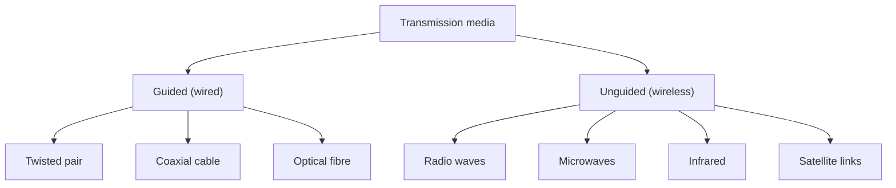
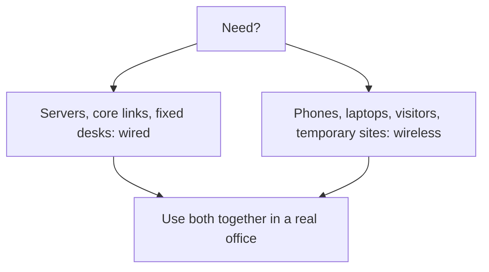

**In one line:** <mark>Wired technology sends data through physical cables (twisted pair, coaxial, optical fibre); wireless technology sends data as radio waves or other signals through the air</mark>. Wired is faster, steadier and more secure; wireless is mobile, quick and cheap to set up. <Cite id="networks-wireless-gfg-wired-wireless" />

<Box kind="key">

**Key points to write (wired versus wireless):**

- <mark>Medium: wired = physical cable (copper or fibre); wireless = air (radio, microwave, infrared, satellite)</mark>.
- <mark>Speed and reliability: wired is high and steady; wireless is usually lower and varies with distance and interference</mark>.
- <mark>Mobility: wired is fixed to a socket; wireless lets users move within range</mark>.
- <mark>Installation and cost: wired is slow and costly to lay; wireless is fast and cheap to expand</mark>.
- <mark>Security: wired is better (physical access needed); wireless can be intercepted, so it needs encryption</mark>.
- Standards: **Ethernet (IEEE 802.3)** for wired, **Wi-Fi (IEEE 802.11)**, Bluetooth, cellular for wireless. Add one **example** each.

</Box>

## Core answer (5 marks, fits every question here)

<Box kind="definition">

**Wired technology** connects devices with physical cables (twisted pair, coaxial cable, optical fibre) that carry the signal. **Wireless technology** connects devices without cables: data travels as electromagnetic waves (radio, microwave, infrared, satellite) through the air. <Cite id="networks-wireless-gfg-guided-unguided" /> <Cite id="networks-wireless-wiki-wireless-network" />

</Box>

| Point | Wired | Wireless |
|---|---|---|
| Medium | Physical cable (copper or fibre) | Air (radio, microwave, infrared, satellite) |
| Speed | High and steady | Usually lower, varies with distance and noise |
| Mobility | Fixed to a socket | Free to move within range |
| Installation | Slow and costly: cables must be laid | Fast and cheap: fit an access point |
| Reliability | High, little interference | Affected by walls, weather and other devices |
| Security | Better: needs physical access | Weaker: signal can be intercepted, needs encryption |
| Cost to expand | More cable for each new point | Little extra cost per new user |
| Standard | Ethernet (IEEE 802.3) | Wi-Fi (IEEE 802.11), Bluetooth, cellular |
| Example | Office desktop on a LAN socket | Phone on campus Wi-Fi |

<Cite id="networks-wireless-gfg-wired-wireless" /> <Cite id="networks-wireless-gfg-guided-unguided" /> <Cite id="networks-wireless-wiki-wireless-network" />

**Conclusion:** <mark>firms use both: servers and core links are wired for speed and reliability, while phones and laptops use Wi-Fi for convenience</mark>.

## Extended answer (10 marks): add these

### 1. Wired technology

| Cable | What it is | Typical use |
|---|---|---|
| Twisted pair (UTP/STP) | Pairs of copper wires twisted to cut interference; Ethernet cabling reaches up to 100 m per segment | Office and home LANs |
| Coaxial cable | Copper core inside insulation and a metal shield | Cable TV, broadband over cable |
| Optical fibre | Thin glass strands carrying pulses of light; very high speed, long distance, hard to tap | Internet backbone, undersea cables |

**Ethernet** is the standard way to build a wired LAN (IEEE 802.3). **Advantages:** high steady speed, low delay, secure, reliable. **Disadvantages:** cables cost money and effort to lay, devices cannot move, new points need more cabling, cables can be cut. <Cite id="networks-wireless-gfg-transmission-media" /> <Cite id="networks-wireless-wiki-optical-fiber" /> <Cite id="networks-wireless-ieee-8023" /> <Cite id="web-mis-2-wiki-ethernet" />

### 2. Wireless technology

| Technology | Range | Use | Example |
|---|---|---|---|
| NFC | About 4 cm | Tap-to-pay, cards | Phone payment at a shop |
| Bluetooth | About 10 m | Links between personal devices | Phone to earbuds |
| Wi-Fi (IEEE 802.11) | Tens of metres indoors | Wireless LAN | Campus Wi-Fi |
| Cellular (4G, 5G) | Kilometres per cell | Mobile phones and data | Jio, Airtel |
| Satellite | Almost the whole earth | Remote areas, ships, aircraft | Satellite Internet |

<Cite id="networks-wireless-tp-wireless-transmission" /> <Cite id="networks-wireless-wiki-wifi" /> <Cite id="networks-wireless-ieee-80211" />

**Advantages:** mobility, quick and cheap set-up, easy to add users, works where cabling is hard. **Disadvantages:** slower and less steady than a good cable, interference, shorter range, higher security risk (needs encryption and strong passwords).

### 3. Choosing between them

## Fit it to each question

- **"List the main difference between Wireless and Wired Technologies?"** (5 marks) <PYQ id="2022-12-ce/q1e" />: write the **core answer**: one-line meaning of each, the comparison table with six to eight rows, and one example each. Add the conclusion line.

## Exam tips

- **Make a two-column table** with at least six rows (medium, speed, mobility, installation, security, cost).
- Mention the **standards** (Ethernet 802.3, Wi-Fi 802.11) and give one **example** each.
- State that real firms **use both**; it shows understanding.
