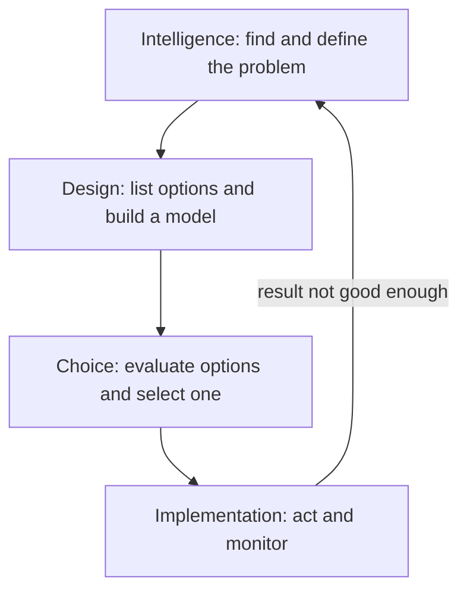
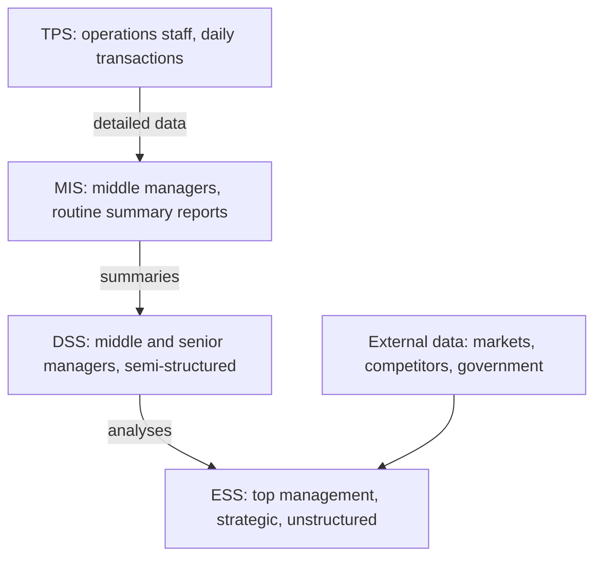
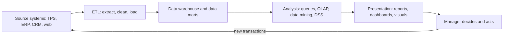
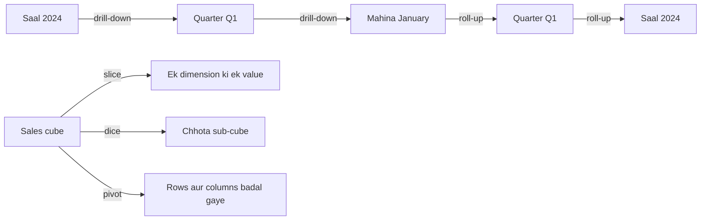
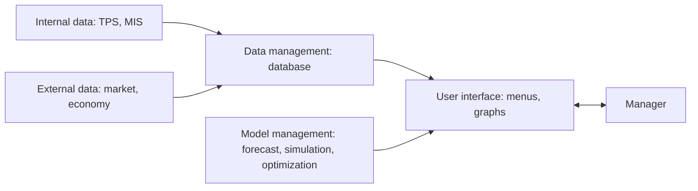

Naye ideas se pehle wo purane ideas jo tumhe chahiye. Agar already pata hain to next section pe jao.

## The basics first

- **Data** raw facts hote hain, jaise "Order 1021, 3 shirts, Rs 1,200, Pune". **Information** wo data hai jo is tarah arrange kiya gaya ho ki uska matlab nikle, jaise "Pune sales is mahine 12% gir gayi".
- **Transaction processing system (TPS)** business ke roz ke events record karta hai: sales, payments, stock movements. Ye company ke data ka main source hai.
- **Data warehouse** ek alag database hai jo kai TPS aur doosre sources se cleaned, historical data jama karta hai taaki uska analysis ho sake. **Data mart** ek department ke liye chhota warehouse hota hai. <Cite id="business-intelligence-gfg-data-warehousing" />
- **ETL** (extract, transform, load) wo process hai jo source systems se data copy karta hai, clean karta hai aur warehouse mein load karta hai.
- **Manager** wo insaan hai jo organisation ke goals ki taraf kaam ko plan, organise aur control karta hai. Decisions lena is kaam ka central hissa hai.
- **KPI** (key performance indicator) ek number hai jo dikhata hai ki goal kitna achieve ho raha hai, jaise monthly sales ya delivery time.

## The problem: too much data, too little insight

Ek modern company millions of transactions record karti hai. Manager ko decide karna hai "Kya hum Nashik mein naya store kholein?", wo millions of rows nahi padh sakta. Use data summarised, compared, forecast aur picture ki form mein chahiye. Business intelligence aur decision support systems yahi karte hain. Ye syllabus <Syl m="2" /> ka hissa hai, sections 2.3 aur 2.4: managers aur decision making, data analysis ke liye BI, aur results present karna. <Cite id="business-intelligence-rainer-mis" loc="Ch. 5" />

**Everyday analogy.** Car ka engine har second hazaaron signals banata hai. Driver unhe nahi padhta. Dashboard kuch hi dikhata hai: speed, fuel, ek warning light. BI business ka dashboard hai: raw data ki baadh ko wo kuch signals bana deta hai jo manager ko steer karne ke liye chahiye.

## Managers and decision making

**Decision kya hai.** Decision do ya zyada alternatives mein se ek choice hai. Managers hamesha decisions lete hain: kitna stock order karna hai, kise hire karna hai, kis market mein jaana hai.

**Managers ko computer support kyun chahiye.** Decisions chaar wajah se mushkil ho gaye hain:

1. **Zyada alternatives.** Technology aur global markets bahut zyada options compare karne ke liye dete hain.
2. **Time pressure.** Kai decisions jaldi lene padte hain, aksar kuch ghanton mein.
3. **Uncertainty.** Markets tezi se badalte hain, isliye choice ka effect predict karna mushkil hai.
4. **Galti ki cost.** Galat decision bahut costly ho sakta hai, aur kai logon ko affect kar sakta hai.

Insaanon mein **bounded rationality** bhi hoti hai: hamare decisions us information, available time aur is baat se limited hote hain ki hamara dimaag ek saath kitna process kar sakta hai. Isliye hum aksar best option ki jagah "good enough" option chun lete hain. Computer support in limits ko badhata hai. <Cite id="business-intelligence-wiki-bounded-rationality" />

### The phases of decision making (Simon's model)

Herbert Simon ne decision ka systematic process teen phases mein bataya: intelligence, design aur choice; implementation baad mein chautha phase joda gaya. <Cite id="business-intelligence-delen-decision-process" />

1. **Intelligence:** environment scan karo, problem ya opportunity notice karo, aur uske baare mein data collect karo. Example: sales report dikhati hai ki Pune sales 12% gir gayi.
2. **Design:** possible courses of action nikalo aur unhe test karne ke liye model banao. Example: prices kam karo, advert chalao, ya store band karo.
3. **Choice:** options ko criteria ke against compare karo aur ek chuno. Example: model kehta hai ki advert sabse kam cost mein sales wapas laata hai.
4. **Implementation:** chuna hua option lagu karo aur result dekho. Agar kaam nahi kare to wapas intelligence pe jao.

DSS in sab phases ko support karta hai, sirf aakhri choice ko nahi. <Cite id="business-intelligence-tp-dss" /> <Cite id="business-intelligence-wiki-dss" />

### Types of decisions

Decisions do tarah se alag hote hain: problem kitni well structured hai, aur organisation ke kis level pe decision liya jaata hai.

<Box kind="definition">

- **Structured decision:** routine aur repetitive, known procedure ke saath. Example: stock 100 units se neeche jaye to reorder karo.
- **Semi-structured decision:** problem ka ek hissa clear procedure wala hai, ek hissa judgment maangta hai. Example: agli quarter ka marketing budget set karna.
- **Unstructured decision:** naya, one-off, koi fixed procedure nahi; zyada tar judgment aur intuition. Example: naye country mein jaana ya nayi technology mein invest karna.

</Box>

| Level of management | Nature of decision | Typical example | Typical structure |
|---|---|---|---|
| Operational control (lower) | Roz ke tasks efficiently karna | Kal ki machine shifts schedule karna | Mostly structured |
| Management control (middle, tactical) | Goals pane ke liye resources achhe se use karna | Branches ke beech budget baantna | Mostly semi-structured |
| Strategic planning (top) | Long-term goals aur direction | Rival se merge karna, nayi product line launch karna | Mostly unstructured |

Decision jitna zyada unstructured, system ko utna zyada human ko support karna padta hai (DSS, ESS), decision ko automate karne ki jagah (TPS).

## The MIS hierarchy (the pyramid of information systems)

**MIS hierarchy** information systems ko is hisaab se arrange karti hai ki wo management ke kis level ko serve karte hain. Data upar ki taraf jaata hai aur har level pe aur zyada summarised hota jaata hai. <Cite id="business-intelligence-gfg-types-is" /> <Cite id="business-intelligence-wiki-mis" />

| System | Who uses it | What it does | Decision type | Output |
|---|---|---|---|---|
| TPS | Clerks, supervisors | Transactions record aur process karta hai | Structured | Detailed records, receipts |
| MIS | Middle managers | TPS data ko regular reports mein summarise karta hai | Structured, some semi-structured | Scheduled, exception aur summary reports |
| DSS | Middle aur senior managers, analysts | Models aur data ke saath interactive analysis | Semi-structured aur unstructured | What-if results, forecasts |
| ESS | Top executives | Internal aur external data se strategic overview | Unstructured | Dashboards, graphs, drill-down views |

| | MIS | DSS |
|---|---|---|
| Question answered | "What happened?" | "What if...?" and "What is best?" |
| Reports | Fixed, scheduled | Flexible, on demand, interactive |
| Problems | Structured | Semi-structured aur unstructured |
| Uses | Mainly internal TPS data | Internal aur external data plus models |

**Hierarchy mein DSS pe comment.** Beech ka MIS fixed reports se "kya hua?" ka jawab deta hai. Wo "agar ... ho to kya hoga?" ka jawab nahi de sakta. DSS uske theek upar is gap ko bharta hai: wo MIS aur TPS data leta hai, models jodta hai, aur manager ko alternatives interactively try karne deta hai. Yaani DSS routine reporting aur strategic judgment ke beech ka bridge hai. <Cite id="business-intelligence-tp-mis" />

## What business intelligence is

<Box kind="definition">

**Business intelligence (BI)** applications, technologies aur processes ka broad set hai jo data collect, store, access aur analyse karta hai taaki business users behtar decisions le sakein. <Cite id="business-intelligence-wiki-bi" /> <Cite id="business-intelligence-ibm-bi" />

</Box>

Ye term IBM researcher Hans Peter Luhn ne 1958 mein use kiya tha, aur Howard Dresner ne 1989 mein ise umbrella term ke roop mein propose kiya, un methods ke liye jo fact-based support systems se decisions behtar karte hain. BI decision support systems, executive information systems, data warehouses aur OLAP se grow hua. <Cite id="business-intelligence-wiki-bi" /> <Cite id="business-intelligence-tp-bi" />

**BI aur business analytics.** Ye words aksar loosely use hote hain. Ek common split ye hai ki BI batata hai ki kya hua aur kya ho raha hai (descriptive), jabki business analytics ye bhi predict karta hai ki kya hoga (**predictive analytics**) aur ye bhi suggest karta hai ki kya karna chahiye (**prescriptive analytics**). Sources exact boundary pe alag-alag kehte hain, isliye exam mein jo term use karo uski definition likho. <Cite id="business-intelligence-wiki-business-analytics" /> <Cite id="business-intelligence-wiki-predictive" /> <Cite id="business-intelligence-wiki-prescriptive" />

### How BI works, step by step

1. **Data sources:** TPS, ERP, CRM, websites, social media aur bahar ke data providers raw data banate hain.
2. **ETL:** data extract hota hai, clean hota hai aur data warehouse ya data marts mein load hota hai.
3. **Analysis:** users data query karte hain, OLAP chalate hain, data mining lagate hain ya DSS model use karte hain.
4. **Presentation:** results reports, dashboards, scorecards, charts aur maps ki form mein dikhaye jaate hain.
5. **Decision and action:** manager results ko KPIs se compare karta hai, decide karta hai aur act karta hai. Us action ke naye transactions step 1 mein wapas feed hote hain.

<Cite id="business-intelligence-ibm-bi" /> <Cite id="business-intelligence-gfg-bi" />

**Analogy.** Kitchen socho. Sabziyan kai farms se aati hain (sources), dhoi aur kaati jaati hain (ETL), pantry mein rakhi jaati hain (warehouse), dishes mein pakayi jaati hain (analysis) aur diner (manager) ke liye achhe se plate hoti hain (presentation).

## BI for data analysis

Teen families ke tools warehouse data ka analysis karte hain.

### 1. Multidimensional analysis (OLAP)

**Online analytical processing (OLAP)** users ko data ek saath kai **dimensions** mein dekhne deta hai, jaise product, region aur time. Data ko ek **cube** ki tarah imagine karte hain: har chhote cell mein ek measure hota hai, jaise ek product ki, ek region mein, ek mahine ki sales. <Cite id="business-intelligence-wiki-olap" /> <Cite id="business-intelligence-wiki-olap-cube" />

Common OLAP operations: <Cite id="business-intelligence-gfg-olap-ops" />

| Operation | What it does | Example |
|---|---|---|
| Roll-up | Higher level pe summarise karta hai | Monthly sales se yearly sales |
| Drill-down | Finer detail mein jaata hai | Yearly se monthly, phir daily |
| Slice | Ek dimension ko ek value pe fix karta hai | Sirf year 2024 |
| Dice | Do ya zyada dimensions pe chhota sub-cube chunta hai | Shirts aur jeans, Pune aur Mumbai mein, Q1 mein |
| Pivot | View rotate karta hai, rows aur columns swap karta hai | Rows ki jagah regions columns mein |

<Cite id="business-intelligence-gfg-olap-ops" loc="diagram" />

**Analogy.** Sales ka Rubik's cube: tum ise ghuma ke koi bhi face dekh sakte ho (pivot), ek slice nikal sakte ho (slice) ya ek chhote block mein zoom kar sakte ho (drill-down). <Cite id="business-intelligence-ibm-olap" />

### 2. Data mining

**Data mining** bade data mein useful patterns aur relationships dhoondhna hai jinke baare mein kisi ne pehle se nahi poocha tha. OLAP un questions ka jawab deta hai jo user ke paas pehle se hain; data mining wo patterns dhoondta hai jinke baare mein user ne poochna hi nahi socha. <Cite id="business-intelligence-wiki-data-mining" /> <Cite id="business-intelligence-ibm-data-mining" />

Common tasks:

- **Association (market basket analysis):** jo customers bread kharidte hain wo aksar butter bhi kharidte hain. Amazon ka "customers who bought this also bought" ek jaana-pehchana example hai.
- **Classification and prediction:** kya ye loan applicant default karega?
- **Clustering:** similar buying habits wale customers ko group karo taaki targeted offers de sako.
- **Anomaly detection:** unusual card transactions pakdo jo fraud ho sakte hain.

<Cite id="business-intelligence-gfg-data-mining" />

### 3. Decision support systems (DSS)

<Box kind="definition">

**Decision support system (DSS)** ek interactive, computer-based system hai jo data, models aur easy interface ko jodta hai taaki managers semi-structured aur unstructured problems solve kar sakein. Ye decision ko support karta hai; decision manager hi leta hai. <Cite id="business-intelligence-tp-dss" />

</Box>

**Ye kyun zaroori hai.** MIS past ke baare mein fixed reports deta hai. Naye, semi-structured problem ka saamna karte manager ko "what if?" poochna hota hai aur turant jawab chahiye. DSS yahi interactive, model-based help deta hai.

**DSS ke components.** Sources parts ke naam thoda alag likhte hain, par ye teen sab mein hote hain: <Cite id="business-intelligence-wiki-dss" /> <Cite id="business-intelligence-tp-dss" />

1. **Data management (database):** TPS aur MIS ka internal data, aur external data jaise market ya economic figures.
2. **Model management (model base):** data analyse karne ke liye financial, statistical, forecasting, simulation aur optimization models.
3. **User interface (dialogue):** menus, forms aur graphs jo non-programmer ko system use karne dete hain. Kuch texts **support tools** ya **knowledge component** ko chautha part batate hain, aur **user** ko aksar system ka hissa maana jaata hai.

**DSS kaun si analysis deta hai.**

- **What-if analysis:** ek input badlo aur effect dekho. "Agar hum price 5% badha dein to?"
- **Sensitivity analysis:** dekho ki ek input badalne pe output kitna badalta hai, taaki pata chale kaun se inputs sabse important hain. <Cite id="business-intelligence-wiki-sensitivity" />
- **Goal-seeking analysis:** target se peeche ki taraf kaam karo. "Rs 10 lakh profit kamane ke liye kitni units bechni padengi?"

**DSS ki characteristics.**

- Semi-structured aur unstructured problems ko support karta hai.
- Kai levels ke managers use karte hain, individuals ya groups.
- Sab phases support karta hai: intelligence, design, choice aur implementation.
- Interactive aur use mein easy; user control mein rehta hai.
- Problem badalne ke saath flexible aur adaptable.

**Types of DSS (Power's classification).** <Cite id="business-intelligence-wiki-dss" />

| Type | Main emphasis | Example |
|---|---|---|
| Model-driven | Financial, statistical, simulation ya optimization models | Production planning model |
| Data-driven | Bade data sets ka access aur analysis | Data warehouse pe sales analysis |
| Communication-driven | Group ko decision pe saath kaam karne mein help | Group meeting aur voting software |
| Document-driven | Unstructured documents dhoondhna aur manage karna | Policies aur reports search karna |
| Knowledge-driven | Problem solving ke liye expert rules aur facts | Medical diagnosis advice |

**Advantages.** Faster aur better-informed decisions; managers kai options safely try kar sakte hain; better control aur competitiveness; problem ke baare mein learning badhti hai; decision makers ke beech communication better hota hai. <Cite id="business-intelligence-tp-dss" />

**Disadvantages.** Banane aur maintain karne mein costly; results utne hi achhe jitna data aur model (garbage in, garbage out); managers is pe zyada depend kar sakte hain; thodi training chahiye.

**Applications of DSS.** <Cite id="business-intelligence-wiki-dss" />

- **Healthcare:** diagnosis aur treatment choices ke liye clinical decision support.
- **Banking:** credit checks aur loan approval; branch performance evaluate karna.
- **Agriculture:** soil aur weather data ke basis pe crops aur inputs plan karna.
- **Manufacturing and logistics:** production scheduling, inventory levels, route planning.
- **Marketing and finance:** pricing, budgeting, sales forecasting, investment choices.
- **Transport:** railways aur airlines equipment aur crew scheduling ke liye DSS use karti hain.

**Analogy.** DSS GPS app jaisa hai. Kahan jaana hai ye tum decide karte ho; wo routes, traffic aur travel time dikhata hai, aur jab tum poochte ho "agar highway avoid karun to?" wo dobara calculate karta hai. Wo steering kabhi nahi pakadta.

<Box kind="pitfall">

Ye mat likho ki DSS "decision leta hai". Wo decision maker ko **support** karta hai. Jo system fully structured problems pe khud decide karta hai wo automation hai (ya expert rules ke saath expert system), DSS nahi.

</Box>

## Executive support system (ESS)

<Box kind="definition">

**Executive support system (ESS)**, jise **executive information system (EIS)** bhi kehte hain, senior executives ke liye system hai jo summarised internal aur external information tak quick, easy access deta hai, taaki wo performance monitor kar sakein aur strategic, unstructured decisions le sakein. Ise aksar DSS ka ek special, enterprise-wide kind maana jaata hai. <Cite id="business-intelligence-wiki-eis" /> <Cite id="business-intelligence-tp-ess" />

</Box>

**ESS ki features.**

1. **Top management aur strategic decisions ke liye** jo non-routine aur unstructured hote hain.
2. **Drill-down:** company-wide summary se shuru karo aur click karke region, branch aur individual figures tak jao.
3. **External data use karta hai** internal data ke saath: market reports, competitor news, government policy, economic figures.
4. **Graphics-rich aur use mein easy:** charts, dashboards aur maps, un executives ke liye jo computer experts nahi hain.
5. **Filters aur summarises:** sirf critical information, key indicators aur exceptions dikhata hai, har detail nahi.
6. **Trend analysis aur status access:** latest status aur time ke saath wo kaise badla dikhata hai.
7. **Communication tools:** jo dikha uspe act karne ke liye e-mail, alerts aur sharing.
8. **Little analytical modelling** DSS ke comparison mein; focus monitoring aur overview pe hai.

**Advantages.** Use karna easy; information dhoondhna fast; problems aur trends jaldi pakadta hai; strategic control ko support karta hai. **Disadvantages.** Limited functions; benefits naapna mushkil; high cost, khaaskar small firms ke liye; information overload ka risk; data current rakhna mushkil. <Cite id="business-intelligence-tp-ess" /> <Cite id="business-intelligence-wiki-eis" />

| | DSS | ESS |
|---|---|---|
| Users | Middle aur senior managers, analysts | Top executives |
| Decisions | Semi-structured | Unstructured, strategic |
| Focus | Models ke saath analysis (what-if, goal seeking) | Monitoring, overview, drill-down |
| Data | Mostly internal, thoda external | Internal aur bahut sara external |
| Interface | Interactive, thodi skill chahiye | Bahut simple, graphical |

**Analogy.** Agar DSS route plan karne wala GPS hai, to ESS airline pilot ka cockpit display hai: kuch bade, clear instruments, aur kisi bhi ek ko closer dekhne ka option.

## BI for presenting results

Agar manager analysis ko jaldi samajh na sake to wo bekaar hai. BI results ko in main tareeko se present karta hai.

**1. Reports.** Scheduled (routine) reports, ad hoc (on demand) reports aur exception reports jo sirf normal limits se bahar ke results dikhate hain, jaise wo branches jo target se 10% neeche hain.

**2. Dashboards.** **Dashboard** key indicators ko ek screen pe gauges, charts aur tables mein dikhata hai, aksar real time mein update hota hai. Typical abilities: <Cite id="business-intelligence-wiki-dashboard" />

- Number ke peeche ki detail tak **drill-down**.
- **KPIs aur critical success factors** (wo kuch cheezein jo business ki success ke liye sahi honi chahiye) ek nazar mein.
- Latest data ka **status access**.
- Time ke saath **trend analysis**.
- Colours ya alerts ke saath **exception reporting**, jaise target se neeche ho to red.

**Scorecard** uska close relative hai: wo har goal ke liye actual results ko targets se compare karta hai.

**3. Data visualization.** Data ko pictures mein badalna, jaise bar aur line charts, heat maps aur scatter plots, taaki patterns aur outliers dikhein. <Cite id="business-intelligence-wiki-dataviz" /> <Cite id="business-intelligence-ibm-dataviz" />

**4. Geographic information systems (GIS).** **GIS** locations se jude data ko map pe capture, store, analyse aur show karta hai. Example: retailer customer addresses aur competitor stores ko map pe dalta hai taaki naye outlet ke liye best site chun sake. <Cite id="business-intelligence-wiki-gis" />

| Way of presenting | Best for | Example |
|---|---|---|
| Report | Detailed, regular information | Monthly sales report |
| Dashboard | KPIs ki quick monitoring | CEO ki daily performance screen |
| Scorecard | Actual versus target | Branch target achievement |
| Charts and visuals | Patterns aur trends dekhna | Sales trend line |
| GIS map | Location-based decisions | Naye store ki site chunna |

## Impact of BI on decision making

Is topic ka ye sabse zyada repeat hone wala question hai. Answer ko positive impacts, phir limits ke structure mein likho.

**Positive impacts.** <Cite id="business-intelligence-ibm-bi" /> <Cite id="business-intelligence-tp-bi" />

1. **Fact-based decisions:** managers sirf intuition ya guesswork ki jagah data pe rely karte hain.
2. **Faster decisions:** kai systems ka data pehle se integrated hai, isliye answers hafton ki jagah minutes mein aate hain.
3. **Single view of the business:** sales, finance, inventory aur customer data ek saath dikhta hai ("360-degree view").
4. **Better planning and forecasting:** trends aur predictive models demand, budgets aur staffing plan karne mein help karte hain.
5. **Early warning:** dashboards aur exception reports problems (girti sales, badhti cost) ko bade hone se pehle flag karte hain.
6. **Better customer understanding:** data mining buying patterns dikhata hai, isliye offers aur service targeted ho sakti hain.
7. **Efficiency and lower cost:** operations aur supply chains ke bottlenecks pakadna.
8. **Decisions at every level:** self-service BI se sirf executives nahi, operational staff bhi informed decisions le sakta hai.
9. **Measurement and accountability:** KPIs aur scorecards dikhate hain ki decision kaam aaya ya nahi.
10. **Competitive advantage:** jo firms market ko jaldi padhti hain wo rivals se pehle react kar sakti hain.

**Limits and challenges.**

- Kharab data quality galat conclusions deti hai.
- Warehouses, tools aur skilled staff ki cost.
- Dashboards mein bahut zyada dikhe to information overload.
- Numbers pe zyada rely karne se human judgment aur context ignore ho sakta hai.
- Collected data ki privacy aur security.

**Example.** Ek retail chain ka dashboard dikhata hai ki North India mein winter jackets ki sales pichhle saal se do hafte pehle badh rahi hain. Drill-down se pata chalta hai ki cold wave hai. Manager turant southern stores se stock hata ke yahan bhejta hai aur shortage se bach jaata hai. BI ke bina ye month-end report mein hi pata chalta.

<Box kind="exam">

"Analyze the impact of BI on decision making" ke liye: BI ko ek line mein define karo, BI process diagram banao, BI ko Simon ke phases se jodo (BI mostly intelligence aur design mein help karta hai, DSS models choice mein), phir 6 se 10 impacts short example ke saath likho, phir 2 ya 3 limits, aur ek line ka conclusion. 10 marks ke liye decision types table bhi jodo.

</Box>

## Where this was asked

| If the question says | What to write | Seen as |
|---|---|---|
| "Evaluate the MIS hierarchy to comment on DSS" | Pyramid diagram, TPS/MIS/DSS/ESS table, phir kyun DSS MIS reports aur strategic judgment ke beech ka gap bharta hai, apne components ke saath | <PYQ id="2022-12-ce/q1d" /> |
| "Analyze the impact of BI on decision making" | BI definition, BI process diagram, decision phases se link, 6 se 10 impacts example ke saath, limits | <PYQ id="2023-12-ce/q1c" /> <PYQ id="2024-12-ce/q2a" /> |
| "What are the features of Executive Support System?" | ESS definition, aathon features (drill-down, external data, graphics, ease of use, filtering, trends, communication, little modelling), use pe ek line | <PYQ id="2024-05-ce/q1b" /> <PYQ id="2025-05-ce/q1a" /> |
| "What is DSS? Explain the application of DSS" | Definition, kyun zaroori, components diagram, what-if aur goal seeking, characteristics, phir fields ke hisaab se applications, har ek ka example | <PYQ id="2025-05-ce/q6a" /> |

## Quick revision

- BI: tools aur processes jo warehouse data ko decisions ke liye information banate hain; flow hai sources, ETL, warehouse, analysis, presentation, decision.
- Simon's phases: intelligence, design, choice, phir implementation; ye ek loop hai.
- Decision structure: structured (routine), semi-structured (thoda judgment), unstructured (one-off, judgment).
- Levels: operational control, management control (tactical), strategic planning.
- MIS hierarchy: TPS (operations), MIS (middle, reports), DSS (semi-structured analysis), ESS (top, strategic).
- OLAP: multidimensional cube; roll-up, drill-down, slice, dice, pivot.
- Data mining: unknown patterns dhoondta hai; association, classification, clustering, anomaly detection.
- DSS: database, model base, user interface; what-if, sensitivity, goal seeking; support karta hai, decide nahi.
- ESS: top executives, external data, drill-down, graphics, easy to use, filtered key indicators.
- Presenting results: reports, dashboards, scorecards, visualization, GIS maps.
- BI impact: fact-based, faster, single view, forecasting, early warning, customer insight, efficiency, competitive advantage; limits hain data quality, cost aur overload.
