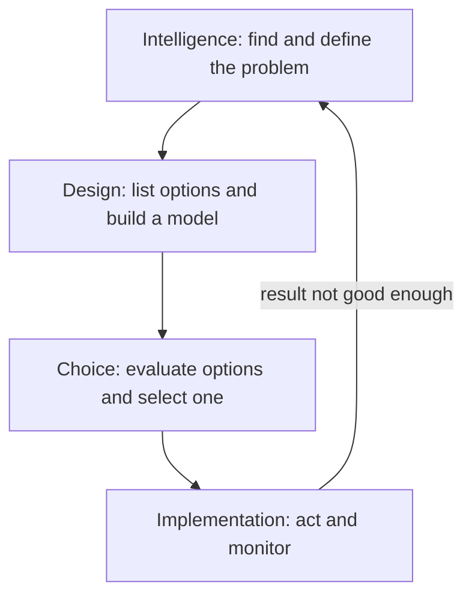
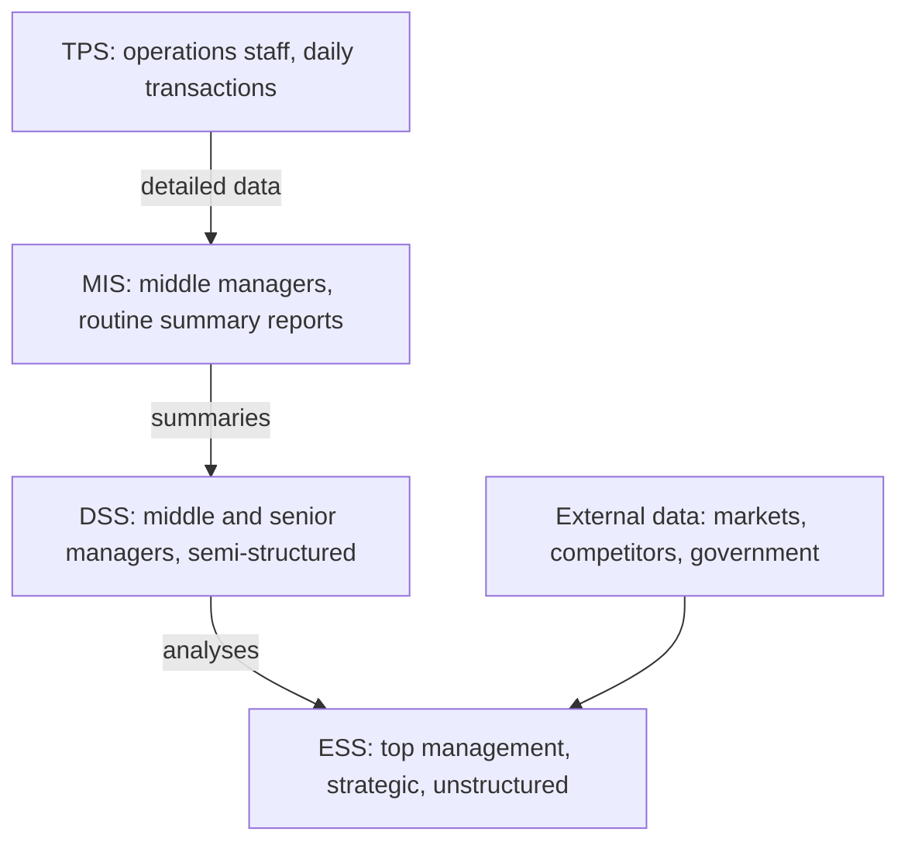
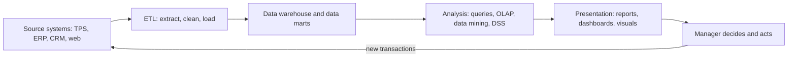
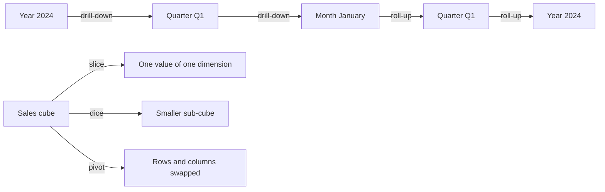
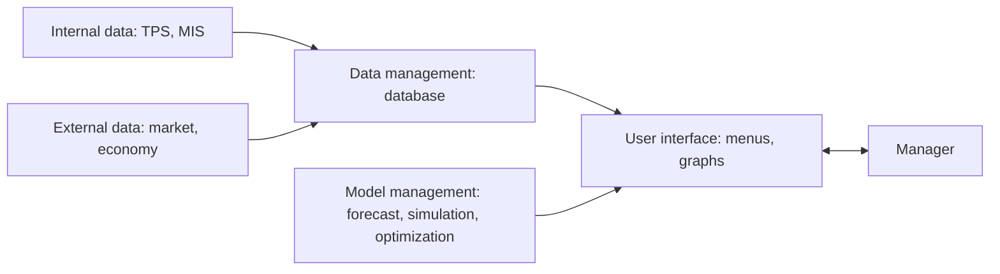

Before the new ideas, here are the old ones you need. If you already know them, skip to the next section.

## The basics first

- **Data** are raw facts, such as "Order 1021, 3 shirts, Rs 1,200, Pune". **Information** is data arranged so it means something, such as "Pune sales fell 12% this month".
- A **transaction processing system (TPS)** records the day-to-day events of a business: sales, payments, stock movements. It is the main source of a company's data.
- A **data warehouse** is a separate database that collects cleaned, historical data from many TPS and other sources so it can be analysed. A **data mart** is a small warehouse for one department. <Cite id="business-intelligence-gfg-data-warehousing" />
- **ETL** (extract, transform, load) is the process that copies data from the source systems, cleans it and loads it into the warehouse.
- A **manager** is a person who plans, organises and controls work towards the organisation's goals. Making decisions is a central part of that job.
- A **KPI** (key performance indicator) is a number that shows how well a goal is being met, such as monthly sales or delivery time.

## The problem: too much data, too little insight

A modern company records millions of transactions. A manager who must decide "Should we open a new store in Nashik?" cannot read millions of rows. They need the data summarised, compared, forecast and shown as a picture. Business intelligence and decision support systems do exactly this. This is syllabus <Syl m="2" />, sections 2.3 and 2.4: managers and decision making, BI for data analysis, and presenting results. <Cite id="business-intelligence-rainer-mis" loc="Ch. 5" />

**Everyday analogy.** A car's engine produces thousands of signals per second. The driver does not read them. The dashboard shows a few: speed, fuel, a warning light. BI is the dashboard of a business: it turns a flood of raw data into the few signals a manager needs to steer.

## Managers and decision making

**What a decision is.** A decision is a choice between two or more alternatives. Managers take decisions all the time: how much stock to order, whom to hire, which market to enter.

**Why managers need computer support.** Decisions have become harder for four reasons:

1. **More alternatives.** Technology and global markets give many more options to compare.
2. **Time pressure.** Many decisions must be made quickly, often in hours.
3. **Uncertainty.** Markets change fast, so the effect of a choice is hard to predict.
4. **Cost of mistakes.** A wrong decision can be very costly, and it may affect many people.

Humans also have **bounded rationality**: our decisions are limited by the information we have, the time available and how much our minds can process at once. So we often choose an option that is "good enough" rather than the best one. Computer support widens those limits. <Cite id="business-intelligence-wiki-bounded-rationality" />

### The phases of decision making (Simon's model)

Herbert Simon described a systematic decision process in three phases, intelligence, design and choice; implementation was added later as a fourth. <Cite id="business-intelligence-delen-decision-process" />

1. **Intelligence:** scan the environment, notice a problem or an opportunity, and collect data about it. Example: the sales report shows Pune sales fell 12%.
2. **Design:** work out possible courses of action and build a model to test them. Example: cut prices, run an advert, or close the store.
3. **Choice:** compare the options against criteria and pick one. Example: the model says an advert recovers sales at the lowest cost.
4. **Implementation:** put the chosen option into action and watch the result. If it does not work, go back to intelligence.

A DSS supports every one of these phases, not only the final choice. <Cite id="business-intelligence-tp-dss" /> <Cite id="business-intelligence-wiki-dss" />

### Types of decisions

Decisions differ in two ways: how well structured the problem is, and at what level of the organisation it is taken.

<Box kind="definition">

- **Structured decision:** routine and repetitive, with a known procedure. Example: reorder stock when it falls below 100 units.
- **Semi-structured decision:** part of the problem has a clear procedure, part needs judgment. Example: setting next quarter's marketing budget.
- **Unstructured decision:** new, one-off, no fixed procedure; mostly judgment and intuition. Example: whether to enter a new country or invest in a new technology.

</Box>

| Level of management | Nature of decision | Typical example | Typical structure |
|---|---|---|---|
| Operational control (lower) | Day-to-day tasks done efficiently | Schedule tomorrow's machine shifts | Mostly structured |
| Management control (middle, tactical) | Use resources well to meet goals | Allocate budget between branches | Mostly semi-structured |
| Strategic planning (top) | Long-term goals and direction | Merge with a rival, launch a new product line | Mostly unstructured |

The more unstructured the decision, the more the system must support the human (DSS, ESS) rather than automate the decision (TPS).

## The MIS hierarchy (the pyramid of information systems)

The **MIS hierarchy** arranges information systems by the level of management they serve. Data flows upward and gets more summarised at each level. <Cite id="business-intelligence-gfg-types-is" /> <Cite id="business-intelligence-wiki-mis" />

| System | Who uses it | What it does | Decision type | Output |
|---|---|---|---|---|
| TPS | Clerks, supervisors | Records and processes transactions | Structured | Detailed records, receipts |
| MIS | Middle managers | Summarises TPS data into regular reports | Structured, some semi-structured | Scheduled, exception and summary reports |
| DSS | Middle and senior managers, analysts | Interactive analysis with models and data | Semi-structured and unstructured | What-if results, forecasts |
| ESS | Top executives | Strategic overview from internal and external data | Unstructured | Dashboards, graphs, drill-down views |

| | MIS | DSS |
|---|---|---|
| Question answered | "What happened?" | "What if...?" and "What is best?" |
| Reports | Fixed, scheduled | Flexible, on demand, interactive |
| Problems | Structured | Semi-structured and unstructured |
| Uses | Mainly internal TPS data | Internal and external data plus models |

**Commenting on DSS in the hierarchy.** The MIS at the middle answers "what happened?" with fixed reports. It cannot answer "what would happen if...?". The DSS sits just above it to fill that gap: it takes MIS and TPS data, adds models, and lets a manager try alternatives interactively. So the DSS is the bridge between routine reporting and strategic judgment. <Cite id="business-intelligence-tp-mis" />

## What business intelligence is

<Box kind="definition">

**Business intelligence (BI)** is a broad set of applications, technologies and processes for collecting, storing, accessing and analysing data to help business users make better decisions. <Cite id="business-intelligence-wiki-bi" /> <Cite id="business-intelligence-ibm-bi" />

</Box>

The term was used by IBM researcher Hans Peter Luhn in 1958, and Howard Dresner in 1989 proposed it as an umbrella term for methods that improve decisions using fact-based support systems. BI grew out of decision support systems, executive information systems, data warehouses and OLAP. <Cite id="business-intelligence-wiki-bi" /> <Cite id="business-intelligence-tp-bi" />

**BI and business analytics.** The words are often used loosely. A common split is that BI describes what has happened and what is happening (descriptive), while business analytics also predicts what will happen (**predictive analytics**) and recommends what to do (**prescriptive analytics**). Sources differ on the exact boundary, so in an exam define the term you use. <Cite id="business-intelligence-wiki-business-analytics" /> <Cite id="business-intelligence-wiki-predictive" /> <Cite id="business-intelligence-wiki-prescriptive" />

### How BI works, step by step

1. **Data sources:** TPS, ERP, CRM, websites, social media and outside data providers produce raw data.
2. **ETL:** the data is extracted, cleaned and loaded into a data warehouse or data marts.
3. **Analysis:** users query the data, run OLAP, apply data mining or use a DSS model.
4. **Presentation:** results are shown as reports, dashboards, scorecards, charts and maps.
5. **Decision and action:** the manager compares results with KPIs, decides and acts. New transactions from that action feed back into step 1.

<Cite id="business-intelligence-ibm-bi" /> <Cite id="business-intelligence-gfg-bi" />

**Analogy.** Think of a kitchen. Vegetables arrive from many farms (sources), are washed and cut (ETL), stored in the pantry (warehouse), cooked into dishes (analysis) and plated nicely (presentation) for the diner (manager).

## BI for data analysis

Three families of tools analyse the warehouse data.

### 1. Multidimensional analysis (OLAP)

**Online analytical processing (OLAP)** lets users look at data along several **dimensions** at once, such as product, region and time. The data is pictured as a **cube**: each small cell holds a measure such as sales for one product, in one region, in one month. <Cite id="business-intelligence-wiki-olap" /> <Cite id="business-intelligence-wiki-olap-cube" />

The common OLAP operations are: <Cite id="business-intelligence-gfg-olap-ops" />

| Operation | What it does | Example |
|---|---|---|
| Roll-up | Summarises to a higher level | Monthly sales up to yearly sales |
| Drill-down | Goes to finer detail | Yearly sales down to monthly, then daily |
| Slice | Fixes one dimension to one value | Only the year 2024 |
| Dice | Picks a smaller sub-cube on two or more dimensions | Shirts and jeans, in Pune and Mumbai, in Q1 |
| Pivot | Rotates the view, swapping rows and columns | Regions as columns instead of rows |

<Cite id="business-intelligence-gfg-olap-ops" loc="diagram" />

**Analogy.** A Rubik's cube of sales: you can turn it to look at any face (pivot), cut one slice out (slice) or zoom into one small block (drill-down). <Cite id="business-intelligence-ibm-olap" />

### 2. Data mining

**Data mining** is searching large amounts of data for useful patterns and relationships that nobody asked about in advance. OLAP answers questions the user already has; data mining finds patterns the user did not know to ask about. <Cite id="business-intelligence-wiki-data-mining" /> <Cite id="business-intelligence-ibm-data-mining" />

Common tasks:

- **Association (market basket analysis):** customers who buy bread often buy butter. Amazon's "customers who bought this also bought" is a familiar example.
- **Classification and prediction:** will this loan applicant default?
- **Clustering:** group customers with similar buying habits for targeted offers.
- **Anomaly detection:** spot unusual card transactions that may be fraud.

<Cite id="business-intelligence-gfg-data-mining" />

### 3. Decision support systems (DSS)

<Box kind="definition">

A **decision support system (DSS)** is an interactive, computer-based system that combines data, models and an easy interface to help managers solve semi-structured and unstructured problems. It supports the decision; the manager still makes it. <Cite id="business-intelligence-tp-dss" />

</Box>

**Why it is needed.** An MIS gives fixed reports about the past. A manager facing a new, semi-structured problem needs to ask "what if?" and get an answer at once. A DSS gives that interactive, model-based help.

**Components of a DSS.** Sources name the parts slightly differently, but all include these three: <Cite id="business-intelligence-wiki-dss" /> <Cite id="business-intelligence-tp-dss" />

1. **Data management (database):** internal data from TPS and MIS, and external data such as market or economic figures.
2. **Model management (model base):** the financial, statistical, forecasting, simulation and optimization models used to analyse the data.
3. **User interface (dialogue):** menus, forms and graphs that let a non-programmer use the system. Some texts list **support tools** or a **knowledge component** as a fourth part, and the **user** is often counted as part of the system.

**Kinds of analysis a DSS offers.**

- **What-if analysis:** change an input and see the effect. "What if we raise the price by 5%?"
- **Sensitivity analysis:** find how much the output changes when one input changes, to see which inputs matter most. <Cite id="business-intelligence-wiki-sensitivity" />
- **Goal-seeking analysis:** work backward from a target. "How many units must we sell to earn a profit of Rs 10 lakh?"

**Characteristics of a DSS.**

- Supports semi-structured and unstructured problems.
- Used by managers at several levels, by individuals or groups.
- Supports all phases: intelligence, design, choice and implementation.
- Interactive and easy to use; the user stays in control.
- Flexible and adaptable as the problem changes.

**Types of DSS (Power's classification).** <Cite id="business-intelligence-wiki-dss" />

| Type | Main emphasis | Example |
|---|---|---|
| Model-driven | Financial, statistical, simulation or optimization models | Production planning model |
| Data-driven | Access to and analysis of large data sets | Sales analysis on a data warehouse |
| Communication-driven | Helping a group work together on a decision | Group meeting and voting software |
| Document-driven | Finding and managing unstructured documents | Searching policies and reports |
| Knowledge-driven | Expert rules and facts for problem solving | Medical diagnosis advice |

**Advantages.** Faster and better-informed decisions; managers can try many options safely; better control and competitiveness; encourages learning about the problem; improves communication among decision makers. <Cite id="business-intelligence-tp-dss" />

**Disadvantages.** Costly to build and maintain; results are only as good as the data and the model (garbage in, garbage out); managers may over-rely on it; needs some training.

**Applications of DSS.** <Cite id="business-intelligence-wiki-dss" />

- **Healthcare:** clinical decision support for diagnosis and treatment choices.
- **Banking:** credit checks and loan approval; evaluating branch performance.
- **Agriculture:** planning crops and inputs based on soil and weather data.
- **Manufacturing and logistics:** production scheduling, inventory levels, route planning.
- **Marketing and finance:** pricing, budgeting, sales forecasting, investment choices.
- **Transport:** railways and airlines use DSS for equipment and crew scheduling.

**Analogy.** A DSS is like a GPS app. You decide where to go; it shows routes, traffic and travel time, and recalculates when you ask "what if I avoid the highway?". It never takes the wheel.

<Box kind="pitfall">

Do not write that a DSS "makes the decision". It **supports** the decision maker. A system that decides by itself on fully structured problems is automation (or, with expert rules, an expert system), not a DSS.

</Box>

## Executive support system (ESS)

<Box kind="definition">

An **executive support system (ESS)**, also called an **executive information system (EIS)**, is a system for senior executives that gives quick, easy access to summarised internal and external information so they can monitor performance and make strategic, unstructured decisions. It is usually seen as a special, enterprise-wide kind of DSS. <Cite id="business-intelligence-wiki-eis" /> <Cite id="business-intelligence-tp-ess" />

</Box>

**Features of an ESS.**

1. **For top management and strategic decisions** that are non-routine and unstructured.
2. **Drill-down:** start from a company-wide summary and click down to region, branch and individual figures.
3. **Uses external data** as well as internal data: market reports, competitor news, government policy, economic figures.
4. **Graphics-rich and easy to use:** charts, dashboards and maps for executives who are not computer experts.
5. **Filters and summarises:** shows only critical information, key indicators and exceptions, not every detail.
6. **Trend analysis and status access:** shows the latest status and how it has changed over time.
7. **Communication tools:** e-mail, alerts and sharing to act on what is seen.
8. **Little analytical modelling** compared to a DSS; the focus is on monitoring and overview.

**Advantages.** Easy to use; speeds up finding information; spots problems and trends early; supports strategic control. **Disadvantages.** Limited functions; benefits hard to measure; high cost, especially for small firms; risk of information overload; keeping data current is hard. <Cite id="business-intelligence-tp-ess" /> <Cite id="business-intelligence-wiki-eis" />

| | DSS | ESS |
|---|---|---|
| Users | Middle and senior managers, analysts | Top executives |
| Decisions | Semi-structured | Unstructured, strategic |
| Focus | Analysis with models (what-if, goal seeking) | Monitoring, overview, drill-down |
| Data | Mostly internal, some external | Internal and a lot of external |
| Interface | Interactive, needs some skill | Very simple, graphical |

**Analogy.** If a DSS is a GPS for planning a route, an ESS is the airline pilot's cockpit display: a few big, clear instruments, with the option to look closer at any one.

## BI for presenting results

Analysis is useless if the manager cannot understand it quickly. BI presents results in these main ways.

**1. Reports.** Scheduled (routine) reports, ad hoc (on demand) reports and exception reports that show only results outside normal limits, such as branches 10% below target.

**2. Dashboards.** A **dashboard** shows the key indicators on one screen as gauges, charts and tables, often updated in real time. Typical abilities: <Cite id="business-intelligence-wiki-dashboard" />

- **Drill-down** to the detail behind a number.
- **KPIs and critical success factors** (the few things that must go right for the business to succeed) shown at a glance.
- **Status access** to the latest data.
- **Trend analysis** over time.
- **Exception reporting** with colours or alerts, such as red for below target.

A **scorecard** is a close relative: it compares actual results with targets for each goal.

**3. Data visualization.** Turning data into pictures such as bar and line charts, heat maps and scatter plots, so patterns and outliers are visible. <Cite id="business-intelligence-wiki-dataviz" /> <Cite id="business-intelligence-ibm-dataviz" />

**4. Geographic information systems (GIS).** A **GIS** captures, stores, analyses and shows data linked to locations on a map. Example: a retailer maps customer addresses and competitor stores to choose the best site for a new outlet. <Cite id="business-intelligence-wiki-gis" />

| Way of presenting | Best for | Example |
|---|---|---|
| Report | Detailed, regular information | Monthly sales report |
| Dashboard | Quick monitoring of KPIs | CEO's daily performance screen |
| Scorecard | Actual versus target | Branch target achievement |
| Charts and visuals | Seeing patterns and trends | Sales trend line |
| GIS map | Location-based decisions | Choosing a new store site |

## Impact of BI on decision making

This is the most repeated question in this topic. Structure the answer as positive impacts, then limits.

**Positive impacts.** <Cite id="business-intelligence-ibm-bi" /> <Cite id="business-intelligence-tp-bi" />

1. **Fact-based decisions:** managers rely on data rather than only on intuition or guesswork.
2. **Faster decisions:** data from many systems is already integrated, so answers come in minutes, not weeks.
3. **Single view of the business:** sales, finance, inventory and customer data seen together (a "360-degree view").
4. **Better planning and forecasting:** trends and predictive models help plan demand, budgets and staffing.
5. **Early warning:** dashboards and exception reports flag problems (falling sales, rising costs) before they grow.
6. **Better customer understanding:** data mining reveals buying patterns, so offers and service can be targeted.
7. **Efficiency and lower cost:** spotting bottlenecks in operations and supply chains.
8. **Decisions at every level:** self-service BI lets operational staff, not only executives, make informed decisions.
9. **Measurement and accountability:** KPIs and scorecards show whether a decision worked.
10. **Competitive advantage:** firms that read the market faster can react before rivals.

**Limits and challenges.**

- Poor data quality leads to wrong conclusions.
- Cost of warehouses, tools and skilled staff.
- Information overload if dashboards show too much.
- Over-reliance on numbers can ignore human judgment and context.
- Privacy and security of the collected data.

**Example.** A retail chain's dashboard shows that sales of winter jackets in North India are rising two weeks earlier than last year. Drilling down shows a cold wave. The manager moves stock from southern stores at once and avoids shortages. Without BI this would have been noticed only in the month-end report.

<Box kind="exam">

For "Analyze the impact of BI on decision making": define BI in one line, draw the BI process diagram, link BI to Simon's phases (BI mostly helps intelligence and design, DSS models help choice), then list 6 to 10 impacts with a short example, then 2 or 3 limits, and a one-line conclusion. For 10 marks add the decision types table.

</Box>

## Where this was asked

| If the question says | What to write | Seen as |
|---|---|---|
| "Evaluate the MIS hierarchy to comment on DSS" | The pyramid diagram, the TPS/MIS/DSS/ESS table, then why DSS fills the gap between MIS reports and strategic judgment, with its components | <PYQ id="2022-12-ce/q1d" /> |
| "Analyze the impact of BI on decision making" | BI definition, BI process diagram, link to decision phases, 6 to 10 impacts with an example, limits | <PYQ id="2023-12-ce/q1c" /> <PYQ id="2024-12-ce/q2a" /> |
| "What are the features of Executive Support System?" | ESS definition, the eight features (drill-down, external data, graphics, ease of use, filtering, trends, communication, little modelling), one line on use | <PYQ id="2024-05-ce/q1b" /> <PYQ id="2025-05-ce/q1a" /> |
| "What is DSS? Explain the application of DSS" | Definition, why needed, components diagram, what-if and goal seeking, characteristics, then applications by field with an example each | <PYQ id="2025-05-ce/q6a" /> |

## Quick revision

- BI: tools and processes that turn warehouse data into information for decisions; flow is sources, ETL, warehouse, analysis, presentation, decision.
- Simon's phases: intelligence, design, choice, then implementation; it is a loop.
- Decision structure: structured (routine), semi-structured (part judgment), unstructured (one-off, judgment).
- Levels: operational control, management control (tactical), strategic planning.
- MIS hierarchy: TPS (operations), MIS (middle, reports), DSS (semi-structured analysis), ESS (top, strategic).
- OLAP: multidimensional cube; roll-up, drill-down, slice, dice, pivot.
- Data mining: finds unknown patterns; association, classification, clustering, anomaly detection.
- DSS: database, model base, user interface; what-if, sensitivity, goal seeking; supports, does not decide.
- ESS: top executives, external data, drill-down, graphics, easy to use, filtered key indicators.
- Presenting results: reports, dashboards, scorecards, visualization, GIS maps.
- BI impact: fact-based, faster, single view, forecasting, early warning, customer insight, efficiency, competitive advantage; limited by data quality, cost and overload.
