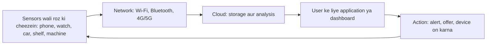
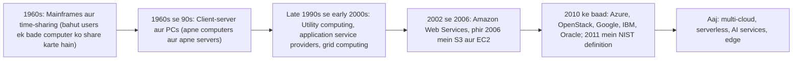
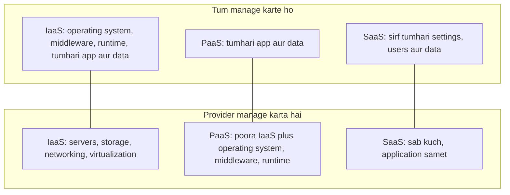
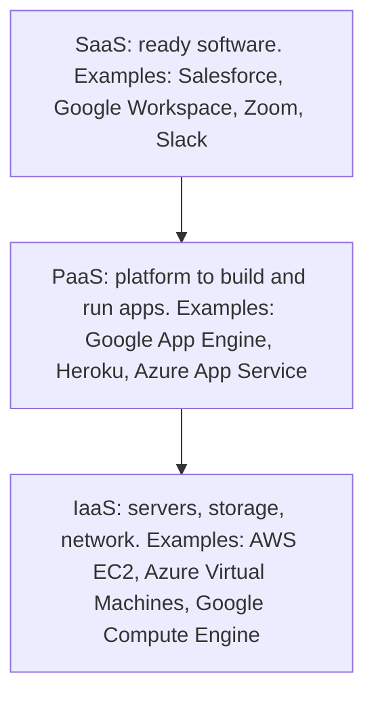
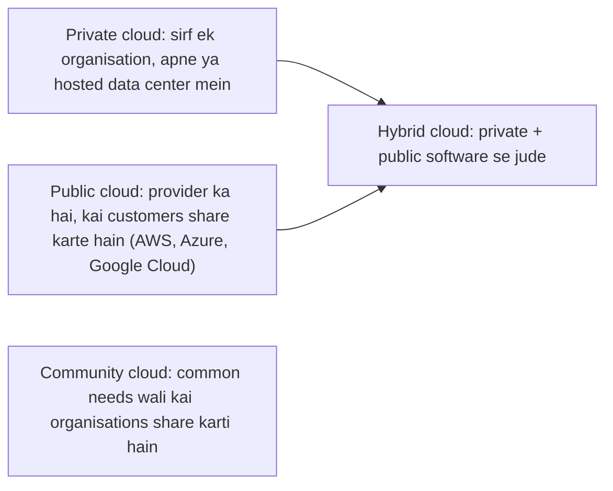

Naye ideas se pehle purane ideas, jo tumhe chahiye. Agar already pata hain to agle section pe jao.

## Basics pehle

- **Server** ek powerful computer hai jo network par dusre computers (jinhe **clients** kehte hain) ke liye data store karta hai ya programs chalata hai.
- **Data center** ek building hai jo servers, storage aur networking equipment se bhari hoti hai, saath mein power, cooling aur security.
- **Storage** wo jagah hai jahan data rakha jaata hai (disks). **Network** wo connection hai jo computers ke beech data le jaata hai. **Internet** sabse bada aisa network hai.
- **Capital expenditure (capex)** ek baar ka bada kharcha hai assets pe, jaise servers kharidna. **Operating expenditure (opex)** regular kharcha hai cheezein chalane ka, jaise monthly bill.
- **Virtualization** matlab software se ek physical computer ko kai **virtual machines (VMs)** mein baantna, jahan har ek alag computer jaisa behave karta hai. Ye cloud ko possible banane wali main technology hai. <Cite id="note-cloud-computing-wiki-cloud" />
- **Sensor** ek chhota device hai jo kuch measure karta hai (temperature, location, motion), aur **smart device** koi bhi roz ki cheez hai jisme processor aur network connection ho.

## Pervasive computing

Ye syllabus <Syl m="5" /> hai, section 5.2 (pervasive computing, cloud computing model).

<Box kind="definition">

**Pervasive computing** (ise **ubiquitous computing** ya "ubicomp" bhi kehte hain) ye idea hai ki computing seamlessly, kabhi bhi aur kahin bhi dikhe. Chhote, saste, network se jude computers roz ki cheezon mein lage hote hain, isliye log computer ke baare mein sochey bina unhe use karte hain. <Cite id="note-cloud-computing-wiki-ubicomp" /> <Cite id="it-impact-society-rainer-iis7" />

</Box>

**Ye kahan se aaya.** Mark Weiser, jo Xerox PARC mein Chief Technologist the, ne ye phrase lagbhag 1988 mein banaya. Unki soch ek "calm" technology ki thi jo background mein rehti hai, jaise tum street sign padhte ho aur tumhe nahi lagta ki tum machine use kar rahe ho. <Cite id="note-cloud-computing-wiki-ubicomp" />

**Ye kyun zaroori hai (kaunsi problem solve karta hai).** Pehle computer use karne ke liye uske saamne baithna padta tha. Pervasive computing computer ko wahan le jaata hai jahan insaan hai aur jahan data ban raha hai: car mein, hospital bed pe, factory machine pe ya shop ki shelf pe.

**Roz ki analogy.** Bijli pervasive hai. Switch dabate waqt tum power station ke baare mein nahi sochte; bas light ki ummeed karte ho. Pervasive computing computing ke saath wahi feeling chahta hai.

**Main building blocks.**

1. **Sensors aur actuators.** Sensors changes detect karte hain, jaise temperature ya motion; actuators physical action karte hain, jaise motor on karna. <Cite id="note-cloud-computing-ibm-pervasive" />
2. **Identification aur tracking tags**, jaise RFID (radio-frequency identification: ek chhota tag jo radio se padha jaata hai, goods aur cards pe use hota hai) aur wireless sensor networks (bahut saare chhote sensors jo aapas mein data pass karte hain).
3. **Connectivity**: Wi-Fi, Bluetooth, cellular, Zigbee jaise links jo data le jaate hain. <Cite id="note-cloud-computing-ibm-pervasive" />
4. **Cloud aur analytics**: platforms data store karte hain, process karte hain aur applications chalate hain. <Cite id="note-cloud-computing-ibm-pervasive" />
5. **Security aur privacy controls**: encryption aur access control.

**Internet of Things (IoT)** pervasive computing ka wo hissa hai jo physical objects pe focus karta hai, jinme sensors aur network connection hote hain jo data collect aur share karte hain. <Cite id="note-cloud-computing-ibm-pervasive" /> <Cite id="note-cloud-computing-wiki-ubicomp" />

**Applications aur examples.**

| Area | Example |
|---|---|
| Smart home | Thermostats, smart lights, voice assistants |
| Healthcare | Wearables aur heart rate, blood pressure, oxygen level ki remote monitoring |
| Industry | Machines pe sensors jo part fail hone se pehle warning dete hain; temperature aur stock tracking |
| Retail aur logistics | Goods pe RFID tags; delivery vehicles ki live tracking (Amazon, Flipkart, Zomato delivery tracking) |
| Transport | Connected cars, FASTag toll payment |
| Education | Smart classrooms, card ya phone se attendance |

<Cite id="note-cloud-computing-ibm-pervasive" /> <Cite id="note-cloud-computing-wiki-ubicomp" />

**Advantages.** Convenience, routine kaam ka automation, real-time information, behtar decisions, kam human errors.

**Disadvantages aur challenges.** Privacy sabse zyada bataya jaane wala criticism hai, aur shayad long-term success ki sabse badi rukavat: hamesha on rehne wale sensors record karte hain ki tum kahan ho aur kya karte ho. Dusre issues: hazaaron chhote devices ki security, cost, battery life, aur alag-alag makers ke alag standards. <Cite id="note-cloud-computing-wiki-ubicomp" />

**Conclusion.** Pervasive computing computer ko hamare aas-paas ki duniya mein daal deta hai; cloud computing wo back-end hai jo un devices ka banaya data store aur process karta hai.

## Cloud computing: meaning aur need

<Box kind="definition">

**Cloud computing** ek model hai jo "ubiquitous, convenient, on-demand network access to a shared pool of configurable computing resources (for example networks, servers, storage, applications and services) that can be rapidly provisioned and released with minimal management effort or service provider interaction" deta hai (NIST). Simple words mein: tum internet par computing power, storage aur software rent karte ho, aur jitna use karo utna pay karte ho, khud kharidne aur chalane ki jagah. <Cite id="note-cloud-computing-nist-800-145" /> <Cite id="note-cloud-computing-aws-cloud" /> <Cite id="note-cloud-computing-gfg-cloud" />

</Box>

**Ye kyun zaroori hai.** Jo company apne servers kharidti hai use pehle bahut paisa dena padta hai, andaza lagana padta hai ki kitni capacity chahiye hogi, unhe chalane ke liye staff rakhna padta hai, aur sabse busy din ke liye extra capacity rakhni padti hai. Normal dino mein ye zyadatar capacity khaali padi rehti hai. Cloud computing is fixed cost ko variable cost bana deta hai: abhi jitna chahiye lo, baad mein chhod do. <Cite id="note-cloud-computing-aws-cloud" />

**Roz ki analogy.** Apne servers rakhna car rakhne jaisa hai: tum uske paise dete ho, insurance, repair aur parking ka kharcha uthate ho, chahe chalao ya na chalao. Cloud Ola ya Uber jaisa hai: sirf jitni rides lo utna pay karo. Ek aur analogy: apna generator chalane ki jagah grid se bijli lena.

**"Cloud" kyun kehte hain.** Engineers network diagrams mein internet ko cloud ke shape mein banate hain, kyunki user ko andar kya hai ye jaanna zaroori nahi. Ye shabd 1990s mein un jagahon ke liye use hua tha jahan programs move kar sakte the. <Cite id="note-cloud-computing-wiki-cloud" />

**Ye kaise kaam karta hai, step by step.**

1. Ek provider (Amazon Web Services, Microsoft Azure, Google Cloud) duniya bhar mein bade data centers banata hai.
2. **Virtualization** se wo hardware ko kai virtual resources mein baant deta hai aur bahut saare customers mein share karta hai. <Cite id="note-cloud-computing-wiki-cloud" />
3. Customer web portal pe login karta hai ya API (programs ke programs se baat karne ka tareeka) use karta hai aur maangta hai jo chahiye: maan lo 4 virtual machines aur 1 TB storage.
4. Provider kuch minutes mein resources de deta hai.
5. Provider usage measure karta hai (hours, GB, requests) aur uska bill banata hai.
6. Zaroorat khatam hone par customer resources release kar deta hai aur pay karna band.

### Cloud computing ka evolution

Cloud computing achanak nahi aaya. Har stage ne pichle stage ki ek problem solve ki. Neeche ki dates sources mein di gayi main dates hain.

| Stage | Ye kya tha | Kaunsi problem chhodi |
|---|---|---|
| Mainframes pe time-sharing (1960s) | Users jobs central mainframe ko bhejte the aur use share karte the | Bahut mehngi machines; users computer se door |
| Personal computers aur client-server (1980s se 90s) | Har company ke apne servers aur PCs | Kharidne aur maintain karne ka high cost; idle capacity |
| Utility computing aur ASPs (late 1990s) | Computing aur applications bijli ki tarah rent aur meter hote the; John McCarthy ne 1961 mein "computer utility" imagine ki thi | Technology aur internet speed tayyar nahi thi; customers ke beech sharing kamzor |
| Cloud computing (2002 se) | 2002 mein AWS bana; 2006 mein S3 aur EC2 launch hue; 2010 mein Azure; 2010 mein OpenStack | Security, lock-in aur cost control (abhi bhi open) |

<Cite id="note-cloud-computing-wiki-cloud" /> <Cite id="note-cloud-computing-wiki-utility" /> <Cite id="note-cloud-computing-wiki-saas" /> <Cite id="note-cloud-computing-tp-cloud" />

Aakhri step ke peeche do enablers hain: **virtualization**, jo hardware ko kai virtual machines mein baanta hai, aur **utility computing**, public utility ki tarah metered billing ka idea. <Cite id="note-cloud-computing-wiki-cloud" /> Client-server aur grid-computing steps kahani batane ka usual textbook tareeka hain aur sources mein date ke saath nahi hain; 1960s, 1961, 2002, 2006, 2010 aur 2011 ki dates sources se aayi hain.

<Box kind="exam">

"Highlight the evolution" ke liye upar wala timeline diagram banao aur har stage ki ek line likho (wo kya tha, kaunsi problem solve ki, kya chhodi). Sirf dates ki list mat likho. <PYQ id="2022-12-ce/q6b" /> <PYQ id="2023-05-ce/q4b" />

</Box>

### Essential characteristics (NIST)

NIST kehta hai ki cloud model ke paanch essential characteristics hain. <Cite id="note-cloud-computing-nist-800-145" /> <Cite id="note-cloud-computing-wiki-cloud" /> <Cite id="note-cloud-computing-gfg-cloud" />

| Characteristic | Simple words mein matlab | Example |
|---|---|---|
| On-demand self-service | Resources khud, kabhi bhi lo, provider ko call kiye bina | AWS pe kuch clicks mein virtual server start karna |
| Broad network access | Network par kai devices se service tak pahunch | Phone aur laptop dono pe Google Docs use karna |
| Resource pooling (multi-tenancy) | Provider ke resources kai customers mein share hote hain, zaroorat ke hisaab se assign hote hain | Kai companies ek hi data center par chalti hain |
| Rapid elasticity | Demand ke saath resources jaldi badhte ya ghatte hain | Shopping site sale ke din servers badhati hai aur baad mein hata deti hai |
| Measured service | Usage measure hota hai aur bill hota hai, isliye jitna use karo utna pay | Compute ke per hour ya storage ke per GB pay karna |

## Cloud computing models

Exam questions mein "models" ka matlab usually **service models** (kya deliver hota hai) hota hai, aur aksar **deployment models** (cloud kiska hai aur kaun share karta hai) bhi. NIST teen service models aur chaar deployment models batata hai. <Cite id="note-cloud-computing-nist-800-145" /> Dono likho jab tak question limit na kare.

### Service models: IaaS, PaaS, SaaS aur CaaS

Dinner banane ki tarah socho: **IaaS** stove wali khaali kitchen rent karna hai (saaman tum laate ho aur pakate ho), **PaaS** saaman aur tools wali kitchen hai (tum bas pakate ho), **SaaS** taiyaar khana order karna hai. **CaaS** ready, standard lunch boxes ko delivery system ke saath rent karne jaisa hai, jisme tum apna khana bharte ho.

<Cite id="note-cloud-computing-gfg-models" loc="diagram" />

**1. IaaS (Infrastructure as a Service).** Provider internet par virtualized computing, storage aur networking deta hai, usually pay-as-you-go. Operating system, middleware aur applications tum install aur manage karte ho. <Cite id="note-cloud-computing-ibm-models" /> <Cite id="note-cloud-computing-gfg-models" />

- Users: skilled developers, IT administrators, DevOps teams.
- Examples: Amazon EC2, Microsoft Azure Virtual Machines, Google Compute Engine, IBM Cloud.
- Applications: start-up jo hardware kharide bina traffic spike mein server capacity badhata hai; website hosting; storage aur backup; testing aur development; high-performance computing.

**2. PaaS (Platform as a Service).** Provider applications develop, test, run aur manage karne ka ready platform deta hai. Wo servers, operating system, databases, middleware aur runtime manage karta hai; tum sirf apni application aur data manage karte ho. <Cite id="note-cloud-computing-ibm-models" /> <Cite id="note-cloud-computing-gfg-models" />

- Users: application developers.
- Examples: Heroku, AWS Elastic Beanstalk, Google App Engine, Azure App Service.
- Applications: mobile-app team code deploy karti hai aur managed databases jodti hai, backend server configure kiye bina; web apps aur APIs jaldi banana.

**3. SaaS (Software as a Service).** Provider internet par ready-made application deta hai, usually subscription pe, aur infrastructure, updates aur security sambhalta hai. Zyadatar providers sab customers ke liye ek hi version chalate hain (multi-tenancy). <Cite id="note-cloud-computing-wiki-saas" /> <Cite id="note-cloud-computing-salesforce-saas" />

- Users: end users aur businesses.
- Examples: Salesforce CRM, Google Workspace, Microsoft 365, Zoom, Slack, Dropbox.
- Applications: sales team browser se cloud CRM use karti hai, hosting ya updates manage kiye bina; email, office documents, video meetings, HR aur accounting software.

**4. CaaS (Containers as a Service).** **Container** application ko uski zaroori libraries ke saath pack kar deta hai taaki wo har jagah same tarah chale; ye virtual machine se halka hota hai. CaaS developers ko API ya web portal se containers upload, start, stop, scale aur manage karne deta hai, orchestration (automatic deployment, load balancing, scaling) built-in ke saath. IBM ise IaaS aur PaaS ke beech rakhta hai: PaaS se zyada control, IaaS se simple. <Cite id="note-cloud-computing-ibm-caas" /> <Cite id="note-cloud-computing-gfg-caas" />

- Users: developers aur DevOps teams jo containers mein build karte hain.
- Examples: Amazon ECS, Google Kubernetes Engine (GKE), IBM Cloud Kubernetes Service, Azure Container Instances; Docker aur Kubernetes common tools hain.
- Applications: microservices (app ko chhoti services mein todna, jaise payments, login aur cart, har ek apne container set mein); DevOps pipelines; purani applications ko poora rewrite kiye bina cloud mein le jaana; portable applications jo on-premises aur cloud ke beech move karti hain. <Cite id="note-cloud-computing-ibm-caas" />
- Limits: provider ki technology se bandhe; containers host operating system ka kernel share karte hain, isliye security mein dhyan chahiye; kuch performance overhead. <Cite id="note-cloud-computing-gfg-caas" />

Spelling pe note: kuch exam papers mein "CAAS" Containers as a Service ke liye likha jaata hai, aur upar yahi matlab use hua hai. 2023 ka ISO standard "Communications as a Service" aur "Compute as a Service" ko bhi service categories mein list karta hai, isliye exam mein likho ki tum kaunsa matlab use kar rahe ho. <Cite id="note-cloud-computing-wiki-cloud" />

**Dusre service types** ek line mein bata sakte ho: **FaaS / serverless** (tum events pe chhote code pieces chalate ho, jaise AWS Lambda, servers manage kiye bina). <Cite id="note-cloud-computing-gfg-cloud" />

| Point | IaaS | PaaS | SaaS | CaaS |
|---|---|---|---|---|
| Kya milta hai | Virtual machines, storage, network | Apps banane aur chalane ka platform | Finished application | Containers chalane ka platform |
| Tum manage karte ho | OS, middleware, apps, data | Apps aur data | Settings, users, data | Containers aur unke andar ki apps |
| Provider manage karta hai | Hardware aur virtualization | Hardware, OS, runtime, middleware | Sab kuch | Hardware, orchestration layer |
| Technical skill chahiye | High | Medium | Low | Medium se high |
| Main users | IT admins, DevOps | Developers | End users | Developers, DevOps |
| Examples | AWS EC2, Azure VMs | Heroku, Google App Engine | Salesforce, Microsoft 365, Zoom | Amazon ECS, GKE |
| Typical use | Hosting, backup, testing | Apps build aur deploy karna | Email, CRM, office tools | Microservices, portable apps |
| Main limit | Zyada kaam aur expertise | Kam control, lock-in | Control ya customising kam | Provider dependence, security par dhyan |

<Cite id="note-cloud-computing-ibm-models" /> <Cite id="note-cloud-computing-gfg-models" /> <Cite id="note-cloud-computing-ibm-caas" /> <Cite id="note-cloud-computing-gfg-caas" />

<Box kind="exam">

"CAAS, SAAS, IAAS with application of each" ke liye: full form likho, ek line ka meaning, kaun kya manage karta hai, har ek ke do examples aur do applications, phir comparison table. Layered diagram bhi jodo. <PYQ id="2024-05-ce/q2b" />

</Box>

### Deployment models

Ye batate hain ki cloud kiska hai aur kaun use kar sakta hai. <Cite id="note-cloud-computing-gfg-deploy" /> <Cite id="note-cloud-computing-nist-800-145" /> <Cite id="note-cloud-computing-wiki-cloud" />

| Model | Matlab | Advantages | Disadvantages | Example |
|---|---|---|---|---|
| **Public** | Third-party provider ka hai, internet par milta hai, kai customers share karte hain | Kam upfront cost, pay per use, lagbhag unlimited scaling, hardware upkeep nahi | Shared resources; strict compliance mushkil; customising limited | AWS pe chalta start-up |
| **Private** | Ek organisation ke liye dedicated, wo ya third party chalata hai | Poora control, strong security aur privacy, legacy systems support | Sabse mehnga; scale kharide hue hardware tak limited | Bank jo apna core system apne data center mein chalata hai |
| **Hybrid** | Private aur public clouds jude hue taaki data aur apps unke beech move kar sakein | Sensitive data private rakho, spikes ke liye public capacity use karo ("cloud bursting") | Manage karna complex; latency ho sakti hai | Retailer jo customer records private rakhta hai aur sale ke liye public capacity rent karta hai |
| **Community** | Ek field ki organisations share karti hain jinki common concerns hain (compliance, security, mission) | Cost share hoti hai; strong shared security | Scalability limited; customise karna mushkil | Hospitals ya government departments jo compliance-bound cloud share karte hain |

<Cite id="note-cloud-computing-gfg-deploy" />

Ek paanchva idea jo aksar jodte hain wo **multi-cloud** hai: do ya zyada providers ki public services use karna (jaise storage ke liye AWS aur machine learning ke liye Google Cloud). Ismein private cloud zaroori nahi. <Cite id="note-cloud-computing-gfg-deploy" /> <Cite id="note-cloud-computing-wiki-cloud" />

## Cloud computing ke key benefits

Benefits ko business headings ke neeche group karo taaki answer analysis jaisa lage, list jaisa nahi. <Cite id="note-cloud-computing-aws-cloud" /> <Cite id="note-cloud-computing-wiki-cloud" /> <Cite id="note-cloud-computing-gfg-cloud" /> <Cite id="note-cloud-computing-gfg-models" />

| Benefit | Kyun important hai | Example |
|---|---|---|
| **Lower upfront cost** | Servers kharidne ki zaroorat nahi; capital cost operating cost ban jaati hai | Naya start-up data center kharide bina launch karta hai |
| **Pay-as-you-go** | Jitna consume karo utna pay, isliye waste kam | Test server ke liye per hour pay karna |
| **Scalability aur elasticity** | Demand ke saath capacity badhao ya ghatao | Shopping site jaise Flipkart bade sale ke liye capacity badhata hai (illustration) |
| **Speed aur agility** | Naye resources minutes mein; time to market tez; experiments easy | Team apna idea usi din naye server pe try karti hai |
| **Global reach** | Naye regions mein minutes mein deploy, users ke paas, kam delay ke saath | Streaming service kai deshon ke viewers ko serve karti hai |
| **Reliability aur recovery** | Backup aur disaster recovery aasaan aur sasta; provider redundancy deta hai | Doosre region mein copy kiya data failure mein bach jaata hai |
| **Access from anywhere** | Connection wale kisi bhi device se kaam; remote work support | Staff ghar se Microsoft 365 use karta hai |
| **Less IT burden** | Maintenance, updates aur patches provider sambhalta hai | IT team ke bina chhoti firm SaaS use karti hai |
| **Access to advanced services** | AI, analytics aur machine learning services ke roop mein | Company ready speech ya analytics service use karti hai |
| **Better collaboration** | Kai log ek hi files ek saath edit karte hain | Class group mein share kiya Google Docs |

**Analysis (manager ko ise kaise padhna chahiye).** Benefits sabse zyada tab hote hain jab demand uneven ho, firm chhoti ya nayi ho, ya speed matter kare. Steady, predictable workloads ke liye jahan hardware own karna sasta pad sakta hai, aur strict rules wale data ke liye benefits kam hote hain. Cloud ka cost budget se zyada bhi ho sakta hai: Wikipedia mein diye ek survey ke mutabik 2023 mein 69% IT leaders apne cloud budgets se aage nikal gaye. <Cite id="note-cloud-computing-wiki-cloud" />

## Risks aur limitations

| Risk | Matlab |
|---|---|
| Security aur privacy | Tumhara data provider ke paas hai jo use access kar sakta hai; GDPR ya HIPAA jaise rules follow karna mushkil ho sakta hai. Security shared hai: provider cloud ko secure karta hai, tum jo cloud mein rakhte ho use secure karte ho. |
| Kam control aur visibility | Tum wahi dekhte ho jo provider dikhata hai. |
| Internet dependence | Connection ya provider down ho to kaam nahi kar sakte. |
| Vendor lock-in | Proprietary platforms, data formats aur tools switch karna mehnga bana dete hain. Platform, data aur tools lock-in teen forms hain. |
| Cost overruns | Pay-per-use bills bina pata chale badh sakte hain. |
| Migration effort | Maujooda systems ko move karna complex, costly aur risky ho sakta hai. |

<Cite id="note-cloud-computing-wiki-cloud" /> <Cite id="note-cloud-computing-wiki-lockin" /> <Cite id="note-cloud-computing-gfg-cloud" />

## Real-world examples

- **Amazon:** Amazon Web Services 2002 mein establish hua, aur S3 aur EC2 2006 mein launch hue. <Cite id="note-cloud-computing-wiki-cloud" />
- **Salesforce:** SaaS ke roop mein CRM, 1999 mein "End Software" ke aim se shuru hua. <Cite id="note-cloud-computing-salesforce-saas" />
- **Gmail aur Google Docs:** consumer SaaS; Gmail (2004) ne SaaS ko aam users tak pahunchane mein madad ki. <Cite id="note-cloud-computing-wiki-saas" />
- **Heroku aur Google App Engine:** developers ke liye PaaS. <Cite id="note-cloud-computing-ibm-models" />
- **Retail aur delivery apps (Flipkart, Zomato):** busy periods ke liye cloud capacity use karte hain. Har firm kaunsa provider use karti hai ye yahan ke sources mein nahi hai, isliye exam mein naam mat likho.

## 10-mark question ke liye answer plan

1. Definition (NIST ki line simple words mein).
2. Need: servers own karne ki problem.
3. Characteristics (paanch, har ek ki ek line).
4. Service models, diagram aur comparison table ke saath.
5. Deployment models, table ke saath.
6. Evolution timeline (agar poocha ho) ya benefits table (agar poocha ho).
7. Limits aur ek line ka conclusion: "Cloud computing lets an organisation use computing as a utility, paying for what it uses, but it must manage security, cost and lock-in."

## Quick exam map

| Agar question kehta hai... | Likho... | Past paper |
|---|---|---|
| "Describe various cloud computing models and highlight their evolution" (10 marks) | Definition, evolution timeline diagram aur table, service models aur deployment models tables ke saath | <PYQ id="2022-12-ce/q6b" /> <PYQ id="2023-05-ce/q4b" /> |
| "What is cloud computing? Explain its models" (10 marks) | Definition, need, paanch characteristics, IaaS/PaaS/SaaS layered diagram, deployment models, conclusion | <PYQ id="2023-12-ce/q4a" /> <PYQ id="2025-05-ce/q6b" /> |
| "CAAS, SAAS, IAAS with application of each" (10 marks) | Meaning, kaun kya manage karta hai, har ek ke examples aur do applications, comparison table | <PYQ id="2024-05-ce/q2b" /> |
| "Analyze the key benefits of cloud computing" (10 marks) | Reasons aur examples wali benefit table, benefits kab sabse zyada hote hain ka analysis, risks ek chhote section mein | <PYQ id="2024-05-ce/q6a" /> |
| "Pervasive computing" (syllabus 5.2) | Definition, Weiser, blocks, cloud se link diagram, applications, privacy | <Syl m="5" /> |
