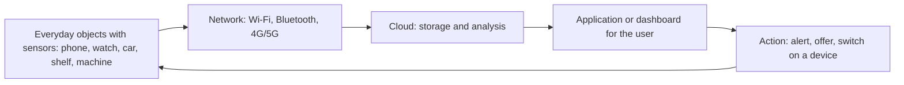
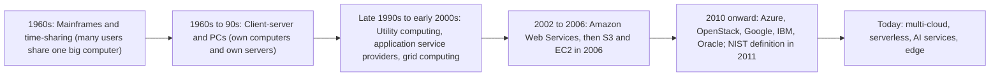
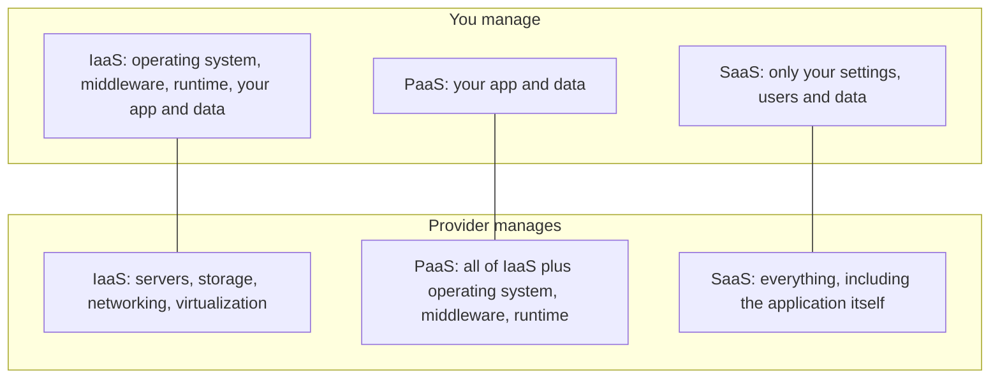
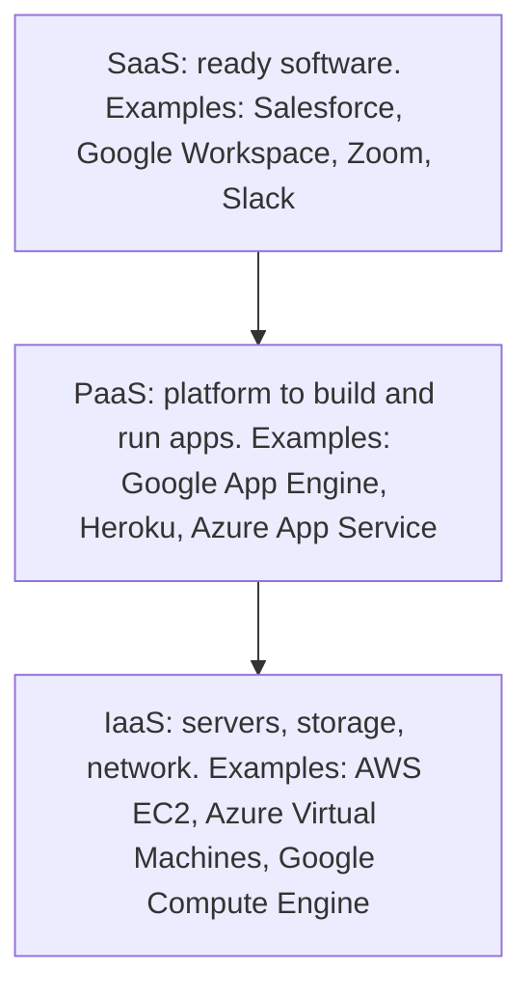
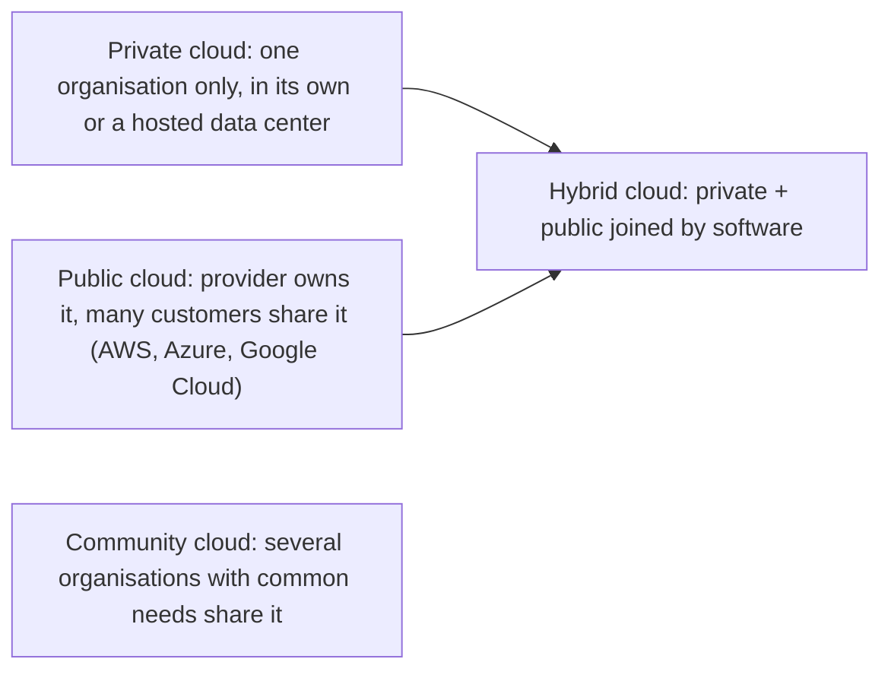

Before the new ideas, here are the old ones you need. If you already know them, skip to the next section.

## The basics first

- A **server** is a powerful computer that stores data or runs programs for other computers (called **clients**) over a network.
- A **data center** is a building full of servers, storage and networking equipment, with power, cooling and security.
- **Storage** is where data is kept (disks). **Network** is the connection that carries data between computers. The **internet** is the biggest such network.
- **Capital expenditure (capex)** is a big one-time spend on assets, for example buying servers. **Operating expenditure (opex)** is a regular spend on running things, for example a monthly bill.
- **Virtualization** means using software to split one physical computer into many **virtual machines (VMs)**, each behaving like a separate computer. It is the main technology that makes the cloud possible. <Cite id="note-cloud-computing-wiki-cloud" />
- A **sensor** is a small device that measures something (temperature, location, motion) and a **smart device** is any everyday object with a processor and a network connection.

## Pervasive computing

This is syllabus <Syl m="5" />, section 5.2 (pervasive computing, cloud computing model).

<Box kind="definition">

**Pervasive computing** (also called **ubiquitous computing** or "ubicomp") is the idea that computing is made to appear seamlessly anytime and everywhere. Small, cheap, network-connected computers are built into everyday objects, so people use them without thinking about the computer. <Cite id="note-cloud-computing-wiki-ubicomp" /> <Cite id="it-impact-society-rainer-iis7" />

</Box>

**Where it comes from.** Mark Weiser, Chief Technologist at Xerox PARC, coined the phrase around 1988. His picture was a "calm" technology that stays in the background, the way you read a street sign without feeling that you are using a machine. <Cite id="note-cloud-computing-wiki-ubicomp" />

**Why it is needed (the problem it solves).** Earlier, to use a computer you had to sit in front of one. Pervasive computing takes the computer to where the person is and to where the data is created: in a car, a hospital bed, a factory machine or a shop shelf.

**Everyday analogy.** Electricity is pervasive. You do not think about the power station when you press a switch; you just expect light. Pervasive computing aims for the same feeling with computing.

**Main building blocks.**

1. **Sensors and actuators.** Sensors detect changes such as temperature or motion; actuators cause a physical action, such as switching on a motor. <Cite id="note-cloud-computing-ibm-pervasive" />
2. **Identification and tracking tags** such as RFID (radio-frequency identification: a tiny tag read by radio, used on goods and cards) and wireless sensor networks (many small sensors passing data to each other).
3. **Connectivity**: Wi-Fi, Bluetooth, cellular, Zigbee and similar links that carry the data. <Cite id="note-cloud-computing-ibm-pervasive" />
4. **Cloud and analytics**: platforms store the data, process it and run the applications. <Cite id="note-cloud-computing-ibm-pervasive" />
5. **Security and privacy controls**: encryption and access control.

The **Internet of Things (IoT)** is the part of pervasive computing that focuses on physical objects with sensors and network connections that collect and share data. <Cite id="note-cloud-computing-ibm-pervasive" /> <Cite id="note-cloud-computing-wiki-ubicomp" />

**Applications and examples.**

| Area | Example |
|---|---|
| Smart home | Thermostats, smart lights, voice assistants |
| Healthcare | Wearables and remote monitoring of heart rate, blood pressure and oxygen level |
| Industry | Sensors on machines that warn before a part fails; tracking temperature and stock |
| Retail and logistics | RFID tags on goods; delivery vehicles tracked live (Amazon, Flipkart, Zomato delivery tracking) |
| Transport | Connected cars, FASTag toll payment |
| Education | Smart classrooms, attendance by card or phone |

<Cite id="note-cloud-computing-ibm-pervasive" /> <Cite id="note-cloud-computing-wiki-ubicomp" />

**Advantages.** Convenience, automation of routine tasks, real-time information, better decisions, fewer human errors.

**Disadvantages and challenges.** Privacy is the most frequently cited criticism, and possibly the biggest barrier to long-term success: always-on sensors record where you are and what you do. Other issues are security of thousands of small devices, cost, battery life, and standards that differ between makers. <Cite id="note-cloud-computing-wiki-ubicomp" />

**Conclusion.** Pervasive computing puts the computer into the world around us; cloud computing is the back-end that stores and processes what those devices produce.

## Cloud computing: meaning and need

<Box kind="definition">

**Cloud computing** is a model for enabling "ubiquitous, convenient, on-demand network access to a shared pool of configurable computing resources (for example networks, servers, storage, applications and services) that can be rapidly provisioned and released with minimal management effort or service provider interaction." (NIST). In simple words: you rent computing power, storage and software over the internet, and pay for what you use, instead of buying and running your own. <Cite id="note-cloud-computing-nist-800-145" /> <Cite id="note-cloud-computing-aws-cloud" /> <Cite id="note-cloud-computing-gfg-cloud" />

</Box>

**Why it is needed.** A company that buys its own servers must pay a large amount first, guess how much capacity it will need, hire staff to run them, and keep spare capacity for the busiest day. Most of that capacity sits idle on normal days. Cloud computing turns that fixed cost into a variable cost: you take what you need now and release it later. <Cite id="note-cloud-computing-aws-cloud" />

**Everyday analogy.** Owning your own servers is like owning a car: you pay for it, insure it, repair it and park it even when you do not drive. Cloud is like using Ola or Uber: you pay only for the rides you take. Another analogy is electricity from the grid instead of running your own generator.

**Why it is called "cloud".** Engineers draw the internet as a cloud shape on network diagrams, because the user does not need to know what is inside it. The word was used for places where programs could move in the 1990s. <Cite id="note-cloud-computing-wiki-cloud" />

**How it works, step by step.**

1. A provider (Amazon Web Services, Microsoft Azure, Google Cloud) builds huge data centers around the world.
2. Using **virtualization**, it splits the hardware into many virtual resources and shares them among many customers. <Cite id="note-cloud-computing-wiki-cloud" />
3. The customer logs in to a web portal or uses an API (a way for programs to talk to programs) and asks for what it needs: say 4 virtual machines and 1 TB of storage.
4. The provider gives the resources within minutes.
5. The provider measures usage (hours, GB, requests) and bills for it.
6. When the need ends, the customer releases the resources and stops paying.

### Evolution of cloud computing

Cloud computing did not appear suddenly. Each stage solved a problem of the one before. Dates below are the main ones given in the sources.

| Stage | What it was | Problem it left |
|---|---|---|
| Time-sharing on mainframes (1960s) | Users submitted jobs to a central mainframe and shared it | Very costly machines; users far from the computer |
| Personal computers and client-server (1980s to 90s) | Each company owned its servers and PCs | High cost of buying and maintaining; idle capacity |
| Utility computing and ASPs (late 1990s) | Computing and applications rented and metered like electricity; John McCarthy had imagined a "computer utility" in 1961 | Technology and internet speed not ready; poor sharing between customers |
| Cloud computing (2002 onward) | AWS formed in 2002; S3 and EC2 launched in 2006; Azure in 2010; OpenStack in 2010 | Security, lock-in and cost control (still open) |

<Cite id="note-cloud-computing-wiki-cloud" /> <Cite id="note-cloud-computing-wiki-utility" /> <Cite id="note-cloud-computing-wiki-saas" /> <Cite id="note-cloud-computing-tp-cloud" />

Two enablers sit behind the last step: **virtualization**, which splits hardware into many virtual machines, and **utility computing**, the idea of metered billing like a public utility. <Cite id="note-cloud-computing-wiki-cloud" /> The client-server and grid-computing steps are the usual textbook way of telling the story and are not dated in the sources; the 1960s, 1961, 2002, 2006, 2010 and 2011 dates come from them.

<Box kind="exam">

For "highlight the evolution", draw the timeline diagram above and write one line per stage (what it was, what problem it solved, what it left). Do not just list dates. <PYQ id="2022-12-ce/q6b" /> <PYQ id="2023-05-ce/q4b" />

</Box>

### Essential characteristics (NIST)

NIST says the cloud model has five essential characteristics. <Cite id="note-cloud-computing-nist-800-145" /> <Cite id="note-cloud-computing-wiki-cloud" /> <Cite id="note-cloud-computing-gfg-cloud" />

| Characteristic | Meaning in simple words | Example |
|---|---|---|
| On-demand self-service | You get resources yourself, any time, without calling the provider | Starting a virtual server on AWS in a few clicks |
| Broad network access | Reach the service from many devices over the network | Using Google Docs on phone and laptop |
| Resource pooling (multi-tenancy) | The provider's resources are shared among many customers, assigned as needed | Many companies run on the same data center |
| Rapid elasticity | Resources grow or shrink quickly with demand | A shopping site adds servers for a sale day and drops them after |
| Measured service | Usage is measured and billed, so you pay for what you use | Pay per hour of compute or per GB of storage |

## Cloud computing models

The word "models" in exam questions usually means **service models** (what is delivered), and often also **deployment models** (who owns and shares the cloud). NIST names three service models and four deployment models. <Cite id="note-cloud-computing-nist-800-145" /> Write both unless the question limits you.

### Service models: IaaS, PaaS, SaaS and CaaS

Think of making dinner: **IaaS** is renting an empty kitchen with a stove (you bring ingredients and cook), **PaaS** is a kitchen with ingredients and tools (you only do the cooking), **SaaS** is ordering the finished meal. **CaaS** is like renting ready, standard lunch boxes together with a delivery system, which you fill with your own food.

<Cite id="note-cloud-computing-gfg-models" loc="diagram" />

**1. IaaS (Infrastructure as a Service).** The provider gives virtualized computing, storage and networking over the internet, usually pay-as-you-go. You install and manage the operating system, middleware and applications. <Cite id="note-cloud-computing-ibm-models" /> <Cite id="note-cloud-computing-gfg-models" />

- Users: skilled developers, IT administrators, DevOps teams.
- Examples: Amazon EC2, Microsoft Azure Virtual Machines, Google Compute Engine, IBM Cloud.
- Applications: a start-up adding server capacity in a traffic spike without buying hardware; hosting a website; storage and backup; testing and development; high-performance computing.

**2. PaaS (Platform as a Service).** The provider gives a ready platform to develop, test, run and manage applications. It manages servers, operating system, databases, middleware and runtime; you manage only your application and data. <Cite id="note-cloud-computing-ibm-models" /> <Cite id="note-cloud-computing-gfg-models" />

- Users: application developers.
- Examples: Heroku, AWS Elastic Beanstalk, Google App Engine, Azure App Service.
- Applications: a mobile-app team deploys code and connects managed databases without configuring a backend server; building web apps and APIs quickly.

**3. SaaS (Software as a Service).** The provider delivers a ready-made application over the internet, usually by subscription, and handles infrastructure, updates and security. Most providers run one version for all customers (multi-tenancy). <Cite id="note-cloud-computing-wiki-saas" /> <Cite id="note-cloud-computing-salesforce-saas" />

- Users: end users and businesses.
- Examples: Salesforce CRM, Google Workspace, Microsoft 365, Zoom, Slack, Dropbox.
- Applications: a sales team uses a cloud CRM through a browser without managing hosting or updates; email, office documents, video meetings, HR and accounting software.

**4. CaaS (Containers as a Service).** A **container** packs an application together with the libraries it needs so that it runs the same way everywhere; it is lighter than a virtual machine. CaaS lets developers upload, start, stop, scale and manage containers through an API or a web portal, with orchestration (automatic deployment, load balancing, scaling) built in. IBM places it between IaaS and PaaS: more control than PaaS, simpler than IaaS. <Cite id="note-cloud-computing-ibm-caas" /> <Cite id="note-cloud-computing-gfg-caas" />

- Users: developers and DevOps teams who build in containers.
- Examples: Amazon ECS, Google Kubernetes Engine (GKE), IBM Cloud Kubernetes Service, Azure Container Instances; Docker and Kubernetes are the common tools.
- Applications: microservices (an app split into small services, such as payments, login and cart, each in its own container set); DevOps pipelines; moving older applications to the cloud without a full rewrite; portable applications that move between on-premises and cloud. <Cite id="note-cloud-computing-ibm-caas" />
- Limits: tied to the provider's technology; containers share the host operating system's kernel, so security needs care; some performance overhead. <Cite id="note-cloud-computing-gfg-caas" />

Note on spelling: in some exam papers the word "CAAS" is written for Containers as a Service, which is how it is used above. The ISO standard of 2023 also lists "Communications as a Service" and "Compute as a Service" as other service categories, so state in the exam which meaning you use. <Cite id="note-cloud-computing-wiki-cloud" />

**Other service types** you may mention in one line: **FaaS / serverless** (you run small pieces of code on events, for example AWS Lambda, without managing servers). <Cite id="note-cloud-computing-gfg-cloud" />

| Point | IaaS | PaaS | SaaS | CaaS |
|---|---|---|---|---|
| What you get | Virtual machines, storage, network | Platform to build and run apps | Finished application | Platform to run containers |
| You manage | OS, middleware, apps, data | Apps and data | Settings, users, data | Containers and the apps in them |
| Provider manages | Hardware and virtualization | Hardware, OS, runtime, middleware | Everything | Hardware, orchestration layer |
| Technical skill needed | High | Medium | Low | Medium to high |
| Main users | IT admins, DevOps | Developers | End users | Developers, DevOps |
| Examples | AWS EC2, Azure VMs | Heroku, Google App Engine | Salesforce, Microsoft 365, Zoom | Amazon ECS, GKE |
| Typical use | Hosting, backup, testing | Building and deploying apps | Email, CRM, office tools | Microservices, portable apps |
| Main limit | More work and expertise | Less control, lock-in | Little control or customising | Provider dependence, security care |

<Cite id="note-cloud-computing-ibm-models" /> <Cite id="note-cloud-computing-gfg-models" /> <Cite id="note-cloud-computing-ibm-caas" /> <Cite id="note-cloud-computing-gfg-caas" />

<Box kind="exam">

For "CAAS, SAAS, IAAS with application of each": write the full form, one-line meaning, who manages what, two examples and two applications for each, then the comparison table. Add the layered diagram. <PYQ id="2024-05-ce/q2b" />

</Box>

### Deployment models

These describe who owns the cloud and who may use it. <Cite id="note-cloud-computing-gfg-deploy" /> <Cite id="note-cloud-computing-nist-800-145" /> <Cite id="note-cloud-computing-wiki-cloud" />

| Model | Meaning | Advantages | Disadvantages | Example |
|---|---|---|---|---|
| **Public** | Owned by a third-party provider, delivered over the internet, shared by many customers | Low upfront cost, pay per use, almost unlimited scaling, no hardware upkeep | Shared resources; harder to meet strict compliance; limited customising | A start-up running on AWS |
| **Private** | Dedicated to one organisation, run by it or a third party | Full control, strong security and privacy, supports legacy systems | Most expensive; scale limited by the hardware you buy | A bank running its core system in its own data center |
| **Hybrid** | Private and public clouds joined so data and apps can move between them | Keep sensitive data private, use public capacity for spikes ("cloud bursting") | Complex to manage; latency possible | A retailer keeping customer records privately and renting public capacity for a sale |
| **Community** | Shared by organisations in one field with common concerns (compliance, security, mission) | Cost shared; strong shared security | Limited scalability; hard to customise | Hospitals or government departments sharing a compliance-bound cloud |

<Cite id="note-cloud-computing-gfg-deploy" />

A fifth idea often added is **multi-cloud**: using public services of two or more providers (for example AWS for storage and Google Cloud for machine learning). It does not need a private cloud. <Cite id="note-cloud-computing-gfg-deploy" /> <Cite id="note-cloud-computing-wiki-cloud" />

## Key benefits of cloud computing

Group benefits under business headings so the answer reads as an analysis, not a list. <Cite id="note-cloud-computing-aws-cloud" /> <Cite id="note-cloud-computing-wiki-cloud" /> <Cite id="note-cloud-computing-gfg-cloud" /> <Cite id="note-cloud-computing-gfg-models" />

| Benefit | Why it matters | Example |
|---|---|---|
| **Lower upfront cost** | No need to buy servers; capital cost becomes an operating cost | A new start-up launches without buying a data center |
| **Pay-as-you-go** | Only pay for what you consume, so little waste | Paying per hour for a test server |
| **Scalability and elasticity** | Grow or shrink capacity with demand | A shopping site such as Flipkart adding capacity for a big sale (illustration) |
| **Speed and agility** | New resources in minutes; faster time to market; easy experiments | A team tries an idea on a new server the same day |
| **Global reach** | Deploy in new regions in minutes, closer to users, with lower delay | A streaming service serves viewers in many countries |
| **Reliability and recovery** | Easier and cheaper backup and disaster recovery; provider offers redundancy | Data copied to another region survives a failure |
| **Access from anywhere** | Work from any device with a connection; supports remote work | Staff using Microsoft 365 from home |
| **Less IT burden** | Provider handles maintenance, updates and patches | A small firm without an IT team uses SaaS |
| **Access to advanced services** | AI, analytics and machine learning offered as services | A company uses a ready speech or analytics service |
| **Better collaboration** | Many people edit the same files at once | Google Docs shared by a class group |

**Analysis (how a manager should read this).** Benefits are largest when demand is uneven, when the firm is small or new, or when speed matters. They are smaller for steady, predictable workloads where owning hardware can be cheaper, and for data under strict rules. The cost of cloud can also exceed the budget: one survey cited by Wikipedia found 69% of IT leaders went over their cloud budgets in 2023. <Cite id="note-cloud-computing-wiki-cloud" />

## Risks and limitations

| Risk | Meaning |
|---|---|
| Security and privacy | Your data sits with a provider who can access it; rules such as GDPR or HIPAA can be hard to meet. Security is shared: the provider secures the cloud, you secure what you put in it. |
| Less control and visibility | You see only what the provider shows. |
| Internet dependence | If the connection or the provider is down, you cannot work. |
| Vendor lock-in | Proprietary platforms, data formats and tools make switching costly. Platform, data and tools lock-in are the three forms. |
| Cost overruns | Pay-per-use bills can grow unnoticed. |
| Migration effort | Moving existing systems can be complex, costly and risky. |

<Cite id="note-cloud-computing-wiki-cloud" /> <Cite id="note-cloud-computing-wiki-lockin" /> <Cite id="note-cloud-computing-gfg-cloud" />

## Real-world examples

- **Amazon:** Amazon Web Services was established in 2002, and S3 and EC2 launched in 2006. <Cite id="note-cloud-computing-wiki-cloud" />
- **Salesforce:** a CRM delivered as SaaS, started in 1999 with the aim to "End Software". <Cite id="note-cloud-computing-salesforce-saas" />
- **Gmail and Google Docs:** consumer SaaS; Gmail (2004) helped bring SaaS to ordinary users. <Cite id="note-cloud-computing-wiki-saas" />
- **Heroku and Google App Engine:** PaaS for developers. <Cite id="note-cloud-computing-ibm-models" />
- **Retail and delivery apps (Flipkart, Zomato):** use cloud capacity for busy periods. Which provider each firm uses is not stated in the sources here, so do not name it in the exam.

## Answer plan for a 10-mark question

1. Definition (the NIST sentence in simple words).
2. Need: the problem of owning servers.
3. Characteristics (five, one line each).
4. Service models with diagram and comparison table.
5. Deployment models with table.
6. Evolution timeline (if asked) or benefits table (if asked).
7. Limits and one-line conclusion: "Cloud computing lets an organisation use computing as a utility, paying for what it uses, but it must manage security, cost and lock-in."

## Quick exam map

| If the question says... | Write... | Past paper |
|---|---|---|
| "Describe various cloud computing models and highlight their evolution" (10 marks) | Definition, evolution timeline diagram and table, service models and deployment models with tables | <PYQ id="2022-12-ce/q6b" /> <PYQ id="2023-05-ce/q4b" /> |
| "What is cloud computing? Explain its models" (10 marks) | Definition, need, five characteristics, IaaS/PaaS/SaaS layered diagram, deployment models, conclusion | <PYQ id="2023-12-ce/q4a" /> <PYQ id="2025-05-ce/q6b" /> |
| "CAAS, SAAS, IAAS with application of each" (10 marks) | Meaning, who manages what, examples and two applications each, comparison table | <PYQ id="2024-05-ce/q2b" /> |
| "Analyze the key benefits of cloud computing" (10 marks) | Benefit table with reasons and examples, analysis of when benefits are largest, risks in one short section | <PYQ id="2024-05-ce/q6a" /> |
| "Pervasive computing" (syllabus 5.2) | Definition, Weiser, blocks, link to cloud diagram, applications, privacy | <Syl m="5" /> |
