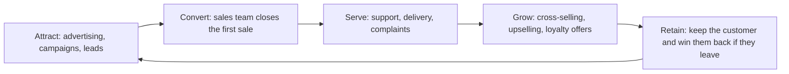
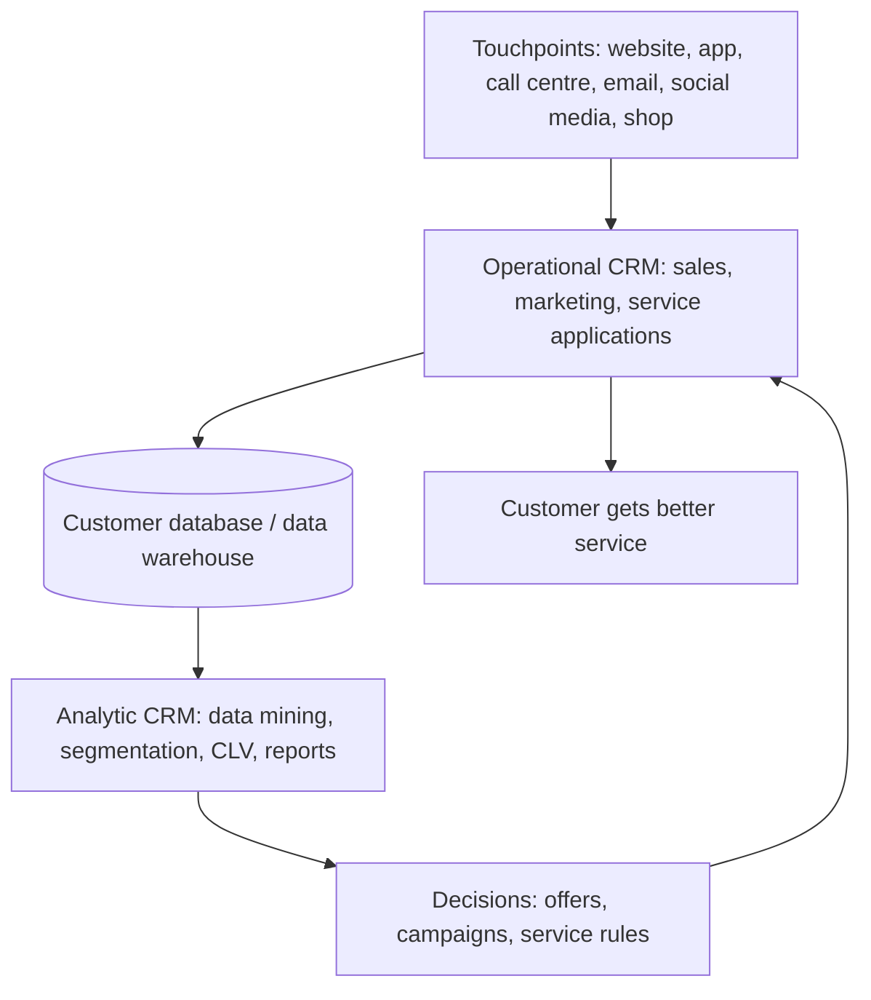
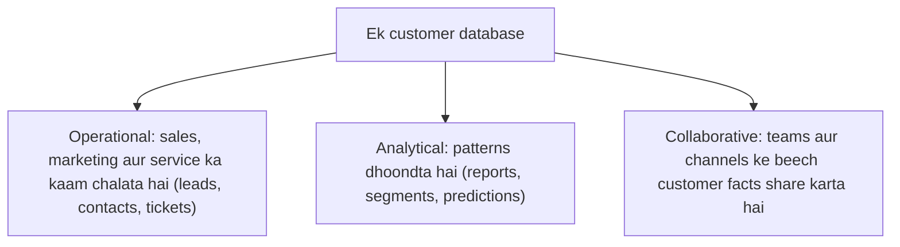
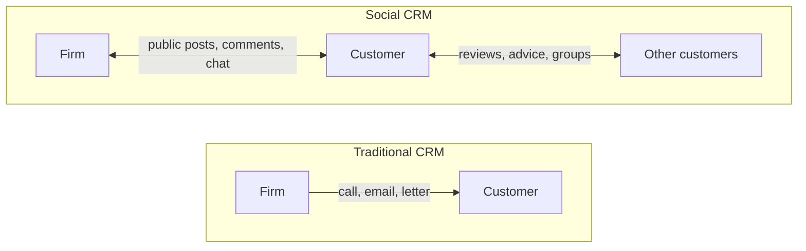

CRM se pehle kuch basic ideas chahiye. Agar aapko aate hain to aage badh jaao.

## The basics first

- **Customer** wo person ya business hai jo firm se kharidta hai. **Prospect** (ya lead) wo hai jo kharid sakta hai par abhi kharida nahi.
- **Touchpoint** wo har moment hai jab customer firm se milta hai: website visit, helpline call, email padhna, app use karna, Instagram pe sawaal poochna, ya shop mein jaana. <Cite id="crm-wiki-touchpoint" />
- **Front office** firm ka wo hissa hai jo customers se deal karta hai (sales, marketing, support). **Back office** wo hissa hai jo customer ko nahi dikhta (accounts, stock, delivery, HR).
- **Customer loyalty** matlab customer baar baar wapas aata hai, rival ke paas nahi jaata.
- **Database** data ka organised store hai. CRM ko customers ke baare mein ek shared database chahiye.

## CRM kya hai aur kyun zaroori hai

<Box kind="definition">

**Customer relationship management (CRM)** ek strategy hai, jise information systems support karte hain. Ye firm ke customers aur firm ke saath unke saare contacts ki information ek jagah jama karti hai, taaki firm ka har hissa har customer ko achhe se treat kar sake aur firm apne customers ko rakh aur badha sake. <Cite id="crm-rainer-iis" /> <Cite id="crm-wiki-crm" /> <Cite id="crm-ibm" />

</Box>

Ye syllabus <Syl m="4" /> ka section 4.3 hai (marketing, operational aur analytic CRM).

**Ye kyun zaroori hai (kaunsi problem solve karta hai).** Bade firm mein customer bahut logon se baat karta hai: salesperson, support desk, delivery team, billing team. Agar har koi apne alag notes rakhe, to customer ko wahi kahani baar baar sunani padti hai, offers galat logon ko jaate hain aur complaints bhool jaati hain. Naya customer jodna purane customer ko rakhne se kaafi mehenga padta hai, isliye firm apne customers ko achhe se jaanna aur khush rakhna chahti hai. CRM har customer ki ek shared, updated picture deta hai, jisse bikhri hui customer information ki problem solve hoti hai. <Cite id="crm-salesforce" /> <Cite id="crm-oracle" />

**Roz ki analogy.** Chhote kirana shopkeeper ko yaad rehta hai ki aap chini kam lete ho, aapki mummy ka haal poochta hai aur monthly khata rakhta hai. Wo yaad rakhna hi CRM hai. Jab firm ke lakhon customers hon, to koi insaan sabko yaad nahi rakh sakta, isliye software ye yaad rakhne ka kaam karta hai. <Cite id="crm-tp-quick-guide" />

## Goals of CRM

1. Sahi customers lana (acquire).
2. Unhe better serve karna aur zyada bechna (enhance).
3. Unhe lambe time tak rakhna (retain).

Ye teen goals neeche dikhaye gaye customer life cycle banate hain. Firm aksar customer ko **customer lifetime value (CLV)** se judge karti hai: poore relationship mein us customer se firm ko jitna total profit milne ki ummeed hai. <Cite id="crm-wiki-clv" />

## CRM system kaise kaam karta hai

CRM system chaar steps follow karta hai. <Cite id="crm-rainer-iis" /> <Cite id="crm-gfg-intro" />

1. **Collect.** Har touchpoint se har customer ka data aata hai: website clicks, orders, calls, emails, chats, social media posts, shop purchases.
2. **Store.** Sab kuch ek central customer database mein jaata hai (aksar data warehouse), taaki har employee wahi record dekhe.
3. **Analyse.** Software patterns dhundta hai: kaun kya kharidta hai, kaun jaane wala hai, kaun sabse valuable hai.
4. **Act.** Firm result use karti hai: personal offer, sahi agent ka call, reminder, better product. Customer ka reaction naya data ban jaata hai aur loop dobara chalta hai.

## Types of CRM

Books CRM ko thode alag tareeke se group karti hain. Rainer ise operational aur analytical CRM mein baantta hai, aur syllabus mein **marketing, operational aur analytic** likha hai. Kai websites **collaborative** CRM bhi jodti hain. Chaaron seekho; exam mein pehle syllabus ke teen likho aur collaborative ko extra ki tarah mention karo. <Cite id="crm-rainer-iis" /> <Cite id="crm-techtarget-types" /> <Cite id="crm-tpoint-types" />

<Cite id="crm-gfg-intro" loc="diagram" />

### 1. Operational CRM

**Ye kya hai.** Aisa software jo customers ko touch karne wala roz ka front-office kaam automate karta hai. Ye customer ke saath abhi ke kaam dekhta hai. <Cite id="crm-rainer-iis" /> <Cite id="crm-techtarget-types" />

Iske teen parts hain:

- **Sales force automation (SFA):** leads, contacts, deals aur follow-up reminders rakhta hai, taaki salesperson ko pata ho ki agla call kise karna hai aur pichli baar kya baat hui thi. <Cite id="crm-wiki-sfa" />
- **Marketing automation:** emails aur messages jaise campaigns schedule pe chalata hai aur response track karta hai. <Cite id="crm-wiki-marketing-automation" />
- **Customer service and support:** har complaint ko ticket ki tarah log karta hai, sahi agent ko bhejta hai aur band hone tak track karta hai; isme call centres, IVR (phone menus), live chat aur chatbots aate hain. <Cite id="crm-wiki-call-centre" /> <Cite id="crm-wiki-ivr" /> <Cite id="crm-wiki-chatbot" />

Rainer **customer-facing** applications (jahan staff aur customer aamne-saamne deal karte hain, jaise call centres aur sales) ko **customer-touching** applications se alag karta hai (jahan customer akela system use karta hai, jaise search aur comparison, FAQs, personalised web pages, order tracking aur loyalty accounts). <Cite id="crm-rainer-iis" /> <Cite id="crm-laudon-mis" />

**Example.** Flipkart ya Amazon pe jab aap late order ki complaint daalte ho, to support agent ek saath aapke orders, pichli chats aur refund history dekh leta hai. Aapko kahani dobara nahi sunani padti. Jio ya Airtel jaisi telecom company har complaint ka ticket kholti hai aur track karti hai.

### 2. Analytic CRM

**Ye kya hai.** Aisa software jo operational CRM ke stored customer data ko study karke patterns dhundta hai aur decisions mein madad karta hai. Ye customers ko time ke saath dekhta hai. <Cite id="crm-rainer-iis" /> <Cite id="crm-oracle" />

Common techniques:

- **Segmentation:** customers ko milte-julte behaviour wale groups mein baantna, jaise frequent buyers aur price-sensitive buyers. <Cite id="crm-wiki-segmentation" />
- **Data mining:** chhupe patterns dhundna, jaise kaun se products saath mein kharide jaate hain. <Cite id="crm-wiki-data-mining" />
- **Customer lifetime value aur churn prediction:** kaun se customers sabse valuable hain aur kaun chhodne wale hain. <Cite id="crm-wiki-clv" />
- Managers ke liye **reports aur dashboards**.

**Example.** Amazon ka "customers who bought this also bought" aur Netflix jaise suggestions pichli purchases ke analysis se aate hain. SBI ya HDFC jaisa bank un customers ko dhundh sakta hai jinhone card use karna band kar diya, aur unhe offer bhej sakta hai. Aise patterns **cross-selling** (related product bechna) aur **upselling** (better ya bada version bechna) mein bhi madad karte hain. <Cite id="crm-wiki-cross-selling" /> <Cite id="crm-wiki-upselling" />

### 3. Marketing CRM

**Ye kya hai.** Customer data se marketing plan karna aur chalana: sahi customers, sahi offer, sahi channel aur sahi time chunna, aur result napna. Kai books mein marketing hissa operational CRM ke andar (marketing automation) hota hai aur insight ke liye analytic CRM use karta hai, yaani ye wo jagah hai jahan dono milte hain. <Cite id="crm-rainer-iis" /> <Cite id="crm-tp-quick-guide" /> <Cite id="crm-wiki-marketing-automation" />

**Typical activities.** Targeted campaigns, personalised emails, discount coupons, **loyalty programmes**, aur ye track karna ki kaun se campaign se kaunsi sale aayi. <Cite id="crm-wiki-loyalty" />

**Example.** Zomato ya Swiggy un logon ko lunch offer bhejta hai jo aksar dopahar mein order karte hain. Starbucks, Tanishq ya koi airline points-based loyalty programme chalati hai aur birthday aur pichle use ke hisaab se offers bhejti hai.

### 4. Collaborative CRM

**Ye kya hai.** Aise systems jo alag departments (sales, support, marketing) aur bahar ke partners (dealers, suppliers, service vendors) ko customer information share karne dete hain, taaki customer ko firm ek jaisi dikhe. <Cite id="crm-techtarget-types" /> <Cite id="crm-tpoint-types" />

**Example.** Ek car maker, uska dealer aur service centre sab ek hi customer ki purchase aur repair history dekhte hain, to customer ke aane se pehle hi dealer ko car ki problems pata hoti hain.

### Comparison of the types

| Point | Operational CRM | Analytic CRM | Marketing CRM | Collaborative CRM |
| --- | --- | --- | --- | --- |
| Main aim | Roz ka customer kaam smooth chalana | Data se customers ko samajhna | Campaigns se customers jeetna aur rakhna | Teams aur partners mein customer data share karna |
| Main users | Sales, support, front-office staff | Analysts, managers | Marketing team | Saare departments, partners |
| Typical tools | SFA, ticketing, call centre, chat | Data mining, segmentation, dashboards | Email aur campaign tools, loyalty programmes | Shared portals, common customer record |
| Time view | Abhi (current interaction) | Past aur future (patterns, prediction) | Planned campaigns | Chalta hua teamwork |
| Example | Flipkart support ticket | Amazon recommendations | Zomato lunch offer | Car maker aur dealer |

## Social CRM aur social computing ka role

**Social CRM** matlab social media (Facebook, Instagram, X/Twitter, WhatsApp, YouTube, review sites) ko CRM channel ki tarah use karna. Firm sirf messages bahar nahi bhejti. Wo customers ki baatein **sunti** hai, public mein jawab deti hai, aur ye contacts CRM record mein likhti hai. Purana CRM firm ke control mein tha; social CRM mein kai conversations customer shuru karta hai. <Cite id="crm-wiki-social-crm" /> <Cite id="crm-techtarget-social" /> <Cite id="crm-gfg-ecrm" />

**Social computing CRM aur customer service mein kaise madad karta hai.**

1. **Tez, public support.** Customer bank ya airline ko complaint tweet karta hai aur kuch minutes mein reply milta hai, aksar direct message mein baat aage badhane ko kaha jaata hai. Doosre customers dekhte hain ki firm problem solve kar rahi hai, to trust badhta hai.
2. **Opinions sunna.** Reviews, ratings, comments aur hashtags firm ko batate hain ki log kya pasand aur napasand karte hain, mehenge survey ke bina.
3. **Customers ek doosre ki madad karte hain.** Community forums aur user groups sawaalon ke jawab dete hain, jisse support cost kam hoti hai. Customers ideas bhi suggest kar sakte hain, jo **crowdsourcing** ka ek roop hai. <Cite id="crm-wiki-crowdsourcing" />
4. **Personal marketing.** Public profiles aur interests se aise offers ban sakte hain jo us insaan ko suit karein.
5. **Chat channels.** Chatbots aur messaging apps 24 ghante support dete hain. <Cite id="crm-wiki-chatbot" />
6. **Pehle se warning.** Gusse bhare posts ka badhta number crisis banne se pehle problem dikha deta hai.

**Risks.** Kharab experience tezi se aur public mein phailta hai; private data leak ho sakta hai; fake reviews aur rumours gumraah karte hain; aur channels ko din bhar dekhne ke liye staff chahiye. Firm ko reply dene aur privacy bachane ke clear rules chahiye.

**Example.** X pe Zomato aur Swiggy ke public replies, Amazon India ke support handles, aur IndiGo jaisi airlines ka social media pe passengers ko jawab dena roz ke cases hain. Tools aur risks ke liye social computing note dekho.

| Point | Traditional CRM | Social CRM |
| --- | --- | --- |
| Baat kaun control karta hai | Firm | Customers aur firm milkar |
| Direction | Zyadatar one-way (firm se customer) | Two-way, many-to-many |
| Channels | Phone, email, letter, shop | Social networks, forums, chat apps, review sites |
| Visibility | Private | Aksar public |
| Speed | Ghante ya din | Minutes |
| Main data | Firm ke apne records | Posts, likes, reviews, shares aur firm ke records |

## E-CRM in brief

**E-CRM (electronic CRM)** matlab internet pe kiya gaya CRM: web self-service, email, chat, mobile apps, online communities. Idea wahi CRM ka hai, bas main channel web hai. Traditional CRM phone, mail aur shops ke through chalta hai. <Cite id="crm-gfg-ecrm" />

## Benefits of CRM

- Better, tez aur zyada personal customer service.
- Zyada customer loyalty aur repeat sales; customers jodne ki cost kam.
- Cross-selling aur upselling se har customer se zyada sales.
- Kam wasted marketing, kyunki offers sahi logon ko jaate hain.
- Saare departments ke liye customer ka ek single view.
- Analysed data se better forecasting aur decisions. <Cite id="crm-salesforce" /> <Cite id="crm-microsoft" /> <Cite id="crm-ibm" />

## Problems and limits of CRM

- **Cost:** software, set-up, training aur upkeep mehenga ho sakta hai.
- **Poor data:** galat, duplicate ya purane records galat results dete hain ("garbage in, garbage out").
- **Staff use nahi karta:** agar employees data enter karna chhod dein, to system khaali rehta hai. Kai CRM projects software ki wajah se nahi, log aur process ki wajah se fail hote hain.
- **Privacy aur ethics:** bahut personal data collect karne se legal aur trust ke issues aate hain (ethics and privacy note dekho).
- **Purane systems ko jodna** mushkil ho sakta hai.
- **Zyada automation** se service thandi lag sakti hai. <Cite id="crm-rainer-iis" /> <Cite id="crm-laudon-mis" /> <Cite id="crm-oracle" />

<Box kind="pitfall">

Ye mat likho ki CRM sirf software hai. Exam mein likho ki CRM ek strategy aur process hai, aur software uski madad karta hai. Saath hi "operational" (roz ka kaam chalata hai) aur "analytic" (data study karta hai) ko clearly alag rakho.

</Box>

## CRM versus ERP

| Point | CRM | ERP |
| --- | --- | --- |
| Focus | Customers (firm ke bahar) | Internal resources aur processes |
| Area | Sales, marketing, service | Finance, stock, production, HR, supply chain |
| Aim | Customers jeetna aur rakhna, sales badhana | Poora business efficiently chalana, cost kam karna |
| Main users | Front office | Poori firm, zyadatar back office |
| Example | Salesforce | SAP |

Dono aksar judte hain: jab CRM order leta hai, to ERP stock, billing aur delivery sambhalta hai. <Cite id="crm-gfg-erp-vs-crm" />

## Real examples

| Firm | CRM kaise dikhta hai |
| --- | --- |
| Amazon | Pichli purchase ka data recommendations chalata hai (analytic) aur support ke liye har order ka ek view (operational). |
| Flipkart | Support tickets, order history aur customer group ke hisaab se special-sale offers. |
| Zomato / Swiggy | Order-time offers aur loyalty programmes (marketing) aur tez public replies (social CRM). |
| SBI / HDFC Bank | Account, card aur loan ka ek customer record, behaviour ke hisaab se offers. |
| Airlines (IndiGo) | Frequent-flyer points, targeted offers aur social media support. |

Ye well-known public practices hain jo general terms mein likhi gayi hain; exact internal systems publish nahi hote.

## Past-paper answers: kya likhna hai

- <PYQ id="2022-12-ce/q3a" /> (10 marks, CRM, types, social computing ka role): definition, kyun zaroori, types (operational, analytic, marketing, collaborative) har ek ka ek example, phir upar ka social computing section (chhe points) aur traditional-versus-social table.
- <PYQ id="2023-12-ce/q3b" /> aur <PYQ id="2025-05-ce/q4a" /> (10 marks, CRM aur types examples ke saath): definition, goals aur life-cycle ya system diagram, phir har type ka example aur comparison table.
- <PYQ id="2023-05-ce/q1d" /> aur <PYQ id="2024-12-ce/q1d" /> (5 marks, social computing customer service ko kaise inspire karta hai): social computing ke neeche ke chhe points, do examples aur ek risk ke saath.

<Box kind="exam">

Exam mein English mein likho: "CRM is a strategy and a set of information systems that collects customer data from all touchpoints into one database and uses it to acquire, serve and retain customers."

</Box>

## One-line conclusion

CRM bikhre hue customer contacts ko ek shared record mein badalta hai aur use operational, marketing, analytic aur collaborative tools se, aur ab social media se, customers ko better serve karne aur lambe time tak rakhne mein use karta hai.
