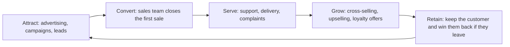
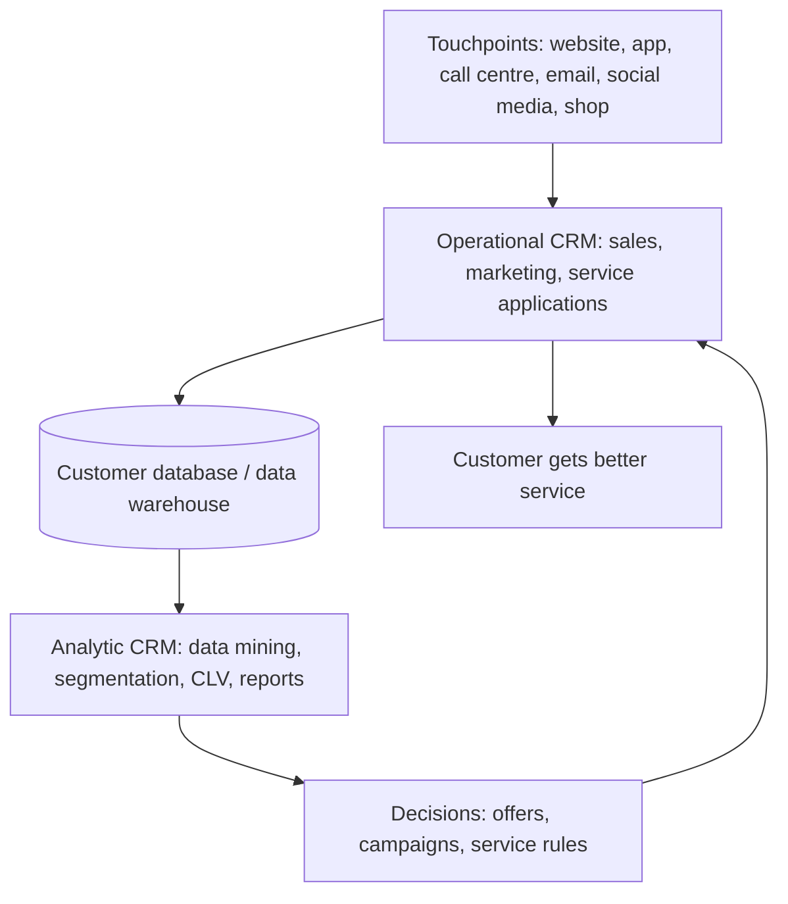
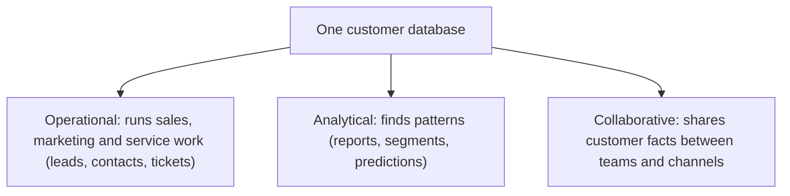
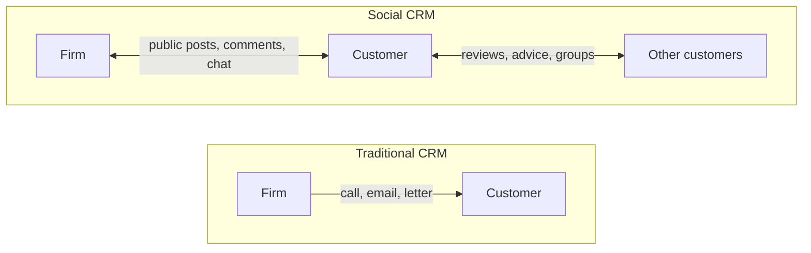

Before CRM itself, here are the few ideas you need. If you know them, skip ahead.

## The basics first

- A **customer** is a person or business that buys from the firm. A **prospect** (or lead) is someone who might buy but has not yet.
- A **touchpoint** is any moment where a customer meets the firm: visiting the website, calling the helpline, reading an email, using the app, asking a question on Instagram, or walking into a shop. <Cite id="crm-wiki-touchpoint" />
- A **front office** is the part of a firm that deals with customers (sales, marketing, support). The **back office** is the part customers do not see (accounts, stock, delivery, HR).
- **Customer loyalty** means a customer keeps coming back instead of switching to a rival.
- A **database** is an organised store of data. A CRM needs one shared database about customers.

## What CRM is and why it is needed

<Box kind="definition">

**Customer relationship management (CRM)** is a strategy, supported by information systems, that gathers all the information about a firm's customers and their contacts with the firm in one place, so that every part of the firm can treat each customer well and the firm can keep and grow its customers. <Cite id="crm-rainer-iis" /> <Cite id="crm-wiki-crm" /> <Cite id="crm-ibm" />

</Box>

This is syllabus <Syl m="4" />, section 4.3 (marketing, operational and analytic CRM).

**Why it is needed (the problem it solves).** In a big firm, a customer talks to many people: a salesperson, the support desk, the delivery team, the billing team. If each keeps its own notes, the customer has to repeat the same story, offers go to the wrong people and complaints are forgotten. Winning a new customer also costs far more than keeping an old one, so a firm wants to know its customers well and keep them happy. CRM gives one shared, up-to-date picture of each customer, which solves the problem of scattered customer information. <Cite id="crm-salesforce" /> <Cite id="crm-oracle" />

**Everyday analogy.** A small kirana shopkeeper remembers that you take less sugar, ask after your mother and keep a monthly account. That memory is CRM. When a firm has millions of customers, no person can remember everyone, so software does the remembering. <Cite id="crm-tp-quick-guide" />

## Goals of CRM

1. Get the right customers (acquire).
2. Serve them better and sell them more (enhance).
3. Keep them for a long time (retain).

These three goals make the customer life cycle shown below. Firms often judge a customer by **customer lifetime value (CLV)**: the total profit the firm expects from that customer over the whole relationship. <Cite id="crm-wiki-clv" />

## How a CRM system works

A CRM system follows four steps. <Cite id="crm-rainer-iis" /> <Cite id="crm-gfg-intro" />

1. **Collect.** Data about each customer comes in from every touchpoint: website clicks, orders, calls, emails, chats, social media posts, shop purchases.
2. **Store.** All of it goes into one central customer database (often a data warehouse), so every employee sees the same record.
3. **Analyse.** Software finds patterns: who buys what, who is about to leave, who is the most valuable.
4. **Act.** The firm uses the result: a personal offer, a call from the right agent, a reminder, a better product. The customer's reaction becomes new data and the loop repeats.

## Types of CRM

Books group CRM in slightly different ways. Rainer divides it into operational and analytical CRM, and the syllabus names **marketing, operational and analytic**. Many websites add **collaborative** CRM. Learn all four; in the exam, name the three from the syllabus first and mention collaborative as an extra. <Cite id="crm-rainer-iis" /> <Cite id="crm-techtarget-types" /> <Cite id="crm-tpoint-types" />

<Cite id="crm-gfg-intro" loc="diagram" />

### 1. Operational CRM

**What it is.** Software that automates the daily front-office work that touches customers. It deals with the customer now. <Cite id="crm-rainer-iis" /> <Cite id="crm-techtarget-types" />

It has three parts:

- **Sales force automation (SFA):** keeps leads, contacts, deals and follow-up reminders, so the salesperson knows who to call next and what was said last time. <Cite id="crm-wiki-sfa" />
- **Marketing automation:** runs campaigns such as emails and messages on a schedule and tracks the response. <Cite id="crm-wiki-marketing-automation" />
- **Customer service and support:** logs every complaint as a ticket, routes it to the right agent and tracks it until it is closed; includes call centres, IVR (phone menus), live chat and chatbots. <Cite id="crm-wiki-call-centre" /> <Cite id="crm-wiki-ivr" /> <Cite id="crm-wiki-chatbot" />

Rainer also separates **customer-facing** applications (where staff and customer deal with each other, such as call centres and sales) from **customer-touching** applications (where the customer uses the system alone, such as search and comparison, FAQs, personalised web pages, order tracking and loyalty accounts). <Cite id="crm-rainer-iis" /> <Cite id="crm-laudon-mis" />

**Example.** On Flipkart or Amazon, when you raise a complaint about a late order, the support agent sees your orders, past chats and refund history at once. You do not repeat your story. A telecom company such as Jio or Airtel opens a ticket for each complaint and tracks it.

### 2. Analytic CRM

**What it is.** Software that studies the customer data stored by operational CRM to find patterns and support decisions. It looks at customers over time. <Cite id="crm-rainer-iis" /> <Cite id="crm-oracle" />

Common techniques:

- **Segmentation:** splitting customers into groups with similar behaviour, such as frequent buyers and price-sensitive buyers. <Cite id="crm-wiki-segmentation" />
- **Data mining:** finding hidden patterns, such as which products are bought together. <Cite id="crm-wiki-data-mining" />
- **Customer lifetime value and churn prediction:** which customers are worth the most and which are likely to leave. <Cite id="crm-wiki-clv" />
- **Reports and dashboards** for managers.

**Example.** Amazon's "customers who bought this also bought" and Netflix-style suggestions come from analysing past purchases. A bank such as SBI or HDFC may find customers who stopped using their card and send them an offer. Spotting such patterns also supports **cross-selling** (selling a related product) and **upselling** (selling a better or bigger version). <Cite id="crm-wiki-cross-selling" /> <Cite id="crm-wiki-upselling" />

### 3. Marketing CRM

**What it is.** The use of customer data to plan and run marketing: picking the right customers, the right offer, the right channel and the right time, and measuring the result. In many books the marketing part sits inside operational CRM (marketing automation) and uses analytic CRM for the insight, so it is the place where both meet. <Cite id="crm-rainer-iis" /> <Cite id="crm-tp-quick-guide" /> <Cite id="crm-wiki-marketing-automation" />

**Typical activities.** Targeted campaigns, personalised emails, discount coupons, **loyalty programmes** and tracking which campaign brought which sale. <Cite id="crm-wiki-loyalty" />

**Example.** Zomato or Swiggy sends a lunch offer to people who often order at noon. Starbucks, Tanishq or an airline runs a points-based loyalty programme and sends offers by birthday and past use.

### 4. Collaborative CRM

**What it is.** Systems that let different departments (sales, support, marketing) and outside partners (dealers, suppliers, service vendors) share customer information, so the customer sees one consistent firm. <Cite id="crm-techtarget-types" /> <Cite id="crm-tpoint-types" />

**Example.** A car maker, its dealer and its service centre all see the same customer's purchase and repair history, so the dealer knows the car's problems before the customer walks in.

### Comparison of the types

| Point | Operational CRM | Analytic CRM | Marketing CRM | Collaborative CRM |
| --- | --- | --- | --- | --- |
| Main aim | Run daily customer work smoothly | Understand customers from data | Win and keep customers through campaigns | Share customer data across teams and partners |
| Main users | Sales, support, front-office staff | Analysts, managers | Marketing team | All departments, partners |
| Typical tools | SFA, ticketing, call centre, chat | Data mining, segmentation, dashboards | Email and campaign tools, loyalty programmes | Shared portals, common customer record |
| Time view | Now (current interaction) | Past and future (patterns, prediction) | Planned campaigns | Ongoing teamwork |
| Example | Flipkart support ticket | Amazon recommendations | Zomato lunch offer | Car maker with dealer |

## Social CRM and the role of social computing

**Social CRM** means using social media (Facebook, Instagram, X/Twitter, WhatsApp, YouTube, review sites) as a CRM channel. The firm does not only send messages out. It **listens** to what customers say, answers in public, and records these contacts in the CRM record. The old CRM was controlled by the firm; with social CRM the customer starts many of the conversations. <Cite id="crm-wiki-social-crm" /> <Cite id="crm-techtarget-social" /> <Cite id="crm-gfg-ecrm" />

**How social computing helps CRM and customer service.**

1. **Faster, public support.** A customer tweets a complaint to a bank or an airline and gets a reply within minutes, often with a request to continue by direct message. Other customers watch the firm solve the problem, which builds trust.
2. **Listening to opinions.** Reviews, ratings, comments and hashtags tell the firm what people like and dislike, without a costly survey.
3. **Customers help each other.** Community forums and user groups answer questions, which lowers support cost. Customers can also suggest ideas, which is a form of **crowdsourcing**. <Cite id="crm-wiki-crowdsourcing" />
4. **Personal marketing.** Public profiles and interests allow offers that fit the person.
5. **Chat channels.** Chatbots and messaging apps give round-the-clock support. <Cite id="crm-wiki-chatbot" />
6. **Early warning.** A rising number of angry posts shows a problem before it becomes a crisis.

**Risks.** A bad experience spreads quickly and publicly; private data can leak; fake reviews and rumours mislead; and the firm needs staff to watch the channels all day. A firm needs clear rules for replying and for protecting privacy.

**Example.** Zomato's and Swiggy's public replies on X, Amazon India's support handles, and airlines such as IndiGo answering passengers on social media are everyday cases. See the social computing note for more on tools and risks.

| Point | Traditional CRM | Social CRM |
| --- | --- | --- |
| Who controls the talk | The firm | Customers and the firm together |
| Direction | Mostly one-way (firm to customer) | Two-way, many-to-many |
| Channels | Phone, email, letter, shop | Social networks, forums, chat apps, review sites |
| Visibility | Private | Often public |
| Speed | Hours or days | Minutes |
| Main data | The firm's own records | Posts, likes, reviews, shares plus the firm's records |

## E-CRM in brief

**E-CRM (electronic CRM)** is CRM done over the internet: web self-service, email, chat, mobile apps, online communities. It is the same idea as CRM, with the web as the main channel. Traditional CRM works through phone, mail and shops. <Cite id="crm-gfg-ecrm" />

## Benefits of CRM

- Better, faster and more personal customer service.
- Higher customer loyalty and more repeat sales; lower cost of winning customers.
- More sales from each customer through cross-selling and upselling.
- Less wasted marketing because offers go to the right people.
- A single view of the customer for all departments.
- Better forecasting and decisions from analysed data. <Cite id="crm-salesforce" /> <Cite id="crm-microsoft" /> <Cite id="crm-ibm" />

## Problems and limits of CRM

- **Cost:** software, set-up, training and upkeep can be high.
- **Poor data:** wrong, duplicate or old records give wrong results ("garbage in, garbage out").
- **Staff do not use it:** if employees skip entering data, the system is empty. Many CRM projects fail because of people and process, not software.
- **Privacy and ethics:** collecting much personal data raises legal and trust issues (see the ethics and privacy note).
- **Joining old systems** can be hard.
- **Too much automation** can make service feel cold. <Cite id="crm-rainer-iis" /> <Cite id="crm-laudon-mis" /> <Cite id="crm-oracle" />

<Box kind="pitfall">

Do not say CRM is only software. In the exam, write that CRM is a strategy and a process, and that the software supports it. Also keep "operational" (runs daily work) and "analytic" (studies the data) clearly apart.

</Box>

## CRM versus ERP

| Point | CRM | ERP |
| --- | --- | --- |
| Focus | Customers (outside the firm) | Internal resources and processes |
| Area | Sales, marketing, service | Finance, stock, production, HR, supply chain |
| Aim | Win and keep customers, raise sales | Run the whole business efficiently, cut cost |
| Main users | Front office | Whole firm, mostly back office |
| Example | Salesforce | SAP |

The two are often linked: when CRM takes an order, ERP handles stock, billing and delivery. <Cite id="crm-gfg-erp-vs-crm" />

## Real examples

| Firm | How CRM shows up |
| --- | --- |
| Amazon | Past-purchase data drives recommendations (analytic) and one view of each order for support (operational). |
| Flipkart | Support tickets, order history and special-sale offers by customer group. |
| Zomato / Swiggy | Order-time offers and loyalty programmes (marketing) and quick public replies (social CRM). |
| SBI / HDFC Bank | One customer record across account, card and loan, with offers based on behaviour. |
| Airlines (IndiGo) | Frequent-flyer points, targeted offers and social media support. |

These are well-known public practices described in general terms; the exact internal systems are not published.

## Past-paper answers: what to write

- <PYQ id="2022-12-ce/q3a" /> (10 marks, CRM, types, role of social computing): definition, why needed, the types (operational, analytic, marketing, collaborative) with one example each, then the social computing section above (six points) and the traditional-versus-social table.
- <PYQ id="2023-12-ce/q3b" /> and <PYQ id="2025-05-ce/q4a" /> (10 marks, explain CRM and types with examples): definition, goals and the life-cycle or system diagram, then the types with an example each and the comparison table.
- <PYQ id="2023-05-ce/q1d" /> and <PYQ id="2024-12-ce/q1d" /> (5 marks, how social computing inspires customer service): the six points under social computing, with two examples and one risk.

<Box kind="exam">

Write this in the exam: "CRM is a strategy and a set of information systems that collects customer data from all touchpoints into one database and uses it to acquire, serve and retain customers."

</Box>

## One-line conclusion

CRM turns scattered customer contacts into one shared record and uses it, through operational, marketing, analytic and collaborative tools and now social media, to serve customers better and keep them longer.
