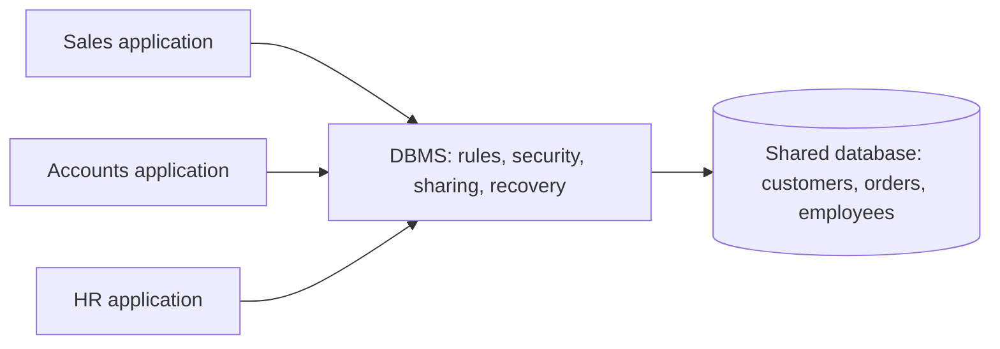
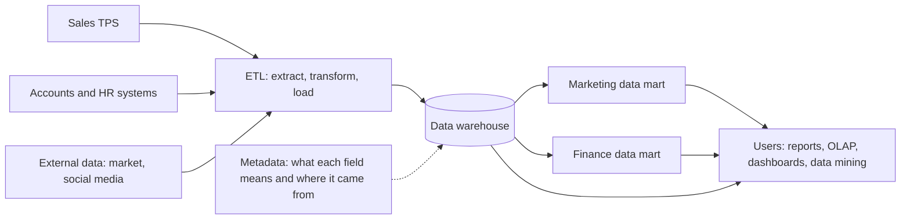
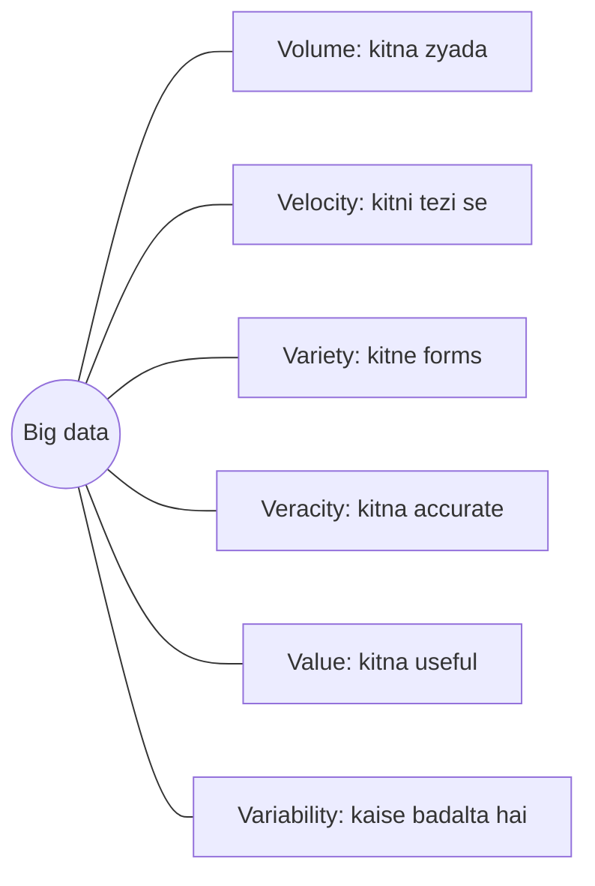
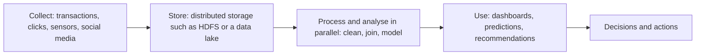

Ye note syllabus <Syl m="2" /> ke section 2.1 ko cover karta hai: data management, database approach, big data, data warehouses aur data marts. Knowledge management aur business intelligence (sections 2.2 se 2.4) ke apne alag notes hain.

## The basics first

- **Data** raw facts hain jinka abhi koi matlab nahi juda, jaise `45000`, `Virar`, `12-03-2025`.
- **Information** wo data hai jo organize ho kar kisi insaan ke liye matlab rakhta hai: "Customer Riya from Virar ne 12 March ko ₹45,000 ka saaman kharida".
- **Knowledge** information plus experience hai jo act karne mein help karta hai: "Virar ke customers March mein zyada kharidte hain, to February mein stock badhao".
- Data ek **hierarchy** mein store hota hai: bit (0 ya 1), byte (ek character), **field** (ek item jaise naam), **record** (ek cheez ke saare fields, jaise ek customer), **file** ya **table** (ek type ke bahut saare records), aur **database** (related tables ka group).
- **Operational** (roz ka) system transactions ko hote hi record karta hai: ek sale, fee payment, bank withdrawal. Inhe **transaction processing systems (TPS)** kehte hain.
- **Analysis** ka matlab hai bahut saare purane data ko dekh kar trends dhoondhna aur decisions lena.

Last do ideas yaad rakho. Is topic ka bada hissa "aaj ka kaam record karna" aur "saalon ki history analyse karna" ke difference ke baare mein hai.

## Data manage karna mushkil kyun hai

Har organization data pe chalti hai, par data manage karna mushkil hai kyunki:

1. **Amount badhta rehta hai.** Har second naya data aata hai aur purana data rakhna padta hai.
2. **Ye scattered hota hai.** Sales, accounts, HR aur website sab apni alag copy alag formats mein rakhte hain.
3. **Ye bahut sources se aata hai.** Internal systems, customers, suppliers, sensors, social media.
4. **Ye purana hota jaata hai.** Address, phone number aur prices badalte hain, to ek sahi record time ke saath galat ho jaata hai.
5. **Ise safe aur legal rakhna padta hai.** Privacy laws decide karte hain ki kaun kya dekh sakta hai.

**Data management** data ko uski poori life mein handle karne ka kaam hai (collect, store, clean, protect, share, archive) taaki sahi logon ko jab zaroorat ho tab accurate data mile. <Cite id="data-management-ibm-data-management" />

Analogy: college library. Books (data) roz aati hain, unhe catalogue karna padta hai (organize), ek jagah shelf pe rakhna padta hai (store), kharab hone par repair ya hataana padta hai (clean), sirf members ko dena padta hai (secure), aur student maange to jaldi dhoondhna padta hai (access). Data management company ke liye wahi library chalana hai.

## The database approach

### Purana tareeka: alag-alag files

Databases se pehle har department apni files aur apne programs rakhta tha. Isse ye jaani-maani problems hoti thi: <Cite id="data-management-gfg-dbms-vs-files" />

| Problem | What it means | Example |
|---|---|---|
| Data redundancy | Same data kayi baar store hota hai | Student ka address office, library aur hostel teeno ke paas |
| Data inconsistency | Ek copy badalne ke baad copies aapas mein match nahi karti | Office ke paas naya address hai, library ke paas purana |
| Data isolation | Data alag files aur formats mein band hai, combine karna mushkil | Fees aur attendance wali report ke liye naya program chahiye |
| Poor integrity | Values ki koi automatic checking nahi | 100 mein se 120 marks save ho jaate hain |
| Poor security and sharing | Kaun kya dekhe ye control karna aur safely share karna mushkil | File wala koi bhi salaries dekh sakta hai |

### Naya tareeka: ek shared database

<Box kind="definition">

**Database approach:** saara related data ek logically shared **database** mein rakha jaata hai, jise **database management system (DBMS)** control karta hai. Har application private files rakhne ki jagah DBMS ke through read aur write karti hai.

</Box>

DBMS users aur stored data ke beech mein baithta hai. Ye har fact ek baar store karta hai (ya copies ko sync mein rakhta hai), rules check karta hai, control karta hai ki kaun kya dekhe, kayi users ko ek saath kaam karne deta hai, aur crash ke baad data recover karta hai. <Cite id="data-management-gfg-dbms-vs-files" />

**Advantages:** kam redundancy, consistent data, easy sharing, integrity rules, central security, backup aur recovery, aur **data independence** (storage details badalne par programs break nahi hote).

**Disadvantages:** DBMS paisa leta hai aur skilled staff maangta hai; ye zyada complex hai; aur sab kuch ek jagah hone ki wajah se failure ya attack sab pe asar daalta hai, jab tak backups na ho.

Analogy: har family member apni alag phone book rakhne ki jagah family cloud pe ek shared contact list rakhti hai. Ek number ek baar badlo aur sabko dikh jaata hai.

## Data governance and master data management

### Data governance

Database storage ki problem solve karta hai, par ye decide nahi karta ki **kisi data ka owner kaun hai, uska matlab kya hai, wo kitna achha hona chahiye, ya use kaun dekh sakta hai**. Ye data governance ka kaam hai.

<Box kind="definition">

**Data governance:** poori **organization** mein information manage karne ka approach. Ye policies, standards, roles aur processes ka set hai jo decide karta hai ki data kaise create, store, use, protect aur retire hota hai. <Cite id="data-management-wiki-data-governance" />

</Box>

IBM ise organization ke data ki quality, security aur availability manage karne ka discipline batata hai. <Cite id="data-management-ibm-data-governance" />

**Kaun kya karta hai (roles):** <Cite id="data-management-ibm-data-governance" /> <Cite id="data-management-wiki-data-governance" />

| Role | Job |
|---|---|
| Steering committee or chief data officer | Senior log jo data strategy set karte hain aur disputes settle karte hain |
| Data owner | Ek business manager jo data ke ek area ke liye accountable hai, jaise customer data ke liye sales head |
| Data steward | Us data ki roz ki care karta hai aur business needs ko technical rules mein badalta hai |
| Data users | Staff jo data use karte hain aur rules follow karne padte hain |

**Governance kaise achieve hota hai, step by step** (ye "How is data governance achieved in MIS?" ka answer hai): <Cite id="data-management-ibm-data-governance" />

1. **Goals aur measures set karo**, jaise "billing errors kam" ya "privacy audit pass karna".
2. **Roles assign karo**: har data area ke liye owners aur stewards, upar steering committee.
3. **Policies aur standards likho**: common definitions ("active customer kise kehte hain"), naming rules, formats, access rules, data kitne time rakhna hai.
4. **Data catalog banao**: ek jagah jahan likha ho ki kaun sa data hai, uska matlab kya hai aur wo kahan rakha hai.
5. **Master data aur quality manage karo**: key entities ke liye ek golden record, regular checks aur cleaning ke saath.
6. **Access aur security control karo**: har role ko sirf wahi data do jo use chahiye.
7. **Lineage track karo**: har data item kahan se aaya aur kaise badla ye record karo, taaki errors trace ho sakein.
8. **Monitor, audit aur improve karo**: goals ke against measure karo aur rules update karo.

**Ye kyun zaroori hai:** behtar data quality, decisions ke liye "one version of the truth", leak ya misuse ka kam risk, aur GDPR jaise laws ka compliance. <Cite id="data-management-wiki-data-governance" />

Analogy: shehar ke traffic rules. Sirf roads (database) kaafi nahi; rules, signs, traffic police (stewards) aur transport department (steering committee) bhi chahiye taaki sab safely chalein.

### Master data management (MDM)

**Master data** wo core data hai jo business ki main "cheezon" ke baare mein hota hai: customers, products, suppliers, employees, locations. Ye lagbhag har system mein shared hota hai.

<Box kind="definition">

**Master data management (MDM):** wo processes aur tools jo saare systems ke master data ko ek consistent, trusted version mein combine karte hain, jise aksar **golden record** ya single source of truth kehte hain. <Cite id="data-management-ibm-mdm" />

</Box>

Ye kaise kaam karta hai:

1. Ek entity (maan lo customer) ke records har system se collect karo: sales, billing, support, website.
2. Jo records asal mein same insaan ke hain unhe match karo ("R. Sharma" aur "Riya Sharma", same phone number).
3. Agreed rules se unhe ek golden record mein merge karo (jaise "billing ke paas latest address hai").
4. Golden record ko wapas har system mein bhejo aur use updated rakho.

Benefits: duplicate mailings ya galat bills nahi, consistent reports, easier compliance, aur acquisition ke baad systems merge karna aasaan. <Cite id="data-management-ibm-mdm" /> <Cite id="data-management-gfg-mdm" />

<Box kind="exam">

**"Categorize the approach to managing information across an entire organization."** "Poori organization mein information manage karne ka approach" data governance ko describe karne ka tareeka hai. To approach ka naam **data governance** likho aur uske parts ko categorize karo: (1) **people** (steering committee, data owners, data stewards), (2) **policies and standards** (definitions, access, retention), (3) **processes and tools** (master data management, data quality checks, data catalog, lineage, security). Aap ye bhi dikha sakte ho ki approach kaise grow hua: alag department files, phir database approach, phir MDM ke saath organization-wide governance.

</Box>

## Data quality

Kharab data kharab decisions deta hai ("garbage in, garbage out"). Data quality ka matlab hai data us kaam ke liye fit ho jiske liye use ho raha hai.

**Data quality ki dimensions** ("achha" ka matlab kya hai): <Cite id="data-management-ibm-data-quality" /> <Cite id="data-management-wiki-data-quality" />

| Dimension | Question it asks | Bad example |
|---|---|---|
| Accuracy | Kya value sahi hai? | Galat date of birth |
| Completeness | Kuch missing to nahi? | Customer ka phone number nahi |
| Consistency | Kya systems agree karte hain? | Sales aur billing mein alag addresses |
| Timeliness | Kya ye up to date hai aur zaroorat pe available hai? | Pichle mahine ke stock levels |
| Validity | Kya ye format aur range rules follow karta hai? | 5 digits ka PIN code |
| Uniqueness | Kya har cheez sirf ek baar record hai? | Same customer do baar enter |

**Organization data quality kaise ensure karti hai, step by step:** <Cite id="data-management-ibm-data-quality" />

1. **Standards set karo** data governance ke under: har field ke liye definitions aur rules.
2. **Entry pe validate karo**: drop-down lists, format checks aur mandatory fields errors ko source pe rokte hain. Ye fix karne ki sabse sasti jagah hai.
3. **Data profile karo**: tables scan kar ke missing values, duplicates aur ajeeb values measure karo.
4. **Cleanse karo**: errors theek karo, gaps bharo, duplicates hataao (MDM yahan help karta hai).
5. **Source of truth chuno** aur baaki systems ko uske against cross-check karo.
6. **Root cause dhoondho** baar baar hone wali errors ka (kharab designed form, untrained clerk) aur process fix karo, sirf record nahi.
7. **Responsibility assign karo**: data owners aur stewards apne data ki quality ke liye answerable hain.
8. **Continuously monitor karo**: data-quality dashboards aur regular audits.

<Box kind="pitfall">

Data quality ek baar ki cleaning ka kaam nahi hai. Data purana hota hai (log shift hote hain, prices badalte hain), isliye checks hamesha chalne chahiye. Aur "quality" use pe depend karti hai: monthly report ke liye kaafi achha data fraud detection ke liye bahut purana ho sakta hai.

</Box>

## Data warehouses

### Warehouse ki zaroorat kyun hai

Operational databases transactions jaldi record karne ke liye bane hain. Agar managers unpe "pichle paanch saal ki region-wise sales" jaise heavy questions chalayein, to do problems aati hain: queries asli customers ki billing slow kar deti hain, aur chahiye wala data kayi systems mein alag formats mein bikhra hota hai. Solution hai data ko ek alag store mein copy karna jo sirf analysis ke liye bana ho.

<Box kind="definition">

**Data warehouse:** kayi sources se jama kiye gaye current aur historical data ka central store, jo analysis aur decision making ke liye organize hai. Bill Inmon, jinhone ye term banaya, ne ise data ka **subject-oriented, integrated, time-variant aur non-volatile** collection bataya jo management decisions ko support karta hai. <Cite id="data-management-tp-dwh-overview" />

</Box>

### Characteristics

<Cite id="data-management-tp-dwh-overview" /> <Cite id="data-management-wiki-data-warehouse" />

1. **Subject-oriented:** business subjects jaise customer, product ya sales ke around organized, applications jaise "billing program" ke around nahi.
2. **Integrated:** alag sources ka data ek format mein badla jaata hai, ek hi set of names aur codes ke saath (jaise gender har jagah M/F).
3. **Time-variant:** history rakhta hai, aksar kayi saal, aur har record kisi time period se juda hota hai, taaki trends dikh sakein.
4. **Non-volatile:** data load hota hai aur phir sirf padha jaata hai; roz ke kaam se badla ya delete nahi hota. Naya data purane data ke upar add hota hai.
5. **Multidimensional and summarized:** data ko kayi dimensions mein dekha ja sakta hai (product × region × month), aksar pre-computed totals ke saath, aur **OLAP** (online analytical processing: slice, dice, drill down, roll up) se analyse hota hai.

Analogy: family photo album versus aapka phone camera. Phone (operational system) din bhar naye photos lene mein busy rehta hai. Saal mein ek baar aap best photos chunte ho, unhe event aur saal ke hisaab se label karte ho (integrate), album (warehouse) mein lagate ho aur phir kabhi edit nahi karte (non-volatile). Phir aap bees saal peeche dekh sakte ho (time-variant), insaan ya festival ke hisaab se (subject-oriented).

### Data warehouse kaise kaam karta hai (architecture)

Usual environment mein source systems, ek integration step, metadata ke saath warehouse store, aur users ke tools hote hain. <Cite id="data-management-wiki-data-warehouse" />

Step by step:

1. **Source systems** data banate hain: TPS, ERP, CRM, spreadsheets aur bahar ka data.
2. **Extract:** har source se zaroori data copy karo, aksar schedule pe (jaise har raat). <Cite id="data-management-ibm-etl" />
3. **Transform:** use clean karo (errors theek karo, duplicates hataao), codes aur units ek standard mein badlo, aur jahan kaam ka ho wahan summarize karo. Yahan data quality enforce hoti hai. <Cite id="data-management-gfg-etl" />
4. **Load:** cleaned data ko warehouse mein likho. Kuch modern systems pehle load karte hain aur warehouse ke andar transform karte hain (ELT). <Cite id="data-management-wiki-data-warehouse" />
5. **Metadata ke saath store:** warehouse data ke saath **metadata** bhi rakhta hai, yaani "data about data", jo users ko batata hai ki har field ka matlab kya hai aur wo kahan se aaya.
6. **Deliver:** users reports, OLAP, dashboards aur data mining tools se query karte hain. TutorialsPoint in uses ko information processing (queries aur reports), analytical processing (OLAP) aur data mining (hidden patterns dhoondhna) mein group karta hai. <Cite id="data-management-tp-dwh-overview" />

### Operational database versus data warehouse

<Cite id="data-management-tp-dwh-overview" /> <Cite id="data-management-wiki-data-warehouse" />

| Point | Operational database (OLTP) | Data warehouse (OLAP) |
|---|---|---|
| Purpose | Daily business chalana | Analyse karna aur decide karna |
| Data | Current | Current plus saalon ki history |
| Operations | Bahut saare chhote inserts, updates, deletes | Zyada tar read-only, bade complex queries |
| Users | Bahut saare clerks aur customers | Kam managers aur analysts |
| Records touched per query | Kuch | Hazaaron se millions |
| Design | Entity-relationship model, normalized | Star ya snowflake schema, subject ke hisaab se organized |

### Advantages and disadvantages

**Advantages:** business ka ek integrated, consistent view; trend analysis ke liye history; operations slow kiye bina fast analytical queries; behtar decisions; ye business intelligence aur data mining ka base hai. <Cite id="data-management-ibm-data-warehouse" />

**Disadvantages:** banana mehnga aur slow; ETL design complex; data utna hi fresh jitna last load; ongoing maintenance aur skilled staff chahiye; kharab source data phir bhi problem deta hai.

**Examples:** ek retail chain har store ki festival season sales study karti hai; ek bank loan offers design karne ke liye customer history analyse karta hai; ek college kamzor subjects dhoondhne ke liye kayi batches ke results analyse karta hai.

## Data marts

<Box kind="definition">

**Data mart:** ek chhota data warehouse jo ek subject, department ya business line pe focused hai, jaise marketing ya finance. Ismein sirf wahi data hota hai jo us group ko chahiye. <Cite id="data-management-ibm-data-mart" /> <Cite id="data-management-wiki-data-mart" />

</Box>

**Kyun banate hain:** poora warehouse bada aur costly hota hai, aur department ko usually uska ek slice hi chahiye. TutorialsPoint chaar valid reasons deta hai: data ka access control karna, kam data scan kar ke queries tez karna, data ko alag hardware pe rakhna, aur data ko kisi particular user tool ke hisaab se shape karna. Wo ye bhi warn karta hai ki data marts chalana costly hai, isliye kisi aur reason se nahi banane chahiye. <Cite id="data-management-tp-data-marting" />

**Types:** <Cite id="data-management-ibm-data-mart" />

1. **Dependent data mart:** enterprise data warehouse se banta hai (top-down). Company ke baaki data ke saath consistent.
2. **Independent data mart:** seedha source systems se banta hai, bina central warehouse ke. Quick aur sasta, par alag marts aapas mein disagree kar sakte hain.
3. **Hybrid data mart:** warehouse aur dusre sources, dono se data leta hai.

Analogy: warehouse ek hotel chain ki central kitchen hai; har data mart ek restaurant ka counter hai, jisme sirf wahi saaman hai jo wo restaurant serve karta hai. Dependent mart sab kuch central kitchen se leta hai; independent mart seedha mandi se kharidta hai.

**Advantages:** banana sasta aur fast (hafte, saal nahi), users ke liye simple, fast queries, maintain karna aasaan. **Disadvantages:** narrow view; bahut saare independent marts "data islands" aur inconsistent numbers banate hain, jo wahi problem hai jise solve karne ke liye warehouses bane the.

### Data warehouse versus data mart

<Cite id="data-management-gfg-dw-vs-dm" /> <Cite id="data-management-ibm-data-mart" />

| Point | Data warehouse | Data mart |
|---|---|---|
| Scope | Poori organization, kayi subjects | Ek department ya subject |
| Size | Bada (aksar terabytes ya zyada) | Chhota |
| Sources | Kayi source systems | Kam sources ya warehouse khud |
| Time and cost to build | Lamba aur high | Short aur low |
| Users | Company ke kayi groups | Ek group, jaise marketing |
| Design approach | Usually top-down | Aksar bottom-up |
| Control | Central IT | Aksar department |

Do famous design approaches dono ko jodte hain: **Inmon** pehle central, normalized warehouse banata hai aur phir usse dependent marts (top-down); **Kimball** business processes ke liye dimensional (star-schema) marts banata hai jo milkar warehouse banate hain (bottom-up). <Cite id="data-management-wiki-data-warehouse" />

Ek related naya idea **data lake** hai: ek store jo bahut zyada raw data ko uske original form mein (unstructured data samet) sasta rakhta hai, baad mein process karne ke liye. Warehouse ya mart cleaned, structured data rakhta hai jo analysis ke liye ready ho. <Cite id="data-management-ibm-data-lake" />

## Big data

### Ye kya hai

<Box kind="definition">

**Big data:** itne bade, tez aane wale ya alag-alag type ke data sets ki traditional databases aur software unhe reasonable time mein capture, store aur analyse nahi kar sakte. <Cite id="data-management-wiki-big-data" /> NIST kehta hai ki data growth ordinary analytics se tez badh rahi hai aur uske volume, velocity aur variety ko handle karne ke liye naye scalable architectures chahiye. <Cite id="data-management-nist-bigdata-defs" />

</Box>

Analogy: school canteen ek counter se 200 students ko serve kar sakti hai. Half-time mein 50,000 logon ke stadium ko khilana poori alag system maangta hai: kayi counters parallel mein, kayi tarah ke khaane ki supply chain, aur freshness ki checking. Big data tools wahi stadium system hain.

### Characteristics: the V's

Pehle teen V's analyst Doug Laney ne 2000 ke shuruaati saalon mein describe kiye; baad ke writers ne aur jode. <Cite id="data-management-sas-big-data" /> <Cite id="data-management-gfg-6vs" /> <Cite id="data-management-wiki-big-data" />

| V | Meaning | Example |
|---|---|---|
| Volume | Bahut zyada data, terabytes se petabytes | Supermarket chain ke saalon ke har transaction |
| Velocity | Data bahut tez aata hai aur aksar near real time mein handle karna padta hai | Card payments ka fraud check hote hi |
| Variety | Kayi forms: structured (tables), semi-structured (JSON, XML), unstructured (text, images, video) | Reviews, photos, sensor readings aur sales rows ek saath |
| Veracity | Data kitna accurate aur trustworthy hai | Fake reviews, duplicate ya purane records |
| Value | Data jo useful insight de sakta hai | Behtar product recommendations |
| Variability | Meaning ya flow time aur context ke saath badalta hai | Sale ke time traffic spike; ek word jiska meaning badalta hai |

<Cite id="data-management-gfg-6vs" loc="diagram" />

<Box kind="exam">

Pehle 3 V's (volume, velocity, variety) likho, phir veracity aur value (5 V's) aur variability (6 V's) add karo. Har ek ka ek example do. Alag books 3, 5 ya zyada V's ginti hain; explain karo to sab accepted hain.

</Box>

### Big data kahan se aata hai (generation ke examples)

<Cite id="data-management-wiki-big-data" /> <Cite id="data-management-gfg-big-data" />

1. **Retail transactions:** Wikipedia ke quoted figures ke mutabik Walmart ek ghante mein 10 lakh (1 million) se zyada customer transactions handle karta hai.
2. **Social media:** Wikipedia ke mutabik Facebook tens of billions user photos handle karta hai. Har like, share aur comment data hai.
3. **Science and sensors:** CERN ke Large Hadron Collider mein lagbhag 150 million sensors hain jo experiments ke dauran data banate hain.
4. **Others:** e-commerce clickstreams (Amazon ya Flipkart pe users kya dekhte aur click karte hain), food-delivery orders aur rider locations (Zomato), mobile phone aur GPS location data, smart meters aur Internet-of-Things devices, bank aur stock-market transactions, hospital records aur scans.

### Challenges of big data

<Cite id="data-management-wiki-big-data" /> <Cite id="data-management-aws-big-data" />

1. **Storage:** volumes ordinary databases ke scale hone se tez badhte hain.
2. **Processing speed:** data aate hi analyse karne (velocity) ke liye naye tools chahiye.
3. **Variety ka integration:** tables, text, images aur logs ko combine karna mushkil hai.
4. **Quality (veracity):** untrusted sources aur dirty ya badalta data galat results dete hain.
5. **Privacy and security:** zyada tar data personal ya sensitive hota hai.
6. **Skills shortage:** data scientists aur engineers kam hain.
7. **Cost and value:** agar koi useful insight na mile to storage pe kharch bekaar hai.
8. Is scale pe search, sharing, transfer, visualization aur querying jaise aur technical tasks.

### Big data kaise handle hota hai

Big data systems data aur kaam ko bahut saare ordinary computers (cluster) mein baant dete hain jo parallel mein kaam karte hain. Sabse famous open-source framework **Apache Hadoop** hai, jo distributed storage (HDFS, Hadoop Distributed File System) aur computers ke clusters pe distributed processing deta hai. <Cite id="data-management-hadoop" /> <Cite id="data-management-hdfs-design" /> <Cite id="data-management-tp-hadoop-bigdata" />

Ye chaar stages (collect, store, process and analyse, consume and visualize) wahi flow follow karte hain jo AWS describe karta hai. <Cite id="data-management-aws-big-data" />

### Competitive advantage ke liye big data use karna

Company ko edge tab milta hai jab wo wo cheez dekh kar act kar sake jo uske rivals nahi kar paate. Big data in tareekon se help karta hai: <Cite id="data-management-sas-big-data" /> <Cite id="data-management-aws-big-data" /> <Cite id="data-management-ibm-big-data" />

1. **Customers ko behtar jaano (micro-segmentation):** customers ko bahut chhote segments mein baanto aur offers personalize karo, jaise Amazon aur Flipkart "customers who bought this also bought" ke saath karte hain.
2. **Events predict karo (predictive analytics):** demand forecast karo, kharab hone wali machines pehchano (preventive maintenance) aur fraud jaldi pakdo.
3. **Operations improve karo aur cost kam karo:** stock, routes aur staffing optimize karo; manufacturing mein waste kam karo.
4. **Faster decisions:** near real-time dashboards se managers mahino nahi, ghanton mein react kar sakte hain.
5. **Experiments chalao:** web page ya price ke do versions test karo aur winner rakho.
6. **Naye products aur business models banao:** jaise driving data se priced usage-based insurance, ya insights bechna.
7. **Risk aur compliance manage karo:** banks regulations follow karte hue risk aur fraud kam karte hain.

Industry examples: retail (personalized marketing, khoye hue customers ko wapas jeetna), manufacturing (behtar quality, kam waste), banking (fraud aur risk), healthcare (hidden patterns se behtar patient care). <Cite id="data-management-sas-big-data" />

<Box kind="pitfall">

Big data tab hi advantage deta hai jab use action mein badla jaye. Bina clear question ke untrusted data ke bade stores paisa waste karte hain. Success ki conditions ke taur pe data quality, governance aur privacy mention karo.

</Box>

### Traditional data versus big data

<Cite id="data-management-gfg-big-data" /> <Cite id="data-management-av-big-data" />

| Point | Traditional data (database or warehouse) | Big data |
|---|---|---|
| Size | Gigabytes se terabytes | Terabytes se petabytes aur zyada |
| Type | Zyada tar structured tables | Structured, semi-structured aur unstructured |
| Speed | Batch updates | Aksar streaming, near real time |
| Storage | Ek central server | Cluster pe distributed |
| Tools | SQL DBMS, ETL | Hadoop-style frameworks, NoSQL, data lakes |
| Schema | Loading se pehle define | Aksar read karte time apply |

## Where this was asked

| Question | Marks | What to write |
|---|---|---|
| <PYQ id="2022-12-ce/q1b" /> | 5 | Data governance define karo; roles (committee, owner, steward); steps: policies, catalog, MDM, quality, access, lineage, audit |
| <PYQ id="2023-05-ce/q1e" /> | 5 | Approach ka naam data governance likho; people, policies, processes aur tools (MDM, quality, security) mein categorize karo; file se database se governance ka mention |
| <PYQ id="2024-12-ce/q1e" /> | 5 | Upar jaisa |
| <PYQ id="2022-12-ce/q3b" /> | 10 | Warehouse (4 Inmon traits) aur mart (types) define karo; diagram; comparison table; big data ke do sources jaise social media aur retail transactions |
| <PYQ id="2023-05-ce/q6b" /> | 10 | Upar jaisa |
| <PYQ id="2022-12-ce/q6a" /> | 10 | Big data define karo; examples ke saath V's ki table; challenges ki list; one-line conclusion |
| <PYQ id="2023-05-ce/q4a" /> | 10 | Upar jaisa |
| <PYQ id="2023-12-ce/q2b" /> | 10 | Kyun zaroori; characteristics; ETL architecture diagram; data mart types; warehouse vs mart table; benefits |
| <PYQ id="2024-12-ce/q2b" /> | 10 | Definition; chaar characteristics; ETL aur metadata ke saath architecture diagram; OLTP vs warehouse table; pros aur cons; example |
| <PYQ id="2024-05-ce/q6b" /> | 10 | Quality dimensions table; steps: standards, entry validation, profiling, cleansing, MDM, stewards, monitoring |
| <PYQ id="2024-12-ce/q3b" /> | 10 | Short definition aur V's; jeetne ke tareeke: customer segmentation, prediction, cost cutting, experiments, new products; industry examples; success ki conditions |

## Quick revision

- Data raw facts hain; information organized data hai; knowledge information plus experience hai.
- File-based systems redundancy, inconsistency aur isolation lete hain; DBMS ke saath database approach inhe fix karta hai.
- Data governance information manage karne ka organization-wide approach hai: people (owners, stewards), policies aur processes.
- Master data management customers, products aur suppliers ke liye ek golden record rakhta hai.
- Data quality dimensions: accuracy, completeness, consistency, timeliness, validity, uniqueness. Inhe standards, validation, profiling, cleansing aur monitoring se ensure karo.
- Data warehouse: subject-oriented, integrated, time-variant, non-volatile; ETL se bharta hai; OLAP aur data mining ke saath use hota hai.
- Data mart: department-size warehouse; dependent, independent ya hybrid.
- Inmon top-down hai (pehle warehouse), Kimball bottom-up hai (pehle marts).
- Big data: volume, velocity, variety, saath mein veracity, value aur variability.
- Big data challenges: storage, speed, variety, quality, privacy, skills, cost.
- Hadoop ordinary computers ke clusters pe big data store aur process karta hai.
- Competitive advantage insights pe act karne se aata hai: segmentation, prediction, efficiency, experiments, new business models.
