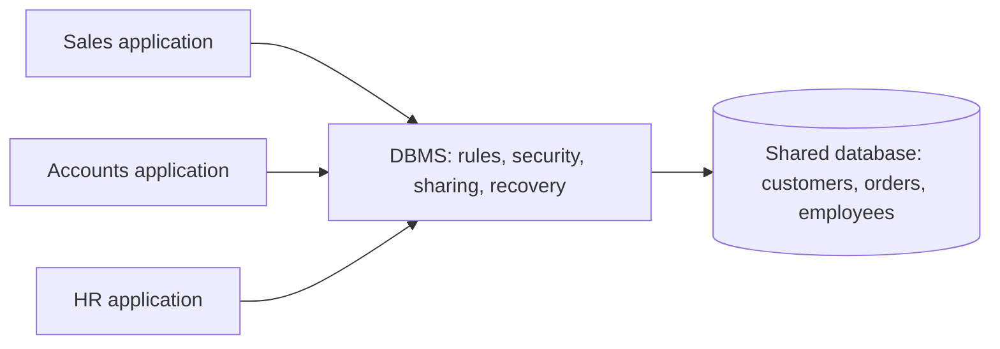
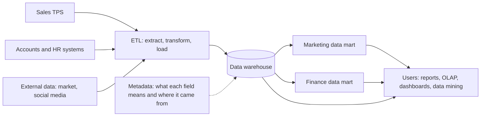
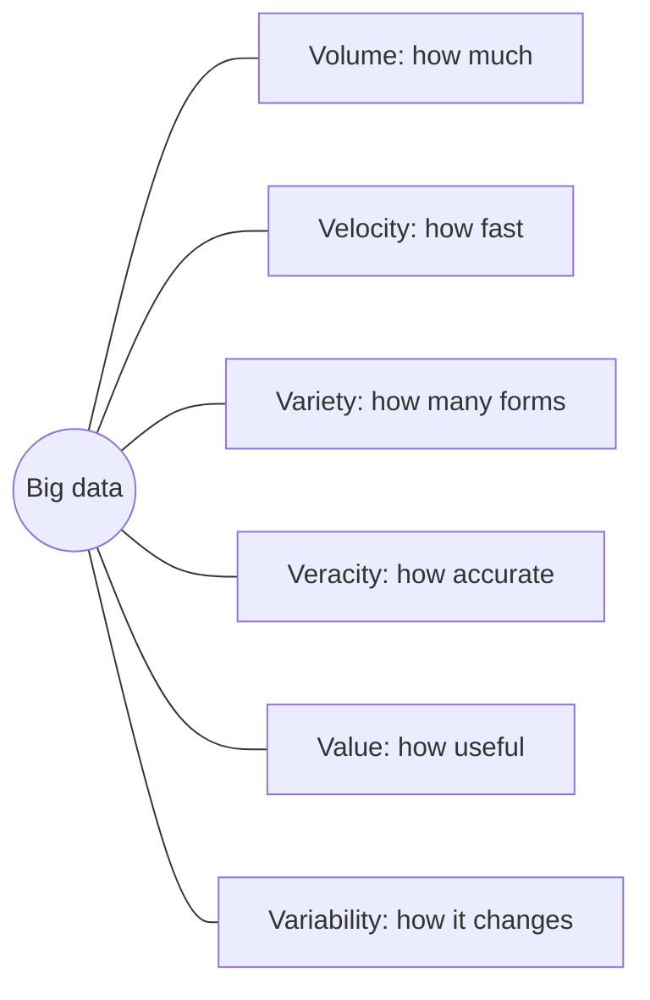
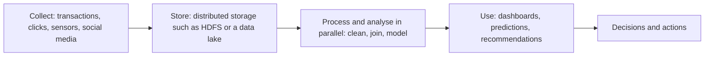

This note covers syllabus <Syl m="2" />, section 2.1: data management, the database approach, big data, data warehouses and data marts. Knowledge management and business intelligence (sections 2.2 to 2.4) have their own notes.

## The basics first

- **Data** are raw facts with no meaning attached yet, for example `45000`, `Virar`, `12-03-2025`.
- **Information** is data organized so it means something to a person: "Customer Riya from Virar bought goods worth ₹45,000 on 12 March".
- **Knowledge** is information plus experience that helps you act: "Customers from Virar buy more in March, so stock up in February".
- Data are stored in a **hierarchy**: a bit (0 or 1), a byte (one character), a **field** (one item such as a name), a **record** (all fields about one thing, such as one customer), a **file** or **table** (many records of one kind), and a **database** (a group of related tables).
- An **operational** (day-to-day) system records transactions as they happen: a sale, a fee payment, a bank withdrawal. These are called **transaction processing systems (TPS)**.
- **Analysis** means looking back over lots of past data to find trends and make decisions.

Keep the last two in mind. Much of this topic is about the difference between "recording today's work" and "analysing years of history".

## Why data is hard to manage

Every organization runs on data, but data is difficult to manage because:

1. **The amount keeps growing.** New data arrives every second and old data must be kept.
2. **It is scattered.** Sales, accounts, HR and the website each keep their own copy, in different formats.
3. **It comes from many sources.** Internal systems, customers, suppliers, sensors, social media.
4. **It decays.** Addresses, phone numbers and prices change, so a correct record becomes wrong over time.
5. **It must be kept safe and legal.** Privacy laws decide who may see what.

**Data management** is the work of handling data across its whole life (collect, store, clean, protect, share, archive) so that the right people get accurate data when they need it. <Cite id="data-management-ibm-data-management" />

Analogy: a college library. Books (data) arrive daily, must be catalogued (organized), shelved in one place (stored), repaired or removed when damaged (cleaned), lent only to members (secured), and found quickly when a student asks (accessed). Data management is running that library for a company.

## The database approach

### The old way: separate files

Before databases, each department kept its own files with its own programs. This caused well-known problems: <Cite id="data-management-gfg-dbms-vs-files" />

| Problem | What it means | Example |
|---|---|---|
| Data redundancy | The same data stored many times | Student address kept by the office, library and hostel |
| Data inconsistency | Copies disagree after one is changed | Office has the new address, library still has the old one |
| Data isolation | Data locked in separate files and formats, hard to combine | A report needing fees and attendance needs a new program |
| Poor integrity | No automatic checks on values | Marks of 120 out of 100 get saved |
| Poor security and sharing | Hard to control who sees what or to share safely | Anyone with the file sees salaries |

### The new way: one shared database

<Box kind="definition">

**Database approach:** all related data is kept in one logically shared **database**, controlled by a **database management system (DBMS)**. Every application reads and writes through the DBMS instead of keeping private files.

</Box>

The DBMS sits between the users and the stored data. It stores each fact once (or keeps copies in step), checks the rules, controls who can see what, lets many users work at the same time, and recovers data after a crash. <Cite id="data-management-gfg-dbms-vs-files" />

**Advantages:** less redundancy, consistent data, easy sharing, integrity rules, central security, backup and recovery, and **data independence** (programs do not break when the storage details change).

**Disadvantages:** a DBMS costs money and needs skilled staff; it is more complex; and since everything is in one place, a failure or attack affects everyone unless there are backups.

Analogy: instead of every family member keeping their own phone book, the family keeps one shared contact list on the cloud. Change a number once and everyone sees it.

## Data governance and master data management

### Data governance

A database fixes the storage problem, but it does not decide **who owns a piece of data, what it means, how good it must be, or who may see it**. That is the job of data governance.

<Box kind="definition">

**Data governance:** an approach to managing information across the **entire organization**. It is the set of policies, standards, roles and processes that decide how data is created, stored, used, protected and retired. <Cite id="data-management-wiki-data-governance" />

</Box>

IBM describes it as the discipline of managing the quality, security and availability of an organization's data. <Cite id="data-management-ibm-data-governance" />

**Who does what (roles):** <Cite id="data-management-ibm-data-governance" /> <Cite id="data-management-wiki-data-governance" />

| Role | Job |
|---|---|
| Steering committee or chief data officer | Senior people who set the data strategy and settle disputes |
| Data owner | A business manager accountable for one area of data, for example the sales head for customer data |
| Data steward | Does the daily care of that data and translates business needs into technical rules |
| Data users | Staff who use data and must follow the rules |

**How governance is achieved, step by step** (this is the answer to "How is data governance achieved in MIS?"): <Cite id="data-management-ibm-data-governance" />

1. **Set goals and measures**, for example "fewer billing errors" or "pass the privacy audit".
2. **Assign roles**: owners and stewards for each data area, with a steering committee on top.
3. **Write policies and standards**: common definitions ("what counts as an active customer"), naming rules, formats, access rules, how long to keep data.
4. **Build a data catalog**: one place listing what data exists, what it means and where it lives.
5. **Manage master data and quality**: one golden record for key entities, with regular checks and cleaning.
6. **Control access and security**: give each role only the data it needs.
7. **Track lineage**: record where each data item came from and how it was changed, so errors can be traced.
8. **Monitor, audit and improve**: measure against the goals and update the rules.

**Why it matters:** better data quality, one version of the truth for decisions, lower risk of leaks or misuse, and compliance with laws such as GDPR. <Cite id="data-management-wiki-data-governance" />

Analogy: traffic rules for a city. Roads (the database) alone are not enough; you also need rules, signs, traffic police (stewards) and a transport department (steering committee) so that everyone moves safely.

### Master data management (MDM)

**Master data** is the core data about the main "things" a business deals with: customers, products, suppliers, employees, locations. It is shared by almost every system.

<Box kind="definition">

**Master data management (MDM):** the processes and tools that combine master data from all systems into one consistent, trusted version, often called the **golden record** or single source of truth. <Cite id="data-management-ibm-mdm" />

</Box>

How it works:

1. Collect the records for one entity (say, a customer) from every system: sales, billing, support, website.
2. Match records that are really the same person ("R. Sharma" and "Riya Sharma", same phone number).
3. Merge them into one golden record using agreed rules (for example, "billing has the latest address").
4. Send the golden record back to every system, and keep it updated.

Benefits: no duplicate mailings or wrong bills, consistent reports, easier compliance and easier merging of systems after an acquisition. <Cite id="data-management-ibm-mdm" /> <Cite id="data-management-gfg-mdm" />

<Box kind="exam">

**"Categorize the approach to managing information across an entire organization."** "An approach to managing information across the entire organization" is how data governance is described. So name **data governance** as the approach and categorize its parts: (1) **people** (steering committee, data owners, data stewards), (2) **policies and standards** (definitions, access, retention), (3) **processes and tools** (master data management, data quality checks, data catalog, lineage, security). You can also show how the approach grew: separate department files, then the database approach, then organization-wide governance with MDM.

</Box>

## Data quality

Bad data gives bad decisions ("garbage in, garbage out"). Data quality means data is fit for the job it is used for.

**Dimensions of data quality** (what "good" means): <Cite id="data-management-ibm-data-quality" /> <Cite id="data-management-wiki-data-quality" />

| Dimension | Question it asks | Bad example |
|---|---|---|
| Accuracy | Is the value correct? | Wrong date of birth |
| Completeness | Is anything missing? | Customer with no phone number |
| Consistency | Do systems agree? | Different addresses in sales and billing |
| Timeliness | Is it up to date and available when needed? | Last month's stock levels |
| Validity | Does it follow the format and range rules? | PIN code with 5 digits |
| Uniqueness | Is each thing recorded once? | The same customer entered twice |

**How an organization ensures data quality, step by step:** <Cite id="data-management-ibm-data-quality" />

1. **Set standards** under data governance: definitions and rules for each field.
2. **Validate at entry**: drop-down lists, format checks and mandatory fields stop errors at the source. This is the cheapest place to fix them.
3. **Profile the data**: scan tables to measure missing values, duplicates and odd values.
4. **Cleanse**: correct errors, fill gaps, remove duplicates (MDM helps here).
5. **Choose a source of truth** and cross-check other systems against it.
6. **Find the root cause** of repeated errors (a badly designed form, an untrained clerk) and fix the process, not just the record.
7. **Assign responsibility**: data owners and stewards answer for the quality of their data.
8. **Monitor continuously**: data-quality dashboards and regular audits.

<Box kind="pitfall">

Data quality is not a one-time cleaning job. Data decays (people move, prices change), so checks must run all the time. Also, "quality" depends on use: data good enough for a monthly report may be too old for fraud detection.

</Box>

## Data warehouses

### Why a warehouse is needed

Operational databases are built to record transactions quickly. If managers run heavy questions such as "sales by region for the last five years" on them, two problems appear: the queries slow down billing for real customers, and the data needed is spread over many systems in different formats. The answer is to copy the data into a separate store built only for analysis.

<Box kind="definition">

**Data warehouse:** a central store of current and historical data gathered from many sources, organized for analysis and decision making. Bill Inmon, who coined the term, described it as a **subject-oriented, integrated, time-variant and non-volatile** collection of data that supports management decisions. <Cite id="data-management-tp-dwh-overview" />

</Box>

### Characteristics

<Cite id="data-management-tp-dwh-overview" /> <Cite id="data-management-wiki-data-warehouse" />

1. **Subject-oriented:** organized around business subjects such as customer, product or sales, not around applications such as "billing program".
2. **Integrated:** data from different sources is converted to one format, with one set of names and codes (for example gender stored as M/F everywhere).
3. **Time-variant:** keeps history, often many years, and every record is linked to a time period, so trends can be seen.
4. **Non-volatile:** data is loaded and then read; it is not changed or deleted by daily work. New data is added on top of old data.
5. **Multidimensional and summarized:** data can be viewed along several dimensions (product × region × month), often as pre-computed totals, and analysed with **OLAP** (online analytical processing: slice, dice, drill down, roll up).

Analogy: a family photo album versus your phone camera. The phone (operational system) is busy taking new photos all day. Once a year you pick the best photos, label them by event and year (integrate), put them in the album (warehouse) and never edit them again (non-volatile). Then you can look back over twenty years (time-variant) by person or by festival (subject-oriented).

### How a data warehouse works (architecture)

The usual environment has source systems, an integration step, the warehouse store with metadata, and the users' tools. <Cite id="data-management-wiki-data-warehouse" />

Step by step:

1. **Source systems** produce data: TPS, ERP, CRM, spreadsheets and outside data.
2. **Extract:** copy the needed data out of each source, usually on a schedule (for example every night). <Cite id="data-management-ibm-etl" />
3. **Transform:** clean it (fix errors, remove duplicates), convert codes and units to one standard, and summarize where useful. This is where data quality is enforced. <Cite id="data-management-gfg-etl" />
4. **Load:** write the cleaned data into the warehouse. Some modern systems load first and transform inside the warehouse (ELT). <Cite id="data-management-wiki-data-warehouse" />
5. **Store with metadata:** the warehouse keeps the data plus **metadata**, "data about data" that tells users what each field means and where it came from.
6. **Deliver:** users query it through reports, OLAP, dashboards and data mining tools. TutorialsPoint groups these uses as information processing (queries and reports), analytical processing (OLAP) and data mining (finding hidden patterns). <Cite id="data-management-tp-dwh-overview" />

### Operational database versus data warehouse

<Cite id="data-management-tp-dwh-overview" /> <Cite id="data-management-wiki-data-warehouse" />

| Point | Operational database (OLTP) | Data warehouse (OLAP) |
|---|---|---|
| Purpose | Run daily business | Analyse and decide |
| Data | Current | Current plus years of history |
| Operations | Many short inserts, updates, deletes | Mostly read-only, large complex queries |
| Users | Many clerks and customers | Fewer managers and analysts |
| Records touched per query | A few | Thousands to millions |
| Design | Entity-relationship model, normalized | Star or snowflake schema, organized by subject |

### Advantages and disadvantages

**Advantages:** one integrated, consistent view of the business; history for trend analysis; fast analytical queries without slowing operations; better decisions; it is the base for business intelligence and data mining. <Cite id="data-management-ibm-data-warehouse" />

**Disadvantages:** expensive and slow to build; ETL design is complex; data is only as fresh as the last load; needs ongoing maintenance and skilled staff; poor source data still causes problems.

**Examples:** a retail chain studies sales per store per festival season; a bank analyses customer history to design loan offers; a college analyses results of many batches to find weak subjects.

## Data marts

<Box kind="definition">

**Data mart:** a small data warehouse focused on one subject, department or business line, such as marketing or finance. It holds only the data that group needs. <Cite id="data-management-ibm-data-mart" /> <Cite id="data-management-wiki-data-mart" />

</Box>

**Why build one:** a whole warehouse is large and costly, and a department usually needs only a slice of it. TutorialsPoint gives four valid reasons: to control access to data, to speed up queries by reducing the amount of data scanned, to place data on different hardware, and to shape the data for a particular user tool. It also warns that data marts are costly to run, so they should not be created for any other reason. <Cite id="data-management-tp-data-marting" />

**Types:** <Cite id="data-management-ibm-data-mart" />

1. **Dependent data mart:** built from the enterprise data warehouse (top-down). Consistent with the rest of the company.
2. **Independent data mart:** built directly from source systems, without a central warehouse. Quick and cheap, but different marts may disagree.
3. **Hybrid data mart:** takes data both from the warehouse and from other sources.

Analogy: the warehouse is the central kitchen of a hotel chain; each data mart is the counter of one restaurant, stocked only with what that restaurant serves. A dependent mart gets everything from the central kitchen; an independent mart buys straight from the market.

**Advantages:** cheaper and faster to build (weeks, not years), simpler for users, faster queries, easier to maintain. **Disadvantages:** narrow view; many independent marts lead to "data islands" and inconsistent numbers, which is the very problem warehouses were built to solve.

### Data warehouse versus data mart

<Cite id="data-management-gfg-dw-vs-dm" /> <Cite id="data-management-ibm-data-mart" />

| Point | Data warehouse | Data mart |
|---|---|---|
| Scope | Whole organization, many subjects | One department or subject |
| Size | Large (often terabytes or more) | Smaller |
| Sources | Many source systems | Few sources or the warehouse itself |
| Time and cost to build | Long and high | Short and low |
| Users | Many groups across the company | One group, for example marketing |
| Design approach | Usually top-down | Often bottom-up |
| Control | Central IT | Often the department |

Two famous design approaches link the two: **Inmon** builds the central, normalized warehouse first and then dependent marts from it (top-down); **Kimball** builds dimensional (star-schema) marts for business processes that together form the warehouse (bottom-up). <Cite id="data-management-wiki-data-warehouse" />

A related newer idea is the **data lake**: a store that keeps huge amounts of raw data in its original form (including unstructured data) cheaply, to be processed later. A warehouse or mart holds cleaned, structured data ready for analysis. <Cite id="data-management-ibm-data-lake" />

## Big data

### What it is

<Box kind="definition">

**Big data:** data sets so large, fast-arriving or varied that traditional databases and software cannot capture, store and analyse them in reasonable time. <Cite id="data-management-wiki-big-data" /> NIST notes that data growth is outpacing ordinary analytics and that new scalable architectures are needed to handle its volume, velocity and variety. <Cite id="data-management-nist-bigdata-defs" />

</Box>

Analogy: a school canteen can serve 200 students with one counter. Feeding a stadium of 50,000 people in the half-time break needs a different system altogether: many counters working in parallel, a supply chain for many kinds of food, and checks on freshness. Big data tools are that stadium system.

### Characteristics: the V's

The first three V's were described by analyst Doug Laney in the early 2000s; later writers added more. <Cite id="data-management-sas-big-data" /> <Cite id="data-management-gfg-6vs" /> <Cite id="data-management-wiki-big-data" />

| V | Meaning | Example |
|---|---|---|
| Volume | Huge amount of data, terabytes to petabytes | Years of every transaction of a supermarket chain |
| Velocity | Data arrives very fast and often must be handled in near real time | Card payments checked for fraud as they happen |
| Variety | Many forms: structured (tables), semi-structured (JSON, XML), unstructured (text, images, video) | Reviews, photos, sensor readings and sales rows together |
| Veracity | How accurate and trustworthy the data is | Fake reviews, duplicate or outdated records |
| Value | The useful insight the data can give | Better product recommendations |
| Variability | Meaning or flow changes over time and context | Traffic spike during a sale; a word whose meaning changes |

<Cite id="data-management-gfg-6vs" loc="diagram" />

<Box kind="exam">

Write the 3 V's (volume, velocity, variety) first, then add veracity and value (5 V's) and variability (6 V's). Give one example for each. Different books count 3, 5 or more V's; all are accepted if you explain them.

</Box>

### Where big data comes from (examples of its generation)

<Cite id="data-management-wiki-big-data" /> <Cite id="data-management-gfg-big-data" />

1. **Retail transactions:** Walmart handles more than 1 million customer transactions an hour, according to figures quoted on Wikipedia.
2. **Social media:** Facebook handles tens of billions of user photos, according to Wikipedia. Every like, share and comment is data.
3. **Science and sensors:** the Large Hadron Collider at CERN has about 150 million sensors producing data during experiments.
4. **Others:** e-commerce clickstreams (what users view and click on Amazon or Flipkart), food-delivery orders and rider locations (Zomato), mobile phone and GPS location data, smart meters and Internet-of-Things devices, bank and stock-market transactions, hospital records and scans.

### Challenges of big data

<Cite id="data-management-wiki-big-data" /> <Cite id="data-management-aws-big-data" />

1. **Storage:** volumes grow faster than ordinary databases can scale.
2. **Processing speed:** analysing data as it arrives (velocity) needs new tools.
3. **Integration of variety:** combining tables, text, images and logs is hard.
4. **Quality (veracity):** untrusted sources and dirty or changing data give wrong results.
5. **Privacy and security:** much of the data is personal or sensitive.
6. **Skills shortage:** data scientists and engineers are scarce.
7. **Cost and value:** spending on storage is wasted if no useful insight is found.
8. Other technical tasks such as search, sharing, transfer, visualization and querying at this scale.

### How big data is handled

Big data systems split the data and the work across many ordinary computers (a cluster) that work in parallel. The best-known open-source framework is **Apache Hadoop**, which offers distributed storage (HDFS, the Hadoop Distributed File System) and distributed processing across clusters of computers. <Cite id="data-management-hadoop" /> <Cite id="data-management-hdfs-design" /> <Cite id="data-management-tp-hadoop-bigdata" />

These four stages (collect, store, process and analyse, consume and visualize) follow the flow AWS describes. <Cite id="data-management-aws-big-data" />

### Using big data for competitive advantage

A company gains an edge when it can see and act on something its rivals cannot. Big data helps in these ways: <Cite id="data-management-sas-big-data" /> <Cite id="data-management-aws-big-data" /> <Cite id="data-management-ibm-big-data" />

1. **Know customers better (micro-segmentation):** group customers into very small segments and personalize offers, as Amazon and Flipkart do with "customers who bought this also bought".
2. **Predict events (predictive analytics):** forecast demand, spot machines likely to fail (preventive maintenance) and detect fraud early.
3. **Improve operations and cut cost:** optimize stock, routes and staffing; reduce waste in manufacturing.
4. **Faster decisions:** near real-time dashboards let managers react within hours, not months.
5. **Run experiments:** test two versions of a web page or price and keep the winner.
6. **Create new products and business models:** for example, usage-based insurance priced from driving data, or selling insights from data.
7. **Manage risk and compliance:** banks reduce risk and fraud while meeting regulations.

Industry examples: retail (personalized marketing, winning back lost customers), manufacturing (better quality, less waste), banking (fraud and risk), healthcare (better patient care from hidden patterns). <Cite id="data-management-sas-big-data" />

<Box kind="pitfall">

Big data gives an advantage only when it is turned into action. Huge stores of untrusted data with no clear question waste money. Mention data quality, governance and privacy as conditions for success.

</Box>

### Traditional data versus big data

<Cite id="data-management-gfg-big-data" /> <Cite id="data-management-av-big-data" />

| Point | Traditional data (database or warehouse) | Big data |
|---|---|---|
| Size | Gigabytes to terabytes | Terabytes to petabytes and more |
| Type | Mostly structured tables | Structured, semi-structured and unstructured |
| Speed | Batch updates | Often streaming, near real time |
| Storage | One central server | Distributed over a cluster |
| Tools | SQL DBMS, ETL | Hadoop-style frameworks, NoSQL, data lakes |
| Schema | Defined before loading | Often applied when reading |

## Where this was asked

| Question | Marks | What to write |
|---|---|---|
| <PYQ id="2022-12-ce/q1b" /> | 5 | Define data governance; roles (committee, owner, steward); steps: policies, catalog, MDM, quality, access, lineage, audit |
| <PYQ id="2023-05-ce/q1e" /> | 5 | Name data governance as the approach; categorize into people, policies, processes and tools (MDM, quality, security); mention file to database to governance |
| <PYQ id="2024-12-ce/q1e" /> | 5 | Same as above |
| <PYQ id="2022-12-ce/q3b" /> | 10 | Define warehouse (4 Inmon traits) and mart (types); diagram; comparison table; two big data sources such as social media and retail transactions |
| <PYQ id="2023-05-ce/q6b" /> | 10 | Same as above |
| <PYQ id="2022-12-ce/q6a" /> | 10 | Define big data; table of V's with examples; list of challenges; one-line conclusion |
| <PYQ id="2023-05-ce/q4a" /> | 10 | Same as above |
| <PYQ id="2023-12-ce/q2b" /> | 10 | Why needed; characteristics; ETL architecture diagram; data mart types; warehouse vs mart table; benefits |
| <PYQ id="2024-12-ce/q2b" /> | 10 | Definition; four characteristics; architecture diagram with ETL and metadata; OLTP vs warehouse table; pros and cons; example |
| <PYQ id="2024-05-ce/q6b" /> | 10 | Quality dimensions table; steps: standards, entry validation, profiling, cleansing, MDM, stewards, monitoring |
| <PYQ id="2024-12-ce/q3b" /> | 10 | Short definition and V's; ways to win: customer segmentation, prediction, cost cutting, experiments, new products; industry examples; conditions for success |

## Quick revision

- Data is raw facts; information is organized data; knowledge is information plus experience.
- File-based systems cause redundancy, inconsistency and isolation; the database approach with a DBMS fixes them.
- Data governance is the organization-wide approach to managing information: people (owners, stewards), policies and processes.
- Master data management keeps one golden record for customers, products and suppliers.
- Data quality dimensions: accuracy, completeness, consistency, timeliness, validity, uniqueness. Ensure them with standards, validation, profiling, cleansing and monitoring.
- Data warehouse: subject-oriented, integrated, time-variant, non-volatile; filled by ETL; used with OLAP and data mining.
- Data mart: a department-sized warehouse; dependent, independent or hybrid.
- Inmon is top-down (warehouse first), Kimball is bottom-up (marts first).
- Big data: volume, velocity, variety, plus veracity, value and variability.
- Big data challenges: storage, speed, variety, quality, privacy, skills, cost.
- Hadoop stores and processes big data across clusters of ordinary computers.
- Competitive advantage comes from acting on insights: segmentation, prediction, efficiency, experiments, new business models.
