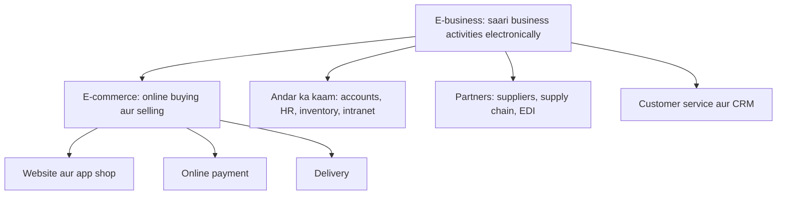
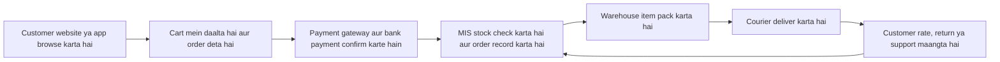
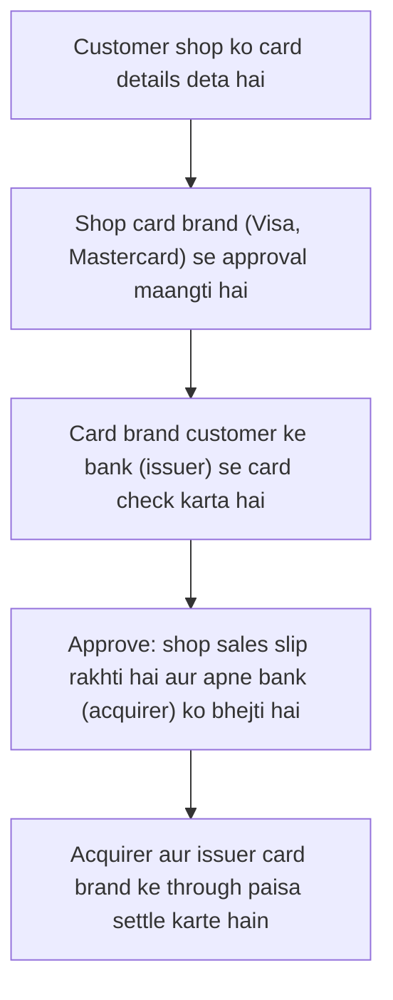
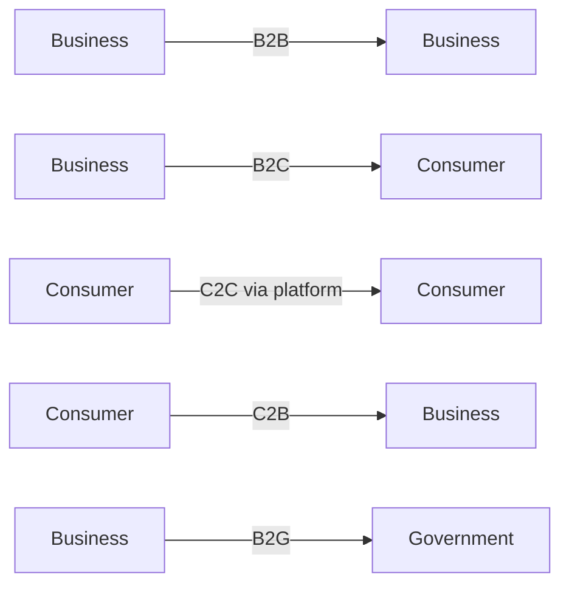
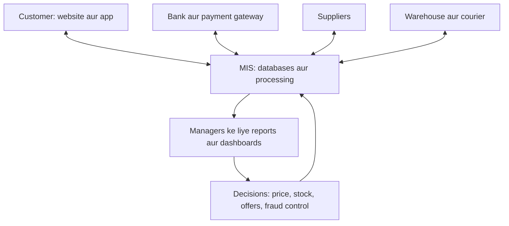
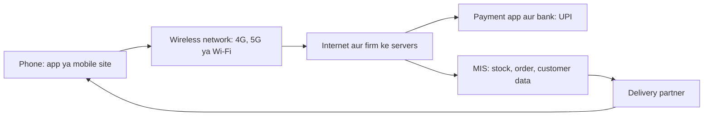
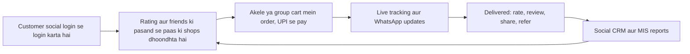

Naye ideas se pehle wo purane ideas jo tumhe chahiye. Agar pata hai to seedha agle section pe jao.

## Basics pehle

- **Transaction** ek business exchange hai: customer order karta hai, firm deliver karti hai, customer pay karta hai.
- **Website** wo jagah hai jahan firm apne products online dikhati hai. **Mobile app** phone mein install hone wala program hai jo wahi kaam phone-friendly tareeke se karta hai.
- **Payment gateway** wo service hai jo tumhare card ya UPI ki details shop se bank tak safely pahunchati hai aur "paid" ya "failed" wapas deti hai. Examples: Razorpay, PayU, Paytm. <Cite id="e-commerce-tp-payment" />
- **Supply chain** poora raasta hai: raw material se maker, warehouse, shop aur phir customer tak. <Cite id="e-commerce-wiki-scm" />
- **MIS** (Management Information System) firm ka data collect karta hai, process karta hai aur managers ko decide aur control karne ke liye reports deta hai. Is note mein MIS website ke peeche ka system hai. <Cite id="e-commerce-rainer-intro-is" />
- **Wireless** matlab bina cable ke connection (Wi-Fi, 4G, 5G). Ye m-commerce ki base hai aur networks note mein cover hai.

## E-business aur e-commerce

<Box kind="definition">

**E-commerce** (electronic commerce) internet ya dusre electronic networks pe goods, services ya information ki buying aur selling hai. **E-business** (electronic business) internet aur IT ka use hai business ki *saari* activities chalane ke liye: selling, buying, customers ko serve karna, partners ke saath kaam aur andar ka kaam. <Cite id="e-commerce-wiki-ecommerce" /> <Cite id="e-commerce-wiki-ebusiness" /> <Cite id="e-commerce-rainer-intro-is" />

</Box>

Ye syllabus <Syl m="4" />, section 4.4 (e-business aur e-commerce, B2B aur B2C) aur 4.5 (mobile commerce) hai.

**Ye kyun zaroori hai (kaunsi problem solve hoti hai).** Gali ki dukaan sirf kuch ghante khuli rehti hai, sirf wahi log aa sakte hain jo chal ke aa sakein, aur stock limited hota hai. Online business ye limits hata deta hai: 24 ghante khula, poore desh tak pahunch, bahut bada range, aur building aur middlemen ka kharcha kam. <Cite id="e-commerce-ibm" />

**Roz ka example.** E-commerce dukaan ka counter hai, jo ab screen pe baitha hai. E-business poori dukaan hai: counter, godown, accounts ki copy, staff ka register aur supplier ke phone calls, sab computer pe.

| Point | E-commerce | E-business |
|---|---|---|
| Matlab | Internet pe buying aur selling | Har business activity internet aur IT se chalana |
| Scope | Chhota: sirf transaction | Bada: transactions plus andar aur partners ka kaam |
| Relation | E-business ka hissa | Poora, jisme e-commerce shamil hai |
| Focus | Customer aur sale | Customer, employees, suppliers aur partners |
| Paisa involved | Hamesha (sale hoti hai) | Hamesha nahi (jaise supplier ke saath stock data share karna) |
| Network | Mostly internet | Internet, intranet aur extranet |
| Example | Flipkart pe shoes kharidna | Flipkart ka warehouses, supplier portal, HR aur accounts online chalana |

<Cite id="e-commerce-gfg-ecom-vs-ebiz" /> <Cite id="e-commerce-wiki-ebusiness" />

### E-business pe note

E-business pe exam-ready note mein ye points aate hain. <PYQ id="2023-12-ce/q4b" />

1. **Definition** upar ki tarah.
2. **E-business ke parts.**
   - *E-commerce:* online selling aur buying.
   - *E-procurement:* raw material aur supplies suppliers se online kharidna.
   - *E-supply chain:* partners ke saath stock aur order data share karna, aksar EDI se. EDI matlab standard business documents (purchase order, invoice) ka computer-to-computer exchange. <Cite id="e-commerce-wiki-edi" />
   - *E-CRM:* customers ko online serve karna aur rakhna (chat, email, social media).
   - *Internal systems:* ERP, intranet, online HR aur payroll, e-learning.
3. **Kaunse networks use hote hain.** Internet (sab ke liye), **intranet** (firm ke andar ka private network) aur **extranet** (chune hue partners ke saath shared private network).
4. **Benefits.** Kam cost, tez kaam, kam paper, 24 ghante service, bada reach, suppliers ke saath behtar coordination, live data se tez decisions.
5. **Limits.** Technology ka cost, security threats, staff training, network pe dependence, legal aur tax rules, aur wo customers jo internet use nahi kar sakte ya nahi karna chahte.
6. **Example.** *Infosys* aur *TCS* apna zyadatar andar ka kaam (projects, HR, billing) electronic systems pe chalate hain, *Walmart* suppliers ke saath sales data share karta hai taaki wo time pe restock karein, aur *Amazon* selling, warehousing, payments aur customer service ko ek connected e-business ki tarah chalata hai.
7. **Conclusion.** E-business sirf website nahi hai; ye poori firm ko digital tareeke se chalane ka tareeka hai. <Cite id="e-commerce-wiki-ebusiness" /> <Cite id="e-commerce-laudon-mis" />

## E-commerce: ye kaise kaam karta hai

<Box kind="definition">

**E-commerce transaction** ka ek fixed flow hota hai: customer product dhoondhta hai, order deta hai, pay karta hai, firm stock check karti hai, pack karke bhejti hai, customer receive karta hai aur return ya support maang sakta hai. <Cite id="e-commerce-tp-overview" />

</Box>

**Simple words mein steps**

1. Customer catalogue search ya browse karta hai aur reviews padhta hai.
2. Customer items cart mein daalta hai aur address deta hai.
3. Customer UPI, card, net banking, wallet ya cash on delivery (COD) se pay karta hai.
4. System payment confirm karta hai aur stock count kam karta hai.
5. Warehouse item uthata hai, pack karta hai aur parcel delivery partner ko deta hai.
6. Customer ko parcel milta hai; system order ko delivered mark karta hai.
7. After-sales: returns, refunds, reviews aur support. Data MIS mein wapas jaata hai agle decision ke liye.

**Payment methods.** Credit aur debit cards, net banking, UPI, wallets, buy-now-pay-later aur cash on delivery. India mein UPI (Unified Payments Interface, NPCI chalata hai) se log phone se ek bank account se dusre mein turant paisa bhej sakte hain, jisse chhoti dukaanein aur apps online aa gayi. <Cite id="e-commerce-tp-payment" /> <Cite id="e-commerce-wiki-upi" />

<Cite id="e-commerce-tp-payment" loc="diagram" />

**Last mile.** Delivery ka aakhri step, local hub se customer ke darwaze tak, chain ka sabse mehnga aur mushkil hissa hai. <Cite id="e-commerce-wiki-last-mile" />

### E-commerce pe note likho

10 marks ke "Write note on e-commerce" ke liye ye order use karo. <PYQ id="2023-05-ce/q2b" /> <PYQ id="2024-12-ce/q6b" />

1. **Definition** (upar), aur e-business se difference ki ek line.
2. **Need ya growth ke reasons:** bada reach, 24 ghante service, kam cost, zyada choice, price comparison, aasaan payment (UPI), sasta smartphone aur data.
3. **Process diagram** (upar ka flow) aur steps.
4. **Types ya models:** B2B, B2C, C2C, C2B, B2G (agla section).
5. **Advantages aur disadvantages** (neeche table).
6. **Applications aur examples:** shopping (Amazon, Flipkart), food delivery (Zomato, Swiggy), travel (MakeMyTrip, IRCTC), banking (SBI YONO), tickets (BookMyShow), education (online courses).
7. **Conclusion.** E-commerce ne logon ke kharidne aur firms ke bechne ka tareeka badal diya, aur ye tabhi chalta hai jab information system, payments aur delivery teeno reliable hon.

| Advantages | Disadvantages |
|---|---|
| 24 ghante khula, internet wali har jagah pahunch | Product chhu ke ya try karke nahi dekh sakte, isliye returns zyada |
| Bada choice aur aasaan price comparison | Security risks: fraud, stolen cards, fake sites, phishing |
| Seller ka cost kam (shop rent nahi, kam staff) | Delivery mein delay ya damage; mehnga last mile |
| Customer data se personal offers aur behtar stock planning | Jo data collect hota hai uski privacy ki chinta |
| Tez payment aur har order ka record | Internet aur device chahiye; jinke paas nahi unhe chhod deta hai |
| Chhote sellers marketplaces se poore desh ke buyers tak pahunchte hain | Tough competition, heavy discounts aur platform fees |
| Tez service aur jahan promise ho wahan aasaan returns | Sale ke din technical failure se saari sales ruk sakti hain |

<Cite id="e-commerce-gfg-intro" /> <Cite id="e-commerce-ibm" /> <Cite id="e-commerce-wiki-ecommerce" />

## E-commerce ke models (B2B, B2C aur baaki)

Model is se decide hota hai ki *kaun kisko bechta hai*. <Cite id="e-commerce-tp-models" /> <Cite id="e-commerce-gfg-types" />

| Model | Seller se buyer | Example |
|---|---|---|
| **B2B** (business to business) | Ek business dusre business ko bechta hai | Infosys ka bank ko software services dena, steel maker ka car company ko bechna, Amazon Business, IndiaMART |
| **B2C** (business to consumer) | Business individual customers ko bechta hai | Amazon, Flipkart, Myntra, Zomato, BookMyShow |
| **C2C** (consumer to consumer) | Ek insaan platform ke through dusre ko bechta hai | OLX, eBay, Facebook Marketplace |
| **C2B** (consumer to business) | Individual business ko service ya product deta hai | Upwork pe freelancer, stock site ko photos bechne wala photographer, brand se paise lene wala YouTuber |
| **B2G** (business to government) | Business government body ko bechta hai | GeM portal pe tender jeetne wali firm |
| **G2C** (government to citizen) | Government citizens ko online serve karti hai | Income tax filing, IRCTC booking, passport services |

<Cite id="e-commerce-wiki-b2b" /> <Cite id="e-commerce-wiki-c2c" /> <Cite id="e-commerce-tp-b2b" /> <Cite id="e-commerce-tp-b2c" />

### B2B aur B2C ki tulna

| Point | B2B | B2C |
|---|---|---|
| Buyer | Dusra business | Individual customer |
| Buyers ki sankhya | Kam, long-term | Bahut zyada |
| Order size aur value | Bada, bulk | Chhota, single items |
| Buying decision | Dhyan se, kai log, need, price aur contract pe based | Tez, aksar emotional, price, reviews aur offers pe based |
| Price | Negotiate hota hai, contract ya volume rate | Fixed list price, discounts |
| Relationship | Long-term, personal | Short-term, mass market |
| Payment | Credit terms, invoices, bank transfer | Card, UPI, wallet, COD |
| Marketing | Direct sales, trade portals, demos | Ads, social media, offers |
| Systems | EDI, ERP links, supplier portals, e-procurement | Website, app, cart, payment gateway, recommendation engine |
| Example | Walmart ka supplier se kharidna; Indian firm ka AWS se cloud kharidna | Customer ka Flipkart se phone kharidna |

<Cite id="e-commerce-tp-b2b" /> <Cite id="e-commerce-tp-b2c" /> <Cite id="e-commerce-gfg-types" />

**B2B types.** *Supplier-oriented* (ek supplier kai buyers ko bechta hai), *buyer-oriented* (ek bada buyer kai suppliers se bid maangta hai, jaise bade retailer ka procurement portal) aur *intermediary* marketplaces (teesri party dono taraf ko milati hai, jaise IndiaMART). <Cite id="e-commerce-wiki-marketplace" />

**B2C types.** Direct sellers (brand ki apni site), online marketplaces (Amazon, Flipkart), service providers (online banking, travel), content providers (Netflix, news) aur community ya social sites jo bechti hain. <Cite id="e-commerce-tp-b2c" />

## MIS e-commerce ko kaise support karta hai

<Box kind="definition">

MIS e-commerce ko support karta hai wo **data collect, store, process aur report karke** jis pe online business chalta hai, aur front end (website ya app) ko back end (stock, accounts, delivery, customer service) se jodke. <Cite id="e-commerce-rainer-intro-is" /> <Cite id="e-commerce-laudon-mis" />

</Box>

Sawaal support aur ek case maangta hai. <PYQ id="2024-05-ce/q1e" /> Table likho aur phir neeche ka case.

| Business need | MIS kya karta hai |
|---|---|
| Catalogue dikhana | Product database: price, photos, stock count aur reviews |
| Orders lena | Order processing system order record karta hai, stock check karta hai, order number deta hai |
| Payment lena | Payment gateway se link, paid ya failed record, duplicate payment rokta hai |
| Stock manage karna | Inventory system har warehouse ka har item track karta hai, stock kam ho to warning |
| Deliver karna | Logistics system sabse paas ka warehouse aur courier chunta hai, tracking deta hai |
| Customer ko jaanna | Customer database aur CRM history track karte hain, personal offers aur recommendations bhejte hain |
| Suppliers manage karna | Supply chain system purchase orders (EDI) bhejta hai aur demand predict karta hai |
| Control aur decide | Reports aur dashboards: din ke hisaab se sales, best products, returns, delivery time, fraud alerts |
| Safe rakhna | Access control, logs, fraud checks aur backups |

<Cite id="e-commerce-laudon-mis" /> <Cite id="e-commerce-wiki-scm" />

**Case: Flipkart jaisi online shop.**

1. Customer phone search karta hai. Product database models, price aur live stock dikhata hai, aur recommendation system accessories suggest karta hai, jo milte-julte customers ne kharidi.
2. Customer order karta hai aur UPI se pay karta hai. Transaction processing system order record karta hai aur payment gateway confirm karta hai.
3. Inventory system stock kam karta hai aur sabse paas ka warehouse chunta hai. Agar stock set level se neeche jaaye to supplier ko purchase order raise karta hai.
4. Logistics system courier assign karta hai aur SMS aur app se tracking updates bhejta hai.
5. Delivery ke baad customer product rate karta hai. Reports manager ko batate hain kaunse products zyada bikte hain, kaunse sellers ke returns zyada hain aur deliveries kahan late hain, taaki manager action le sake.

*Result:* tez delivery, kam stock-outs, kam errors aur behtar decisions. Amazon yahi idea bade scale pe use karta hai, automated warehouses aur data-driven recommendations ke saath. <Cite id="e-commerce-ibm" /> <Cite id="e-commerce-laudon-mis" />

### B2B aur B2C ke examples aur MIS unhe kaise control karta hai

<PYQ id="2025-05-ce/q5b" />

**B2C example: Flipkart ya Amazon individuals ko bechte hain.** *MIS ka contribution:*

- Customer aur order database, har order track karne ke liye.
- Recommendation engine aur personal offers, sales badhane ke liye.
- Fraud detection (ajeeb orders, kai failed payments).
- Return aur refund tracking.
- Dashboards: daily sales, cart abandonment (log cart mein daalte hain par kharidte nahi), delivery time, customer ratings.

**B2B example: car maker jo kai suppliers se parts kharidta hai, ya Walmart aur uske suppliers.** *MIS ka contribution:*

- E-procurement portal: requests, bids aur orders ke liye.
- EDI, jisse purchase orders, invoices aur shipping notices bina paper ke exchange hote hain. <Cite id="e-commerce-wiki-edi" />
- Real-time stock sharing, taaki suppliers automatically restock karein.
- Contract, price aur credit-limit records.
- Supplier performance reports (quality, delay, price), achhe suppliers chunne aur rakhne ke liye.

**MIS ke through control.** MIS managers ko targets set karne deta hai (sales, delivery time, return rate), actual figures ko target se compare karne deta hai aur gap theek karne deta hai: *plan, measure, compare, act*. Alerts, exception reports aur audit logs dono models mein cost, quality aur fraud control karne mein madad karte hain.

| Point | B2C control | B2B control |
|---|---|---|
| Main sawaal | Kya customers kharid rahe hain aur khush hain? | Kya suppliers aur buyers contract pe deliver kar rahe hain? |
| Key reports | Sales, abandoned carts, returns, ratings | Contract ke against orders, supplier delay, credit use |
| Kaunsa risk dekhte hain | Payment fraud, fake reviews | Late supply, price disputes, data leak |

## Business value, risks aur good practice

**Disintermediation aur naye middlemen.** E-commerce se maker seedha customer ko bech sakta hai (*disintermediation*: wholesaler aur retailer ko hata dena), jaise airline ka apni site pe tickets bechna. Saath hi marketplaces aur payment gateways jaise naye middlemen bante hain (*reintermediation*). <Cite id="e-commerce-wiki-disintermediation" /> <Cite id="e-commerce-wiki-marketplace" />

**Risks aur unhe kaise kam karein**

| Risk | Control |
|---|---|
| Card fraud aur stolen data | HTTPS (encrypted connection), OTP aur two-step login, tokenised cards |
| Fake websites aur phishing | User awareness, verified payment pages, domain checks |
| Fake reviews | Sirf verified buyers ko review dene do |
| Sale ke din website down | Cloud hosting jo scale kare, load testing, backups |
| Galat ya late delivery | Tracking, achhe courier partners, return policy |
| Privacy | Consent lo, sirf zaroori data lo, data-protection law follow karo |

## Mobile commerce (m-commerce)

<Box kind="definition">

**Mobile commerce (m-commerce)** wireless handheld devices, jaise smartphones aur tablets, pe buying, selling aur paying hai, apps, mobile websites, SMS ya QR codes ke through. Ye e-commerce hai jo customer ke saath chalta hai. <Cite id="e-commerce-wiki-mcommerce" /> <Cite id="e-commerce-rainer-intro-is" /> <Cite id="e-commerce-gfg-ecom-vs-mcom" />

</Box>

**Ye kyun zaroori hai.** India mein zyada log internet computer se nahi, phone se use karte hain. Phone personal hai, hamesha saath rehta hai aur hamari location jaanta hai, isliye business customer tak kahin bhi aur sahi waqt pe pahunch sakta hai. <Cite id="e-commerce-wiki-mcommerce" />

**Roz ka example.** E-commerce wo dukaan hai jahan tum computer ke saamne table pe baithke jaate ho. M-commerce wo dukaandaar hai jo tumhari jeb mein tumhare saath chalta hai.

**Main applications**

- **Mobile shopping:** Amazon, Flipkart, Myntra apps.
- **Mobile payments aur banking:** UPI apps (Google Pay, PhonePe, Paytm), SBI YONO, mobile wallets. <Cite id="e-commerce-wiki-mobile-payment" /> <Cite id="e-commerce-wiki-mobile-banking" />
- **Food aur grocery delivery:** Zomato, Swiggy, Blinkit aur Zepto (quick commerce, minutes mein delivery). <Cite id="e-commerce-wiki-qcommerce" />
- **Ticketing aur travel:** IRCTC, MakeMyTrip, BookMyShow, Ola aur Uber.
- **Location-based services:** paas ke offers, maps aur cab dhoondhna. <Cite id="e-commerce-wiki-lbs" />
- **Content aur entertainment:** music, video, games aur e-books phone pe kharidna ya stream karna.
- **Business tools:** field staff ka phone pe orders lena aur deliveries track karna.

### E-commerce versus m-commerce

| Point | E-commerce | M-commerce |
|---|---|---|
| Device | Computer, laptop (aur phone) | Smartphone, tablet, wearable |
| Network | Wired ya Wi-Fi, aksar fixed jagah | Wireless, chalte hue bhi use |
| Screen | Badi | Chhoti |
| Location | Mostly use nahi hoti | Use hoti hai (GPS offers, nearby search, delivery tracking) |
| Reach | Computer chahiye | Phone wale har kisi tak |
| Personalisation | Account aur history se | Account, history *aur* jagah aur time se |
| Payment | Card, net banking | UPI, wallet, tap-to-pay, QR code |
| Security risk | Phishing, malware | Wahi, plus lost phone, fake apps, public Wi-Fi |
| Example | Laptop pe flight book karna | Raste se Zomato pe khana order karna |

<Cite id="e-commerce-gfg-ecom-vs-mcom" /> <Cite id="e-commerce-wiki-mcommerce" />

### M-commerce ne kaunse naye challenges laye hain

<PYQ id="2022-12-ce/q2b" /> <PYQ id="2025-05-ce/q4b" />

1. **Chhoti screen aur kharab usability.** Products ke liye kam jagah, lambe forms bharna mushkil. *Solution:* simple design, kam steps, one-tap pay.
2. **Weak ya slow network.** Coverage aur speed jagah ke hisaab se badalti hai, isliye pages aur payments fail ho sakte hain. *Solution:* light apps, offline cart, safe retry.
3. **Security aur fraud.** Phone kho jaate hain ya infect ho jaate hain; fake apps aur public Wi-Fi data churate hain. *Solution:* app lock, OTP, biometric login, encryption, sirf official app stores. <Cite id="e-commerce-wiki-mobile-payment" />
4. **Privacy.** Location aur contacts bahut personal hain. *Solution:* permission maango, kam collect karo, use batao.
5. **Kai devices aur operating systems.** Android, iOS, kai screen sizes. *Solution:* responsive design aur kai devices pe testing.
6. **Payment trust aur failures.** Paisa kat gaya par payment fail, to customer naraz hota hai. *Solution:* reliable gateways, tez refund rules.
7. **Battery, memory aur data cost.** Heavy apps phone drain karte hain. *Solution:* lean apps.
8. **Delivery aur logistics.** Quick delivery ke promise se partners aur riders pe pressure padta hai. *Solution:* local hubs, route planning. <Cite id="e-commerce-wiki-last-mile" />
9. **Language aur digital skill.** Kai users ko local languages aur simple voice ya icon design chahiye.
10. **Law aur standards.** Data protection, payments aur consumer rights ke rules alag-alag hain aur badalte rehte hain; wireless standards uniform nahi hain.
11. **Tough competition aur app overload.** Users sirf kuch apps rakhte hain; firms offers pe bahut kharch karti hain.

**M-commerce ke advantages.** Kabhi bhi, kahin bhi use, personal aur location-aware offers, tez payment (UPI), push notifications, chhote shehron tak reach, aur aasaan sign-up.

**Disadvantages.** Upar ke challenges: security, chhoti screen, network pe dependence aur privacy ki chinta.

**Conclusion.** M-commerce e-commerce ko har jeb tak le jaata hai; jo firm chhoti screen pe security, speed aur simplicity solve karti hai, wahi jeetti hai.

## M-commerce mein social computing se delivery application ka plan

<PYQ id="2023-12-ce/q2a" />

Phases aur revenue ke saath poora plan social computing note mein hai. Yahan exam-ready core hai.

1. **Aim.** Ek app jo paas ki shops se khana ya grocery customers tak jaldi deliver kare, aur social features se trust aur repeat orders badhaye.
2. **Users.** Customers, shops ya restaurants, delivery partners aur admin.
3. **M-commerce features.** GPS location aur nearest-shop search, UPI payment, push notifications, live order tracking aur phone-friendly screen.
4. **Social computing features.** Social login, photos ke saath ratings aur reviews, referral codes, bill splitting ke saath group orders, dishes ko WhatsApp aur Instagram pe share karna, nayi cuisines ke liye polls, aur social CRM team jo complaints ka public mein jawab de. <Cite id="e-commerce-wiki-social-commerce" />
5. **Andar MIS.** Order, stock aur menu database, rider allocation, payment records, customer aur review data, aur delivery time, ratings aur repeat orders ke dashboards.
6. **Steps.** Market study, design, build, chhote group ke saath test, ek area mein launch, results track, phir grow.
7. **Revenue.** Commission, delivery fee, paid promotion aur subscription.
8. **Risks aur controls.** Fake reviews (sirf verified buyers), location ki privacy (consent), payment fraud (secure gateway), late delivery (fair rider allocation).

## WhatsApp aur Telegram ki tulna

<PYQ id="2023-05-ce/q1b" /> <PYQ id="2024-12-ce/q1b" />

Dono mobile messaging apps hain jinhe firms customers se baat karne ke liye use karti hain, isliye ye m-commerce ka hissa hain. Figures updates ke saath badalte hain, isliye answer mein "about" bolo. <Cite id="e-commerce-wiki-whatsapp" /> <Cite id="e-commerce-wiki-telegram" />

| Parameter | WhatsApp | Telegram |
|---|---|---|
| Owner | Meta | Telegram Messenger |
| Multimedia | Photos, videos, voice notes, documents, voice aur video calls, status | Wahi, plus channels, bots, polls, stickers aur large files |
| Security | Chats aur calls ke liye end-to-end encryption default on | Cloud chats device aur server ke beech encrypted; end-to-end sirf optional Secret Chats mein |
| Privacy | Phone number hi ID hai; privacy settings se control | Number chhupa sakte ho aur username use kar sakte ho |
| Storage | Chats phone pe; Google Drive ya iCloud pe optional backup | Chats Telegram ke cloud mein aur har device pe khulte hain |
| Data usage | Moderate; low-data call mode; auto-download controls | Moderate; detailed auto-download aur cache controls |
| Notifications | Per chat mute, custom tones | Per chat mute, custom tones, silent aur scheduled messages |
| Groups | Bade groups aur Communities | Bahut bade groups aur unlimited-member channels |
| Business use | WhatsApp Business app aur API, catalogues | Broadcast aur automation ke liye channels aur bots |

<Cite id="e-commerce-telegram-faq" /> <Cite id="e-commerce-whatsapp-security" />

**Conclusion.** WhatsApp customer chat ke liye simple private default hai; Telegram bade groups, channels, large files aur bots ke liye strong hai, par uski normal chats end-to-end encrypted nahi hain. Social computing note mein ye table zyada sources ke saath dobara hai.

## Quick revision aur exam guide

<Box kind="exam">

- "Write note on e-commerce": definition, need, flow diagram, models, advantages-disadvantages table, examples, conclusion. <PYQ id="2023-05-ce/q2b" /> <PYQ id="2024-12-ce/q6b" />
- "Write note on e-business": definition, parts (e-commerce, e-procurement, e-supply chain, e-CRM, internal systems), networks, benefits, limits, example. <PYQ id="2023-12-ce/q4b" />
- "How is e-commerce supported by MIS, with a case": MIS table plus order flow case. <PYQ id="2024-05-ce/q1e" />
- "B2B and B2C examples and MIS contribution": do examples, B2B versus B2C table, MIS har ek ko kaise control karta hai. <PYQ id="2025-05-ce/q5b" />
- "Mobile commerce" aur "new challenges": definition, applications, e-commerce versus m-commerce table, 6 se 8 challenges har ek ke solution ke saath. <PYQ id="2025-05-ce/q4b" /> <PYQ id="2022-12-ce/q2b" />
- "Delivery application in m-commerce using social computing": features, MIS, steps, revenue, risks, diagram. <PYQ id="2023-12-ce/q2a" />
- "WhatsApp versus Telegram": multimedia, security, privacy, storage, data usage aur notifications pe table. <PYQ id="2023-05-ce/q1b" /> <PYQ id="2024-12-ce/q1b" />

</Box>

<Box kind="pitfall">

Ye mat likho ki "e-commerce aur e-business same hain". E-business bada hai. Har online sale ko B2C mat bolo: do firms ke beech bulk order B2B hai. Real company example mat bhoolo, kyunki example ke bina MIS answers mein marks kat jaate hain.

</Box>
