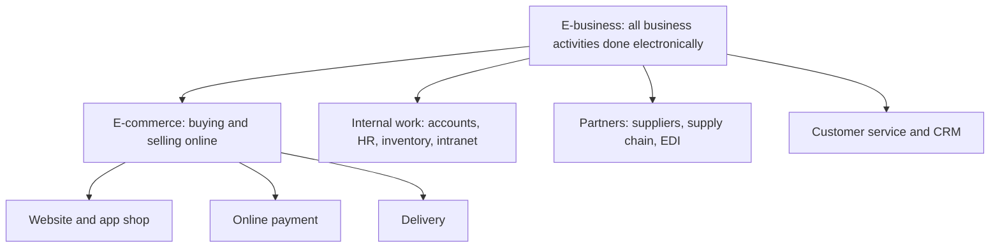
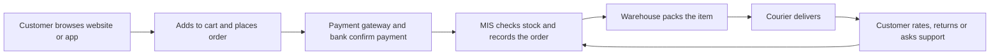
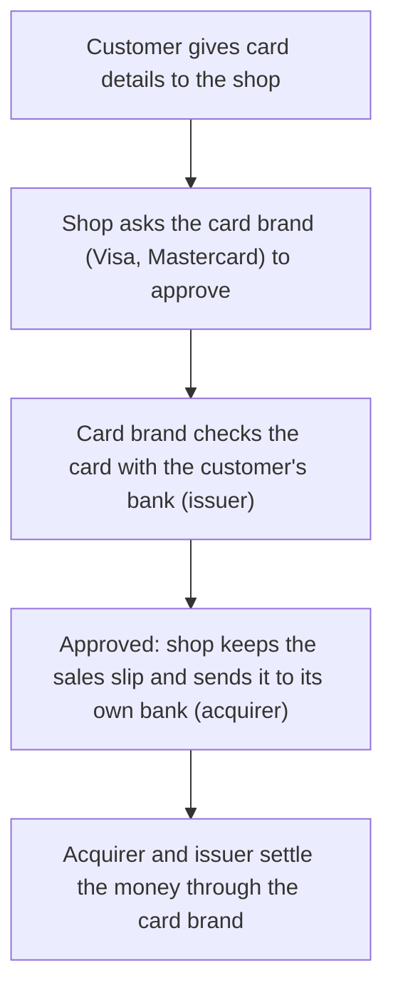
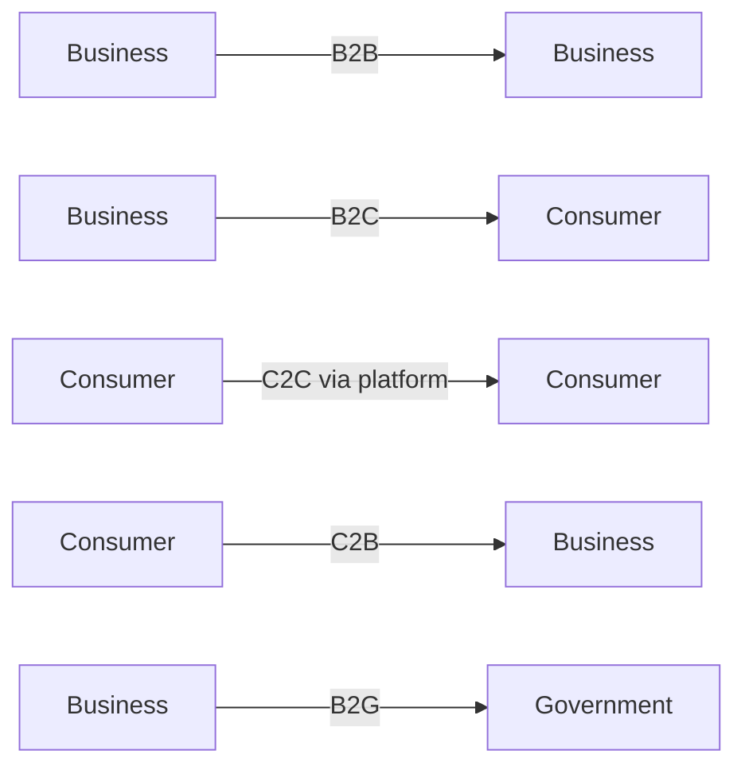
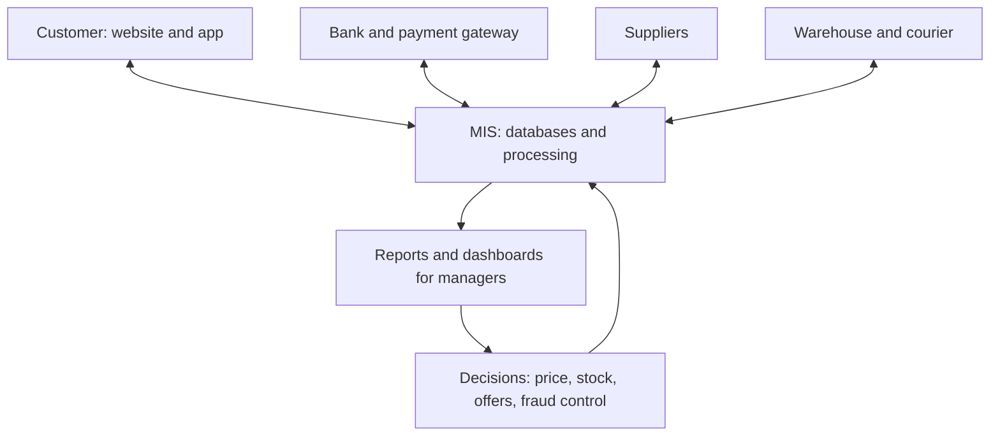
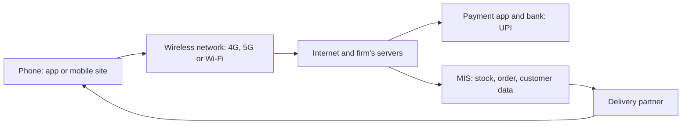
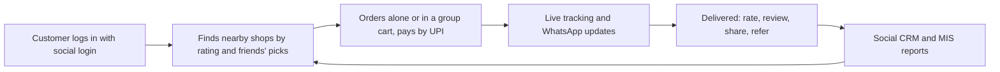

Before the new ideas, here are the old ones you need. If you already know them, skip to the next section.

## The basics first

- A **transaction** is one business exchange: a customer orders, the firm delivers, the customer pays.
- A **website** is where a firm shows its products online. A **mobile app** is a program installed on a phone that does the same job in a phone-friendly way.
- A **payment gateway** is the service that safely passes your card or UPI details from the shop to the bank and returns "paid" or "failed". Examples: Razorpay, PayU, Paytm. <Cite id="e-commerce-tp-payment" />
- A **supply chain** is the whole path from raw material to maker to warehouse to shop to customer. <Cite id="e-commerce-wiki-scm" />
- **MIS** (Management Information System) collects the firm's data, processes it and gives managers the reports they need to decide and control. In this note, MIS is the system behind the website. <Cite id="e-commerce-rainer-intro-is" />
- **Wireless** means connecting without a cable (Wi-Fi, 4G, 5G). It is the base of m-commerce and is covered in the networks note.

## E-business and e-commerce

<Box kind="definition">

**E-commerce** (electronic commerce) is the buying and selling of goods, services or information over the internet or other electronic networks. **E-business** (electronic business) is the use of the internet and information technology to run *all* the activities of a business: selling, buying, serving customers, working with partners and managing internal work. <Cite id="e-commerce-wiki-ecommerce" /> <Cite id="e-commerce-wiki-ebusiness" /> <Cite id="e-commerce-rainer-intro-is" />

</Box>

This is syllabus <Syl m="4" />, section 4.4 (e-business and e-commerce, B2B and B2C) and 4.5 (mobile commerce).

**Why it is needed (the problem it solves).** A shop in a street is open only a few hours, serves only people who can walk there and keeps a limited stock. Online business removes these limits: it is open 24 hours, reaches the whole country, shows a very large range of goods and cuts the cost of buildings and middlemen. <Cite id="e-commerce-ibm" />

**Everyday analogy.** E-commerce is the shop counter, which now sits on a screen. E-business is the whole shop: the counter, the godown, the accounts book, the staff register and the supplier phone calls, all running on computers.

| Point | E-commerce | E-business |
|---|---|---|
| Meaning | Buying and selling over the internet | Running every business activity with the internet and IT |
| Scope | Narrow: only the transaction | Wide: transactions plus internal and partner work |
| Relation | A part of e-business | The whole, which includes e-commerce |
| Focus | Customer and sale | Customer, employees, suppliers and partners |
| Money involved | Always (a sale happens) | Not always (for example sharing stock data with a supplier) |
| Network used | Mostly the internet | Internet, intranet and extranet |
| Example | Buying shoes on Flipkart | Flipkart also running its warehouses, supplier portal, HR and accounts online |

<Cite id="e-commerce-gfg-ecom-vs-ebiz" /> <Cite id="e-commerce-wiki-ebusiness" />

### Note on e-business

An exam-ready note on e-business covers these points. <PYQ id="2023-12-ce/q4b" />

1. **Definition** as above.
2. **Parts of e-business.**
   - *E-commerce:* online selling and buying.
   - *E-procurement:* buying raw material and supplies online from suppliers.
   - *E-supply chain:* sharing stock and order data with partners, often through EDI, which is the computer-to-computer exchange of standard business documents such as purchase orders and invoices. <Cite id="e-commerce-wiki-edi" />
   - *E-CRM:* serving and keeping customers online (chat, email, social media).
   - *Internal systems:* ERP, intranet, online HR and payroll, e-learning.
3. **Types of networks used.** Internet (everyone), **intranet** (private network inside the firm) and **extranet** (private network shared with chosen partners).
4. **Benefits.** Lower cost, faster work, less paper, 24 hours service, wider reach, better coordination with suppliers, faster decisions from live data.
5. **Limits.** Technology cost, security threats, staff training, dependence on the network, legal and tax rules, and customers who cannot or will not use the internet.
6. **Example.** *Infosys* and *TCS* run most of their internal work (projects, HR, billing) on electronic systems, *Walmart* shares sales data with its suppliers so they restock on time, and *Amazon* runs selling, warehousing, payments and customer service as one connected e-business.
7. **Conclusion.** E-business is not just a website; it is the digital way of running the whole firm. <Cite id="e-commerce-wiki-ebusiness" /> <Cite id="e-commerce-laudon-mis" />

## E-commerce: how it works

<Box kind="definition">

An **e-commerce transaction** has a fixed flow: the customer finds a product, places an order, pays, the firm checks stock, packs and ships, the customer receives the product and can return it or ask for support. <Cite id="e-commerce-tp-overview" />

</Box>

**Steps in simple words**

1. The customer searches or browses the catalogue and reads reviews.
2. The customer puts items in the cart and gives the address.
3. The customer pays by UPI, card, net banking, wallet or cash on delivery (COD).
4. The system confirms the payment and lowers the stock count.
5. The warehouse picks, packs and hands the parcel to a delivery partner.
6. The customer gets the parcel; the system updates the order as delivered.
7. After-sales: returns, refunds, reviews and support. The data goes back to the MIS for the next decision.

**Payment methods.** Credit and debit cards, net banking, UPI, wallets, buy-now-pay-later and cash on delivery. In India, UPI (Unified Payments Interface, run by NPCI) lets people send money instantly from one bank account to another using a phone, which pushed small shops and apps online. <Cite id="e-commerce-tp-payment" /> <Cite id="e-commerce-wiki-upi" />

<Cite id="e-commerce-tp-payment" loc="diagram" />

**Last mile.** The final step of delivery, from the local hub to the customer's door, is the costliest and trickiest part of the chain. <Cite id="e-commerce-wiki-last-mile" />

### Write a note on e-commerce

For a 10-mark "Write note on e-commerce" use this order. <PYQ id="2023-05-ce/q2b" /> <PYQ id="2024-12-ce/q6b" />

1. **Definition** (above), with a line on how it differs from e-business.
2. **Need or reasons for growth:** wide reach, 24 hours service, lower cost, more choice, price comparison, easy payment (UPI), cheap smartphones and data.
3. **Process diagram** (the flow above) and the steps.
4. **Types or models:** B2B, B2C, C2C, C2B, B2G (the next section).
5. **Advantages and disadvantages** (table below).
6. **Applications and examples:** shopping (Amazon, Flipkart), food delivery (Zomato, Swiggy), travel (MakeMyTrip, IRCTC), banking (SBI YONO), tickets (BookMyShow), education (online courses).
7. **Conclusion.** E-commerce changes how people buy and how firms sell, and it works only when the information system, payments and delivery are all reliable.

| Advantages | Disadvantages |
|---|---|
| Open 24 hours, reaches any place with internet | Cannot touch or try the product, so returns are common |
| Large choice and easy price comparison | Security risks: fraud, stolen cards, fake sites, phishing |
| Lower cost for the seller (no shop rent, fewer staff) | Delivery delay or damage; costly last mile |
| Customer data helps personal offers and better stock planning | Privacy concerns about the data collected |
| Quick payment and record of every order | Needs internet and a device; excludes people without them |
| Small sellers reach national buyers through marketplaces | Tough competition, heavy discounts and platform fees |
| Faster service and easy returns where promised | Technical failure on a sale day can stop all sales |

<Cite id="e-commerce-gfg-intro" /> <Cite id="e-commerce-ibm" /> <Cite id="e-commerce-wiki-ecommerce" />

## Models of e-commerce (B2B, B2C and others)

The model is decided by *who sells to whom*. <Cite id="e-commerce-tp-models" /> <Cite id="e-commerce-gfg-types" />

| Model | Seller to buyer | Example |
|---|---|---|
| **B2B** (business to business) | A business sells to another business | Infosys selling software services to a bank, a steel maker selling to a car company, Amazon Business, IndiaMART |
| **B2C** (business to consumer) | A business sells to individual customers | Amazon, Flipkart, Myntra, Zomato, BookMyShow |
| **C2C** (consumer to consumer) | One person sells to another through a platform | OLX, eBay, Facebook Marketplace |
| **C2B** (consumer to business) | An individual offers a service or product to a business | A freelancer on Upwork, a photographer selling photos to a stock site, a YouTuber paid by a brand |
| **B2G** (business to government) | A business sells to a government body | A firm winning a tender on the GeM portal |
| **G2C** (government to citizen) | Government serves citizens online | Income tax filing, IRCTC booking, passport services |

<Cite id="e-commerce-wiki-b2b" /> <Cite id="e-commerce-wiki-c2c" /> <Cite id="e-commerce-tp-b2b" /> <Cite id="e-commerce-tp-b2c" />

### B2B and B2C compared

| Point | B2B | B2C |
|---|---|---|
| Buyer | Another business | Individual customer |
| Number of buyers | Few, long-term | Very many |
| Order size and value | Large, bulk | Small, single items |
| Buying decision | Careful, several people, based on need, price and contract | Quick, often emotional, based on price, reviews and offers |
| Price | Negotiated, contract or volume rate | Fixed list price, discounts |
| Relationship | Long-term, personal | Short-term, mass market |
| Payment | Credit terms, invoices, bank transfer | Card, UPI, wallet, COD |
| Marketing | Direct sales, trade portals, demos | Ads, social media, offers |
| Systems used | EDI, ERP links, supplier portals, e-procurement | Website, app, cart, payment gateway, recommendation engine |
| Example | Walmart buying from a supplier; Indian firm buying cloud from AWS | Customer buying a phone from Flipkart |

<Cite id="e-commerce-tp-b2b" /> <Cite id="e-commerce-tp-b2c" /> <Cite id="e-commerce-gfg-types" />

**B2B types.** *Supplier-oriented* (one supplier sells to many buyers), *buyer-oriented* (one big buyer asks many suppliers to bid, for example a large retailer's procurement portal) and *intermediary* marketplaces (a third party brings both sides together, such as IndiaMART). <Cite id="e-commerce-wiki-marketplace" />

**B2C types.** Direct sellers (a brand's own site), online marketplaces (Amazon, Flipkart), service providers (online banking, travel), content providers (Netflix, news) and community or social sites that sell. <Cite id="e-commerce-tp-b2c" />

## How MIS supports e-commerce

<Box kind="definition">

MIS supports e-commerce by **collecting, storing, processing and reporting the data** that the online business runs on, and by connecting the front end (website or app) to the back end (stock, accounts, delivery, customer service). <Cite id="e-commerce-rainer-intro-is" /> <Cite id="e-commerce-laudon-mis" />

</Box>

The question asks for support plus one case. <PYQ id="2024-05-ce/q1e" /> Write the table and then the case below.

| Business need | What the MIS does |
|---|---|
| Show the catalogue | Product database with price, photos, stock count and reviews |
| Take orders | Order processing system records the order, checks stock, gives order number |
| Take payment | Links to the payment gateway, records paid or failed, stops duplicate payment |
| Manage stock | Inventory system tracks every item in every warehouse, warns when stock is low |
| Deliver | Logistics system picks the nearest warehouse and courier, gives tracking |
| Know the customer | Customer database and CRM track history, send personal offers and recommendations |
| Manage suppliers | Supply chain system sends purchase orders (EDI) and predicts demand |
| Control and decide | Reports and dashboards: sales by day, best products, returns, delivery time, fraud alerts |
| Keep it safe | Access control, logs, fraud checks and backups |

<Cite id="e-commerce-laudon-mis" /> <Cite id="e-commerce-wiki-scm" />

**Case: Flipkart-style online shop.**

1. A customer searches for a phone. The product database shows the models, price and live stock, and the recommendation system suggests accessories based on what similar customers bought.
2. The customer orders and pays by UPI. The transaction processing system records the order and the payment gateway confirms it.
3. The inventory system reduces stock and chooses the nearest warehouse. If the stock falls below a set level it raises a purchase order to the supplier.
4. The logistics system assigns a courier and sends tracking updates by SMS and app.
5. After delivery the customer rates the product. The reports tell the manager which products sell most, which sellers have high returns and where deliveries are late, so the manager can act.

*Result:* faster delivery, fewer stock-outs, fewer errors and better decisions. Amazon uses the same idea on a bigger scale, with automated warehouses and data-driven recommendations. <Cite id="e-commerce-ibm" /> <Cite id="e-commerce-laudon-mis" />

### B2B and B2C examples and how MIS controls them

<PYQ id="2025-05-ce/q5b" />

**B2C example: Flipkart or Amazon selling to individuals.** *MIS contribution:*

- Customer and order database to track every order.
- Recommendation engine and personal offers to raise sales.
- Fraud detection (strange orders, many failed payments).
- Return and refund tracking.
- Dashboards: daily sales, cart abandonment (people who add to cart and do not buy), delivery time, customer ratings.

**B2B example: a car maker buying parts from many suppliers, or Walmart and its suppliers.** *MIS contribution:*

- E-procurement portal for requests, bids and orders.
- EDI to exchange purchase orders, invoices and shipping notices without paper. <Cite id="e-commerce-wiki-edi" />
- Real-time stock sharing so suppliers restock automatically.
- Contract, price and credit-limit records.
- Supplier performance reports (quality, delay, price), used to choose and keep good suppliers.

**Control through MIS.** MIS lets managers set targets (sales, delivery time, return rate), compare actual figures with the target and correct the gap: *plan, measure, compare, act*. Alerts, exception reports and audit logs help to control cost, quality and fraud in both models.

| Point | B2C control | B2B control |
|---|---|---|
| Main question | Are customers buying and are they happy? | Are suppliers and buyers delivering on contract? |
| Key reports | Sales, abandoned carts, returns, ratings | Orders against contract, supplier delay, credit use |
| Main risk watched | Payment fraud, fake reviews | Late supply, price disputes, data leak |

## Business value, risks and good practice

**Disintermediation and new middlemen.** E-commerce lets a maker sell straight to the customer (*disintermediation*: cutting out the wholesaler and retailer), for example an airline selling tickets on its own site. At the same time it creates new middlemen such as marketplaces and payment gateways (*reintermediation*). <Cite id="e-commerce-wiki-disintermediation" /> <Cite id="e-commerce-wiki-marketplace" />

**Risks and how to reduce them**

| Risk | Control |
|---|---|
| Card fraud and stolen data | HTTPS (encrypted connection), OTP and two-step login, tokenised cards |
| Fake websites and phishing | User awareness, verified payment pages, domain checks |
| Fake reviews | Allow reviews only from verified buyers |
| Website down on a sale day | Cloud hosting that scales, load testing, backups |
| Wrong or late delivery | Tracking, good courier partners, return policy |
| Privacy | Ask consent, collect only what is needed, follow data-protection law |

## Mobile commerce (m-commerce)

<Box kind="definition">

**Mobile commerce (m-commerce)** is buying, selling and paying through wireless handheld devices such as smartphones and tablets, using apps, mobile websites, SMS or QR codes. It is e-commerce that moves with the customer. <Cite id="e-commerce-wiki-mcommerce" /> <Cite id="e-commerce-rainer-intro-is" /> <Cite id="e-commerce-gfg-ecom-vs-mcom" />

</Box>

**Why it is needed.** More people in India reach the internet through a phone than through a computer. A phone is personal, always with us and knows our location, so a business can reach the customer anywhere and at the right moment. <Cite id="e-commerce-wiki-mcommerce" />

**Everyday analogy.** E-commerce is a shop you visit by sitting at a table with a computer. M-commerce is a shopkeeper who walks with you in your pocket.

**Main applications**

- **Mobile shopping:** Amazon, Flipkart, Myntra apps.
- **Mobile payments and banking:** UPI apps (Google Pay, PhonePe, Paytm), SBI YONO, mobile wallets. <Cite id="e-commerce-wiki-mobile-payment" /> <Cite id="e-commerce-wiki-mobile-banking" />
- **Food and grocery delivery:** Zomato, Swiggy, Blinkit and Zepto (quick commerce, delivery in minutes). <Cite id="e-commerce-wiki-qcommerce" />
- **Ticketing and travel:** IRCTC, MakeMyTrip, BookMyShow, Ola and Uber.
- **Location-based services:** nearby offers, maps and cab finding. <Cite id="e-commerce-wiki-lbs" />
- **Content and entertainment:** music, video, games and e-books bought or streamed on a phone.
- **Business tools:** field staff placing orders and tracking deliveries on a phone.

### E-commerce versus m-commerce

| Point | E-commerce | M-commerce |
|---|---|---|
| Device | Computer, laptop (and phone) | Smartphone, tablet, wearable |
| Network | Wired or Wi-Fi, usually fixed place | Wireless, usable while moving |
| Screen | Large | Small |
| Location | Mostly not used | Used (GPS offers, nearby search, delivery tracking) |
| Reach | Needs a computer | Reaches anyone with a phone |
| Personalisation | By account and history | By account, history *and* place and time |
| Payment | Card, net banking | UPI, wallet, tap-to-pay, QR code |
| Security risk | Phishing, malware | Same, plus lost phone, fake apps, public Wi-Fi |
| Example | Booking a flight on a laptop | Ordering a meal on Zomato from the road |

<Cite id="e-commerce-gfg-ecom-vs-mcom" /> <Cite id="e-commerce-wiki-mcommerce" />

### New challenges that m-commerce has introduced

<PYQ id="2022-12-ce/q2b" /> <PYQ id="2025-05-ce/q4b" />

1. **Small screen and poor usability.** Less space for products, long forms are hard to fill. *Answer:* simple design, fewer steps, one-tap pay.
2. **Weak or slow network.** Coverage and speed differ by place, so pages and payments can fail. *Answer:* light apps, offline cart, retry safely.
3. **Security and fraud.** Phones get lost or infected; fake apps and public Wi-Fi steal data. *Answer:* app lock, OTP, biometric login, encryption, official app stores only. <Cite id="e-commerce-wiki-mobile-payment" />
4. **Privacy.** Location and contacts are very personal. *Answer:* ask permission, collect little, explain use.
5. **Many devices and operating systems.** Android, iOS, many screen sizes. *Answer:* responsive design and testing on many devices.
6. **Payment trust and failures.** A deducted but failed payment makes customers angry. *Answer:* reliable gateways, quick refund rules.
7. **Battery, memory and data cost.** Heavy apps drain the phone. *Answer:* lean apps.
8. **Delivery and logistics.** Quick-delivery promises put pressure on partners and riders. *Answer:* local hubs, route planning. <Cite id="e-commerce-wiki-last-mile" />
9. **Language and digital skill.** Many users need local languages and simple voice or icon design.
10. **Law and standards.** Rules on data protection, payments and consumer rights differ and keep changing; wireless standards are not uniform.
11. **Fierce competition and app overload.** Users keep only a few apps; firms spend heavily on offers.

**Advantages of m-commerce.** Anytime and anywhere use, personal and location-aware offers, quick payment (UPI), push notifications, wide reach including small towns, and easy sign-up.

**Disadvantages.** The challenges above: security, small screen, network dependence and privacy worries.

**Conclusion.** M-commerce widens e-commerce to every pocket; the firm that solves security, speed and simplicity on a small screen wins.

## Plan for a delivery application in m-commerce using social computing

<PYQ id="2023-12-ce/q2a" />

A fuller plan with phases and revenue is in the social computing note. Here is the exam-ready core.

1. **Aim.** An app that delivers food or grocery from nearby shops to customers quickly, and uses social features to build trust and repeat orders.
2. **Users.** Customers, shops or restaurants, delivery partners and the admin.
3. **M-commerce features.** GPS location and nearest-shop search, UPI payment, push notifications, live order tracking and a phone-friendly screen.
4. **Social computing features.** Social login, ratings and reviews with photos, referral codes, group orders with bill splitting, sharing dishes on WhatsApp and Instagram, polls for new cuisines, and a social CRM team that answers complaints in public. <Cite id="e-commerce-wiki-social-commerce" />
5. **MIS inside.** Order, stock and menu database, rider allocation, payment records, customer and review data, and dashboards for delivery time, ratings and repeat orders.
6. **Steps.** Study the market, design, build, test with a small group, launch in one area, track results, then grow.
7. **Revenue.** Commission, delivery fee, paid promotion and subscription.
8. **Risks and controls.** Fake reviews (verified buyers only), privacy of location (consent), payment fraud (secure gateway), late delivery (fair rider allocation).

## WhatsApp and Telegram compared

<PYQ id="2023-05-ce/q1b" /> <PYQ id="2024-12-ce/q1b" />

Both are mobile messaging apps that firms use to talk to customers, which makes them part of m-commerce. Figures change with updates, so say "about" in an answer. <Cite id="e-commerce-wiki-whatsapp" /> <Cite id="e-commerce-wiki-telegram" />

| Parameter | WhatsApp | Telegram |
|---|---|---|
| Owner | Meta | Telegram Messenger |
| Multimedia | Photos, videos, voice notes, documents, voice and video calls, status | Same, plus channels, bots, polls, stickers and large files |
| Security | End-to-end encryption on by default for chats and calls | Cloud chats encrypted between device and server; end-to-end only in optional Secret Chats |
| Privacy | Phone number is the ID; privacy settings can limit who sees it | Can hide the number and use a username |
| Storage | Chats kept on the phone; optional backup to Google Drive or iCloud | Chats kept in Telegram's cloud and open on any device |
| Data usage | Moderate; low-data call mode; auto-download controls | Moderate; detailed auto-download and cache controls |
| Notifications | Mute per chat, custom tones | Mute per chat, custom tones, silent and scheduled messages |
| Groups | Large groups and Communities | Very large groups and unlimited-member channels |
| Business use | WhatsApp Business app and API, catalogues | Channels and bots for broadcast and automation |

<Cite id="e-commerce-telegram-faq" /> <Cite id="e-commerce-whatsapp-security" />

**Conclusion.** WhatsApp is the simple private default for customer chat; Telegram is stronger for big groups, channels, large files and bots, but its normal chats are not end-to-end encrypted. The social computing note repeats this table with more sources.

## Quick revision and exam guide

<Box kind="exam">

- "Write note on e-commerce": definition, need, flow diagram, models, advantages and disadvantages table, examples, conclusion. <PYQ id="2023-05-ce/q2b" /> <PYQ id="2024-12-ce/q6b" />
- "Write note on e-business": definition, parts (e-commerce, e-procurement, e-supply chain, e-CRM, internal systems), networks, benefits, limits, example. <PYQ id="2023-12-ce/q4b" />
- "How is e-commerce supported by MIS, with a case": MIS table plus the order flow case. <PYQ id="2024-05-ce/q1e" />
- "B2B and B2C examples and MIS contribution": two examples, B2B versus B2C table, how MIS controls each. <PYQ id="2025-05-ce/q5b" />
- "Mobile commerce" and "new challenges": definition, applications, e-commerce versus m-commerce table, 6 to 8 challenges each with an answer. <PYQ id="2025-05-ce/q4b" /> <PYQ id="2022-12-ce/q2b" />
- "Delivery application in m-commerce using social computing": features, MIS, steps, revenue, risks, diagram. <PYQ id="2023-12-ce/q2a" />
- "WhatsApp versus Telegram": table on multimedia, security, privacy, storage, data usage and notifications. <PYQ id="2023-05-ce/q1b" /> <PYQ id="2024-12-ce/q1b" />

</Box>

<Box kind="pitfall">

Do not say "e-commerce and e-business are the same". E-business is wider. Do not call every online sale B2C: a bulk order between two firms is B2B. Do not forget a real company example, because MIS answers without an example lose marks.

</Box>
