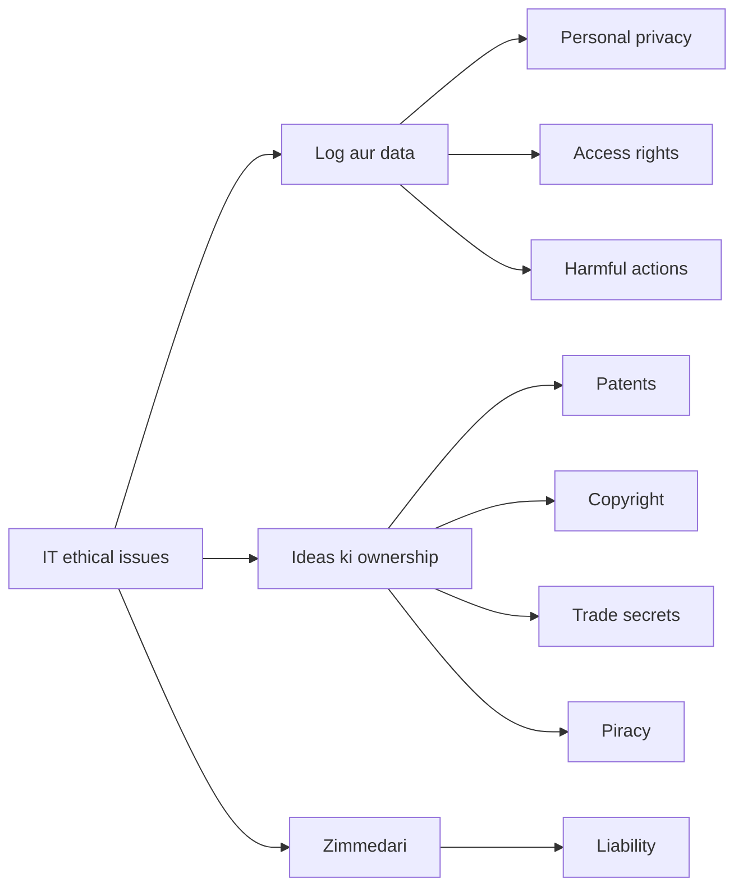
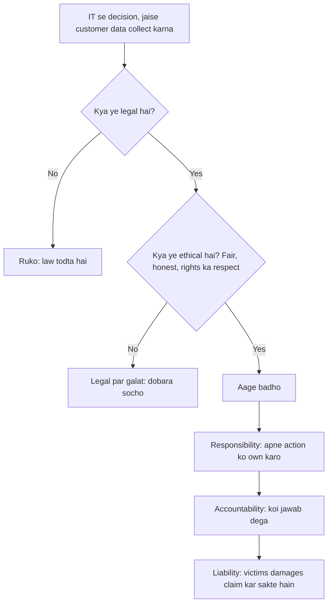
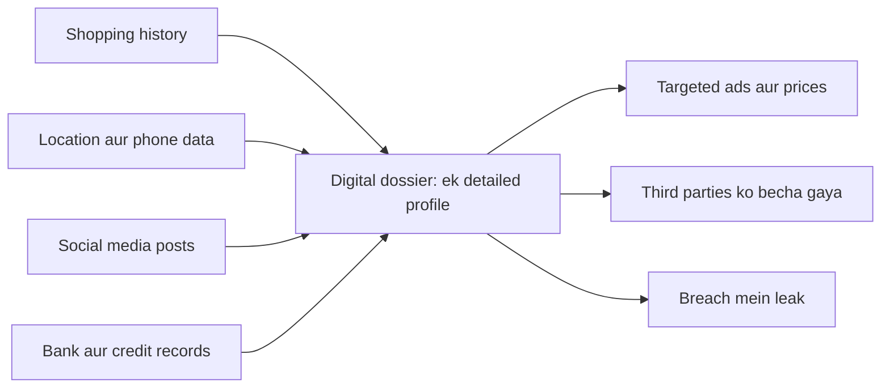
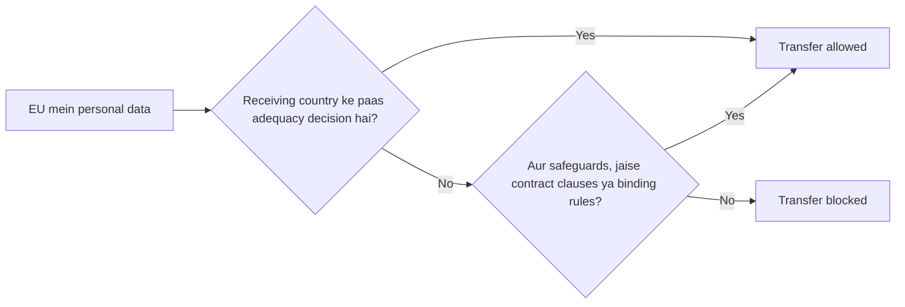

Ye note syllabus <Syl m="3" /> ke section 3.1 ko cover karta hai: ethical issues aur privacy. Information security aur uske controls agle topic ke note mein hain.

## Pehle basics

- **Personal data** koi bhi fact hai jo kisi person ko identify kar sake: naam, phone number, address, Aadhaar ya PAN number, photo, location, health record, browsing history.
- **Database**: data ka organized store. Banks, shops, apps aur governments sab logon ke baare mein databases rakhte hain.
- **Breach**: aisa case jahan data ko woh log dekh ya le jaate hain jinhe nahi dekhna chahiye. <Cite id="ethics-privacy-ibm-data-breach" />
- **Law** woh rule hai jo state enforce karta hai. **Ethics** woh hai jo hum sahi ya galat maante hain, chahe koi law na bole. Bahut si cheezein legal hoti hain par unethical (jaise aapki browsing habits bina bataye bech dena).

## Part 1: Ethics aur IT ke ethical issues kya hain

<Box kind="definition">

**Ethics** sahi aur galat ke principles ka set hai jinse log decide karte hain ki kaise act karna hai. **Ethical issues in IT** woh cases hain jahan information systems use karne se kuch logon ko fayda ho sakta hai par doosron ke rights, paise, safety ya dignity ko nuksan.

</Box>

**Ye kyun zaroori hai.** Information systems ek firm ko seconds mein, sasta aur chupke se, lakhon logon ka data collect, copy, link aur sell karne dete hain. Purane laws iske pehle likhe gaye the, isliye managers ko ethical judgement bhi use karna padta hai. <Cite id="ethics-privacy-rainer-ch3" /> <Cite id="ethics-privacy-tp-mis-ethics" />

**Ethics ke teen tenets** (Rainer aur Prince). <Cite id="ethics-privacy-rainer-wiley" loc="Ch. 3" />

1. **Responsibility**: apne decisions aur actions ke consequences accept karna.
2. **Accountability**: jawabdeh hona, aur kuch galat hone pe bata paana ki kaun kis cheez ke liye responsible hai.
3. **Liability**: logon ka legal haq ki jis individual ya firm ne unhe nuksan pahunchaya, usse damages (muavza) le sakein.

**Ethical choice judge karne ke chaar tareeke.** <Cite id="ethics-privacy-rainer-ch3" />

| Approach | Question it asks | Small example |
|---|---|---|
| Utilitarian | Kaun sa choice sabse zyada logon ka sabse zyada bhala karta hai? | Cure dhoondhne ke liye (anonymised) patient data use karna |
| Rights | Kaun sa choice logon ke basic rights, jaise privacy, ko best protect karta hai? | Employees ke private messages na padhna |
| Fairness | Kya logon ke saath barabar vyavhar ho raha hai jab tak koi achhi wajah na ho? | Sabke liye same loan rules |
| Common good | Kya ye poori community ki madad karta hai, sirf meri nahi? | Security warnings openly share karna |

### Information age ke chaar ethical issues

Textbook IT ke main ethical issues ko chaar categories mein baantta hai, jinhe aksar **PAPA** (Mason) ke naam se yaad rakha jaata hai. <Cite id="ethics-privacy-rainer-wiley" loc="Ch. 3" /> <Cite id="ethics-privacy-wiki-info-ethics" />

| Issue | Meaning | Example |
|---|---|---|
| **Privacy** | Kisi person ka kaun sa data collect ho sakta hai, aur use kaun dekh ya use kar sakta hai? | Ek app jo poora din location track kare |
| **Accuracy** | Data sahi hai ye kaun ensure karta hai, aur galtiyon ka kharcha kaun uthata hai? | Galat credit score jo loan rok de |
| **Property** | Information aur ideas kiske hain? Copyright, patents, trade secrets aur piracy isme aate hain. | Paid software ki copy karna |
| **Accessibility** | Information use karne ka haq kiska hai, aur technology afford kaun kar sakta hai? | Gaon jahan internet nahi (digital divide) |

Study sites ye issues bhi batati hain: access rights, viruses failane jaise harmful actions, product claims ki liability, aur software piracy. <Cite id="ethics-privacy-gfg-ethical-issues" />

<Cite id="ethics-privacy-gfg-ethical-issues" loc="diagram" />

### Codes of ethics

ACM aur IEEE jaisi professional bodies codes publish karti hain: competent raho, law maano, honest raho, public safety protect karo, doosron ko nuksan mat pahunchao, aur computers sirf authorised hone par use karo. <Cite id="ethics-privacy-tp-mis-ethics" /> Ek jaani-maani chhoti list **Ten Commandments of Computer Ethics** hai, jaise "Thou shalt not use a computer to harm other people" aur "Thou shalt not copy proprietary software for which you have not paid". <Cite id="ethics-privacy-wiki-ten-commandments" /> <Cite id="ethics-privacy-wiki-computer-ethics" />

## Part 2: Privacy aur IT se prabhavit privacy issues

<Box kind="definition">

**Privacy** akela chhod diye jaane ka haq hai aur unreasonable personal intrusion se free rehne ka haq; **information privacy** ye decide karne ka haq hai ki aapki personal information kab, kaise aur kitni doosron ke saath share hogi. <Cite id="ethics-privacy-wiki-info-privacy" /> <Cite id="ethics-privacy-sep-it-privacy" />

</Box>

Kai countries ke court decisions kehte hain ki privacy absolute nahi hai: use public safety aur state ki zarooraton ke saath balance karna padta hai. India mein Supreme Court ne **Puttaswamy** judgment (2017) mein kaha ki privacy Article 21 ke under ek fundamental right hai. <Cite id="ethics-privacy-wiki-puttaswamy" />

### IT privacy ko kaise affect karta hai

1. **Electronic surveillance.** CCTV, face recognition, workplace email aur screen monitoring, aur phone tracking employers aur governments ko logon pe lagataar nazar rakhne dete hain.
2. **Data aggregation aur digital dossiers.** Kai databases (shopping, location, social media) ke chhote facts jodkar aapki ek detailed profile bana di jaati hai, jise **digital dossier** kehte hain. Har fact harmless ho sakta hai, par saari tasveer nahi.
3. **Profiling.** Firms aapki profile se aapko predict karti hain aur ads, prices ya loan decisions mein target karti hain, kabhi kabhi unfairly. <Cite id="ethics-privacy-ibm-data-privacy" />
4. **Internet pe information.** Posts, photos aur comments online rehte hain aur copy ho sakte hain. Cookies aur trackers browsing record karte hain. Location data aapki routine bata deta hai.
5. **Data breaches aur misuse.** Hackers ya laparwah staff stored data expose kar dete hain. Firms data ko aise purpose ke liye bhi use kar sakti hain jiske liye aapne agree nahi kiya. Facebook aur Cambridge Analytica case (political profiling ke liye lagbhag 87 million users ka data) ek jaana-maana example hai. <Cite id="ethics-privacy-wiki-cambridge-analytica" />
6. **Inaccurate data.** Records ki galtiyan har jagah copy ho jaati hain aur sudharna mushkil hota hai.
7. **Data ki aasaan copying aur selling.** Digital data copy karna lagbhag free hai aur third parties (data brokers) ko bechna aasaan hai.

### Privacy policies aur codes

Achhi practice ye hai: logon ko batao kya collect ho raha hai aur kyun, sirf zaroorat jitna collect karo, unhe apna data dekhne aur sudharne do, use safe rakho, aur doosre purposes ke liye use mat karo. Ye ideas GDPR principles mein dikhte hain: lawfulness aur transparency, purpose limitation, data minimisation, accuracy, storage limitation, security (integrity aur confidentiality) aur accountability. <Cite id="ethics-privacy-gdpr-art5" /> Consent **opt-out** ho sakta hai (jab tak aap mana na karo data collect hota hai) ya **opt-in** (data tabhi collect hota hai jab aap agree karo); opt-in privacy ko zyada protect karta hai. <Cite id="ethics-privacy-laudon-pearson" />

| Benefit of using personal data | Privacy risk |
|---|---|
| Personalised offers, better service | Profiling aur manipulation |
| Faster fraud detection | Constant monitoring |
| Medical research | "Anonymous" records ki re-identification |
| Convenient one-click login | Ek breach se sab expose |

**Conclusion.** IT data collect aur share karna sasta bana deta hai, isliye privacy ko firms aur law dono se jaanbujhkar protect karna padta hai.

## Part 3: Computer crimes kyun hote hain

<Box kind="definition">

**Computer crime** (cybercrime) koi bhi illegal act hai jisme computer ya network crime ka tool, target ya jagah ho, jaise hacking, fraud, identity theft, ransomware ya viruses failana. <Cite id="ethics-privacy-wiki-cybercrime" /> <Cite id="ethics-privacy-gfg-cyber-crime" />

</Box>

**Main reasons.** <Cite id="ethics-privacy-gfg-cybercrime-causes" /> <Cite id="ethics-privacy-gfg-cyber-criminals" />

1. **Kamzor systems.** Unpatched software, galat configured servers aur weak passwords ya access controls attackers ko raasta dete hain.
2. **Awareness ki kami.** Users phishing links pe click karte hain, passwords reuse karte hain ya OTP share karte hain; bahut se attacks human error se shuru hote hain.
3. **Financial motive.** Ransomware, bank fraud, card theft aur data selling mein achha paisa milta hai.
4. **Information ki aasaan replication.** Digital data original pe koi nishaan chhode bina copy ho sakta hai, isliye chori ka pata chalna mushkil hai aur data tezi se failta hai.
5. **Location aur personal data online exposed.** Posts aur apps batate hain ki log kahan hain aur unke paas kya hai, jo stalkers aur fraudsters ki madad karta hai.
6. **Technology ka tezi se badalna.** Naye tools (deepfakes, automated phishing) defences ke pehle aa jaate hain.

Answers mein aksar ye aur reasons jode jaate hain (upar ke points se nikle hue): **anonymity** (attacker door aur chhupa hota hai), **pakde ya saza paane ka kam risk** kyunki borders ke paar evidence jutana mushkil hai, **insiders** jinke paas legitimate access hota hai, aur **thrill, badla ya political motives**.

| Reason | Short example |
|---|---|
| Weak system | Server jo known bug ke liye update nahi hua |
| Careless user | Employee fake bank page pe password daalta hai |
| Money | Payment maangta ransomware |
| Easy copying | Customer database pen drive mein copy |
| Anonymity aur weak enforcement | Doosre country mein baitha attacker |
| New technology | Voice-cloning scam |

**Kam karne ke tareeke** (short mein): patching, strong authentication, training, backups, encryption, monitoring aur sakht laws. Details information security note mein hain.

## Part 4: Kya security ek ethical responsibility hai? (case ke saath)

Jo firm aapka data collect karti hai woh use bharose pe rakhti hai. Agar woh use protect karne mein fail ho, to asli logon ka paisa, privacy aur sukoon jaata hai. Isliye **haan**: data protect karna legal aur business duty ke saath ethical duty bhi hai. Reasons:

1. **Duty of care.** Data hone se use safe rakhne ki obligation aa jaati hai (responsibility aur accountability).
2. **Nirdosh logon ko nuksan.** Victims ne kuch galat nahi kiya par fraud aur identity theft jhelte hain.
3. **Trust.** Customers data tabhi dete hain jab firm pe bharosa ho.
4. **Honesty.** Breach chhupana, ya warning dene mein deri karna khud unethical hai.
5. **Ab laws bhi maangte hain.** GDPR, IT Act aur DPDP Act sab reasonable security maangte hain. Ethics pehle aayi, law baad mein.

<Box kind="intuition">

Locker room attendant ko socho jise aapka keemti saaman diya gaya hai. "Lock karna bahut mehnat tha" bolkar darwaza khula chhodna galat hai, chahe kisi ne use rule na bataya ho.

</Box>

**Case study: Equifax (2017).** Equifax US ki sabse badi credit reporting firms mein se ek hai. Attackers web software ki ek known, unpatched flaw se uske systems mein ghus gaye, aur lagbhag 147 million logon ka data (naam, birth dates, Social Security numbers aur zyada) expose ho gaya. Flaw publicly known thi aur fix available tha; system time pe update nahi hua, aur firm ko pata chalne ke hafton baad public ko bataya gaya. <Cite id="ethics-privacy-wiki-equifax" /> 2019 ke settlement mein US FTC aur doosron ke saath Equifax ne kam se kam lagbhag USD 575 million, zyada se zyada USD 700 million dene aur apni security sudharne ka agreement kiya. <Cite id="ethics-privacy-ftc-equifax" />

Ethical lessons: **responsibility** ki failure (patch nahi kiya), **accountability** ki failure (deri se disclosure), aur **liability** (penalties aur claims). Isliye security ek ethical responsibility hai. (Ek aur case jo students use kar sakte hain: upar wala Cambridge Analytica.)

| | Ethical security ke bina | Ethical security ke saath |
|---|---|---|
| Customers | Fraud, identity theft | Safe, bharosa |
| Firm | Fines, lawsuits, reputation loss | Trust aur loyalty |
| Society | Digital services use karne mein hichkichahat | Healthy digital economy |

## Part 5: Privacy aur transborder data flows

<Box kind="definition">

**Transborder data flow (TDF)** data ka, khaaskar personal data ka, national borders ke paar jaana hai, jaise jab ek Indian bank customer records abroad servers pe store kare, ya airline passenger data doosre country ko bheje.

</Box>

**TDF kyun matter karta hai.** Global business, cloud computing, outsourcing (Indian IT firms foreign clients ka data handle karti hain), e-commerce aur social media har second data borders ke paar bhejte hain. Par har country ke privacy laws alag hain, isliye data strong protection wale country se weak protection wale country mein ja sakta hai. <Cite id="ethics-privacy-ibm-data-privacy" />

**Privacy TDF ko kaise affect karti hai (impact).**

1. **Transfer pe restrictions.** Sakht laws data ko tabhi bahar jaane dete hain jab receiving country utna hi protect kare. GDPR ke under EU ke bahar transfer ke liye European Commission ka **adequacy decision** ya standard contractual clauses jaise safeguards chahiye. <Cite id="ethics-privacy-gdpr-ch5" /> <Cite id="ethics-privacy-ec-adequacy" />
2. **Legal uncertainty.** 2015 aur 2020 mein EU Court of Justice ne (Max Schrems ke cases mein) EU-US Safe Harbour aur Privacy Shield arrangements ko khatam kar diya kyunki US surveillance EU citizens ko kaafi protection nahi deti thi. Firms ko data transfer ka tareeka badalna pada. <Cite id="ethics-privacy-wiki-schrems" />
3. **Data localisation.** Kuch countries chahte hain ki data country ke andar hi store ho (jaise India ka rule ki payment data India mein store ho). Ye privacy aur national control protect karta hai par cost badhata hai aur internet ko baant sakta hai. <Cite id="ethics-privacy-wiki-data-localization" />
4. **Zyada compliance cost aur deri.** Firms ko har country ke liye contracts, audits aur legal advice chahiye; GDPR fines EUR 20 million ya worldwide turnover ka 4% tak ho sakte hain, jo bhi zyada ho. <Cite id="ethics-privacy-wiki-gdpr" />
5. **Trade aur outsourcing pe asar.** Weak privacy laws wale countries business kho sakte hain; achhe laws wale clients ko attract karte hain. India ka DPDP Act un countries ko chhodkar transfer allow karta hai jinhe government restrict kare. <Cite id="ethics-privacy-wiki-dpdp" />
6. **Jurisdiction conflict.** Jab data ek country mein store, doosre mein process aur teesre country ke person ka ho, to kis country ka law aur court lagega?

| For free flow | For restricted flow |
|---|---|
| Kam cost, global business, cloud services | Citizens ki privacy protect |
| Tez innovation | State ke liye law enforce karna aasaan |
| Outsourcing countries ke liye better | Cost badhta hai, services block ho sakti hain |

**Conclusion.** Privacy rules cross-border data flow ko slow kar sakte hain, par ve woh trust banate hain jo global business ko chahiye.

## Part 6: India aur duniya mein privacy aur cyber laws

| Law | Where | Key point |
|---|---|---|
| IT Act 2000 | India | Electronic records aur digital signatures ko legal recognition; hacking, identity theft, impersonation se cheating, obscene content aur privacy breach ko punish karta hai; sections mein 43, 66, 66C, 66D, 66E aur 72 shamil hain. <Cite id="ethics-privacy-gfg-it-act" /> <Cite id="ethics-privacy-tp-it-act" /> <Cite id="ethics-privacy-wiki-it-act" /> |
| DPDP Act 2023 | India | Digital personal data ki consent-based processing; "Data Principal" ke rights aur "Data Fiduciary" ki duties; breaches pe penalties. <Cite id="ethics-privacy-wiki-dpdp" /> |
| GDPR 2016 | European Union | Strong rights (access, erasure), saat principles, breach notification, bade fines, abroad transfers ke rules. <Cite id="ethics-privacy-wiki-gdpr" /> |

## Likely exam questions

| Question type | What to write | Past paper |
|---|---|---|
| "Discuss how privacy issue can impact transborder data flows" (10 marks) | Privacy aur TDF define karo, TDF kyun matter karta hai, chhe impacts, GDPR transfer diagram, table, conclusion | <PYQ id="2024-05-ce/q3b" /> |
| "Is security an ethical responsibility? Justify with a case study" (10 marks) | Haan, paanch reasons ke saath, tenets, Equifax case, lessons, table | <PYQ id="2024-05-ce/q5b" /> |
| "Analyse the main reasons of computer crimes" (10 marks) | Define karo, chhe reasons plus extras, example table, prevention pe ek line | <PYQ id="2025-05-ce/q2b" /> <PYQ id="2024-12-ce/q5b" /> |
| "Describe the privacy issues affected by IT" (10 marks) | Privacy define karo, IT ke saat tareeke, dossier diagram, benefit versus risk table, conclusion | <PYQ id="2025-05-ce/q5a" /> |

<Box kind="exam">

Exam mein English mein likho: hamesha one-line definition se shuru karo, har point ke saath one-line example ke saath numbered points do, ek diagram ya table jodo, aur one-line conclusion pe khatam karo. Case-study questions mein company ka naam, saal aur numbers likho.

</Box>

<Box kind="pitfall">

Ye mat bolo ki "privacy aur security same hain". Privacy ye hai ki aapka data kaun use kar sakta hai; security data ko unauthorised access se bachana hai. Privacy ke liye security chahiye, par sirf security ek firm ko apne legitimately rakhe data ka misuse karne se nahi rokti.

</Box>

## Quick revision

- Ethics: law se aage sahi aur galat. Tenets: responsibility, accountability, liability.
- Chaar issues (PAPA): privacy, accuracy, property, accessibility.
- IT privacy pe asar daalta hai surveillance, dossiers, profiling, online trails, breaches, errors aur data ki aasaan selling se.
- Computer crime reasons: weak systems, careless users, paisa, easy copying, anonymity, new tech.
- Security ek ethical duty hai: Equifax 2017, lagbhag 147 million log.
- Transborder data flow: GDPR mein sirf adequacy ya safeguards ke saath allowed; India: IT Act 2000, Puttaswamy 2017, DPDP Act 2023.
