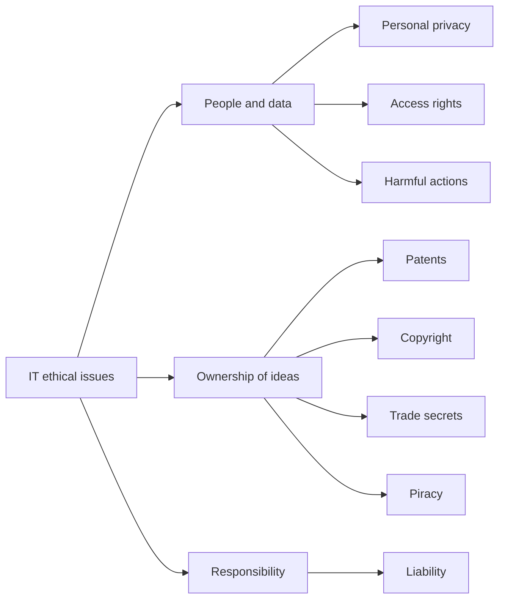
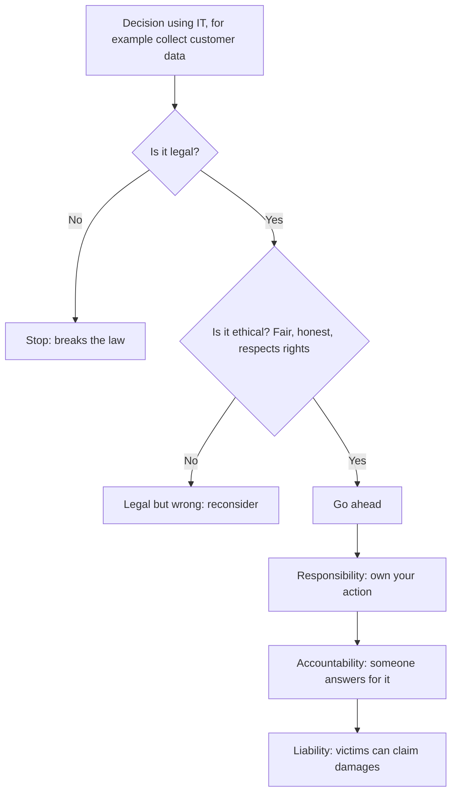
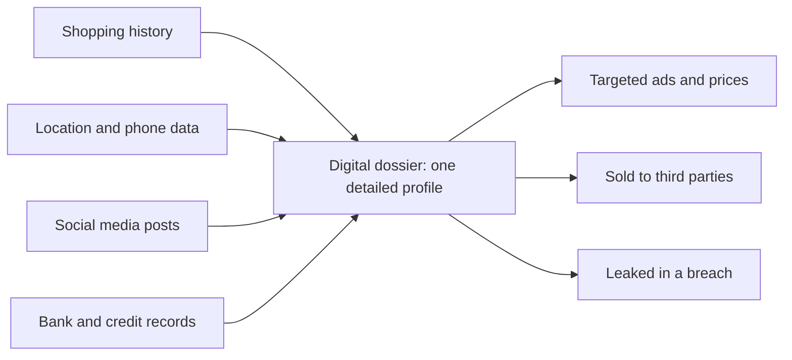
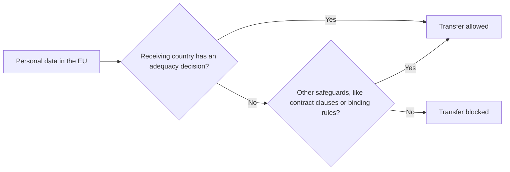

This note covers syllabus <Syl m="3" /> section 3.1, ethical issues and privacy. Information security and its controls are in the next topic note.

## The basics first

- **Personal data** is any fact that can identify a person: name, phone number, address, Aadhaar or PAN number, photo, location, health record, browsing history.
- **Database**: an organized store of data. Banks, shops, apps and governments all keep databases about people.
- **Breach**: a case where data is seen or taken by someone who should not have it. <Cite id="ethics-privacy-ibm-data-breach" />
- **Law** is a rule that the state enforces. **Ethics** is what we judge as right or wrong even when no law says so. Many things are legal but still unethical (for example, selling your browsing habits without telling you).

## Part 1: What are ethics and ethical issues in IT

<Box kind="definition">

**Ethics** is the set of principles of right and wrong that people use to decide how to act. **Ethical issues in IT** are the cases where using information systems can help some people but harm the rights, money, safety or dignity of others.

</Box>

**Why it matters.** Information systems let a firm collect, copy, link and sell data about millions of people in seconds, cheaply and in secret. Old laws were written before this, so managers must also use ethical judgement. <Cite id="ethics-privacy-rainer-ch3" /> <Cite id="ethics-privacy-tp-mis-ethics" />

**Three tenets of ethics** (Rainer and Prince). <Cite id="ethics-privacy-rainer-wiley" loc="Ch. 3" />

1. **Responsibility**: accepting the consequences of your own decisions and actions.
2. **Accountability**: being answerable, and able to say who is responsible for what, when something goes wrong.
3. **Liability**: the legal right of people to recover damages from an individual or firm that harmed them.

**Four ways to judge an ethical choice.** <Cite id="ethics-privacy-rainer-ch3" />

| Approach | Question it asks | Small example |
|---|---|---|
| Utilitarian | Which choice does the most good for the most people? | Using patient data (anonymised) to find a cure |
| Rights | Which choice best protects people's basic rights, like privacy? | Not reading employees' private messages |
| Fairness | Are people treated equally unless there is a good reason? | Same loan rules for everyone |
| Common good | Does it help the whole community, not just me? | Sharing security warnings openly |

### The four ethical issues of the information age

The textbook groups the main IT ethical issues into four categories, often remembered as **PAPA** (Mason). <Cite id="ethics-privacy-rainer-wiley" loc="Ch. 3" /> <Cite id="ethics-privacy-wiki-info-ethics" />

| Issue | Meaning | Example |
|---|---|---|
| **Privacy** | What data about a person can be collected, and who may see or use it? | An app tracking location all day |
| **Accuracy** | Who makes sure data is correct, and who pays for mistakes? | Wrong credit score that blocks a loan |
| **Property** | Who owns information and ideas? Includes copyright, patents, trade secrets and piracy. | Copying paid software |
| **Accessibility** | Who has the right to use information, and who can afford the technology? | Villages without internet (digital divide) |

Other issues named by study sites: access rights, harmful actions such as spreading viruses, liability for product claims, and software piracy. <Cite id="ethics-privacy-gfg-ethical-issues" />

<Cite id="ethics-privacy-gfg-ethical-issues" loc="diagram" />

### Codes of ethics

Professional bodies such as ACM and IEEE publish codes: stay competent, obey the law, be honest, protect public safety, avoid harming others, and use computers only when authorised. <Cite id="ethics-privacy-tp-mis-ethics" /> A well known short list is the **Ten Commandments of Computer Ethics**, for example "Thou shalt not use a computer to harm other people" and "Thou shalt not copy proprietary software for which you have not paid". <Cite id="ethics-privacy-wiki-ten-commandments" /> <Cite id="ethics-privacy-wiki-computer-ethics" />

## Part 2: Privacy and the privacy issues affected by IT

<Box kind="definition">

**Privacy** is the right to be left alone and to be free of unreasonable personal intrusion; **information privacy** is the right to decide when, how and how much of your personal information is shared with others. <Cite id="ethics-privacy-wiki-info-privacy" /> <Cite id="ethics-privacy-sep-it-privacy" />

</Box>

Court decisions in many countries say privacy is not absolute: it must be balanced against public safety and the needs of the state. In India the Supreme Court held in the **Puttaswamy** judgment (2017) that privacy is a fundamental right under Article 21. <Cite id="ethics-privacy-wiki-puttaswamy" />

### How IT affects privacy

1. **Electronic surveillance.** CCTV, face recognition, workplace email and screen monitoring, and phone tracking let employers and governments watch people continuously.
2. **Data aggregation and digital dossiers.** Small facts from many databases (shopping, location, social media) are joined into one detailed profile of you, called a **digital dossier**. Each fact may be harmless, the combined picture is not.
3. **Profiling.** Firms use your profile to predict and target you with ads, prices or loan decisions, sometimes unfairly. <Cite id="ethics-privacy-ibm-data-privacy" />
4. **Information on the internet.** Posts, photos and comments stay online and can be copied. Cookies and trackers record browsing. Location data reveals routines.
5. **Data breaches and misuse.** Hackers or careless staff expose stored data. Firms may also use data for a purpose you never agreed to. The Facebook and Cambridge Analytica case (about 87 million users' data used for political profiling) is a well known example. <Cite id="ethics-privacy-wiki-cambridge-analytica" />
6. **Inaccurate data.** Errors in records are copied everywhere and are hard to correct.
7. **Easy copying and selling of data.** Digital data costs almost nothing to copy and sell to third parties (data brokers).

### Privacy policies and codes

Good practice is to tell people what is collected and why, collect only what is needed, let them see and correct their data, keep it safe, and not use it for other purposes. These ideas appear in the GDPR principles: lawfulness and transparency, purpose limitation, data minimisation, accuracy, storage limitation, security (integrity and confidentiality) and accountability. <Cite id="ethics-privacy-gdpr-art5" /> Consent can be **opt-out** (data is collected unless you refuse) or **opt-in** (data is collected only if you agree); opt-in protects privacy more. <Cite id="ethics-privacy-laudon-pearson" />

| Benefit of using personal data | Privacy risk |
|---|---|
| Personalised offers, better service | Profiling and manipulation |
| Faster fraud detection | Constant monitoring |
| Medical research | Re-identification of "anonymous" records |
| Convenient one-click login | One breach exposes everything |

**Conclusion.** IT makes data cheap to collect and share, so privacy needs deliberate protection from both firms and law.

## Part 3: Why computer crimes happen

<Box kind="definition">

A **computer crime** (cybercrime) is any illegal act that uses a computer or network as the tool, the target or the place of the crime, such as hacking, fraud, identity theft, ransomware or spreading viruses. <Cite id="ethics-privacy-wiki-cybercrime" /> <Cite id="ethics-privacy-gfg-cyber-crime" />

</Box>

**Main reasons.** <Cite id="ethics-privacy-gfg-cybercrime-causes" /> <Cite id="ethics-privacy-gfg-cyber-criminals" />

1. **Weak systems.** Unpatched software, misconfigured servers and weak passwords or access controls give attackers an opening.
2. **Lack of awareness.** Users click phishing links, reuse passwords or share OTPs; many attacks start with human error.
3. **Financial motive.** Ransomware, bank fraud, card theft and data selling pay well.
4. **Easy replication of information.** Digital data can be copied without leaving a trace on the original, so theft is hard to notice and data spreads quickly.
5. **Location and personal data exposed online.** Posts and apps reveal where people are and what they own, helping stalkers and fraudsters.
6. **Fast technology change.** New tools (deepfakes, automated phishing) appear before defences catch up.

Further reasons often added in answers (reasoned from the above): **anonymity** (attacker is far away and hidden), **low risk of being caught or punished** because evidence is hard to collect across borders, **insiders** with legitimate access, and **thrill, revenge or political motives**.

| Reason | Short example |
|---|---|
| Weak system | Server not updated for a known bug |
| Careless user | Employee enters password on a fake bank page |
| Money | Ransomware demanding payment |
| Easy copying | Customer database copied to a pen drive |
| Anonymity and weak enforcement | Attacker in another country |
| New technology | Voice-cloning scam |

**Ways to reduce it** (brief): patching, strong authentication, training, backups, encryption, monitoring and strict laws. Details are in the information security note.

## Part 4: Is security an ethical responsibility? (with case)

A firm that collects your data holds it on trust. If it fails to protect it, real people lose money, privacy and peace of mind. So **yes**: protecting data is an ethical duty as well as a legal and business one. Reasons:

1. **Duty of care.** Having data creates an obligation to keep it safe (responsibility and accountability).
2. **Harm to innocent people.** Victims did nothing wrong yet face fraud and identity theft.
3. **Trust.** Customers share data only if they trust the firm.
4. **Honesty.** Hiding a breach, or delaying the warning, is itself unethical.
5. **Laws now demand it.** GDPR, the IT Act and the DPDP Act all require reasonable security. Ethics came first, law followed.

<Box kind="intuition">

Think of a locker room attendant who is given your valuables. Leaving the door open because "it was too much work to lock" is wrong even if nobody ever told him a rule.

</Box>

**Case study: Equifax (2017).** Equifax is one of the largest US credit reporting firms. Attackers got into its systems through a known, unpatched flaw in web software, and the data of about 147 million people (names, birth dates, Social Security numbers and more) was exposed. The flaw had been publicly known and a fix existed; the system was not updated in time, and the public was told weeks after the firm found out. <Cite id="ethics-privacy-wiki-equifax" /> In a 2019 settlement with the US FTC and others, Equifax agreed to pay at least about USD 575 million, up to USD 700 million, and to improve its security. <Cite id="ethics-privacy-ftc-equifax" />

Ethical lessons: failure of **responsibility** (not patching), failure of **accountability** (slow disclosure), and **liability** (penalties and claims). Security is therefore an ethical responsibility. (Another case students may use: Cambridge Analytica above.)

| | Without ethical security | With ethical security |
|---|---|---|
| Customers | Fraud, identity theft | Safe, trusting |
| Firm | Fines, lawsuits, lost reputation | Trust and loyalty |
| Society | Less willing to use digital services | Healthy digital economy |

## Part 5: Privacy and transborder data flows

<Box kind="definition">

**Transborder data flow (TDF)** is the movement of data, especially personal data, across national borders, for example when an Indian bank stores customer records on servers abroad, or an airline sends passenger data to another country.

</Box>

**Why TDF matters.** Global business, cloud computing, outsourcing (Indian IT firms handle foreign clients' data), e-commerce and social media all send data across borders every second. But each country has different privacy laws, so data may move from a country with strong protection to one with weak protection. <Cite id="ethics-privacy-ibm-data-privacy" />

**How privacy affects TDF (the impact).**

1. **Restrictions on transfer.** Strict laws let data leave only if the receiving country protects it equally. Under GDPR a transfer outside the EU needs an **adequacy decision** by the European Commission or safeguards such as standard contractual clauses. <Cite id="ethics-privacy-gdpr-ch5" /> <Cite id="ethics-privacy-ec-adequacy" />
2. **Legal uncertainty.** In 2015 and 2020 the EU Court of Justice (cases brought by Max Schrems) struck down the EU-US Safe Harbour and Privacy Shield arrangements because US surveillance did not give EU citizens enough protection. Firms had to change how they transfer data. <Cite id="ethics-privacy-wiki-schrems" />
3. **Data localisation.** Some countries require data to be stored inside the country (for example India's rule that payment data be stored in India). It protects privacy and national control but raises costs and may split the internet. <Cite id="ethics-privacy-wiki-data-localization" />
4. **Higher compliance cost and delay.** Firms need contracts, audits and legal advice per country; GDPR fines can reach EUR 20 million or 4% of worldwide turnover, whichever is higher. <Cite id="ethics-privacy-wiki-gdpr" />
5. **Impact on trade and outsourcing.** Countries with weak privacy laws may lose business; those with good laws attract clients. India's DPDP Act allows transfers except to countries the government restricts. <Cite id="ethics-privacy-wiki-dpdp" />
6. **Jurisdiction conflict.** Which country's law and courts apply when data is stored in one country, processed in another and owned by a person in a third?

| For free flow | For restricted flow |
|---|---|
| Lower cost, global business, cloud services | Protects citizens' privacy |
| Faster innovation | Easier for the state to enforce law |
| Better for outsourcing countries | Raises costs, may block services |

**Conclusion.** Privacy rules can slow cross-border data flow, but they build the trust that global business needs.

## Part 6: Privacy and cyber laws in India and the world

| Law | Where | Key point |
|---|---|---|
| IT Act 2000 | India | Legal recognition of electronic records and digital signatures; punishes hacking, identity theft, cheating by impersonation, obscene content and breach of privacy; sections include 43, 66, 66C, 66D, 66E and 72. <Cite id="ethics-privacy-gfg-it-act" /> <Cite id="ethics-privacy-tp-it-act" /> <Cite id="ethics-privacy-wiki-it-act" /> |
| DPDP Act 2023 | India | Consent-based processing of digital personal data; rights of the "Data Principal" and duties of the "Data Fiduciary"; penalties for breaches. <Cite id="ethics-privacy-wiki-dpdp" /> |
| GDPR 2016 | European Union | Strong rights (access, erasure), the seven principles, breach notification, large fines, rules for transfers abroad. <Cite id="ethics-privacy-wiki-gdpr" /> |

## Likely exam questions

| Question type | What to write | Past paper |
|---|---|---|
| "Discuss how privacy issue can impact transborder data flows" (10 marks) | Define privacy and TDF, why TDF matters, the six impacts, GDPR transfer diagram, the table, conclusion | <PYQ id="2024-05-ce/q3b" /> |
| "Is security an ethical responsibility? Justify with a case study" (10 marks) | Yes with five reasons, tenets, Equifax case, lessons, table | <PYQ id="2024-05-ce/q5b" /> |
| "Analyse the main reasons of computer crimes" (10 marks) | Define, the six reasons plus extras, example table, one line on prevention | <PYQ id="2025-05-ce/q2b" /> <PYQ id="2024-12-ce/q5b" /> |
| "Describe the privacy issues affected by IT" (10 marks) | Define privacy, the seven ways IT affects it, dossier diagram, benefit versus risk table, conclusion | <PYQ id="2025-05-ce/q5a" /> |

<Box kind="exam">

Always start with a one-line definition, give numbered points with a one-line example each, add one diagram or table, and finish with a one-line conclusion. For case-study questions name the company, year and numbers.

</Box>

<Box kind="pitfall">

Do not say "privacy and security are the same". Privacy is about who may use your data; security is about protecting data from unauthorised access. You need security to get privacy, but security alone does not stop a firm from misusing the data it legitimately holds.

</Box>

## Quick revision

- Ethics: right and wrong beyond the law. Tenets: responsibility, accountability, liability.
- Four issues (PAPA): privacy, accuracy, property, accessibility.
- IT hits privacy through surveillance, dossiers, profiling, online trails, breaches, errors and easy selling of data.
- Computer crime reasons: weak systems, careless users, money, easy copying, anonymity, new tech.
- Security is an ethical duty: Equifax 2017, about 147 million people.
- Transborder data flow: allowed under GDPR only with adequacy or safeguards; India: IT Act 2000, Puttaswamy 2017, DPDP Act 2023.
