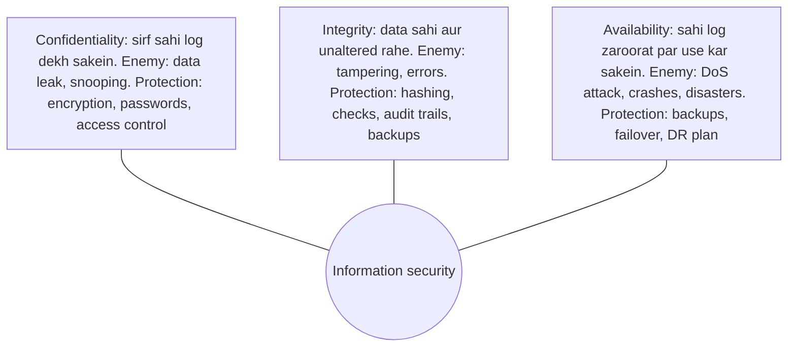
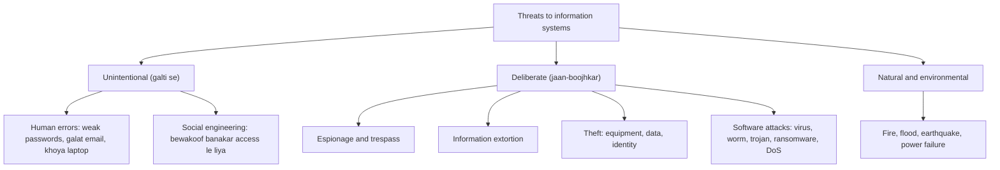
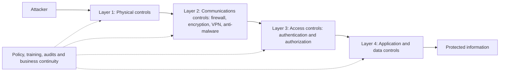
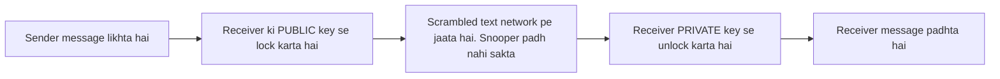

Ye note syllabus <Syl m="3" /> ke sections 3.1 (information security) aur 3.2 (information systems ke threats aur security controls) cover karta hai. Ethics aur privacy, jo 3.1 ka doosra half hai, uska alag note hai.

## Pehle basics

- **Information resource** wo sab kuch hai jo information rakhta ya handle karta hai: computers, phones, servers, networks, databases, software, paper files aur unhe use karne wale log.
- **Asset** wo cheez hai jo organization ke liye valuable hai. Bank mein customer data ek asset hai.
- **Threat** wo cheez hai jo asset ko nuksaan pahuncha sakti hai (hacker, virus, flood, laparwah employee).
- **Vulnerability** ek weakness hai jise threat use kar sakta hai (unpatched server, weak password, khula server room).
- **Risk** is baat ka chance hai ki threat kisi vulnerability se mile aur loss ho. Threat nahi to risk nahi. Weakness nahi to bhi risk nahi.
- **Exposure** wo nuksaan hai jo sach mein hota hai (paisa gaya, data leak hua, trust kharab hua).
- **Control** (safeguard ya countermeasure bhi kehte hain) wo cheez hai jo risk kam karne ke liye lagayi jaati hai.

Analogy: tumhara ghar. Chor threat hai, khuli khidki vulnerability hai, gehne asset hain, chori exposure hai, aur grill, lock aur CCTV controls hain. <Cite id="note-information-security-wiki-infosec" />

## Information security kya hai?

<Box kind="definition">

**Information security** matlab information aur information systems ko unauthorized access, use, disclosure, disruption, change ya destruction se bachana, taaki information **confidential, sahi aur available** rahe jab bhi zaroorat ho. <Cite id="note-information-security-nist-csf" /> <Cite id="note-information-security-ibm-infosec" />

</Box>

**Example.** Ek SBI customer net banking mein login karta hai. Bank user ID, password aur OTP maangta hai (proof ki wahi tum ho), data encrypted HTTPS link se bhejta hai (beech mein koi padh nahi sakta), check karta hai ki amount badla nahi gaya, aur backup server rakhta hai taaki ek server fail ho to bhi service chalti rahe. Ye sab milkar information security hai. <Cite id="note-information-security-gfg-infosec" />

**Ye kyun zaroori hai.** Information ab bahut firms ka sabse valuable asset hai (Amazon ka customer data, bank ke accounts). Isko khone ka matlab hai paise ka loss, legal trouble, customers ka jaana aur naam kharab hona.

Milte-julte words, chhote se bade: **data security** digital data ko protect karti hai; **IT security** technology assets ko; **cybersecurity** digital systems ko networks par hone wale attacks se; **information security** sabse bada umbrella hai aur paper records aur physical protection bhi isme aate hain. <Cite id="note-information-security-ibm-infosec" />

## CIA triad

Information security ke teen basic goals hain: **Confidentiality, Integrity aur Availability**. Har attack inme se ek ya zyada ko hit karta hai, aur har control inme se ek ya zyada ko protect karta hai. <Cite id="note-information-security-gfg-cia" />

| Goal | Meaning | Example of failure | Typical controls |
|---|---|---|---|
| Confidentiality | Sirf authorized log information dekhein | Hacker customers ke card numbers padh leta hai; employee salary sheet share kar deta hai | Encryption, authentication, access control, VPN |
| Integrity | Information complete, accurate ho aur sirf authorized log badal sakein | Koi marks entry ya bank balance badal deta hai; file transit mein corrupt ho jaati hai | Hash checks, digital signatures, version control, audit logs, input validation |
| Availability | Authorized users ko zaroorat par information aur systems mil sakein | Sale ke din DDoS attack shopping site ko down kar deta hai | Backups, redundant servers (failover), DDoS protection, disaster recovery |

<Cite id="note-information-security-gfg-cia" /> <Cite id="note-information-security-tp-ism" />

Kuch books do aur goals jodti hain: **authenticity** (user ya message sach mein wahi hai jo wo bolta hai) aur **non-repudiation** (koi baad mein apna action deny nahi kar sakta, jaise signed payment). <Cite id="note-information-security-tp-ism" />

**Balance zaroori hai.** Network ke bina tijori mein band computer bahut confidential hai par available nahi. Security safety, cost aur ease of use ke beech ka trade-off hai.

<Box kind="exam">

Exam mein English mein likho: "Information security is the protection of information and information systems from unauthorized access, use, disclosure, modification or destruction, to ensure confidentiality, integrity and availability."

</Box>

## Information resources zyada vulnerable kyun ho rahe hain

Rainer aur Prince paanch factors batate hain jo har saal information resources ko zyada vulnerable banate hain. <Cite id="is-fundamentals-wiley-rainer" /> <Cite id="note-information-security-wiki-cybercrime" />

| # | Factor | Risk kyun badhta hai | Specific example |
|---|---|---|---|
| 1 | Aaj ka interconnected, interdependent, wirelessly networked business environment | Har connected device aur partner attacker ke liye ek possible darwaza hai | Shop ka payment system Internet se linked hai; weak supplier link se attackers ghus jaate hain |
| 2 | Chhote, tez, sasste computers aur storage devices | Bahut saara data pen drive ya phone mein aa jaata hai aur khona ya chori hona aasaan hai | Customer records wala laptop gaadi se chori ho gaya |
| 3 | Hacker banne ke liye kam skill chahiye | Ready-made attack tools free online hain, to beginner bhi attack kar sakta hai | Ek teenager downloaded password-cracking tool chalata hai |
| 4 | International organized crime ka cybercrime mein aana | Paise wali gangs profit ke liye attack karti hain aur borders ke paar unhe trace karna mushkil hai | Ransomware gang hospital ki files lock karke payment maangti hai |
| 5 | Management support ki kami | Budget, policy aur dhyan nahi to basic protections skip ho jaati hain | Management server ka patching taal deta hai, aur baad mein wo breach ho jaata hai |

Aur bhi reasons jo aksar jode jaate hain: mobile aur cloud ka zyada use, remote work, bring-your-own-device, aur zaroorat se zyada access wale insiders.

## Information systems ke threats

**Threat** koi bhi danger hai jo information resource ko nuksaan pahuncha sake. Rainer aur Prince mein standard grouping cause ke hisaab se hai. <Cite id="is-fundamentals-wiley-rainer" /> <Cite id="note-information-security-tp-threats" />

### Unintentional threats

- **Human errors.** Employees bina chahe bahut incidents karte hain: weak password chunna, bad link par click karna, file galat person ko email karna, laptop ya pen drive khona, cloud storage bucket galat configure karke public kar dena, software updates skip karna. Higher-level staff zyada risky hote hain kyunki unke paas zyada access hota hai. <Cite id="note-information-security-ibm-infosec" />
- **Social engineering.** Attacker machine todne ke bajay insaan ko bewakoof banata hai. Examples: caller jo bank ya IT desk banke OTP maangta hai; **phishing** emails aur SMS jo real brand ki copy karte hain; koi jo employee ke peeche-peeche secure door se andar chala jaata hai (tailgating). <Cite id="note-information-security-wiki-social-eng" /> <Cite id="note-information-security-gfg-phishing" />

### Deliberate threats

| Threat | What it is | Example |
|---|---|---|
| Espionage or trespass | Secret information tak unauthorized access, rival, hacker ya state dwara | Competitor company server se product plans copy kar leta hai |
| Information extortion | Data churana ya lock karna aur wapas dene ya leak na karne ke liye paisa maangna | Ransomware files unlock karne ke liye payment maangta hai |
| Theft of equipment or information | Laptops, phones, drives churana, ya data copy karna | Banking apps wala chori hua phone; insider customer list copy karta hai |
| Identity theft | Kisi ki personal details (Aadhaar number, card, PAN) use karke uska roop lena | Fraudster victim ke naam par loan le leta hai |
| Sabotage or vandalism | Systems ya websites ko jaan-boojhkar damage karna | Deface ki hui government website; naaraaz employee data delete kar deta hai |
| Software attacks | Malicious programs aur attack methods (neeche) | Virus, worm, trojan, ransomware, DoS |

<Cite id="note-information-security-tp-threats" /> <Cite id="note-information-security-gfg-cyber-attacks" />

### Software attacks detail mein

| Attack | How it works | Key point |
|---|---|---|
| Virus | Program jo file se chipak jaata hai aur file kholne ya share karne par phailta hai | Host file aur user action chahiye |
| Worm | Network par apne aap phailta hai, host ya user action ke bina | Bahut tez; networks ko choke kar sakta hai |
| Trojan horse | Useful dikhta hai par andar harmful code chhupa hota hai | Khud copy nahi hota; user ko bewakoof banakar install karaya jaata hai |
| Spyware and keyloggers | Chupke se dekhte hain tum kya karte ho aur keystrokes ya passwords record karte hain | Passwords aur card numbers churata hai |
| Ransomware | Tumhari files encrypt karta hai aur key ke liye payment maangta hai | Backups sabse achhi defence hain |
| Logic bomb | Chhupa code jo kisi date ya event par trigger hota hai | Aksar insider lagata hai |
| Phishing | Fake emails, SMS ya sites jo users se passwords ya card details nikalwate hain | Spear phishing ek person ko target karta hai; whaling senior executives ko |
| Denial of service (DoS) and DDoS | Server par traffic ki baadh laga deta hai taaki asli users andar na aa sakein; DDoS bahut saari machines (botnet) use karta hai | Availability par attack |
| Man-in-the-middle | Do parties ke beech chupke se baithkar messages padhta ya badalta hai | Open public Wi-Fi par common |
| SQL injection | Web form mein malicious database commands daalkar data padhna ya badalna | Input checks se rukta hai |
| Zero-day attack | Aisi flaw use karta hai jo maker ko abhi pata nahi ya patch nahi hui | Shuru mein koi patch available nahi hota |
| Password attack | Brute force ya dictionary lists se passwords guess ya crack karna | Lambe, unique passwords aur MFA madad karte hain |

<Cite id="note-information-security-wiki-malware" /> <Cite id="note-information-security-gfg-cyber-attacks" /> <Cite id="note-information-security-wiki-dos" />

**Real examples.** May 2017 mein WannaCry ransomware ne lagbhag 150 countries mein 300,000 se zyada computers infect kiye, jisme England ke kai NHS hospitals bhi the. Ye ek Windows flaw se phaila jiska patch Microsoft do mahine pehle hi release kar chuka tha, par bahut systems ne use install nahi kiya tha. <Cite id="note-information-security-wiki-wannacry" />

### Natural and environmental threats

Fire, floods, earthquakes, cyclones, lightning, power failure aur extreme heat servers aur data centres ko destroy kar sakte hain. Inhe roka nahi ja sakta, sirf taiyaari ki ja sakti hai: off-site backups, UPS aur generators, fire protection aur recovery plan.

## Computer crimes kyun hote hain

**Computer crime (cybercrime)** koi bhi illegal act hai jisme computer ya network tool, target ya crime ki jagah ho. <Cite id="note-information-security-wiki-cybercrime" /> <Cite id="note-information-security-gfg-cybercrime" />

| Reason | Crime ko kaise badhawa deta hai |
|---|---|
| Financial gain | Online fraud, ransomware aur card theft mein paisa achha milta hai; ye sabse bada motive hai |
| Easy tools and low skill needed | Free attack kits aur tutorials beginners ko attack karne dete hain |
| Anonymity and borders | Attackers VPN, proxies aur fake identities ke peeche chhupte hain aur doosre country se kaam karte hain, to tracing mushkil hoti hai |
| Weak security and software flaws | Unpatched systems, default passwords aur misconfigurations mein ghusna aasaan hai |
| Human negligence and low awareness | Users links click karte hain, passwords reuse karte hain aur OTP share karte hain |
| Insiders and revenge | Naaraaz ya lalchi employee ke paas pehle se access hota hai |
| Espionage and politics | Competitors, hacktivists aur states secrets churate hain ya services disrupt karte hain |
| Thrill, ego and curiosity | Kuch hackers sirf skill dikhane ke liye attack karte hain |
| Weak laws, enforcement and under-reporting | Pakde jaane ya saza milne ka chance kam; victims aksar report nahi karte |
| Digital growth | Online zyada log, paisa aur data matlab zyada targets (UPI, e-commerce) |

<Cite id="note-information-security-gfg-cybercrime" />

**Cyber crime ke common types:** phishing aur online banking fraud, identity theft, ransomware aur extortion, hacking, DDoS, cyberstalking aur harassment, piracy, cyber terrorism aur espionage. <Cite id="note-information-security-gfg-cybercrime" />

**Indian law.** **Information Technology Act, 2000** (2008 mein amended) main Indian law hai. Jaise, section 66 hacking ko punish karta hai (3 saal tak ki jail aur/ya ₹5 lakh tak fine), 66C kisi aur ke password ke misuse ko, 66D computer resource use karke cheating ko, 66F cyber terrorism ko (life imprisonment tak) aur section 67 electronically obscene material publish karne ko. <Cite id="note-information-security-wiki-itact" /> Incidents national cyber crime portal par report kiye ja sakte hain, aur **CERT-In** cyber security incidents ke liye national agency hai.

## Security controls

**Security control** ek safeguard hai jo threat ko prevent, detect ya uska effect kam karta hai. <Cite id="note-information-security-wiki-controls" /> <Cite id="note-information-security-nist-800-53" />

### Function ke hisaab se control types

| Type | Job | Examples |
|---|---|---|
| Preventive | Incident hone se pehle rokna | Locks, firewall, passwords, encryption, training, patching |
| Deterrent | Logon ko try karne karne se hatana | Warning signs, CCTV, strong penalties, security policy |
| Detective | Jo incident chal raha hai ya ho chuka hai use dhundhna aur report karna | Intrusion detection, log monitoring, audits, alarms, CCTV recording |
| Corrective | Nuksaan theek karke normal kaam wapas laana | Backup se restore, malware hataana, patch lagana, recovery plan |
| Compensating | Jo main control missing ya fail hai uski jagah lena, taaki risk phir bhi cover rahe | Automatic check na ho sake to extra manual approval; purane system par extra monitoring jise patch nahi kar sakte |

<Cite id="note-information-security-wiki-controls" /> <Cite id="note-information-security-tp-ism" />

### Nature ke hisaab se control types

| Nature | What it is | Examples |
|---|---|---|
| Physical | Buildings aur equipment ki tangible protection | Fences, guards, door locks, ID cards, CCTV, fire extinguishers, server-room access |
| Technical (logical) | Software aur hardware protections | Authentication, firewall, antivirus, encryption, IDS |
| Administrative (procedural) | Rules, people aur process | Security policy, training, background checks, separation of duties, incident response plan |
| Legal and compliance | Laws aur regulations | IT Act 2000, data protection rules, company contracts |

<Cite id="note-information-security-wiki-controls" />

<Box kind="intuition">

Yahi idea airport par socho. Boundary wall aur guards physical controls hain. Passport aur boarding-pass checks access controls hain. Metal detector aur baggage scanner detective controls hain. Kya le ja sakte ho uske rules administrative controls hain. Emergency plan corrective control hai.

</Box>

### Defence in depth: layers

Sirf ek control kaafi nahi hota. Organizations kai layers lagate hain, taaki ek fail ho to agli phir bhi protect kare. Isse **defence in depth** kehte hain. Rainer aur Prince controls ko physical, access, communications, business continuity aur audit controls mein group karte hain. <Cite id="is-fundamentals-wiley-rainer" /> <Cite id="note-information-security-nist-800-53" />

**1. Physical controls** buildings aur hardware ko protect karte hain: locked server rooms, ID badges, biometric doors, guards, CCTV, fire aur flood protection, UPS aur generators. Walls aur locks remote hacker ko nahi rokte, isliye physical controls ko baaki ke saath milana padta hai.

**2. Access controls** decide karte hain ki kaun kya resource use kar sakta hai aur kya kar sakta hai. <Cite id="note-information-security-wiki-mfa" />

- **Authentication** prove karta hai ki tum kaun ho. Methods: kuch jo tum **jaante ho** (password, PIN), kuch jo tumhare **paas hai** (phone par OTP, smart card, token), kuch jo tum **ho** (fingerprint, face, iris) aur kabhi kuch jo tum **karte ho** (typing ya voice pattern). **Multi-factor authentication (MFA)** inme se do ya zyada use karta hai, to sirf churaya hua password kaafi nahi hota.
- **Authorization** decide karta hai ki prove ho chuka user job ke hisaab se kya kar sakta hai. **Least privilege** ka rule kehta hai: kaam ke liye jitna access chahiye utna hi do. Clerk data enter kar sakta hai par salary rates nahi badal sakta.

**3. Communications (network) controls** movement mein data aur network ko khud protect karte hain:

- **Firewall:** ek system jo trusted network aur Internet ke beech baithta hai aur rules ke hisaab se traffic allow ya block karta hai. <Cite id="note-information-security-wiki-firewall" />
- **Anti-malware software:** viruses, worms, trojans aur spyware dhundhta aur hataata hai; up to date rakha jaata hai.
- **Whitelisting and blacklisting:** whitelisting sirf approved programs allow karti hai; blacklisting known bad programs ko block karti hai.
- **Encryption:** data ko key se scramble karta hai taaki sirf sahi person padh sake. Symmetric encryption mein ek shared key hoti hai; public-key (asymmetric) encryption mein lock karne ke liye public key aur unlock karne ke liye private key hoti hai. HTTPS aur WhatsApp ki end-to-end encryption ise use karte hain. <Cite id="note-information-security-wiki-pubkey" />
- **Virtual private network (VPN):** public Internet par ek encrypted tunnel, jo remote staff office network tak safely pahunchne ke liye use karta hai. <Cite id="note-information-security-wiki-vpn" />
- **Intrusion detection and prevention systems (IDS/IPS)** aur **employee monitoring** attacks aur misuse par nazar rakhte hain.
- **Secure web protocols (TLS/HTTPS)** online shopping aur banking ko protect karte hain.

<Cite id="note-information-security-wiki-pubkey" loc="diagram" />

**4. Business continuity (disaster recovery) controls** disaster ya attack ke baad business ko chalu rakhte hain ya restore karte hain. <Cite id="note-information-security-wiki-bcp" /> <Cite id="note-information-security-wiki-dr" />

- **Business continuity plan** batata hai ki incident ke dauran aur baad critical kaam kaise chalta rahe; **disaster recovery plan** batata hai ki IT systems kaise restore honge.
- **Backups** (doosri jagah rakhi copies, ideally offline bhi) aur **redundancy** (spare servers, power, links).
- **Backup sites:** **hot site** poori tarah equipped duplicate hai jo lagbhag turant kaam sambhal sakta hai; **warm site** mein hardware aur network hota hai par data load karna padta hai; **cold site** power aur connectivity wali khaali jagah hai jahan equipment laana padta hai. Hot sabse tez aur sabse mehnga; cold sabse slow aur sabse sasta.

**5. Information systems auditing** check karta hai ki controls hain aur kaam kar rahe hain. **IT audit** systems, policies aur logs ko review karta hai (internal ya bahar ke auditor se) aur gaps report karta hai, taaki problems attacker se pehle mil jaayein. Audit trails (logs) ye trace karne mein bhi madad karte hain ki kisne kya kiya. <Cite id="note-information-security-wiki-itaudit" />

### Risk management: kya karna hai ye decide karna

Koi system 100 percent safe nahi hota, isliye organizations risk study karke strategy chunte hain. <Cite id="is-fundamentals-wiley-rainer" />

| Strategy | Meaning | Example |
|---|---|---|
| Risk acceptance | Risk accept karo aur hone par loss uthao | Chhoti shop sasta router insure nahi karti |
| Risk limitation | Loss kam karne ke liye controls lagao | Firewall, backups, training |
| Risk transference | Risk kisi aur ko de do | Cyber insurance, strong security wale cloud provider par jaana |

Steps: assets pehchano, threats aur vulnerabilities dhundho, likelihood aur loss estimate karo, controls par utna hi kharch karo jitna unse bachne wale loss se kam ho, aur phir review karo. NIST Cybersecurity Framework kaam ko isi tarah organize karta hai: **Identify, Protect, Detect, Respond, Recover** (version 2.0 mein **Govern** bhi judta hai). <Cite id="note-information-security-nist-csf" />

## Cyber security improve karne ke measures, examples ke saath

Ye question baar-baar poocha jaata hai, isliye ye list yaad karo. <Cite id="note-information-security-cisa-practices" /> <Cite id="note-information-security-nist-csf" /> <Cite id="note-information-security-ibm-infosec" />

| # | Measure | What to do | Example |
|---|---|---|---|
| 1 | Strong passwords and multi-factor authentication | Lambe unique passwords, password manager, aur second factor | Banking apps password ke saath OTP ya fingerprint maangte hain |
| 2 | Keep software updated (patching) | Security updates jaldi install karo, unsupported software hata do | March 2017 ka Windows patch install hota to WannaCry block ho jaata |
| 3 | Antivirus and anti-malware | Har device par chalao aur update rakho | Endpoint protection downloaded file scan karke trojan block karta hai |
| 4 | Firewall and network security | Traffic filter karo, networks alag rakho, secure Wi-Fi, IDS | Company firewall known bad addresses ka traffic block karta hai |
| 5 | Encryption | Storage aur transit dono mein data encrypt karo | Flipkart checkout par HTTPS; encrypted laptop disks |
| 6 | Regular backups | Copies offline ya doosri jagah rakho aur restore test karo | Company bina payment diye ransomware ke baad files restore kar leti hai |
| 7 | Access control and least privilege | Sirf zaroori access do, staff jaane par access hata do | Clerk payroll database nahi khol sakta |
| 8 | Training and awareness | Staff ko phishing pehchanna, incidents report karna aur data handle karna sikhao | Bank employees ke liye mock phishing drills chalata hai |
| 9 | Security policy and audits | Written rules, regular IT audits aur penetration tests | Saalana audit attackers se pehle ek open server pakad leta hai |
| 10 | Monitoring and incident response plan | Logs rakho, alerts dekho, aur plan ready rakho: detect, contain, recover, learn | SOC team infected laptop ko minutes mein isolate kar deti hai |
| 11 | Secure development and testing | Input validate karo, code test karo, known flaws fix karo | Input checks login form par SQL injection rok dete hain |
| 12 | Legal compliance and reporting | IT Act aur data rules follow karo, incidents authorities ko report karo | Fraud ko cyber crime helpline aur CERT-In ko report karna |

**Conclusion.** Cyber security koi ek tool nahi hai. Ye technology, people aur process ka milkar kaam karna hai, aur ise lagatar review karna padta hai kyunki attackers apne tareeke badalte rehte hain.

## Kya security ek ethical responsibility hai? (case study)

Haan. Organizations ke paas dusron ka personal aur financial data hota hai. Use collect karne se ek **duty of care** banti hai: use protect karna, sirf bataye gaye purpose ke liye use karna, kho jaaye to logon ko jaldi batana, aur weaknesses fix karna. Data protect na karne se asli logon ko nuksaan hota hai (fraud, stress, paise ka loss), isliye security failure sirf technical galti nahi, ethical failure bhi hai. Privacy ke liye bhi security chahiye: data secure nahi hai to private nahi rakh sakte. <Cite id="is-fundamentals-pearson-laudon" />

**Case study: Equifax breach, 2017.** Equifax ek US credit reporting company hai jiske paas karodon logon ka data hai. Apache Struts software ka critical patch 7 March 2017 ko release hua, par Equifax ne use apni credit dispute website par apply nahi kiya. Attackers ne 12 May 2017 se is flaw ka use kiya, aur breach 76 din tak notice nahi hua (29 July ko mila, 7 September ko announce hua). Lagbhag 147.9 million Americans affect hue, saath mein UK aur Canada ke lakhon log, aur names, birth dates, social security numbers aur addresses expose hue. Reports mein ye bhi aaya ki pehle se flag ki hui patching backlog, weak network design aur kuch accounts par weak credentials the. <Cite id="note-information-security-wiki-equifax" />

Consequences: share price ek din mein lagbhag 13 percent gira, CEO ne retire kiya, aur 2019 mein Equifax US regulators aur states ke saath kam se kam 575 aur zyada se zyada 700 million US dollars ke settlement par agree hua, saath mein UK mein penalties. <Cite id="note-information-security-wiki-equifax" />

Ethical lesson: company ko flaw ka pata tha aur uski duty thi ki jaldi patch kare, monitor kare, aur public ko jaldi bataye. Jin logon ko nuksaan hua unhone khud Equifax ko apna data nahi diya tha, isse duty aur mazboot ho jaati hai.

<Box kind="pitfall">

Ethics case study mein sirf technical points mat likho. Hamesha duty se jodo: data kiska hai, kise nuksaan hua, organization ko kya karna chahiye tha, aur usne kaun se rules toode.

</Box>

## Information security ek nazar mein

| Point | Short answer |
|---|---|
| Goal | Confidentiality, integrity, availability |
| Main weakness | Humans (errors, social engineering) aur unpatched software |
| Main threats | Human error, social engineering, malware, ransomware, DoS, theft, espionage, natural disasters |
| Control types | Preventive, detective, corrective (saath mein deterrent, compensating) |
| Control layers | Physical, access, communications, business continuity, audit |
| Law (India) | IT Act, 2000 (2008 mein amended); incidents ke liye CERT-In |
| Biggest rule | Layered defence: kabhi ek control par depend mat karo |

## Ye kahan poocha gaya

| If the question says | What to write | Seen as |
|---|---|---|
| "Types of control to achieve security" | Function ke hisaab se control (preventive, detective, corrective, deterrent, compensating) aur nature ke hisaab se (physical, technical, administrative), phir layers har ek ke ek example ke saath | <PYQ id="2022-12-ce/q2a" /> |
| "Role of Confidentiality, Integrity and Availability" | CIA diagram, har ek ka paragraph aur example, failure examples, controls table, trade-off, conclusion | <PYQ id="2022-12-ce/q4b" /> |
| "Measures to improve cyber security with example" | Chhota intro, 10 se 12 measures ki table har ek ke example ke saath, conclusion | <PYQ id="2023-05-ce/q3a" /> <PYQ id="2023-12-ce/q5a" /> <PYQ id="2024-12-ce/q3a" /> <PYQ id="2024-12-ce/q4a" /> |
| "Five factors for increasing vulnerability of information resources" | Paanch factors har ek ke specific example ke saath | <PYQ id="2023-12-ce/q1b" /> |
| "Major security threats and measures to control them" | Threat tree, unintentional aur deliberate threats, software attacks table, phir control layers | <PYQ id="2023-12-ce/q3a" /> |
| "Define information security with an example" | Definition, ek line mein CIA, banking example | <PYQ id="2024-05-ce/q1c" /> <PYQ id="2025-05-ce/q1b" /> |
| "Is security an ethical responsibility? Case study" | Duty of care, privacy link, Equifax case, lesson | <PYQ id="2024-05-ce/q5b" /> |
| "Main reasons of computer crimes" | Definition, reasons table, crime types, IT Act, prevention | <PYQ id="2024-12-ce/q5b" /> <PYQ id="2025-05-ce/q2b" /> |

## Quick revision

- **Information security** information aur systems ko misuse se bachati hai, unhe confidential, sahi aur available (**CIA**) rakhti hai.
- **Threat** (danger) + **vulnerability** (weakness) = **risk**; **control** use kam karta hai.
- Paanch vulnerability factors: interconnected networks, chhota sasta storage, aasaan hacking skills, organized crime, weak management support.
- Threats: **unintentional** (human errors, social engineering), **deliberate** (espionage, extortion, theft, identity theft, malware, DoS), **natural**.
- Virus ko host chahiye; worm akela phailta hai; trojan disguised hota hai; ransomware files lock karta hai; DoS availability par attack karta hai; phishing logon ko bewakoof banata hai.
- Control types: **preventive, deterrent, detective, corrective, compensating**; nature se **physical, technical, administrative**.
- Control layers: **physical, access (authentication, authorization), communications (firewall, encryption, VPN, anti-malware), business continuity (backup, hot/warm/cold site), audit**.
- Cyber security measures: strong passwords aur MFA, patching, antivirus, firewall, encryption, backups, least privilege, training, audits, incident plan, legal reporting.
- Computer crime ke reasons: paisa, aasaan tools, anonymity, weak security, negligence, insiders, weak enforcement.
- India: **IT Act, 2000**; CERT-In.
- Equifax 2017: ek missed patch, lagbhag 148 million log affect, duty-of-care failure.
