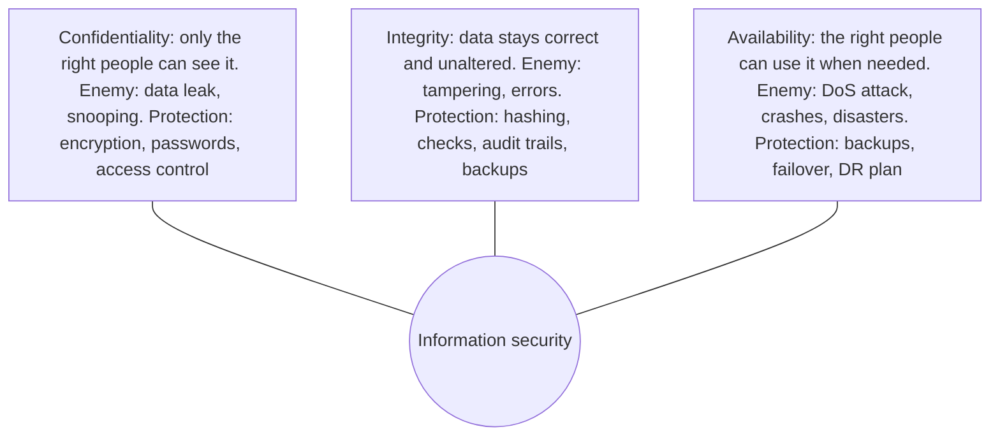
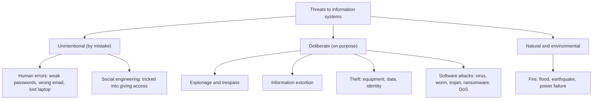
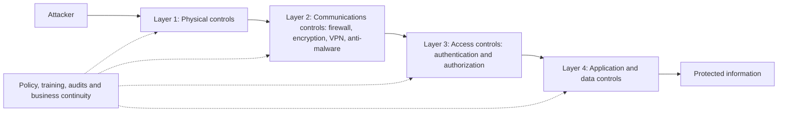
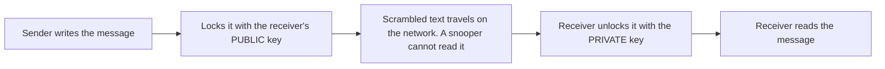

This note covers syllabus <Syl m="3" />, sections 3.1 (information security) and 3.2 (threats to information systems and security controls). Ethics and privacy, the other half of section 3.1, have their own note.

## The basics first

- An **information resource** is anything that holds or handles information: computers, phones, servers, networks, databases, software, paper files and the people who use them.
- An **asset** is something of value to the organization. Customer data in a bank is an asset.
- A **threat** is anything that can cause harm to an asset (a hacker, a virus, a flood, a careless employee).
- A **vulnerability** is a weakness that a threat can use (an unpatched server, a weak password, an unlocked server room).
- **Risk** is the chance that a threat meets a vulnerability and causes a loss. No threat, no risk. No weakness, no risk.
- An **exposure** is the harm or loss that actually happens (money lost, data leaked, trust damaged).
- A **control** (also called a safeguard or countermeasure) is anything you put in place to reduce risk.

Analogy: your home. The thief is the threat, the open window is the vulnerability, the jewellery is the asset, the burglary is the exposure, and the grill, lock and CCTV are controls. <Cite id="note-information-security-wiki-infosec" />

## What is information security?

<Box kind="definition">

**Information security** is the protection of information and information systems from unauthorized access, use, disclosure, disruption, change or destruction, so that the information stays **confidential, correct and available** when needed. <Cite id="note-information-security-nist-csf" /> <Cite id="note-information-security-ibm-infosec" />

</Box>

**Example.** An SBI customer logs in to net banking. The bank asks for a user ID, a password and an OTP (proof it is really you), sends the data over an encrypted HTTPS link (nobody on the way can read it), checks that the amount is not altered, and keeps a backup server so the service is up even if one server fails. All of these together are information security. <Cite id="note-information-security-gfg-infosec" />

**Why it is needed.** Information is now the most valuable asset of many firms (Amazon's customer data, a bank's accounts). Its loss means money loss, legal trouble, lost customers and a damaged name.

Related words, from small to big: **data security** protects digital data; **IT security** protects technology assets; **cybersecurity** protects digital systems from attacks over networks; **information security** is the widest umbrella and includes paper records and physical protection too. <Cite id="note-information-security-ibm-infosec" />

## The CIA triad

The three basic goals of information security are **Confidentiality, Integrity and Availability**. Every attack hits one or more of them, and every control protects one or more of them. <Cite id="note-information-security-gfg-cia" />

| Goal | Meaning | Example of failure | Typical controls |
|---|---|---|---|
| Confidentiality | Only authorized people see the information | A hacker reads customers' card numbers; an employee shares a salary sheet | Encryption, authentication, access control, VPN |
| Integrity | Information is complete, accurate and changed only by authorized people | Someone alters a marks entry or a bank balance; a file is corrupted in transit | Hash checks, digital signatures, version control, audit logs, input validation |
| Availability | Authorized users can reach information and systems when needed | A DDoS attack takes a shopping site down on a sale day | Backups, redundant servers (failover), DDoS protection, disaster recovery |

<Cite id="note-information-security-gfg-cia" /> <Cite id="note-information-security-tp-ism" />

Some books add two more goals: **authenticity** (the user or message really is who or what it claims) and **non-repudiation** (a person cannot later deny an action, for example a signed payment). <Cite id="note-information-security-tp-ism" />

**Balance matters.** A computer locked in a safe with no network is very confidential but not available. Security is a trade-off between safety, cost and ease of use.

<Box kind="exam">

Exam mein English mein likho: "Information security is the protection of information and information systems from unauthorized access, use, disclosure, modification or destruction, to ensure confidentiality, integrity and availability."

</Box>

## Why information resources are becoming more vulnerable

Rainer and Prince list five factors that make information resources more vulnerable every year. <Cite id="is-fundamentals-wiley-rainer" /> <Cite id="note-information-security-wiki-cybercrime" />

| # | Factor | Why it increases risk | Specific example |
|---|---|---|---|
| 1 | Today's interconnected, interdependent, wirelessly networked business environment | Every connected device and partner is a possible door for an attacker | A shop's payment system linked to the Internet; a weak supplier link lets attackers in |
| 2 | Smaller, faster, cheaper computers and storage devices | Huge data fits in a pen drive or phone and is easy to lose or steal | A laptop with customer records is stolen from a car |
| 3 | Decreasing skill needed to be a hacker | Ready-made attack tools are free online, so a beginner can attack | A teenager runs a downloaded password-cracking tool |
| 4 | International organized crime taking over cybercrime | Well-funded gangs attack for profit and are hard to trace across borders | A ransomware gang locks a hospital's files and demands payment |
| 5 | Lack of management support | Without budget, policy and attention, basic protections are skipped | Management delays patching a server, and it is later breached |

Other reasons often added: more mobile and cloud use, remote work, bring-your-own-device, and insiders with too much access.

## Threats to information systems

A **threat** is any danger that can harm an information resource. The standard grouping in Rainer and Prince is by cause. <Cite id="is-fundamentals-wiley-rainer" /> <Cite id="note-information-security-tp-threats" />

### Unintentional threats

- **Human errors.** Employees cause a large share of incidents without meaning to: choosing a weak password, clicking a bad link, emailing a file to the wrong person, losing a laptop or pen drive, misconfiguring a cloud storage bucket so it is public, skipping software updates. Higher-level staff are riskier because they have wider access. <Cite id="note-information-security-ibm-infosec" />
- **Social engineering.** The attacker tricks a person instead of breaking a machine. Examples: a caller who pretends to be the bank or IT desk and asks for an OTP; **phishing** emails and SMS that copy a real brand; someone who follows an employee through a secure door (tailgating). <Cite id="note-information-security-wiki-social-eng" /> <Cite id="note-information-security-gfg-phishing" />

### Deliberate threats

| Threat | What it is | Example |
|---|---|---|
| Espionage or trespass | Gaining unauthorized access to secret information, by a rival, a hacker or a state | A competitor copies product plans from a company server |
| Information extortion | Stealing or locking data and demanding money for returning it or not leaking it | Ransomware demands payment to unlock files |
| Theft of equipment or information | Stealing laptops, phones, drives, or copying data | A stolen phone with banking apps; an insider copying a customer list |
| Identity theft | Using someone's personal details (Aadhaar number, card, PAN) to pose as them | A fraudster takes a loan in a victim's name |
| Sabotage or vandalism | Damaging systems or websites on purpose | A defaced government website; a disgruntled employee deleting data |
| Software attacks | Malicious programs and attack methods (below) | Virus, worm, trojan, ransomware, DoS |

<Cite id="note-information-security-tp-threats" /> <Cite id="note-information-security-gfg-cyber-attacks" />

### Software attacks in detail

| Attack | How it works | Key point |
|---|---|---|
| Virus | A program that attaches itself to a file and spreads when the file is opened or shared | Needs a host file and a user action |
| Worm | Spreads by itself across a network without a host or user action | Very fast; can choke networks |
| Trojan horse | Looks useful but hides harmful code | Does not copy itself; the user is tricked into installing it |
| Spyware and keyloggers | Secretly watch what you do and record keystrokes or passwords | Steals passwords and card numbers |
| Ransomware | Encrypts your files and demands payment for the key | Backups are the best defence |
| Logic bomb | Hidden code that triggers on a date or event | Often planted by an insider |
| Phishing | Fake emails, SMS or sites that trick users into giving passwords or card details | Spear phishing targets one person; whaling targets senior executives |
| Denial of service (DoS) and DDoS | Floods a server with traffic so real users cannot get in; DDoS uses many machines (a botnet) | Attacks availability |
| Man-in-the-middle | Secretly sits between two parties to read or change messages | Common on open public Wi-Fi |
| SQL injection | Malicious database commands typed into a web form to read or change data | Prevented by input checks |
| Zero-day attack | Uses a flaw the maker does not yet know or has not yet patched | No patch is available at first |
| Password attack | Guessing or cracking passwords by brute force or dictionary lists | Long, unique passwords and MFA help |

<Cite id="note-information-security-wiki-malware" /> <Cite id="note-information-security-gfg-cyber-attacks" /> <Cite id="note-information-security-wiki-dos" />

**Real examples.** In May 2017 the WannaCry ransomware infected over 300,000 computers in about 150 countries, including many NHS hospitals in England. It spread through a Windows flaw for which Microsoft had already released a patch two months earlier, but many systems had not installed it. <Cite id="note-information-security-wiki-wannacry" />

### Natural and environmental threats

Fire, floods, earthquakes, cyclones, lightning, power failure and extreme heat can destroy servers and data centres. They cannot be stopped, only prepared for: off-site backups, UPS and generators, fire protection and a recovery plan.

## Why computer crimes happen

**Computer crime (cybercrime)** is any illegal act in which a computer or network is the tool, the target or the place of the crime. <Cite id="note-information-security-wiki-cybercrime" /> <Cite id="note-information-security-gfg-cybercrime" />

| Reason | How it encourages crime |
|---|---|
| Financial gain | Online fraud, ransomware and card theft pay well; this is the biggest motive |
| Easy tools and low skill needed | Free attack kits and tutorials let beginners attack |
| Anonymity and borders | Attackers hide behind VPNs, proxies and fake identities and act from another country, which makes tracing hard |
| Weak security and software flaws | Unpatched systems, default passwords and misconfigurations are easy to enter |
| Human negligence and low awareness | Users click links, reuse passwords and share OTPs |
| Insiders and revenge | A disgruntled or greedy employee already has access |
| Espionage and politics | Competitors, hacktivists and states steal secrets or disrupt services |
| Thrill, ego and curiosity | Some hackers attack just to show skill |
| Weak laws, enforcement and under-reporting | Low chance of being caught or punished; victims often do not report |
| Digital growth | More people, money and data online means more targets (UPI, e-commerce) |

<Cite id="note-information-security-gfg-cybercrime" />

**Common types of cyber crime:** phishing and online banking fraud, identity theft, ransomware and extortion, hacking, DDoS, cyberstalking and harassment, piracy, cyber terrorism and espionage. <Cite id="note-information-security-gfg-cybercrime" />

**Indian law.** The **Information Technology Act, 2000** (amended in 2008) is the main Indian law. For example, section 66 punishes hacking (up to 3 years and/or a fine up to ₹5 lakh), 66C punishes misuse of another person's password, 66D punishes cheating by using a computer resource, 66F punishes cyber terrorism (up to life imprisonment) and section 67 punishes publishing obscene material electronically. <Cite id="note-information-security-wiki-itact" /> Incidents can be reported on the national cyber crime portal, and **CERT-In** is the national agency for cyber security incidents.

## Security controls

A **security control** is a safeguard that prevents, detects or reduces the effect of a threat. <Cite id="note-information-security-wiki-controls" /> <Cite id="note-information-security-nist-800-53" />

### Types of control by function

| Type | Job | Examples |
|---|---|---|
| Preventive | Stop an incident before it happens | Locks, firewall, passwords, encryption, training, patching |
| Deterrent | Discourage people from trying | Warning signs, CCTV, strong penalties, security policy |
| Detective | Find and report an incident that is happening or happened | Intrusion detection, log monitoring, audits, alarms, CCTV recording |
| Corrective | Fix the damage and restore normal work | Restore from backup, remove malware, apply patch, recovery plan |
| Compensating | Stand in for a main control that is missing or has failed, so the risk is still covered | Extra manual approval when an automatic check is not possible; extra monitoring on an old system that cannot be patched |

<Cite id="note-information-security-wiki-controls" /> <Cite id="note-information-security-tp-ism" />

### Types of control by nature

| Nature | What it is | Examples |
|---|---|---|
| Physical | Tangible protection of buildings and equipment | Fences, guards, door locks, ID cards, CCTV, fire extinguishers, server-room access |
| Technical (logical) | Software and hardware protections | Authentication, firewall, antivirus, encryption, IDS |
| Administrative (procedural) | Rules, people and process | Security policy, training, background checks, separation of duties, incident response plan |
| Legal and compliance | Laws and regulations | IT Act 2000, data protection rules, company contracts |

<Cite id="note-information-security-wiki-controls" />

<Box kind="intuition">

Think of the same idea at the airport. A boundary wall and guards are physical controls. Passport and boarding-pass checks are access controls. The metal detector and baggage scanner are detective controls. Rules about what you can carry are administrative controls. The emergency plan is a corrective control.

</Box>

### Defence in depth: the layers

No single control is enough. Organizations stack several layers, so if one fails, the next still protects. This is called **defence in depth**. Rainer and Prince group the controls into physical, access, communications, business continuity and audit controls. <Cite id="is-fundamentals-wiley-rainer" /> <Cite id="note-information-security-nist-800-53" />

**1. Physical controls** protect buildings and hardware: locked server rooms, ID badges, biometric doors, guards, CCTV, fire and flood protection, UPS and generators. Walls and locks do not stop a remote hacker, so physical controls must be combined with the others.

**2. Access controls** decide who may use a resource and what they may do. <Cite id="note-information-security-wiki-mfa" />

- **Authentication** proves who you are. Methods: something you **know** (password, PIN), something you **have** (OTP on phone, smart card, token), something you **are** (fingerprint, face, iris) and sometimes something you **do** (typing or voice pattern). **Multi-factor authentication (MFA)** uses two or more of these, so a stolen password alone is not enough.
- **Authorization** decides what a proven user may do, based on the job. The rule of **least privilege** says: give only the access needed for the work. A clerk can enter data but not change the salary rates.

**3. Communications (network) controls** protect data in movement and the network itself:

- **Firewall:** a system that sits between a trusted network and the Internet and allows or blocks traffic by rules. <Cite id="note-information-security-wiki-firewall" />
- **Anti-malware software:** finds and removes viruses, worms, trojans and spyware; kept up to date.
- **Whitelisting and blacklisting:** whitelisting allows only approved programs; blacklisting blocks known bad ones.
- **Encryption:** scrambles data with a key so that only the right person can read it. Symmetric encryption uses one shared key; public-key (asymmetric) encryption uses a public key to lock and a private key to unlock. HTTPS and WhatsApp's end-to-end encryption use it. <Cite id="note-information-security-wiki-pubkey" />
- **Virtual private network (VPN):** an encrypted tunnel over the public Internet, used by remote staff to reach the office network safely. <Cite id="note-information-security-wiki-vpn" />
- **Intrusion detection and prevention systems (IDS/IPS)** and **employee monitoring** watch for attacks and misuse.
- **Secure web protocols (TLS/HTTPS)** protect online shopping and banking.

<Cite id="note-information-security-wiki-pubkey" loc="diagram" />

**4. Business continuity (disaster recovery) controls** keep the business running or restore it after a disaster or attack. <Cite id="note-information-security-wiki-bcp" /> <Cite id="note-information-security-wiki-dr" />

- A **business continuity plan** says how critical work continues during and after an incident; a **disaster recovery plan** says how IT systems are restored.
- **Backups** (copies kept in another place, ideally offline too) and **redundancy** (spare servers, power, links).
- **Backup sites:** a **hot site** is a fully equipped duplicate that can take over almost at once; a **warm site** has hardware and network but needs data loaded; a **cold site** is an empty space with power and connectivity where equipment must be brought in. Hot is fastest and costliest; cold is slowest and cheapest.

**5. Information systems auditing** checks that controls exist and work. An **IT audit** reviews systems, policies and logs (internal or by an outside auditor) and reports gaps, so problems are found before an attacker finds them. Audit trails (logs) also help to trace who did what. <Cite id="note-information-security-wiki-itaudit" />

### Risk management: deciding what to do

Since no system is 100 percent safe, organizations study the risk and then choose a strategy. <Cite id="is-fundamentals-wiley-rainer" />

| Strategy | Meaning | Example |
|---|---|---|
| Risk acceptance | Accept the risk and bear the loss if it happens | A small shop does not insure a cheap router |
| Risk limitation | Put controls in place to cut the loss | Firewall, backups, training |
| Risk transference | Move the risk to someone else | Cyber insurance, moving to a cloud provider with strong security |

The steps: identify assets, find threats and vulnerabilities, estimate the likelihood and the loss, spend on controls whose cost is less than the loss they prevent, and review again. This is how the NIST Cybersecurity Framework organizes the work: **Identify, Protect, Detect, Respond, Recover** (version 2.0 adds **Govern**). <Cite id="note-information-security-nist-csf" />

## Measures to improve cyber security, with examples

This question is asked again and again, so learn this list. <Cite id="note-information-security-cisa-practices" /> <Cite id="note-information-security-nist-csf" /> <Cite id="note-information-security-ibm-infosec" />

| # | Measure | What to do | Example |
|---|---|---|---|
| 1 | Strong passwords and multi-factor authentication | Long unique passwords, a password manager, and a second factor | Banking apps ask for password plus OTP or fingerprint |
| 2 | Keep software updated (patching) | Install security updates quickly, retire unsupported software | Installing the March 2017 Windows patch would have blocked WannaCry |
| 3 | Antivirus and anti-malware | Run and update on every device | Endpoint protection scans a downloaded file and blocks a trojan |
| 4 | Firewall and network security | Filter traffic, separate networks, use secure Wi-Fi, IDS | A company firewall blocks traffic from known bad addresses |
| 5 | Encryption | Encrypt data in storage and in transit | HTTPS on Flipkart checkout; encrypted laptop disks |
| 6 | Regular backups | Keep copies offline or in another location and test restore | A company restores files after ransomware without paying |
| 7 | Access control and least privilege | Give only needed access, remove access when staff leave | A clerk cannot open the payroll database |
| 8 | Training and awareness | Teach staff to spot phishing, report incidents and handle data | A bank runs mock phishing drills for employees |
| 9 | Security policy and audits | Written rules, regular IT audits and penetration tests | An annual audit finds an open server before attackers do |
| 10 | Monitoring and incident response plan | Log, watch alerts, and have a plan ready: detect, contain, recover, learn | A SOC team isolates an infected laptop within minutes |
| 11 | Secure development and testing | Validate input, test code, fix known flaws | Input checks stop SQL injection on a login form |
| 12 | Legal compliance and reporting | Follow the IT Act and data rules, report incidents to authorities | Reporting a fraud to the cyber crime helpline and CERT-In |

**Conclusion.** Cyber security is not one tool. It is technology, people and process working together, and it must be reviewed continuously because attackers keep changing their methods.

## Is security an ethical responsibility? (case study)

Yes. Organizations hold personal and financial data that belongs to other people. Collecting it creates a **duty of care**: to protect it, to use it only for the stated purpose, to tell people quickly if it is lost, and to fix weaknesses. Failing to protect data harms real people (fraud, stress, lost money), so a security failure is not only a technical error but also an ethical failure. Security is also needed for privacy: you cannot keep data private if it is not secure. <Cite id="is-fundamentals-pearson-laudon" />

**Case study: Equifax breach, 2017.** Equifax is a US credit reporting company holding data on hundreds of millions of people. A critical patch for the Apache Struts software was released on 7 March 2017, but Equifax did not apply it to its credit dispute website. Attackers used the flaw from 12 May 2017, and the breach went unnoticed for 76 days (found on 29 July, announced 7 September). About 147.9 million Americans were affected, plus millions in the UK and Canada, with names, birth dates, social security numbers and addresses exposed. Reports also noted a patching backlog flagged earlier, weak network design and weak credentials on some accounts. <Cite id="note-information-security-wiki-equifax" />

Consequences: share price fell about 13 percent in a day, the CEO retired, and in 2019 Equifax agreed to a settlement of at least 575 million and up to 700 million US dollars with US regulators and states, plus penalties in the UK. <Cite id="note-information-security-wiki-equifax" />

Ethical lesson: the company knew about the flaw and had a duty to patch quickly, to monitor, and to tell the public promptly. The people harmed never chose to give Equifax their data, which makes the duty stronger.

<Box kind="pitfall">

Do not write only technical points in an ethics case study. Always link back to duty: whose data it is, who is harmed, what the organization should have done, and what rules it broke.

</Box>

## Information security at a glance

| Point | Short answer |
|---|---|
| Goal | Confidentiality, integrity, availability |
| Main weakness | Humans (errors, social engineering) and unpatched software |
| Main threats | Human error, social engineering, malware, ransomware, DoS, theft, espionage, natural disasters |
| Control types | Preventive, detective, corrective (also deterrent, compensating) |
| Control layers | Physical, access, communications, business continuity, audit |
| Law (India) | IT Act, 2000 (amended 2008); CERT-In for incidents |
| Biggest rule | Layered defence: never rely on one control |

## Where this was asked

| If the question says | What to write | Seen as |
|---|---|---|
| "Types of control to achieve security" | Control by function (preventive, detective, corrective, deterrent, compensating) and by nature (physical, technical, administrative), then the layers with one example each | <PYQ id="2022-12-ce/q2a" /> |
| "Role of Confidentiality, Integrity and Availability" | CIA diagram, a paragraph and example for each, failure examples, controls table, trade-off, conclusion | <PYQ id="2022-12-ce/q4b" /> |
| "Measures to improve cyber security with example" | Short intro, the 10 to 12 measures table with an example for each, conclusion | <PYQ id="2023-05-ce/q3a" /> <PYQ id="2023-12-ce/q5a" /> <PYQ id="2024-12-ce/q3a" /> <PYQ id="2024-12-ce/q4a" /> |
| "Five factors for increasing vulnerability of information resources" | The five factors with a specific example each | <PYQ id="2023-12-ce/q1b" /> |
| "Major security threats and measures to control them" | Threat tree, unintentional and deliberate threats, software attacks table, then the control layers | <PYQ id="2023-12-ce/q3a" /> |
| "Define information security with an example" | Definition, CIA in one line, a banking example | <PYQ id="2024-05-ce/q1c" /> <PYQ id="2025-05-ce/q1b" /> |
| "Is security an ethical responsibility? Case study" | Duty of care, privacy link, Equifax case, lesson | <PYQ id="2024-05-ce/q5b" /> |
| "Main reasons of computer crimes" | Definition, reasons table, types of crime, IT Act, prevention | <PYQ id="2024-12-ce/q5b" /> <PYQ id="2025-05-ce/q2b" /> |

## Quick revision

- **Information security** protects information and systems from misuse, keeping them confidential, correct and available (**CIA**).
- **Threat** (danger) + **vulnerability** (weakness) = **risk**; a **control** reduces it.
- Five vulnerability factors: interconnected networks, small cheap storage, easy hacking skills, organized crime, weak management support.
- Threats: **unintentional** (human errors, social engineering), **deliberate** (espionage, extortion, theft, identity theft, malware, DoS), **natural**.
- Virus needs a host; worm spreads alone; trojan is disguised; ransomware locks files; DoS attacks availability; phishing tricks people.
- Control types: **preventive, deterrent, detective, corrective, compensating**; by nature **physical, technical, administrative**.
- Control layers: **physical, access (authentication, authorization), communications (firewall, encryption, VPN, anti-malware), business continuity (backup, hot/warm/cold site), audit**.
- Cyber security measures: strong passwords and MFA, patching, antivirus, firewall, encryption, backups, least privilege, training, audits, incident plan, legal reporting.
- Computer crime reasons: money, easy tools, anonymity, weak security, negligence, insiders, weak enforcement.
- India: **IT Act, 2000**; CERT-In.
- Equifax 2017: a missed patch, about 148 million people affected, a duty-of-care failure.
