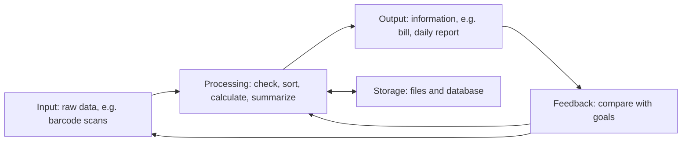
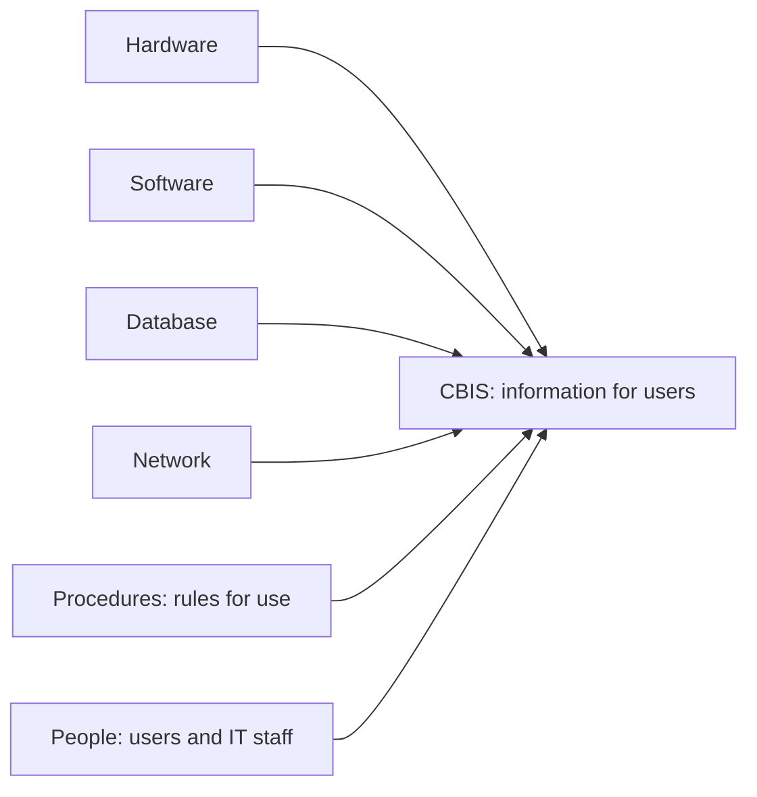
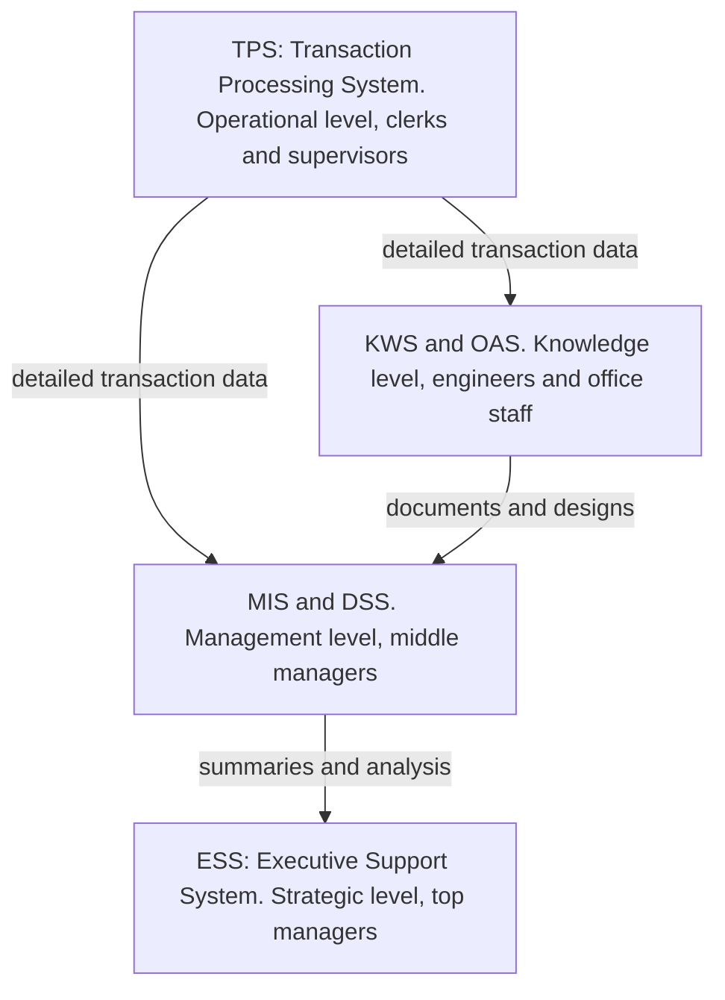
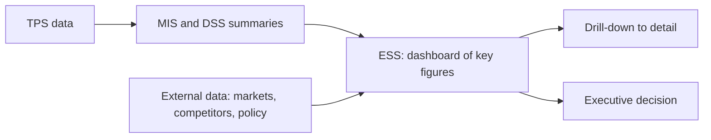
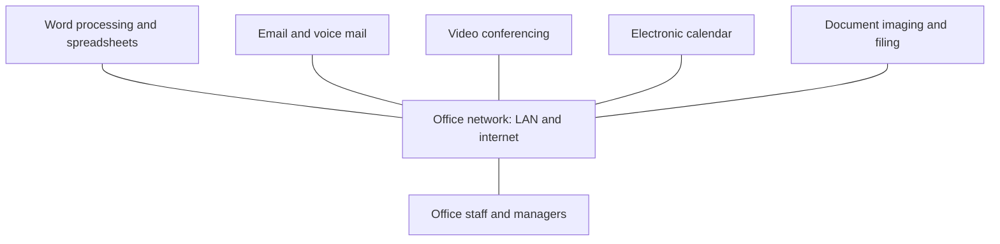
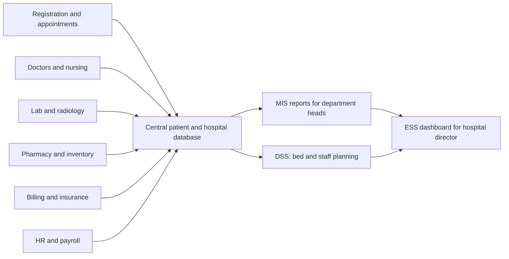

Naye ideas se pehle, purane ideas jo chahiye wo yahan hain. Agar pehle se aate hain to agle section pe chale jao.

## Pehle basics

- **Data** raw facts hain jinka akele koi matlab nahi hota, jaise "72", "Ravi", "12-03-2025".
- **Information** wo data hai jo organize ho gaya hai taaki kisi insaan ke liye uska matlab bane, jaise "Ravi ki pulse 12 March 2025 ko 72 thi".
- **Knowledge** information aur experience se bani samajh hai, jaise "adult ke liye resting pulse 72 normal hai".
- **System** parts ka ek set hai jo ek boundary ke andar ek goal ke liye saath kaam karta hai. Car, human body aur college sab systems hain.
- Ek **organization** mein managers ke teen levels hote hain:
  - **Top (strategic) management** long-term goals decide karta hai, jaise "Pune mein naya branch kholo".
  - **Middle (tactical) management** plan aur control karta hai ki goals kaise poore honge, jaise "is mahine ka har department ka budget".
  - **Lower (operational) management** roz ke kaam ko supervise karta hai, jaise "aaj night shift mein kaun kaam karega".
- Decisions teen tarah ke hote hain:
  - **Structured**: routine, fixed rule ke saath, jaise "stock 50 units se kam ho jaye to reorder karo".
  - **Semi-structured**: thoda rule-based aur thoda judgment, jaise "agli quarter mein advertising pe kitna kharch karein".
  - **Unstructured**: naye aur one-off, koi fixed rule nahi, jaise "kya hume kisi dusri company ke saath merge karna chahiye".

Ye teen levels aur teen kisam ke decisions yaad rakho. Neeche har information system bas "wo system jo ek level aur ek kisam ke decision ko serve karta hai" hai.

## Information system kya hai

<Box kind="definition">

**Information system (IS):** logon, procedures aur resources ka ek set jo data **collect** karta hai, use information mein **process** karta hai, **store** karta hai aur jinko chahiye unko **distribute** karta hai, taaki organization ke operations, management aur decisions ko support mile.

</Box>

Wikipedia ise ek formal, sociotechnical, organizational system batata hai jo information ko collect, process, store aur distribute karne ke liye bana hai. "Sociotechnical" ka matlab hai ki ye logon aur technology dono se bana hai, sirf technology se nahi. <Cite id="is-fundamentals-wiki-is" />

**Ye kyun zaroori hai.** Aaj ka business roz bahut saara data banata hai: sales, payments, attendance, stock. System ke bina managers kaagaz mein doob jayenge aur phir bhi unhe pata nahi hoga ki kya chal raha hai. IS data ke us dher ko chhoti, time pe aur sahi information mein badal deta hai jo logon ko decide karne mein help karti hai.

**Ye kaise kaam karta hai, step by step.**

1. **Input:** data capture hota hai, jaise cashier product ka barcode scan karta hai.
2. **Processing:** data check, sort, calculate aur summarize hota hai, jaise bill ka total banta hai aur stock kam hota hai.
3. **Storage:** results baad mein use ke liye files ya database mein save hote hain.
4. **Output:** information users ko screens, reports ya bills ki tarah milti hai, jaise printed bill aur daily sales report.
5. **Feedback:** output ko goals se compare karte hain aur input ya processing ko correct karne ke liye use karte hain, jaise "sales target se kam hain, discount shuru karo".

**Everyday analogy.** Restaurant ki kitchen khaane ka information system hai. Order slip input hai, cooking processing hai, fridge storage hai, plate output hai, aur customer ka "namak zyada hai" bolna feedback hai.

Information system ko computers use karna **zaroori nahi** hai. Chhoti dukaan ka paper register bhi ek information system hai. Jab computers kaam ka kuch ya poora hissa karte hain, to use **computer-based information system** kehte hain.

## Computer-based information system (CBIS)

<Box kind="definition">

**Computer-based information system (CBIS):** ek information system jo information ko collect, process, store aur distribute karne ke apne kuch ya saare kaam karne ke liye computer technology (hardware, software, databases aur networks) use karta hai.

</Box>

**Ye kyun zaroori hai.** Manual system slow hota hai, usme galtiyan hoti hain aur usme kuch dhundhna mushkil hota hai. Computer ek second mein hazaaron transactions process kar sakta hai, saalon ke records chhoti jagah mein rakh sakta hai, koi bhi record turant dhundh sakta hai aur network ke through information kahin bhi bhej sakta hai. Isi wajah se aaj lagbhag har organization CBIS pe chalti hai. <Cite id="is-fundamentals-wiley-rainer" />

### CBIS ke chhe components

Syllabus ki textbooks aur zyadatar MU answers chhe components likhte hain. <Cite id="is-fundamentals-wiley-rainer" /> <Cite id="is-fundamentals-wiki-is" />

| Component | Ye kya hai | Airline booking system mein example |
|---|---|---|
| **Hardware** | Physical devices: computers, servers, keyboards, scanners, printers, storage disks | Booking counter ke computers, servers, boarding-pass printers |
| **Software** | Wo programs jo hardware ko batate hain ki kya karna hai: system software (operating system) aur application software | Booking program, operating system |
| **Database** | Related files ya tables ka organized collection jo data store karta hai | Flights, seats, passengers, fares |
| **Network** | Connections (wired ya wireless) jo computers ko data aur resources share karne dete hain | Airports aur travel agents ko jodne wala wide area network |
| **Procedures** | System ko use aur operate karne ke rules, instructions aur policies | Cancellation rules, check-in steps, backup schedule |
| **People** | Jo system banate, chalate ya use karte hain: end users, operators, analysts, programmers, managers | Passengers, counter staff, IT staff |

Kuch sources inhe thoda alag group karte hain, to chaunko mat. GeeksforGeeks paanch likhta hai: hardware, software, databases, network aur human resources, aur procedures ko apni list se bahar rakhta hai. <Cite id="is-fundamentals-gfg-components" /> Wikipedia hardware, software, databases, networks aur procedures ko computer-based parts batata hai, aur people ko alag part maanta hai. <Cite id="is-fundamentals-wiki-is" /> MU ke liye chhe ke chhe likhna safe hai.

**Everyday analogy.** CBIS car ke safar jaisa hai. Car ki body hardware hai, engine control program software hai, tank ka fuel data hai, roads network hain, traffic rules procedures hain, aur driver person hai. Koi ek hata do to safar fail ho jaata hai.

<Box kind="pitfall">

"CBIS sirf hardware aur software hai" mat likho. Sahi **procedures** aur trained **people** ke bina best computers bhi galat ya bekaar information dete hain. Examiners saare chhe parts dekhte hain.

</Box>

### Manual IS versus CBIS

| Point | Manual information system | Computer-based information system |
|---|---|---|
| Speed | Slow, haath se hota hai | Bahut fast, ek second mein hazaaron records |
| Accuracy | Calculation aur copying ki galtiyan aam hain | Accurate agar input aur programs sahi hon |
| Storage | Paper files bahut jagah leti hain | Bada data chhoti jagah mein |
| Searching | Slow, kisi ko files mein dekhna padta hai | Turant search aur sorting |
| Sharing | Copies carry ya post karni padti hain | Network pe turant share |
| Cost | Setup cost kam, labour cost zyada | Setup cost zyada, har record ka running cost kam |
| Example | Haath se likha attendance register | Online report wali biometric attendance |

### CBIS ke advantages aur limitations

**Advantages**

- Bahut saare transactions ki fast processing.
- Accurate aur consistent results.
- Chhoti jagah mein bada storage aur quick retrieval.
- Information departments aur locations ke beech turant share hoti hai.
- Better aur quicker decisions, kyunki managers ko time pe reports milte hain.
- Routine kaam automate hota hai, jisse log zyada useful kaam kar paate hain.

**Limitations**

- Hardware, software aur trained staff ki high cost.
- "Garbage in, garbage out": galat input se galat output aata hai.
- Hacking aur data theft jaise security aur privacy risks.
- Computers pe dependence: power ya network failure se kaam ruk jaata hai.
- Staff change ka virodh kar sakta hai aur use training chahiye.

**Applications:** banking (ATMs aur online banking), railway aur airline reservation, hospital management, college admission aur results, supermarket billing aur stock control, payroll.

## Information systems ke types

Alag managers ko alag information chahiye. Clerk ko har ek transaction chahiye; CEO ko ek page ka summary aur bahar ki news chahiye. Isliye organizations kai types ke IS use karti hain, har level ke liye ek. Classic picture ek **pyramid** hai: neeche transaction processing systems, phir management information systems aur decision support systems, aur upar executive systems. <Cite id="is-fundamentals-wiki-is" /> <Cite id="is-fundamentals-pearson-laudon" />

MU answers aam taur par ye pyramid chaar levels (operational, knowledge, management aur strategic) ke saath draw karte hain, aur us pe TPS, OAS, KWS, MIS, DSS aur ESS likhte hain:

Wikipedia batata hai ki pyramid ab bhi useful hai, lekin naye systems, jaise data warehouses aur expert systems, usme theek se fit nahi hote. <Cite id="is-fundamentals-wiki-is" /> Expert systems neeche cover hain, aur ERP aur CRM jaise organization-wide systems ke apne notes Modules 4 aur 6 mein hain.

**Everyday analogy.** Cricket team socho. Scorer har ball likhta hai (TPS). Analyst scorebook padhkar summaries banata hai (MIS). Coach try karta hai "agar Rohit ko number 3 pe khilayein to?" (DSS). Selection committee sirf bada picture dekhti hai: wins, form aur opponents (ESS).

### 1. Transaction Processing System (TPS)

**Ye kya hai.** TPS business ke routine, roz ke transactions record aur process karta hai: sales, purchases, payments, deposits, attendance. Har transaction ek fixed, programmed tareeke se process hota hai. <Cite id="is-fundamentals-wiki-tps" />

**Users:** operational staff aur supervisors.

**Ye kaise kaam karta hai.** Transactions do tareeke se process hote hain:

- **Batch processing:** transactions ek period tak collect hote hain aur saath mein process hote hain, jaise monthly payroll. Results turant nahi milte.
- **Online (real-time) processing:** har transaction turant process hota hai aur turant confirm hota hai, jaise ATM withdrawal ya railway ticket booking. <Cite id="is-fundamentals-wiki-tps" />

**Features:** bahut data handle karta hai; fast aur predictable response; bahut reliable, hardware fail hone par bhi data lose ya corrupt nahi hona chahiye; sirf predefined, structured transactions handle karta hai; ye saare higher systems ke liye data ka main source hai. <Cite id="is-fundamentals-wiki-tps" />

**Examples:** billing system, payroll system, stock control system, ATM, railway reservation. <Cite id="is-fundamentals-gfg-types" />

### 2. Office Automation System (OAS)

**Ye kya hai.** OAS computers, software aur communication technology use karta hai office information ko create, collect, store, manipulate aur send karne ke liye, taaki routine office work fast ho aur paper kam lage. <Cite id="is-fundamentals-wiki-oa" />

**Users:** clerical staff, secretaries aur managers (data workers jo documents handle karte hain, naya knowledge nahi banate).

**Main tools:** word processing, spreadsheets, desktop publishing, email aur voice mail, electronic calendars aur scheduling, video conferencing, document imaging (scanning) aur electronic filing, fax. Local area network wo backbone hai jisse staff ye sab share kar paata hai. <Cite id="is-fundamentals-wiki-oa" />

**Example:** ek college office jo word processor mein circulars banata hai, timetable shared calendar pe rakhta hai, students ko notices email karta hai aur scanned documents shared drive mein store karta hai. (Ye topic neeche apne section mein detail mein hai, kyunki ye 10 marks ke liye pucha gaya tha.)

### 3. Knowledge Work System (KWS)

**Ye kya hai.** KWS knowledge workers (engineers, doctors, designers, scientists) ko naya knowledge banane aur organization mein laane mein help karta hai. Ye aam taur par specialized software wale powerful workstation pe chalta hai.

**Users:** professionals aur technical staff.

**Examples:** engineers ke liye computer-aided design (CAD) software, virtual simulation software, software development tools, financial analysis workstations. <Cite id="is-fundamentals-pearson-laudon" />

### 4. Management Information System (MIS)

**Ye kya hai.** MIS TPS ka detailed data leta hai aur use **summarized, regular reports** mein badalta hai jo middle managers ko business plan, control aur monitor karne mein help karte hain. <Cite id="is-fundamentals-gfg-types" /> TutorialsPoint ise data collect, store aur disseminate karne ka ek planned system kehta hai, jo management ke functions chalane ke liye zaroori information deta hai. <Cite id="is-fundamentals-tp-mis" />

**Users:** middle managers aur operational supervisors.

**Decisions ka kisam:** structured aur routine, jaise "is mahine kaun sa branch sales target miss kar gaya".

**MIS reports ke types** (aksar "types of MIS" ka yahi matlab hota hai): <Cite id="is-fundamentals-gfg-types" />

| Report type | Ye kya deta hai | Example |
|---|---|---|
| **Periodic (scheduled) or summary report** | Fixed time pe fixed format mein banta hai | Region ke hisaab se monthly sales |
| **Exception report** | Sirf unusual cases jinpe dhyaan chahiye | Wo items jinka stock reorder level se neeche hai |
| **Demand (on-demand) report** | Jab manager maange tab banta hai | Ek product ki aaj ki sales, request pe |
| **Ad-hoc report** | Kisi special sawaal ke liye naya, one-time report | Pichle saal ke monsoon mein umbrellas ki sales |

**Features:** TPS ke internal data pe based; central database use karta hai; management ke saare levels ko information deta hai; duplicate data avoid karta hai; department ke hisaab se subsystems mein baanta ja sakta hai (marketing, finance, HR, production). <Cite id="is-fundamentals-tp-mis" />

**Advantages:** decisions ke liye relevant, summarized information; alag departments ka kaam integrate karta hai; planning ko control se jodta hai. **Disadvantages:** rigid aur badalna mushkil; quality input data ki quality pe depend karti hai; benefits naapna mushkil hai. <Cite id="is-fundamentals-gfg-mis" />

**Examples:** sales management system, HR management system, inventory reports. <Cite id="is-fundamentals-gfg-types" />

### 5. Decision Support System (DSS)

**Ye kya hai.** DSS ek **interactive** computer-based system hai jo managers ko **semi-structured aur unstructured** decisions lene mein help karta hai. Ye data, analytical models aur easy user interface ko jodta hai taaki manager "what-if" sawaal try kar sake. <Cite id="is-fundamentals-wiki-dss" /> <Cite id="is-fundamentals-gfg-types" /> DSS decision ko support karta hai; manager ki jagah decision nahi leta. <Cite id="is-fundamentals-inflibnet-mis-dss" />

**Users:** middle aur senior managers, aur analysts. TutorialsPoint ke hisaab se ye har level ke managers ko serve kar sakta hai. <Cite id="is-fundamentals-tp-dss" />

**Components:** <Cite id="is-fundamentals-wiki-dss" /> <Cite id="is-fundamentals-tp-dss" />

1. **Database (data management):** TPS aur MIS ka internal data, plus market ya competitor data jaisa external data.
2. **Model base (model management):** analytical models jaise forecasting, financial planning, optimization aur simulation.
3. **User interface (dialogue):** menus, graphs aur forms jinke through manager sawaal poochta hai aur results dekhta hai.

**Types (kya unhe drive karta hai):** model-driven, data-driven, document-driven, knowledge-driven aur communication-driven (group) DSS. <Cite id="is-fundamentals-wiki-dss" />

**Examples:** financial planning system, bank loan approval analysis, "agar price 5% badha dein to?" wala sales forecasting. <Cite id="is-fundamentals-gfg-types" /> <Cite id="is-fundamentals-gfg-dss" />

**Advantages:** faster aur better decisions; managers alternatives compare kar paate hain; poorly structured problems handle karta hai; long-term planning support karta hai. <Cite id="is-fundamentals-gfg-dss" /> **Limitations:** achha data aur achhe models chahiye; banana costly hai; managers model pe zyada bharosa kar sakte hain.

### 6. Executive Support System (ESS)

**Ye kya hai.** ESS (jise executive information system, EIS bhi kehte hain) **senior executives** ki information aur decision needs ko support karta hai. Ise aam taur par DSS ka ek special kisam maana jaata hai. <Cite id="is-fundamentals-wiki-eis" /> Ye non-programmed, strategic decisions ke liye use hota hai, aur isme zyadatar information external, unstructured aur uncertain hoti hai. <Cite id="is-fundamentals-tp-ess" />

**Users:** CEO, directors, top management.

**Examples:** ek dashboard jo company ka revenue, profit, market share aur share price dikhata hai, competitors ki news ke saath; "kya hume naye market mein jaana chahiye" ke liye long-term forecasting.

ESS ke features 5-mark ka frequent sawaal hain, isliye unka apna section neeche hai.

### 7. Expert System (ES)

**Ye kya hai.** Expert system ek knowledge-based system hai, artificial intelligence ke ideas pe bana, jo ek narrow area mein human expert ke decision-making ki nakal karta hai aur consultant ki tarah advice deta hai. <Cite id="is-fundamentals-wiki-es" /> <Cite id="is-fundamentals-gfg-types" />

**Main parts:** ek **knowledge base** jo experts se liye gaye facts aur if-then rules store karta hai, aur ek **inference engine** jo current case ke facts pe rules lagakar conclusion nikalta hai. <Cite id="is-fundamentals-wiki-es" />

**Example:** MYCIN, 1970s ka Stanford system jo infectious diseases diagnose karta tha; modern examples mein medical diagnosis help aur loan-risk advice hain. <Cite id="is-fundamentals-wiki-es" />

### Saare types ek nazar mein

| Type | Level served | Main users | Input | Output | Decisions | Example |
|---|---|---|---|---|---|---|
| TPS | Operational | Clerks, supervisors | Transactions | Detailed records, bills, lists | Structured | Payroll, ATM, billing |
| OAS | Knowledge (office) | Clerical staff, managers | Documents, schedules | Letters, emails, schedules | Routine office work | Email, word processing |
| KWS | Knowledge | Engineers, designers | Designs, specifications | Models, drawings | Professional work | CAD |
| MIS | Management (middle) | Middle managers | Summary data from TPS | Periodic and exception reports | Structured | Monthly sales report |
| DSS | Management (middle and upper) | Managers, analysts | Data plus models | Interactive what-if analysis | Semi-structured | Loan analysis, forecasting |
| ESS | Strategic (top) | Top executives | Summaries from inside plus outside data | Dashboards, trends, drill-down | Unstructured | CEO dashboard |
| Expert system | Any level | Non-experts needing advice | Facts of a case | Advice with reasons | Specialist problems | Medical diagnosis |

**Real companies, sirf samajhne ke liye.** SBI jaisa bank har deposit, withdrawal aur transfer ke liye TPS chalata hai. Amazon ya Flipkart jaisi e-commerce firm city ke hisaab se daily orders ka MIS report use karti hai, "agar free delivery kam amount pe de dein to?" test karne ke liye DSS, aur apne leaders ke liye ESS dashboard. Hospital chain ya college bhi yahi pattern use karte hain, jaisa neeche hospital design dikhata hai.

## MIS hierarchy aur DSS kahan baithta hai

Jab sawaal "MIS hierarchy" bole, to uska matlab upar wala pyramid hai, management levels ki side se dekha hua. Ise neeche se upar chalo:

1. **TPS** sabse neeche har transaction capture karta hai aur uske upar ke sabke liye data source hai.
2. **MIS** TPS data ko middle managers ke liye regular reports mein summarize karta hai. Ye "kya hua?" ka jawab deta hai.
3. **DSS** MIS ke saath ya thoda upar baithta hai. Ye TPS aur MIS data, plus models aur outside data use karta hai. Ye "what if?" aur "best option kaun sa hai?" ka jawab deta hai.
4. **ESS** sabse upar in sabke summaries aur outside information leta hai aur "hum kahan ja rahe hain?" ka jawab deta hai.

**Comment on DSS.** DSS wo gap bharta hai jo MIS chhodta hai. MIS tab achha hai jab decision routine ho aur rule pata ho. Bahut se middle aur senior decisions sirf semi-structured hote hain: data hai, lekin judgment bhi chahiye. DSS manager ko data aur models pe seedha, interactive control deta hai, to alternatives IT department nahi, manager khud explore karta hai. Isi liye DSS ko MIS se upar aur ESS se neeche rakha jaata hai: ye MIS se zyada analytical hai lekin ESS se zyada detailed aur model-based. <Cite id="is-fundamentals-inflibnet-mis-dss" /> <Cite id="is-fundamentals-gfg-mis-vs-dss" />

### MIS versus DSS

| Point | MIS | DSS |
|---|---|---|
| Purpose | Regular information for monitoring and control | Support for a particular decision |
| Decisions | Structured, routine | Semi-structured and unstructured |
| Emphasis | Efficiency | Effectiveness |
| Output | Fixed periodic and exception reports | Interactive what-if and goal-seeking analysis |
| Data | Mainly internal data from TPS | Internal plus external data, and models |
| Access | Managers often get reports through IT staff | Managers use it directly |
| Built by | IT specialists or vendors | Often with heavy user involvement |
| Flexibility | Low | High |
| Example | Monthly sales report by branch | "What if we cut the price by 10%?" |

Emphasis, access aur built-by rows GeeksforGeeks ko follow karte hain. <Cite id="is-fundamentals-gfg-mis-vs-dss" />

## Executive Support System ke features

<Box kind="exam">

Ye exact sawaal, "What are the features of Executive Support System?", do papers mein aaya. Do line ki definition likho, phir 6 se 8 features, phir ek example.

</Box>

<Box kind="definition">

**Executive support system (ESS):** ek computer-based system jo senior executives ko key internal aur external information tak easy access deta hai, taaki wo organization ko monitor kar sakein aur strategic decisions le sakein. <Cite id="is-fundamentals-wiki-eis" /> <Cite id="is-fundamentals-tp-ess" />

</Box>

1. **Top executives ke liye bana:** senior managers ke strategic, non-programmed decisions ko support karta hai. <Cite id="is-fundamentals-tp-ess" />
2. **Use karna easy:** graphical displays, menus aur simple screens, taaki kam computer experience wale executives bhi use kar sakein. <Cite id="is-fundamentals-wiki-eis" />
3. **Drill-down:** executive summary figure pe click karke zyada detailed figures tak ja sakta hai, jaise company profit se region, phir branch. <Cite id="is-fundamentals-wiki-eis" />
4. **Summarized key indicators:** lambe reports ki jagah ek dashboard pe key performance indicators (revenue, profit, market share) dikhata hai.
5. **Internal aur external data:** MIS aur DSS ke internal summaries ko market reports, competitor news, government policy aur patent records jaise outside data ke saath jodta hai. <Cite id="is-fundamentals-tp-ess" />
6. **Trend analysis aur tracking:** variables ko time ke saath compare karne, trends pakadne aur performance track karne mein help karta hai. <Cite id="is-fundamentals-wiki-eis" />
7. **Communication support:** aksar email, scheduling aur conferencing tools hote hain.
8. **Timely information:** up-to-date information deta hai taaki decisions jaldi liye ja sakein. <Cite id="is-fundamentals-wiki-eis" />

**Advantages:** executives ke liye use karna easy; trends dikhata hai; information dhundhne mein time bachata hai; better reporting aur communication. **Disadvantages:** limited functions; benefits naapna mushkil; information overload ka risk; data ko current rakhna mushkil; chhoti company ke liye costly. <Cite id="is-fundamentals-tp-ess" /> <Cite id="is-fundamentals-wiki-eis" />

## Office Automation System detail mein

<Box kind="definition">

**Office automation system (OAS):** computers, software aur communication networks ka use, roz ke office work ke liye zaroori information ko digitally create, collect, store, manipulate aur send karne ke liye. <Cite id="is-fundamentals-wiki-oa" />

</Box>

**Ye kyun zaroori hai.** Office work ka matlab hota tha typing, copying, filing, letters post karna aur meetings set karne ke liye phone karna. Ye slow hai, bahut paper lagta hai aur information dhundhna mushkil hota hai. OAS office staff aur managers ko zyada productive banata hai aur communication behtar karta hai.

**Everyday analogy.** OAS office ke liye wahi hai jo ghar ke liye washing machine aur dishwasher hain: kaam wahi hai, lekin repetitive hissa machines karti hain.

**Main components aur functions.**

| Function | Tools | Example |
|---|---|---|
| Document creation | Word processing, desktop publishing, spreadsheets, presentations | Circular ya budget sheet banana |
| Communication | Email, voice mail, fax, instant messaging | Saare staff ko notice bhejna |
| Meetings | Video conferencing, teleconferencing | Mumbai aur Pune offices ke beech meeting |
| Scheduling | Electronic calendars, shared diaries | Meeting room book karna aur logon ko invite karna |
| Document management | Document imaging (scanning), electronic filing, records management | Scanned admission forms store karna |
| Data storage and sharing | LAN pe shared drives | Sab ek hi latest file kholte hain |

Local area network wo backbone hai jo in tools ko jodta hai taaki data, mail aur voice poore office mein chal sake. <Cite id="is-fundamentals-wiki-oa" />

**Ek typical din mein ye kaise kaam karta hai.**

1. Clerk word processor mein letter type karta hai aur shared drive pe save karta hai.
2. Manager use email se padhta aur approve karta hai.
3. Letter post ki jagah email se bheja jaata hai, aur reply ki scanned copy electronically file hoti hai.
4. Follow-up meeting shared calendar se book hoti hai aur video conference se hoti hai.

**Advantages:** office ka kaam fast; paper aur storage space kam; quicker, sasta communication; documents search karna easy; shared calendars se better coordination; alag locations se kaam karna possible.

**Disadvantages:** setup aur training cost; data loss ya viruses ka risk; network aur power pe dependence; staff change ka virodh kar sakta hai; typists aur filing clerks jaisi kuch jobs kam ho sakti hain.

**Applications:** college offices, banks, government offices (e-office), hospitals ke front desks, koi bhi corporate office.

## Hospital ke liye MIS design karna

<Box kind="exam">

"Create MIS system for any hospital" ek design question hai. Koi ek sahi answer nahi hai. Dikhao ki tum ideas apply kar sakte ho: objectives, levels ke hisaab se users, subsystems, data flow, reports, CBIS components aur benefits. Labelled diagram zaroori hai.

</Box>

Hospital information system mainly hospital ki administrative aur operational needs handle karta hai, aksar ek integrated system ki tarah jisme alag departments ke modules hote hain, aur ye laboratory, radiology aur imaging systems se link ho sakta hai. <Cite id="is-fundamentals-wiki-his" />

**Step 1: Objectives.** Har patient ko register aur track karo; waiting time kam karo; complete, accurate medical records rakho; medicine aur equipment stock control karo; bill sahi banao; management ke har level ko uske reports do.

**Step 2: Subsystems (modules).** Ye TPS-level parts hain jo data capture karte hain:

1. **Patient registration aur appointments** (OPD aur admission).
2. **Doctor aur nursing module:** diagnosis, prescriptions, treatment notes.
3. **Laboratory aur radiology:** test orders aur results.
4. **Pharmacy aur inventory:** medicines, consumables, reorder levels.
5. **Ward aur bed management:** bed allotment, discharge.
6. **Billing aur insurance.**
7. **HR aur payroll:** staff, shifts, salaries.

**Step 3: Har level ke liye reports.**

| Level | User | Information or report | Type of IS |
|---|---|---|---|
| Operational | Receptionist, pharmacist, billing clerk | Patient record, bill, aaj ke appointments, issue ki gayi medicine | TPS |
| Middle | Department heads, nursing superintendent | Daily bed occupancy, monthly OPD count, reorder level se neeche medicines (exception report), doctor-wise patient load | MIS |
| Middle and upper | Administrator | "Agar 20 ICU beds add karein to?", staff rostering, flu season ka demand forecast | DSS |
| Top | Hospital director, trustees | Revenue, occupancy trend, patient satisfaction, dusre hospitals se comparison | ESS |

**Step 4: Hospital ke liye CBIS components.**

- **Hardware:** har desk pe computers, servers, barcode wristbands aur scanners, printers.
- **Software:** hospital management software, database software, operating system.
- **Database:** patients, doctors, beds, medicines, bills, staff.
- **Network:** saare departments ko jodne wala LAN, aur online appointments aur reports ke liye internet access.
- **Procedures:** admission aur discharge rules, medical records kaun dekh sakta hai, daily backup.
- **People:** doctors, nurses, front-desk staff, administrators, IT staff, patients.

**Step 5: Benefits.** Kam paperwork aur kam duplicate entries; transcription errors kam aur patient records zyada reliable; patient information point of care pe available aur departments ke beech shared; medicines ka better tracking; quicker, accurate bills; managers ko planning ke liye time pe reports. <Cite id="is-fundamentals-wiki-his" />

## Ye kahan pucha gaya

| Agar sawaal ye bole | Kya likhna hai | Kahan aaya |
|---|---|---|
| "What are the different types of MIS?" | Pyramid diagram, TPS, OAS, KWS, MIS, DSS, ESS, expert system pe ek ya do line, aur MIS report ke chaar types | <PYQ id="2022-12-ce/q1a" /> |
| "What are types of IS? Explain with example." | Pyramid, phir har type users, purpose aur ek example ke saath, aur end mein at-a-glance table | <PYQ id="2024-05-ce/q4a" /> |
| "Evaluate the MIS hierarchy to comment on DSS" | Pyramid neeche se upar, semi-structured decisions ke liye DSS kyun chahiye, DSS components, MIS versus DSS table | <PYQ id="2022-12-ce/q1d" /> |
| "List the various components of CBIS" | CBIS ki definition, phir chhe components ek line ke matlab aur example ke saath | <PYQ id="2024-05-ce/q1a" /> |
| "Explain in detail computer-based information systems" | Definition, kyun zaroori, input-process-output-feedback diagram, chhe components examples ke saath, manual versus CBIS, advantages, limitations, applications | <PYQ id="2023-05-ce/q6a" /> |
| "What are the features of Executive Support System?" | Definition, 6 se 8 features (easy interface, drill-down, key indicators, external data, trends), ESS diagram, ek example | <PYQ id="2024-05-ce/q1b" /> <PYQ id="2025-05-ce/q1a" /> |
| "What do you mean by office automation system?" | Definition, kyun zaroori, tools table, OAS diagram, ek typical din, advantages, disadvantages, applications | <PYQ id="2025-05-ce/q3a" /> |
| "Create MIS system for any hospital" | Objectives, modules, data-flow diagram, levels ke hisaab se reports table, CBIS components, benefits | <PYQ id="2022-12-ce/q5b" /> |

## Quick revision

- **Data** raw facts hain; **information** processed, meaningful data hai; **IS** information ko collect, process, store aur distribute karta hai, **feedback** ke saath.
- **CBIS** wo IS hai jo computers use karta hai. Chhe components: **hardware, software, database, network, procedures, people**.
- Manual IS ka setup sasta hai lekin slow aur error-prone; CBIS fast, accurate aur shareable hai lekin costly hai aur security chahiye.
- Pyramid, neeche se upar: **TPS** (operational), **OAS aur KWS** (knowledge), **MIS aur DSS** (management), **ESS** (strategic).
- **TPS:** roz ke transactions, batch ya online, structured, baaki sabka data source. Example: payroll, ATM.
- **OAS:** word processing, email, calendars, video conferencing, LAN pe document imaging. Office productivity badhata hai.
- **MIS:** middle managers ke liye summary, periodic, exception, demand aur ad-hoc reports; structured decisions.
- **DSS:** semi-structured decisions ke liye interactive what-if analysis; components: database, model base aur user interface.
- **ESS:** top executives ke liye; easy graphics, drill-down, key indicators, internal plus external data, trend analysis.
- **Expert system:** knowledge base plus inference engine jo narrow area mein expert jaisi advice deta hai.
- **Hospital MIS:** modules ek central database ko feed karte hain, jo sahi logon ko TPS records, MIS reports, DSS planning aur ESS dashboard deta hai.

Ye note <Syl m="1" /> ka section 1.1, Introduction to Information Systems and Computer Based Information Systems cover karta hai. IT ka organizations pe impact, pehli syllabus line ka doosra hissa, apne note mein hai.
