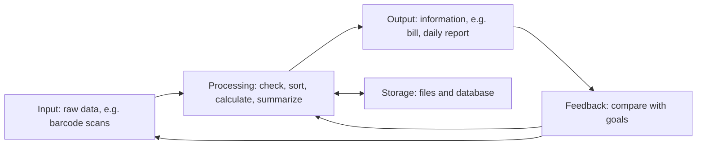
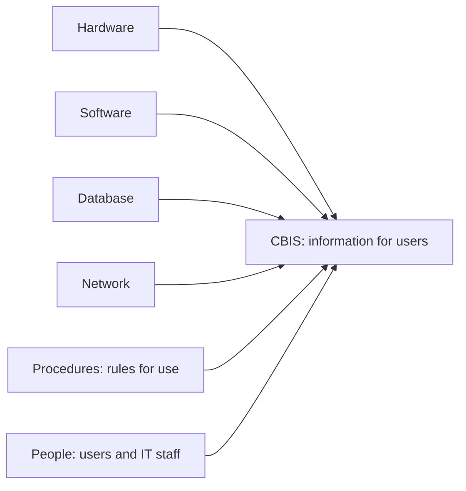
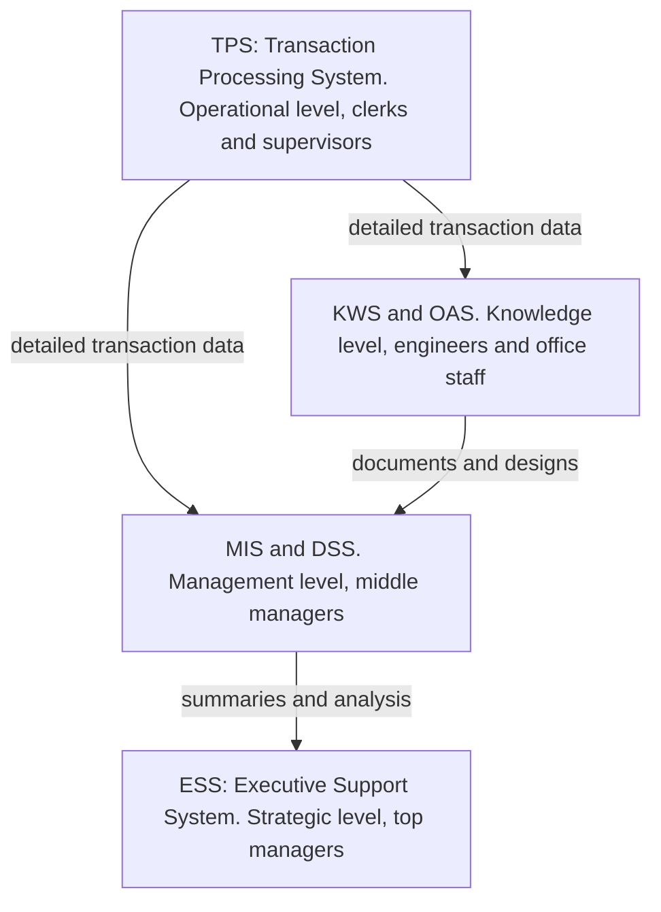
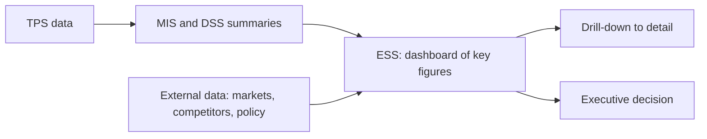
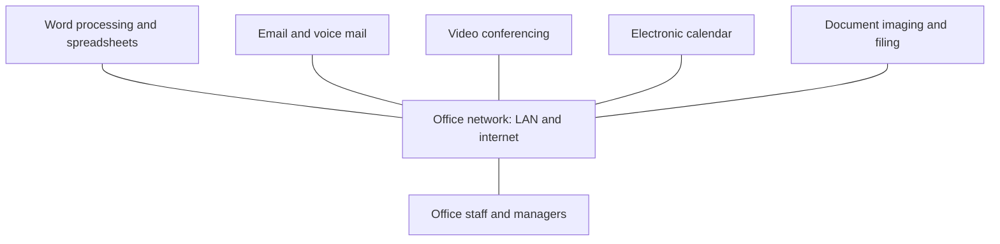
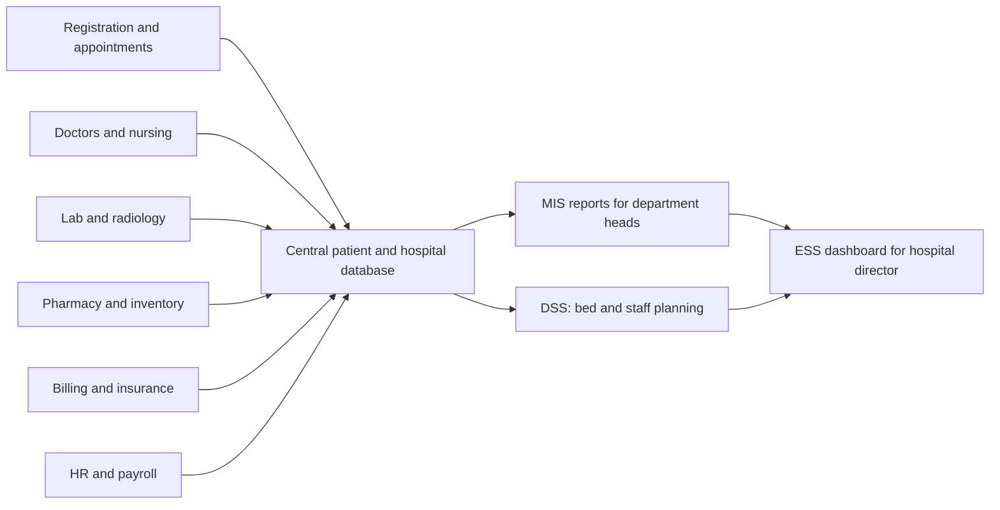

Before the new ideas, here are the old ones you need. If you already know them, skip to the next section.

## The basics first

- **Data** are raw facts with no meaning on their own, for example "72", "Ravi", "12-03-2025".
- **Information** is data that has been organized so that it means something to a person, for example "Ravi's pulse was 72 on 12 March 2025".
- **Knowledge** is understanding built from information and experience, for example "a resting pulse of 72 is normal for an adult".
- A **system** is a set of parts that work together towards one goal, inside a boundary. A car, the human body and a college are all systems.
- An **organization** has three levels of managers:
  - **Top (strategic) management** decides long-term goals, for example "open a new branch in Pune".
  - **Middle (tactical) management** plans and controls how the goals are met, for example "this month's budget for each department".
  - **Lower (operational) management** supervises daily work, for example "who works the night shift today".
- Decisions come in three kinds:
  - **Structured**: routine, with a fixed rule, for example "reorder stock when it falls below 50 units".
  - **Semi-structured**: partly rule-based and partly judgment, for example "how much should we spend on advertising next quarter".
  - **Unstructured**: new and one-off, with no fixed rule, for example "should we merge with another company".

Keep these three levels and three kinds of decisions in mind. Every type of information system below is simply "the system that serves one level and one kind of decision".

## What is an information system

<Box kind="definition">

**Information system (IS):** a set of people, procedures and resources that **collects** data, **processes** it into information, **stores** it and **distributes** it to the people who need it, to support the operations, management and decisions of an organization.

</Box>

Wikipedia describes it as a formal, sociotechnical, organizational system designed to collect, process, store and distribute information. "Sociotechnical" means it is made of both people and technology, not technology alone. <Cite id="is-fundamentals-wiki-is" />

**Why it is needed.** A modern business creates huge amounts of data every day: sales, payments, attendance, stock. Without a system, managers would drown in paper and still not know what is going on. An IS turns that pile of data into short, timely, accurate information that helps people decide.

**How it works, step by step.**

1. **Input:** data is captured, for example a cashier scans a product barcode.
2. **Processing:** the data is checked, sorted, calculated and summarized, for example the bill total is calculated and stock is reduced.
3. **Storage:** the results are saved in files or a database for later use.
4. **Output:** information is given to users as screens, reports or bills, for example a printed bill and a daily sales report.
5. **Feedback:** output is compared with goals and used to correct the input or the processing, for example "sales are below target, start a discount".

**Everyday analogy.** A restaurant kitchen is an information system for food. The order slip is the input, the cooking is the processing, the fridge is the storage, the plate is the output, and the customer saying "too salty" is the feedback.

An information system does **not** have to use computers. A paper register in a small shop is also an information system. When computers do some or all of the work, we call it a **computer-based information system**.

## Computer-based information system (CBIS)

<Box kind="definition">

**Computer-based information system (CBIS):** an information system that uses computer technology (hardware, software, databases and networks) to carry out some or all of its tasks of collecting, processing, storing and distributing information.

</Box>

**Why it is needed.** A manual system is slow, error-prone and hard to search. A computer can process thousands of transactions a second, store years of records in a small space, find any record instantly and send information anywhere through a network. This is the reason almost every organization today runs on CBIS. <Cite id="is-fundamentals-wiley-rainer" />

### The six components of CBIS

The syllabus textbooks and most MU answers list six components. <Cite id="is-fundamentals-wiley-rainer" /> <Cite id="is-fundamentals-wiki-is" />

| Component | What it is | Example in an airline booking system |
|---|---|---|
| **Hardware** | The physical devices: computers, servers, keyboards, scanners, printers, storage disks | Booking counter computers, servers, boarding-pass printers |
| **Software** | The programs that tell the hardware what to do: system software (operating system) and application software | The booking program, the operating system |
| **Database** | An organized collection of related files or tables that stores the data | Flights, seats, passengers, fares |
| **Network** | The connections (wired or wireless) that let computers share data and resources | The wide area network linking airports and travel agents |
| **Procedures** | The rules, instructions and policies for using and operating the system | Cancellation rules, check-in steps, backup schedule |
| **People** | Everyone who builds, runs or uses the system: end users, operators, analysts, programmers, managers | Passengers, counter staff, IT staff |

Some sources group these slightly differently, so do not be surprised. GeeksforGeeks lists five: hardware, software, databases, network and human resources, and leaves procedures out of its list. <Cite id="is-fundamentals-gfg-components" /> Wikipedia names hardware, software, databases, networks and procedures as the computer-based parts, and treats people as a separate part. <Cite id="is-fundamentals-wiki-is" /> For MU, writing all six is safe.

**Everyday analogy.** A CBIS is like a car journey. The car body is the hardware, the engine control program is the software, the fuel in the tank is the data, the roads are the network, the traffic rules are the procedures, and the driver is the person. Remove any one and the journey fails.

<Box kind="pitfall">

Do not say "CBIS is just hardware and software". Without correct **procedures** and trained **people**, the best computers still give wrong or useless information. Examiners look for all six parts.

</Box>

### Manual IS versus CBIS

| Point | Manual information system | Computer-based information system |
|---|---|---|
| Speed | Slow, done by hand | Very fast, thousands of records a second |
| Accuracy | Calculation and copying mistakes are common | Accurate if the input and programs are correct |
| Storage | Paper files take a lot of space | Large data stored in small space |
| Searching | Slow, someone must look through files | Instant search and sorting |
| Sharing | Copies must be carried or posted | Shared at once over a network |
| Cost | Low setup cost, high labour cost | High setup cost, lower running cost per record |
| Example | Hand-written attendance register | Biometric attendance with an online report |

### Advantages and limitations of CBIS

**Advantages**

- Fast processing of large volumes of transactions.
- Accurate and consistent results.
- Large storage in a small space and quick retrieval.
- Information shared instantly across departments and locations.
- Better, quicker decisions because managers get timely reports.
- Automation of routine work, which frees people for more useful tasks.

**Limitations**

- High cost of hardware, software and trained staff.
- "Garbage in, garbage out": wrong input gives wrong output.
- Security and privacy risks such as hacking and data theft.
- Dependence on computers: a power or network failure stops work.
- Staff may resist change and need training.

**Applications:** banking (ATMs and online banking), railway and airline reservation, hospital management, college admission and results, supermarket billing and stock control, payroll.

## Types of information systems

Different managers need different information. A clerk needs every single transaction; the CEO needs a one-page summary and outside news. So organizations use several types of IS, one for each level. The classic picture is a **pyramid**: transaction processing systems at the base, then management information systems and decision support systems, with executive systems at the top. <Cite id="is-fundamentals-wiki-is" /> <Cite id="is-fundamentals-pearson-laudon" />

MU answers usually draw this pyramid with four levels (operational, knowledge, management and strategic), and name TPS, OAS, KWS, MIS, DSS and ESS on it:

Wikipedia notes that the pyramid is still useful but newer systems, such as data warehouses and expert systems, do not fit neatly into it. <Cite id="is-fundamentals-wiki-is" /> Expert systems are covered below, and organization-wide systems such as ERP and CRM have their own notes in Modules 4 and 6.

**Everyday analogy.** Think of a cricket team. The scorer writes down every ball (TPS). The analyst studies the scorebook and prepares summaries (MIS). The coach tries "what if we bat Rohit at number 3?" (DSS). The selection committee looks only at the big picture: wins, form and the opponents (ESS).

### 1. Transaction Processing System (TPS)

**What it is.** A TPS records and processes the routine, day-to-day transactions of a business: sales, purchases, payments, deposits, attendance. Each transaction is processed in a fixed, programmed way. <Cite id="is-fundamentals-wiki-tps" />

**Users:** operational staff and supervisors.

**How it works.** Transactions are processed in one of two ways:

- **Batch processing:** transactions are collected over a period and processed together, for example the monthly payroll. Results are not available at once.
- **Online (real-time) processing:** each transaction is processed immediately and confirmed at once, for example an ATM withdrawal or a railway ticket booking. <Cite id="is-fundamentals-wiki-tps" />

**Features:** handles large volumes of data; fast and predictable response; very reliable, it must not lose or corrupt data even if hardware fails; deals only with predefined, structured transactions; it is the main source of data for all higher systems. <Cite id="is-fundamentals-wiki-tps" />

**Examples:** billing system, payroll system, stock control system, ATM, railway reservation. <Cite id="is-fundamentals-gfg-types" />

### 2. Office Automation System (OAS)

**What it is.** An OAS uses computers, software and communication technology to create, collect, store, manipulate and send office information, so that routine office work is done faster and with less paper. <Cite id="is-fundamentals-wiki-oa" />

**Users:** clerical staff, secretaries and managers (data workers who handle documents rather than create new knowledge).

**Main tools:** word processing, spreadsheets, desktop publishing, email and voice mail, electronic calendars and scheduling, video conferencing, document imaging (scanning) and electronic filing, fax. A local area network is the backbone that lets staff share these. <Cite id="is-fundamentals-wiki-oa" />

**Example:** a college office that prepares circulars in a word processor, keeps the timetable on a shared calendar, emails notices to students and stores scanned documents in a shared drive. (This topic is expanded in its own section below, because it was asked for 10 marks.)

### 3. Knowledge Work System (KWS)

**What it is.** A KWS helps knowledge workers (engineers, doctors, designers, scientists) create new knowledge and bring it into the organization. It usually runs on a powerful workstation with specialized software.

**Users:** professionals and technical staff.

**Examples:** computer-aided design (CAD) software for engineers, virtual simulation software, software development tools, financial analysis workstations. <Cite id="is-fundamentals-pearson-laudon" />

### 4. Management Information System (MIS)

**What it is.** An MIS takes the detailed data from TPS and turns it into **summarized, regular reports** that help middle managers plan, control and monitor the business. <Cite id="is-fundamentals-gfg-types" /> TutorialsPoint calls it a planned system of collecting, storing and disseminating data to supply the information needed to carry out the functions of management. <Cite id="is-fundamentals-tp-mis" />

**Users:** middle managers and operational supervisors.

**Kinds of decisions:** structured and routine, for example "which branch missed its sales target this month".

**Types of MIS reports** (this is often what "types of MIS" means): <Cite id="is-fundamentals-gfg-types" />

| Report type | What it gives | Example |
|---|---|---|
| **Periodic (scheduled) or summary report** | Produced at fixed times in a fixed format | Monthly sales by region |
| **Exception report** | Only the unusual cases that need attention | Items whose stock is below the reorder level |
| **Demand (on-demand) report** | Produced when a manager asks for it | Today's sales of one product, on request |
| **Ad-hoc report** | A new, one-time report for a special question | Sales of umbrellas during last year's monsoon |

**Features:** based on internal data from TPS; uses a central database; gives information to all levels of management; avoids duplicate data; can be divided into subsystems by department (marketing, finance, HR, production). <Cite id="is-fundamentals-tp-mis" />

**Advantages:** relevant, summarized information for decisions; integrates the work of different departments; links planning with control. **Disadvantages:** rigid and hard to change; quality depends on the quality of input data; benefits are hard to measure. <Cite id="is-fundamentals-gfg-mis" />

**Examples:** sales management system, HR management system, inventory reports. <Cite id="is-fundamentals-gfg-types" />

### 5. Decision Support System (DSS)

**What it is.** A DSS is an **interactive** computer-based system that helps managers make **semi-structured and unstructured** decisions. It combines data, analytical models and an easy user interface so that the manager can try "what-if" questions. <Cite id="is-fundamentals-wiki-dss" /> <Cite id="is-fundamentals-gfg-types" /> A DSS supports the decision; it does not make the decision for the manager. <Cite id="is-fundamentals-inflibnet-mis-dss" />

**Users:** middle and senior managers, and analysts. TutorialsPoint notes it can serve managers at every level. <Cite id="is-fundamentals-tp-dss" />

**Components:** <Cite id="is-fundamentals-wiki-dss" /> <Cite id="is-fundamentals-tp-dss" />

1. **Database (data management):** internal data from TPS and MIS plus external data such as market or competitor data.
2. **Model base (model management):** analytical models such as forecasting, financial planning, optimization and simulation.
3. **User interface (dialogue):** menus, graphs and forms through which the manager asks questions and sees results.

**Types (by what drives them):** model-driven, data-driven, document-driven, knowledge-driven and communication-driven (group) DSS. <Cite id="is-fundamentals-wiki-dss" />

**Examples:** financial planning system, bank loan approval analysis, "what if we raise the price by 5%" sales forecasting. <Cite id="is-fundamentals-gfg-types" /> <Cite id="is-fundamentals-gfg-dss" />

**Advantages:** faster and better decisions; lets managers compare alternatives; handles poorly structured problems; supports long-term planning. <Cite id="is-fundamentals-gfg-dss" /> **Limitations:** needs good data and good models; costly to build; managers may trust the model too much.

### 6. Executive Support System (ESS)

**What it is.** An ESS (also called an executive information system, EIS) supports the information and decision needs of **senior executives**. It is usually treated as a special kind of DSS. <Cite id="is-fundamentals-wiki-eis" /> It is used for non-programmed, strategic decisions, and much of its information is external, unstructured and uncertain. <Cite id="is-fundamentals-tp-ess" />

**Users:** CEO, directors, top management.

**Examples:** a dashboard showing a company's revenue, profit, market share and share price, with competitors' news; long-term forecasting for "should we enter a new market".

The features are a frequent 5-mark question, so they have their own section below.

### 7. Expert System (ES)

**What it is.** An expert system is a knowledge-based system, built on artificial intelligence ideas, that copies the decision-making of a human expert in one narrow area and gives advice like a consultant would. <Cite id="is-fundamentals-wiki-es" /> <Cite id="is-fundamentals-gfg-types" />

**Main parts:** a **knowledge base** that stores facts and if-then rules taken from experts, and an **inference engine** that applies the rules to the facts of the current case to reach a conclusion. <Cite id="is-fundamentals-wiki-es" />

**Example:** MYCIN, a 1970s Stanford system for diagnosing infectious diseases; modern examples include medical diagnosis help and loan-risk advice. <Cite id="is-fundamentals-wiki-es" />

### All types at a glance

| Type | Level served | Main users | Input | Output | Decisions | Example |
|---|---|---|---|---|---|---|
| TPS | Operational | Clerks, supervisors | Transactions | Detailed records, bills, lists | Structured | Payroll, ATM, billing |
| OAS | Knowledge (office) | Clerical staff, managers | Documents, schedules | Letters, emails, schedules | Routine office work | Email, word processing |
| KWS | Knowledge | Engineers, designers | Designs, specifications | Models, drawings | Professional work | CAD |
| MIS | Management (middle) | Middle managers | Summary data from TPS | Periodic and exception reports | Structured | Monthly sales report |
| DSS | Management (middle and upper) | Managers, analysts | Data plus models | Interactive what-if analysis | Semi-structured | Loan analysis, forecasting |
| ESS | Strategic (top) | Top executives | Summaries from inside plus outside data | Dashboards, trends, drill-down | Unstructured | CEO dashboard |
| Expert system | Any level | Non-experts needing advice | Facts of a case | Advice with reasons | Specialist problems | Medical diagnosis |

**Real companies, for illustration.** A bank such as SBI runs a TPS for every deposit, withdrawal and transfer. An e-commerce firm such as Amazon or Flipkart uses an MIS report for daily orders by city, a DSS to test "what if we offer free delivery above a lower amount", and an ESS dashboard for its leaders. A hospital chain or a college uses the same pattern, as the hospital design below shows.

## The MIS hierarchy and where DSS sits

When a question says "MIS hierarchy", it means the pyramid above seen from the side of management levels. Walk through it bottom-up:

1. **TPS** at the bottom captures every transaction and is the data source for everything above it.
2. **MIS** summarizes TPS data into regular reports for middle managers. It answers "what happened?".
3. **DSS** sits beside or just above MIS. It uses TPS and MIS data plus models and outside data. It answers "what if?" and "what is the best option?".
4. **ESS** at the top takes summaries from all of these plus outside information and answers "where are we going?".

**Comment on DSS.** DSS fills the gap that MIS leaves. MIS is good when the decision is routine and the rule is known. Many middle and senior decisions are only semi-structured: there is data, but judgment is also needed. DSS gives the manager direct, interactive control over data and models, so the manager, not the IT department, explores the alternatives. This is why DSS is placed higher than MIS and lower than ESS: it is more analytical than MIS but more detailed and model-based than ESS. <Cite id="is-fundamentals-inflibnet-mis-dss" /> <Cite id="is-fundamentals-gfg-mis-vs-dss" />

### MIS versus DSS

| Point | MIS | DSS |
|---|---|---|
| Purpose | Regular information for monitoring and control | Support for a particular decision |
| Decisions | Structured, routine | Semi-structured and unstructured |
| Emphasis | Efficiency | Effectiveness |
| Output | Fixed periodic and exception reports | Interactive what-if and goal-seeking analysis |
| Data | Mainly internal data from TPS | Internal plus external data, and models |
| Access | Managers often get reports through IT staff | Managers use it directly |
| Built by | IT specialists or vendors | Often with heavy user involvement |
| Flexibility | Low | High |
| Example | Monthly sales report by branch | "What if we cut the price by 10%?" |

The emphasis, access and built-by rows follow GeeksforGeeks. <Cite id="is-fundamentals-gfg-mis-vs-dss" />

## Features of an Executive Support System

<Box kind="exam">

This exact question, "What are the features of Executive Support System?", appeared in two papers. Write a two-line definition, then 6 to 8 features, then one example.

</Box>

<Box kind="definition">

**Executive support system (ESS):** a computer-based system that gives senior executives easy access to key internal and external information, so they can monitor the organization and take strategic decisions. <Cite id="is-fundamentals-wiki-eis" /> <Cite id="is-fundamentals-tp-ess" />

</Box>

1. **Built for top executives:** supports strategic, non-programmed decisions of senior managers. <Cite id="is-fundamentals-tp-ess" />
2. **Easy to use:** graphical displays, menus and simple screens, so executives with little computer experience can use it. <Cite id="is-fundamentals-wiki-eis" />
3. **Drill-down:** the executive can click a summary figure and go down to more detailed figures, for example from company profit to region to branch. <Cite id="is-fundamentals-wiki-eis" />
4. **Summarized key indicators:** shows key performance indicators (revenue, profit, market share) on one dashboard instead of long reports.
5. **Internal and external data:** combines internal summaries from MIS and DSS with outside data such as market reports, competitor news, government policy and patent records. <Cite id="is-fundamentals-tp-ess" />
6. **Trend analysis and tracking:** helps compare variables over time, spot trends and track performance. <Cite id="is-fundamentals-wiki-eis" />
7. **Communication support:** often includes email, scheduling and conferencing tools.
8. **Timely information:** delivers up-to-date information so decisions can be made promptly. <Cite id="is-fundamentals-wiki-eis" />

**Advantages:** easy for executives to use; shows trends; saves time finding information; better reporting and communication. **Disadvantages:** limited functions; benefits hard to measure; risk of information overload; hard to keep data current; costly for a small company. <Cite id="is-fundamentals-tp-ess" /> <Cite id="is-fundamentals-wiki-eis" />

## Office Automation System in detail

<Box kind="definition">

**Office automation system (OAS):** the use of computers, software and communication networks to digitally create, collect, store, manipulate and send the information needed for everyday office work. <Cite id="is-fundamentals-wiki-oa" />

</Box>

**Why it is needed.** Office work used to mean typing, copying, filing, posting letters and phoning to set up meetings. This is slow, uses a lot of paper and makes information hard to find. OAS makes office staff and managers more productive and improves communication.

**Everyday analogy.** OAS is to an office what a washing machine and dishwasher are to a home: the work is the same, but the machines do the repetitive part.

**Main components and functions.**

| Function | Tools | Example |
|---|---|---|
| Document creation | Word processing, desktop publishing, spreadsheets, presentations | Preparing a circular or a budget sheet |
| Communication | Email, voice mail, fax, instant messaging | Sending a notice to all staff |
| Meetings | Video conferencing, teleconferencing | A meeting between Mumbai and Pune offices |
| Scheduling | Electronic calendars, shared diaries | Booking a meeting room and inviting people |
| Document management | Document imaging (scanning), electronic filing, records management | Storing scanned admission forms |
| Data storage and sharing | Shared drives over a local area network | Everyone opens the same latest file |

A local area network is the backbone that connects these tools so that data, mail and voice move across the office. <Cite id="is-fundamentals-wiki-oa" />

**How it works in a typical day.**

1. A clerk types a letter in a word processor and saves it to the shared drive.
2. The manager reads and approves it by email.
3. The letter is sent by email instead of post, and a scanned copy of the reply is filed electronically.
4. A follow-up meeting is booked through the shared calendar and held by video conference.

**Advantages:** faster office work; less paper and storage space; quicker, cheaper communication; easier searching of documents; better coordination through shared calendars; supports working from different locations.

**Disadvantages:** setup and training cost; risk of data loss or viruses; dependence on the network and power; staff may resist change; some jobs such as typists and filing clerks may be reduced.

**Applications:** college offices, banks, government offices (e-office), hospitals' front desks, any corporate office.

## Designing an MIS for a hospital

<Box kind="exam">

"Create MIS system for any hospital" is a design question. There is no single correct answer. Show that you can apply the ideas: objectives, users by level, subsystems, data flow, reports, CBIS components and benefits. A labelled diagram is essential.

</Box>

A hospital information system mainly handles the administrative and operational needs of a hospital, often as one integrated system with modules for different departments, and it can link to laboratory, radiology and imaging systems. <Cite id="is-fundamentals-wiki-his" />

**Step 1: Objectives.** Register and track every patient; reduce waiting time; keep complete, accurate medical records; control medicine and equipment stock; bill correctly; give each level of management the reports it needs.

**Step 2: Subsystems (modules).** These are the TPS-level parts that capture data:

1. **Patient registration and appointments** (OPD and admission).
2. **Doctor and nursing module:** diagnosis, prescriptions, treatment notes.
3. **Laboratory and radiology:** test orders and results.
4. **Pharmacy and inventory:** medicines, consumables, reorder levels.
5. **Ward and bed management:** bed allotment, discharge.
6. **Billing and insurance.**
7. **HR and payroll:** staff, shifts, salaries.

**Step 3: Reports for each level.**

| Level | User | Information or report | Type of IS |
|---|---|---|---|
| Operational | Receptionist, pharmacist, billing clerk | Patient record, bill, today's appointments, medicine issued | TPS |
| Middle | Department heads, nursing superintendent | Daily bed occupancy, monthly OPD count, medicines below reorder level (exception report), doctor-wise patient load | MIS |
| Middle and upper | Administrator | "What if we add 20 ICU beds?", staff rostering, demand forecast for the flu season | DSS |
| Top | Hospital director, trustees | Revenue, occupancy trend, patient satisfaction, comparison with other hospitals | ESS |

**Step 4: CBIS components for the hospital.**

- **Hardware:** computers at each desk, servers, barcode wristbands and scanners, printers.
- **Software:** the hospital management software, database software, operating system.
- **Database:** patients, doctors, beds, medicines, bills, staff.
- **Network:** a LAN joining all departments, and internet access for online appointments and reports.
- **Procedures:** admission and discharge rules, who may see medical records, daily backup.
- **People:** doctors, nurses, front-desk staff, administrators, IT staff, patients.

**Step 5: Benefits.** Less paperwork and fewer duplicate entries; fewer transcription errors and more reliable patient records; patient information available at the point of care and shared across departments; better tracking of medicines; quicker, accurate bills; managers get timely reports for planning. <Cite id="is-fundamentals-wiki-his" />

## Where this was asked

| If the question says | What to write | Seen as |
|---|---|---|
| "What are the different types of MIS?" | The pyramid diagram, one or two lines on each of TPS, OAS, KWS, MIS, DSS, ESS, expert system, and the four kinds of MIS report | <PYQ id="2022-12-ce/q1a" /> |
| "What are types of IS? Explain with example." | The pyramid, then each type with users, purpose and one example, and finish with the at-a-glance table | <PYQ id="2024-05-ce/q4a" /> |
| "Evaluate the MIS hierarchy to comment on DSS" | The pyramid walked bottom-up, why DSS is needed for semi-structured decisions, DSS components, MIS versus DSS table | <PYQ id="2022-12-ce/q1d" /> |
| "List the various components of CBIS" | Definition of CBIS, then the six components with one-line meaning and an example each | <PYQ id="2024-05-ce/q1a" /> |
| "Explain in detail computer-based information systems" | Definition, why needed, input-process-output-feedback diagram, six components with examples, manual versus CBIS, advantages, limitations, applications | <PYQ id="2023-05-ce/q6a" /> |
| "What are the features of Executive Support System?" | Definition, 6 to 8 features (easy interface, drill-down, key indicators, external data, trends), ESS diagram, one example | <PYQ id="2024-05-ce/q1b" /> <PYQ id="2025-05-ce/q1a" /> |
| "What do you mean by office automation system?" | Definition, why needed, tools table, OAS diagram, a typical day, advantages, disadvantages, applications | <PYQ id="2025-05-ce/q3a" /> |
| "Create MIS system for any hospital" | Objectives, modules, data-flow diagram, reports by level table, CBIS components, benefits | <PYQ id="2022-12-ce/q5b" /> |

## Quick revision

- **Data** is raw facts; **information** is processed, meaningful data; an **IS** collects, processes, stores and distributes information, with **feedback**.
- **CBIS** is an IS that uses computers. Six components: **hardware, software, database, network, procedures, people**.
- Manual IS is cheap to set up but slow and error-prone; CBIS is fast, accurate and shareable but costly and needs security.
- The pyramid, bottom to top: **TPS** (operational), **OAS and KWS** (knowledge), **MIS and DSS** (management), **ESS** (strategic).
- **TPS:** daily transactions, batch or online, structured, the data source for all others. Example: payroll, ATM.
- **OAS:** word processing, email, calendars, video conferencing, document imaging over a LAN. Raises office productivity.
- **MIS:** summary, periodic, exception, demand and ad-hoc reports for middle managers; structured decisions.
- **DSS:** interactive what-if analysis for semi-structured decisions; components are database, model base and user interface.
- **ESS:** for top executives; easy graphics, drill-down, key indicators, internal plus external data, trend analysis.
- **Expert system:** knowledge base plus inference engine that gives expert-like advice in a narrow area.
- **Hospital MIS:** modules feed one central database, which gives TPS records, MIS reports, DSS planning and an ESS dashboard to the right people.

This note covers <Syl m="1" /> section 1.1, Introduction to Information Systems and Computer Based Information Systems. The impact of IT on organizations, the other half of the first syllabus line, is in its own note.
