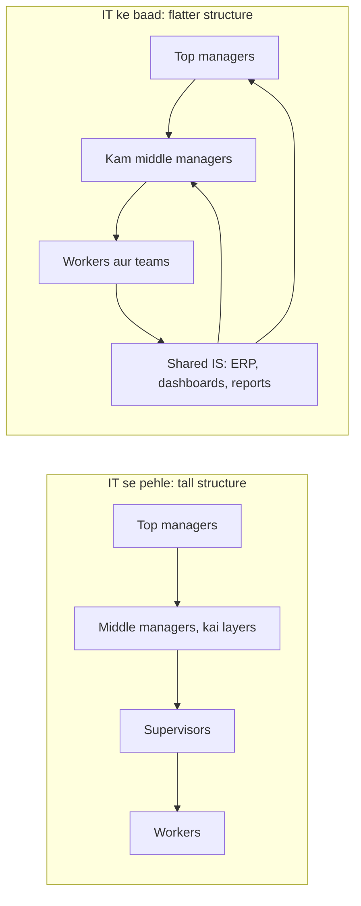
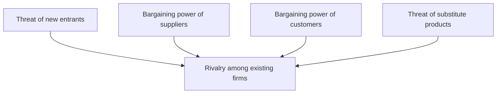
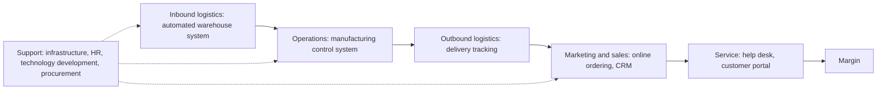
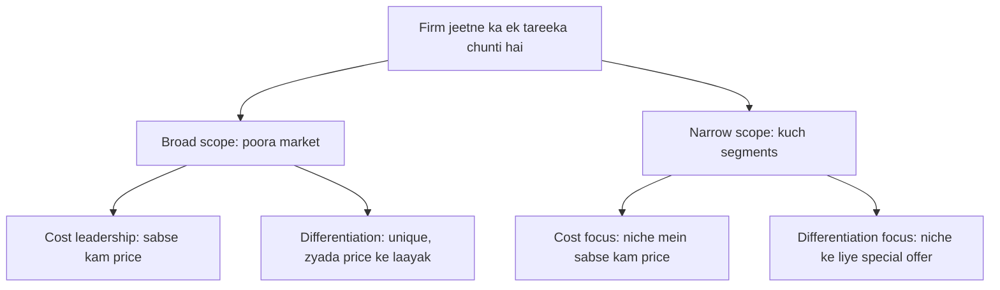

Naye ideas se pehle wo purane ideas dekh lo jo zaroori hain. Agar already pata hai to agle section pe jao.

## Basics pehle

- **Data** raw facts hain (Rs 500 ki sale, 10:05 pe). **Information** wo data hai jo organize ho gaya ho taaki kisi insaan ke liye matlab banaye (aaj ki sales pichhle hafte se 20% zyada hain).
- **Information system (IS)** kisi purpose ke liye information collect, process, store aur share karta hai. **Computer-based information system (CBIS)** ye kaam hardware, software, database, network, procedures aur people se karta hai. <Cite id="it-impact-society-rainer-iis7" loc="Ch. 1" />
- **Information technology (IT)** technology wala hissa hai: computers, software aur networks. IS bada idea hai: technology plus people plus processes.
- **Organization** logon ka group hai jo goals ke liye saath kaam karta hai, jaise company, hospital ya college. Isme levels hote hain: top managers (future plan karte hain), middle managers (plans ko kaam mein badalte hain aur results dekhte hain) aur operational staff (roz ka kaam karte hain).
- **Society** ka matlab company ke bahar ke hum sab: customers, citizens, families, government.

Ye note syllabus <Syl m="1" /> ke sections 1.2 se 1.5 cover karta hai: organizations pe IT ka impact, society ke liye IS ki importance, organizational strategy, aur IS ke saath competitive advantage.

## Part 1: IT organizations pe kaise impact karta hai

<Box kind="definition">

**Impact of IT on organizations** ka matlab wo changes hain jo computers, software aur networks lekar aate hain: firm ka structure kaisa hai, managers aur employees kaise kaam karte hain, aur workplace kitna healthy aur safe hai.

</Box>

**Ye kyun zaroori hai.** Jab firm ERP, online store ya mobile app lagati hai, to use sirf ek naya tool nahi milta. Firm ka shape, uski jobs aur decisions lene ka tareeka sab badal jaata hai. Manager ko in changes ka plan banana padta hai, achhe aur bure dono.

Socho ek school paper register chhod kar attendance app pe aa jaata hai. Teachers ko haath se columns nahi banane padte, principal absent students real time mein dekh leta hai, aur jo clerk monthly reports banata tha uska kaam ab alag hai.

Textbook impact ko kuch clear points mein baantta hai. <Cite id="it-impact-society-rainer-iis7" loc="Ch. 1" />

1. **IT middle managers ki sankhya kam karta hai.** Middle managers neeche se reports lete the aur summary upar bhejte the. Ab system ye khud kar deta hai, aur ek manager zyada logon ko supervise kar sakta hai. Organization **flatter** ho jaata hai (top aur bottom ke beech kam layers). Ye automatic nahi hai: studies mixed results dikhati hain. Kuch firms mein IT ne middle managers kam kiye, kuch mein badhaye, ye is pe depend karta hai ki decisions kitne centralized the. Isliye likho "IT tends to flatten organizations", "IT always removes managers" nahi.
2. **IT manager ka kaam badal deta hai.** Managers ko information jaldi aur zyada detail mein milti hai, isliye wo tez decisions le sakte hain, aksar decision-support aur business-intelligence tools se. Wo door baithe logon ko bhi manage kar sakte hain (remote aur virtual teams), jiske liye email aur video se lead karne jaise naye skills chahiye. <Cite id="it-impact-society-wiki-remote-work" />
3. **IT kuch jobs hata sakta hai aur kuch bana sakta hai.** Routine jobs (data entry, typing, simple clerical kaam, kuch factory ka kaam) automate ho sakte hain. Saath hi nayi jobs aati hain: software developers, data analysts, network aur security staff, digital marketers. Overall IT se job loss zyada hota hai ya job creation, ispe debate hai. <Cite id="it-impact-society-wiki-tech-unemployment" />
4. **IT employees ke kaam aur feelings ko badalta hai.** Computer kaam ko interesting bana sakta hai, lekin stress bhi badha sakta hai (hamesha reachable rehna, monitoring, bahut zyada information). Screen pe lambe ghante eye strain, back pain aur **repetitive strain injury** (jaise carpal tunnel syndrome) karte hain. Achha **ergonomics** (chair, keyboard, screen aur lighting ko insaani body ke hisaab se design karna) isse kam karta hai. <Cite id="it-impact-society-wiki-ergonomics" />
5. **IT disabilities wale logon ke liye jobs kholta hai.** Screen readers, voice input, large-text displays aur work-from-home se jinhe dikhne, sunne ya chalne mein difficulty hai, wo aise jobs kar sakte hain jo pehle mushkil the.

MU answers mein aksar ye aur impacts bhi expected hote hain, jo upar ke points se hi nikalte hain:

- **Faster aur better decisions**: managers ko kaagaz ke dher ki jagah summaries milti hain. <Cite id="it-impact-society-gfg-mis" /> <Cite id="it-impact-society-tp-mis" />
- **Business processes badal jaate hain**: kaam system ke hisaab se redesign hota hai, kabhi kabhi poori tarah, jise business process re-engineering (BPR) kehte hain. <Cite id="it-impact-society-wiki-bpr" />
- **Better coordination**: departments ek hi database share karte hain, to sales, stores aur accounts ko same numbers dikhte hain.
- **Kaam ke naye tareeke**: telecommuting, virtual teams, 24×7 online service.
- **Naye risks**: systems pe dependence, cyber attacks aur data breaches.

| Area | Positive impact | Negative impact |
|---|---|---|
| Structure | Flatter, tez communication | Middle-manager posts kam |
| Managers | Real-time information, better decisions | Information overload, naye skills seekhne padte hain |
| Jobs | Nayi skilled jobs, zyada interesting kaam | Routine jobs automate, retraining ki zaroorat |
| Health | Ergonomic design, kam heavy manual kaam | Eye strain, back pain, repetitive strain injury, stress |
| Inclusion | Disabilities ke liye assistive technology | Digital skills ke bina employees peeche reh jaate hain |
| Privacy | Better records | Employee monitoring surveillance jaisi lag sakti hai |

## Part 2: Information systems society ke liye kyun zaroori hain

<Box kind="definition">

**Importance of IS to society** ka matlab wo tareeke hain jinse information systems company ke bahar ke logon ki roz ki zindagi badalte hain: wo kaise rehte, kaam karte, padhte, health care lete, shopping karte aur public life mein hissa lete hain.

</Box>

**Textbook ke teen main points.** <Cite id="it-impact-society-rainer-iis7" loc="Ch. 1" />

1. **IT hamari quality of life ko affect karta hai.** Online shopping, banking, booking aur government services time aur travel bachate hain. Work from home flexibility deta hai. Lekin wahi phone jo time bachata hai, working day ko lamba bhi kar sakta hai, kyunki log hamesha reachable rehte hain.
2. **Robot revolution.** Robots aur automated machines ab khatarnak, gande ya repetitive kaam karte hain: car factories mein welding, warehouses mein items uthana, delivery drones, cleaning robots. Isse log khatre se door rehte hain, lekin jobs ka dar badhta hai.
3. **Health care mein improvement.** Electronic health records, medical imaging, data ki madad se diagnosis, online consultations (**telehealth**) aur health apps doctors ko jaldi decide karne mein aur door ke patients tak pahunchne mein madad karte hain. <Cite id="it-impact-society-wiki-telehealth" />

**Students ko ye benefits bhi add karne chahiye:**

- **Education:** online courses (jaise India mein NPTEL aur SWAYAM), e-books, video lectures jo internet wale kisi ko bhi mil jaate hain. <Cite id="it-impact-society-nptel-mis" />
- **Information aur awaaz tak access:** search engines, social media aur blogs se koi bhi facts dhundh sakta hai aur poori duniya ke saath apni baat share kar sakta hai. <Cite id="it-impact-society-gfg-media-society" />
- **Government services:** online tax filing, digital certificates, digital payments, jo queues aur paperwork kam karte hain (jaise income-tax e-filing aur UPI payments).
- **Disabilities wale log:** assistive technology se wo padh, kaam aur baat kar sakte hain.

**IS society ke liye kya problems banata hai:**

- **Job loss aur reskill ki zaroorat** jab routine kaam automate hota hai. <Cite id="it-impact-society-wiki-tech-unemployment" />
- **Privacy aur security:** personal data leak, bech ya misuse ho sakta hai. (Ethics aur privacy module 3 mein hain.)
- **Digital divide:** un logon ke beech ka gap jinke paas computer, internet aur digital skills hain aur jinke paas nahi hain. Gaon, gareeb families aur buzurg log peeche reh sakte hain. <Cite id="it-impact-society-wiki-digital-divide" />
- **Misinformation:** fake news online tezi se phailti hai. <Cite id="it-impact-society-gfg-media-society" />
- **Health aur social life:** screen addiction, aamne-saamne contact kam, stress.
- **Electronic waste:** purane phones aur computers mein harmful materials hote hain aur aksar unhe safely recycle nahi kiya jaata. <Cite id="it-impact-society-wiki-ewaste" />

<Box kind="intuition">

IS ek shehar mein bijli jaisa hai. Ye gharon, hospitals aur schools ko roshan karta hai aur zindagi aasan banata hai. Lekin wiring unsafe ho to log hurt hote hain, aur jin gharon mein connection nahi hai wo padosiyon se peeche reh jaate hain. Society ko IS chahiye, aur rules bhi chahiye aur sabke liye access bhi.

</Box>

## Part 3: IS ka economic impact

2024 ke paper mein seedha **economic impacts of IS** puchha gaya tha, isliye ise alag list ki tarah yaad karo. Har point batata hai ki IS cost, output ya markets ko kaise badalta hai. <Cite id="it-impact-society-laudon-mis" /> <Cite id="it-impact-society-porter-millar1985" />

1. **Lower transaction costs.** Supplier dhundhna, prices compare karna aur order dena pehle phone calls, visits aur paperwork maangta tha. Internet pe ye kuch clicks ka kaam hai. Example: dukaandaar wholesale market jaane ki jagah B2B app pe stock order karta hai.
2. **Lower coordination (agency) costs.** Managers ek system se kai employees aur branches ko dekh aur coordinate kar sakte hain, isliye firm zyada supervisors ke cost ke bina bahut badi ho sakti hai. Example: SBI hazaaron branches ek core-banking system pe chalata hai.
3. **Higher productivity.** Routine steps automate hone se har worker same time mein zyada banata hai. Example: supermarket checkout pe billing software.
4. **Capital ka labour se substitution.** IT sasta hone par firms repetitive kaam ke liye hire karne ki jagah systems kharidti hain, jisse cost kam hota hai lekin job market badalta hai.
5. **Naye products, markets aur business models.** Online stores, app-based taxis, food delivery, digital payments aur cloud services pehle the hi nahi. Chhoti firms poore desh mein ya videsh mein bech sakti hain.
6. **Nayi jobs aur industries.** Poori software aur IT-services industry, aur app developer, data analyst, delivery partner jaisi jobs.
7. **Customers ke liye better prices aur choice.** Price comparison aur online competition prices neeche dhakelte hain.
8. **Globalization.** Kaam kahin se bhi ho sakta hai. Indian IT firms poori duniya ke clients ko serve karti hain.

| Economic effect | IS ise kaise karta hai | Example |
|---|---|---|
| Lower transaction cost | Online search, ordering aur payment | B2B app pe stock order |
| Lower coordination cost | Kai units ko monitor karne ke liye ek system | Branches mein core banking |
| Higher productivity | Routine steps ka automation | Checkout pe barcode billing |
| New markets | Internet door ke buyers tak pahunchta hai | Chhota artisan Amazon ya Flipkart pe bechta hai |
| Jobs shift | Routine jobs girti hain, skilled jobs badhti hain | Clerk ki jagah data analyst |

## Part 4: Organizational strategy

<Box kind="definition">

**Organizational strategy** firm ka long-term plan hai: wo kaun se goals chahti hai aur unhe paane ke liye apne logon, paise aur technology ko kaise use karegi. **Strategic management** us plan ko banane, chalane aur check karne ka process hai. <Cite id="it-impact-society-wiki-strategic-mgmt" />

</Box>

**Firms ko strategy kyun chahiye.** Har firm ko apne environment se **business pressures** milte hain, aur use respond karna padta hai. Textbook inhe aise group karta hai. <Cite id="it-impact-society-rainer-iis7" loc="Ch. 2" />

- **Market pressures:** global competition, badalta workforce, aur powerful customers jo online prices compare kar sakte hain.
- **Technology pressures:** nayi technology purane products ko jaldi obsolete kar deti hai, aur sambhalne ke liye bahut zyada information hoti hai.
- **Societal, political aur legal pressures:** social responsibility (jaise green IT), government rules aur compliance, aur terrorism aur cyber attacks se protection.

**Organizations kaise respond karti hain**, bahut baar IS se:

1. **Strategic systems** jo rivals pe edge dete hain.
2. **Customer focus:** har customer ko jaanna aur achhe se serve karna (CRM).
3. **Make-to-order aur mass customization:** har customer ke order pe product banana, mass-production cost pe, jaise online order kiye gaye custom-built laptops.
4. **E-business aur e-commerce:** online bechna, kharidna aur kaam karna.

**Strategy banane ke steps**, simple words mein: <Cite id="it-impact-society-tp-strategic-mgmt" />

1. **Vision, mission aur goals** set karo.
2. **Environment analyse karo**: bahar (competitors, customers, laws, technology, five forces se) aur andar (strengths aur weaknesses, value chain se).
3. **Strategy chuno**: cost leadership, differentiation aur aise hi.
4. **Implement karo**: budgets, people, systems.
5. **Evaluate aur control karo**: results naapo aur adjust karo.

**Strategic information system (SIS)** koi bhi aisa IS hai jo firm ko apni strategy chalane aur rivals pe edge paane mein madad kare, sirf transactions record karne ke liye nahi. <Cite id="it-impact-society-wiki-sis" />

## Part 5: Competitive advantage aur IS

<Box kind="definition">

**Competitive advantage** wo cheez hai jo firm ko rivals se behtar banaye, jaise kam cost, better product ya tez service, taaki use zyada customers ya zyada profit mile. Ye **sustainable** tab hai jab rivals ise jaldi copy na kar sakein. <Cite id="it-impact-society-wiki-competitive-advantage" />

</Box>

Socho ek hi sadak pe do chai ki dukaanein. Ek phone app pe token deti hai aur aap pahunchte ho tab chai ready hoti hai; doosri queue mein intezaar karwati hai. Pehli dukaan ke paas ek simple information system se bana competitive advantage hai.

Do tools firm ko batate hain ki IS kahan use karna hai: Porter's five forces (bahar dekhna) aur Porter's value chain (andar dekhna).

### Porter's competitive forces model

Michael Porter (Harvard) ne ye model 1979 mein publish kiya. Ye kehta hai ki kisi industry mein kitna profit ho sakta hai ye paanch forces pe depend karta hai. Forces jitni strong, profit kamana utna mushkil. <Cite id="it-impact-society-porter-hbr1979" /> <Cite id="it-impact-society-porter-hbr2008" /> <Cite id="it-impact-society-hbs-five-forces" /> <Cite id="it-impact-society-tp-five-forces" />

| Force | Matlab | IS firm ki kaise madad karta hai | Example |
|---|---|---|---|
| Threat of new entrants | Nayi firms aakar customers le sakti hain | Bada system ya network banao jise copy karna costly ho; lekin internet entry barriers bhi kam karta hai | Bank ki mature mobile app aur ATM network |
| Bargaining power of suppliers | Kam suppliers hon to wo prices badha sakte hain | Kai suppliers compare karne ke liye online procurement; supply-chain systems | Retailer suppliers ke beech e-auctions chalata hai |
| Bargaining power of customers | Customers aasani se switch karke prices neeche la sakte hain | Loyalty programs aur personalised service **switching costs** banate hain (firm badalne mein customer ko lagne wali mehnat) | Airline frequent-flyer points |
| Threat of substitutes | Doosre products wahi kaam kar sakte hain | IS se features add karo, improve karte raho, switching costs banao | Streaming apps versus DVDs |
| Rivalry among existing firms | Kai firms price aur features pe compete karti hain | IS se cost kam, launch tez, customers ko behtar jaano | Amazon aur Flipkart delivery speed pe compete karte hue |

<Box kind="pitfall">

Internet sirf firm ki madad nahi karta. Ye aam taur par customers aur new entrants ko strong banata hai, kyunki prices compare karna aasan hai aur online business shuru karna sasta hai. Answer mein dono taraf likho. <Cite id="it-impact-society-porter-hbr2008" />

</Box>

### Porter's value chain model

**Value chain** firm ko un activities mein baantti hai jo product mein value add karti hain, taaki dikhe ki IS kahan sabse zyada madad karta hai. Ye Porter ki 1985 ki book *Competitive Advantage* mein hai, aur Porter aur Millar ka 1985 ka paper dikhata hai ki information technology chain ki har activity ko kaise touch karti hai. <Cite id="it-impact-society-hbs-value-chain" /> <Cite id="it-impact-society-porter-millar1985" /> <Cite id="it-impact-society-wiki-value-chain" /> <Cite id="it-impact-society-tp-value-chain" />

- **Primary activities** seedha product banati aur bechti hain: inbound logistics, operations, outbound logistics, marketing and sales, service.
- **Support activities** primary activities ki madad karti hain: firm infrastructure (accounting, finance, management), human resource management, technology development, procurement.
- **Margin** costs ke baad jo bachta hai. Kisi bhi step pe value badhane ya cost ghatane se margin badhta hai.

| Value chain activity | Example IS | Value added |
|---|---|---|
| Inbound logistics | Inventory aur warehouse management | Sahi material, sahi time pe |
| Operations | Computer-aided manufacturing, quality control | Kam defects, tez production |
| Outbound logistics | Order tracking, route planning | Tez delivery |
| Marketing and sales | E-commerce site, CRM, targeted ads | Zyada aur better-targeted sales |
| Service | Online help desk, chatbot | Khush customers |
| Support activities | ERP, HR system, e-procurement, R&D tools | Kam overhead cost |

<Box kind="intuition">

Five forces aise hain jaise khidki se bahar dekhna ki aapki dukaan ko kaun threaten kar raha hai. Value chain aise hai jaise apni hi dukaan mein step by step chalna ki kahan tez ya sasta kaam ho sakta hai.

</Box>

### Competitive advantage ke liye strategies

Porter ne teen generic strategies batayi: cost leadership, differentiation aur focus. <Cite id="it-impact-society-wiki-generic-strategies" /> Syllabus textbook paanch strategies deta hai, jinhe IS support karta hai. <Cite id="it-impact-society-rainer-iis7" loc="Ch. 2" />

<Cite id="it-impact-society-wiki-generic-strategies" loc="diagram" />

| Strategy | Meaning | IS kaise madad karta hai | Example |
|---|---|---|---|
| Cost leadership | Sabse kam cost wala producer bano | Automated inventory, efficient supply chain | Walmart inventory aur supply-chain systems se prices kam rakhta hai |
| Differentiation | Kuch alag do jo customers ko pasand ho | Personalised products, unique online features | Online order hone wale custom-designed products |
| Innovation | Naye products, services ya methods sabse pehle lao | Online ordering, mobile apps, naye business models | Banks mein ATMs aur baad mein mobile banking |
| Operational effectiveness | Wahi kaam rivals se behtar karo: tez, kam errors | Process automation, ERP | Tez order processing aur kam billing mistakes |
| Customer orientation | Customers ko khush rakhne pe focus | CRM, personalised website, loyalty programs | Amazon ki past purchases pe based recommendations |

Textbooks ki aur strategies: **market niche pe focus** (ek chhote group ko bahut achhe se serve karna, data se use dhundh kar) aur **customer aur supplier intimacy badhana** (systems ko suppliers aur customers se link karna taaki dono ke liye switch karna mushkil ho). <Cite id="it-impact-society-laudon-mis" />

### Competitive advantage ke liye big data

**Big data** ka matlab itne bade, tez aane wale aur alag-alag tarah ke (text, clicks, videos, sensor readings) data sets jinhe aam tools sambhal nahi sakte. Inhe analyse karne se aise patterns mil sakte hain jo rivals miss kar dete hain. <Cite id="it-impact-society-gfg-big-data" /> <Cite id="it-impact-society-ibm-big-data" /> <Cite id="it-impact-society-wiki-big-data" />

Company big data se advantage kaise paati hai, upar ki strategies ke saath mapped:

1. **Customers ko behtar jaano (customer orientation):** purchase history aur browsing analyse karke products recommend karo aur offers personalise karo.
2. **Cost kam karo (cost leadership):** demand forecast karo taaki stock kam waste ho; sensor data se machines kharab hone se pehle repair karo (predictive maintenance).
3. **Better aur faster decisions (operational effectiveness):** dashboards dikhate hain abhi kya ho raha hai, pichhle mahine nahi.
4. **Naye products (innovation):** reviews aur social media se unmet needs pakdo.
5. **Dynamic pricing:** demand ke saath prices badlo, jaise airlines aur ride apps such as Uber karte hain.
6. **Fraud aur risk detection:** banks unusual transactions real time mein flag karte hain.
7. **Supply chain:** goods track karo aur routes plan karo taaki delivery tez ho.

Limitations: skilled people aur costly infrastructure chahiye, data ki quality kharab ho sakti hai, aur personal data use karne se privacy aur legal issues aate hain.

## Part 6: Competitive environment ke advantages aur disadvantages

2024 ke ek question mein organization ke **competitive environment** ke advantages aur disadvantages contrast karne ko kaha gaya tha. Competitive environment ka matlab ek market jisme kai rivals same customers ke liye lad rahe hain, aur firm ke andar aisa culture jahan teams ya employees performance pe compete karte hain.

| Advantages | Disadvantages |
|---|---|
| Firm ko **innovate** karne aur products improve karne ka dabav | **Prices kaatne** ka dabav profit margins kam karta hai |
| **Efficiency** aur kam costs ki taraf dhakelta hai | Marketing, technology aur research pe zyada kharch |
| Customers ko **better quality, kam prices aur zyada choice** | Kamzor firms fail ho sakti hain aur jobs jaati hain |
| Firm rivals se seekhti hai (benchmarking) | Quality ya ethics pe corners kaatne ka lalach |
| Employees motivated rehte hain aur skills badhte hain | Firm ke andar zyada rivalry se **stress**, kam cooperation aur information chhupana hota hai |
| Aage rehne ke liye IS use karne ko encourage karta hai (strategic systems) | IS ke advantages aksar **jaldi copy** ho jaate hain, isliye edge tikta nahi |

Aakhri row IS ke liye important hai: jo system koi bhi rival kharid sakta hai wo sirf chhota advantage deta hai. Lasting advantage aam taur par IS ko firm ke apne processes, data aur people ke saath milane se aata hai. <Cite id="it-impact-society-porter-hbr2008" />

## Ye kahan pucha gaya

| Agar question kehta hai | Kya likhna hai | Seen as |
|---|---|---|
| "How does IT impact organizations?" (5 marks) | Flatter structure aur kam middle managers, manager ka badla kaam, jobs gayi aur bani, health aur ergonomics, disabilities wale logon ke mauke, decisions pe ek line | <PYQ id="2023-05-ce/q1a" /> <PYQ id="2024-12-ce/q1a" /> |
| "Impact of information system on organization and society" (10 marks) | Part 1 ki list plus structure diagram, phir Part 2 ke benefits aur problems, positive/negative table aur ek line ka conclusion | <PYQ id="2023-05-ce/q2a" /> <PYQ id="2024-12-ce/q6a" /> |
| "Importance of information systems to society" (5 marks) | Quality of life, robot revolution, health care, phir education aur government services, aur do problems (digital divide, privacy) | <PYQ id="2023-12-ce/q1e" /> |
| "Economic impacts of IS, give example" (10 marks) | Definition, aath economic effects har ek example ke saath, table, dono taraf (jobs shift) | <PYQ id="2024-05-ce/q2a" /> |
| "Advantages and disadvantages of competitive environment" (10 marks) | Competitive environment define karo, five forces diagram short mein, contrast table, IS aur sustainable advantage se link | <PYQ id="2024-05-ce/q3a" /> |
| "How a company can use big data to gain competitive advantage" (10 marks) | Big data aur competitive advantage define karo, strategies se jude saat uses, examples, limitations | <PYQ id="2024-12-ce/q3b" /> |

## Quick revision

- Organizations pe IT: flatter (kam middle managers), naya manager role, jobs gayi aur bani, stress aur ergonomics, disabilities wale logon ka inclusion.
- Society ke liye IS: quality of life, robots, health care, education, e-governance; problems: job loss, privacy, digital divide, misinformation, e-waste.
- Economic impact: lower transaction aur coordination costs, higher productivity, naye markets aur jobs, globalization.
- Business pressures: market, technology, societal/political/legal. Responses: strategic systems, customer focus, mass customization, e-business.
- Five forces: new entrants, suppliers, customers, substitutes, rivalry.
- Value chain: 5 primary (inbound, operations, outbound, marketing and sales, service) aur 4 support (infrastructure, HR, technology, procurement) activities.
- Paanch strategies: cost leadership, differentiation, innovation, operational effectiveness, customer orientation.
- Competitive environment: innovation aur kam prices laata hai, lekin margins kaatta hai aur IS ke edges aasani se copy hote hain.
