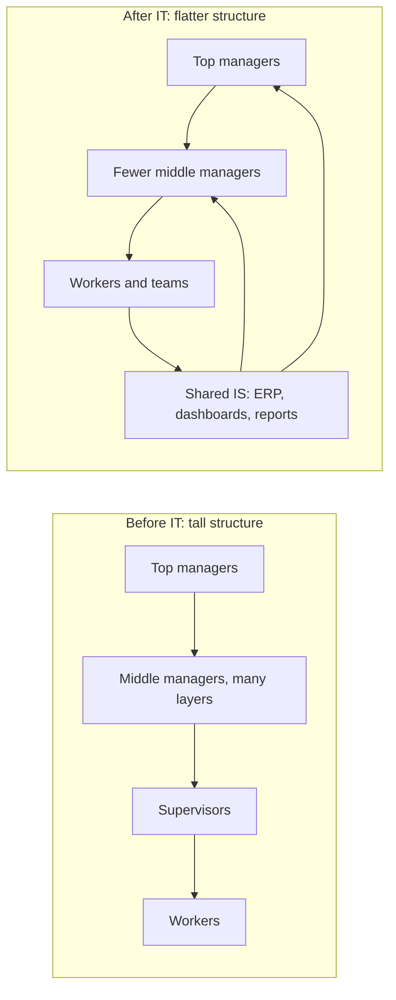
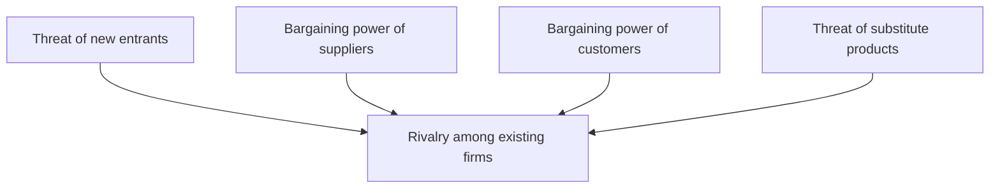
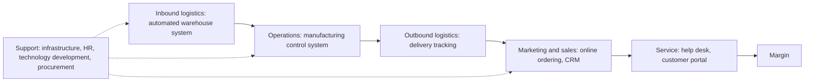
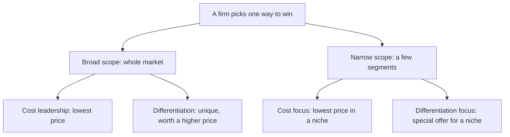

Before the new ideas, here are the old ones you need. If you already know them, skip to the next section.

## The basics first

- **Data** are raw facts (a sale of Rs 500 at 10:05). **Information** is data that has been organized so it means something to a person (today's sales are 20% above last week).
- An **information system (IS)** collects, processes, stores and shares information for a purpose. A **computer-based information system (CBIS)** does this with hardware, software, a database, a network, procedures and people. <Cite id="it-impact-society-rainer-iis7" loc="Ch. 1" />
- **Information technology (IT)** is the technology part: the computers, software and networks. IS is the bigger idea: technology plus people plus processes.
- An **organization** is a group of people working together for goals, for example a company, a hospital or a college. It has levels: top managers (plan the future), middle managers (turn plans into work and watch results) and operational staff (do the daily work).
- **Society** means all of us outside the company: customers, citizens, families, the government.

This note covers syllabus <Syl m="1" /> sections 1.2 to 1.5: the impact of IT on organizations, the importance of IS to society, organizational strategy, and competitive advantage with IS.

## Part 1: How IT impacts organizations

<Box kind="definition">

**Impact of IT on organizations** means the changes that computers, software and networks bring to how a firm is structured, how its managers and employees work, and how healthy and safe its workplace is.

</Box>

**Why it matters.** When a firm brings in an ERP, an online store or a mobile app, it does not just get a new tool. The shape of the firm, the jobs in it and the way decisions are made all change. A manager must plan for these changes, good and bad.

Think of a school that moves from a paper register to an attendance app. Teachers stop adding columns by hand, the principal sees absent students in real time, and the clerk who used to compile monthly reports now has a different job.

The textbook groups the impact into a few clear points. <Cite id="it-impact-society-rainer-iis7" loc="Ch. 1" />

1. **IT reduces the number of middle managers.** Middle managers used to collect reports from below and pass summaries up. A system can now do that automatically, and one manager can supervise more people. The organization becomes **flatter** (fewer layers between the top and the bottom). Studies show mixed results: in some firms IT reduced middle managers, in others it increased them, depending on how centralized the decisions were. So write "IT tends to flatten organizations", not "IT always removes managers".
2. **IT changes the manager's job.** Managers get information faster and in more detail, so they can make decisions quickly, often with decision-support and business-intelligence tools. They can also manage people who are far away (remote and virtual teams), which needs new skills like leading by email and video. <Cite id="it-impact-society-wiki-remote-work" />
3. **IT can remove some jobs and create others.** Routine jobs (data entry, typing, simple clerical work, some factory work) can be automated. At the same time new jobs appear: software developers, data analysts, network and security staff, digital marketers. Whether IT causes more job loss than job creation overall is debated. <Cite id="it-impact-society-wiki-tech-unemployment" />
4. **IT changes how employees work and feel.** Computers can make work more interesting, but they can also add stress (always being reachable, being monitored, too much information). Long hours at a screen cause eye strain, back pain and **repetitive strain injury** such as carpal tunnel syndrome. Good **ergonomics** (designing chairs, keyboards, screens and lighting to fit the human body) reduces this. <Cite id="it-impact-society-wiki-ergonomics" />
5. **IT opens jobs to people with disabilities.** Screen readers, voice input, large-text displays and work-from-home let people with visual, hearing or movement difficulties do jobs that were hard for them before.

Other impacts often expected in MU answers, all following from the points above:

- **Faster and better decisions**: managers see summaries instead of piles of paper. <Cite id="it-impact-society-gfg-mis" /> <Cite id="it-impact-society-tp-mis" />
- **Changed business processes**: work is redesigned around the system, sometimes radically, which is called business process re-engineering (BPR). <Cite id="it-impact-society-wiki-bpr" />
- **Better coordination**: departments share one database, so sales, stores and accounts see the same numbers.
- **New ways of working**: telecommuting, virtual teams, 24×7 online service.
- **New risks**: dependence on systems, cyber attacks and data breaches.

| Area | Positive impact | Negative impact |
|---|---|---|
| Structure | Flatter, faster communication | Fewer middle-manager posts |
| Managers | Real-time information, better decisions | Information overload, must learn new skills |
| Jobs | New skilled jobs, more interesting work | Routine jobs automated, need for retraining |
| Health | Ergonomic design, less heavy manual work | Eye strain, back pain, repetitive strain injury, stress |
| Inclusion | Assistive technology for people with disabilities | Employees without digital skills left behind |
| Privacy | Better records | Employee monitoring can feel like surveillance |

## Part 2: Why information systems are important to society

<Box kind="definition">

**Importance of IS to society** means the ways information systems change daily life for people outside the company: how they live, work, learn, get health care, shop and take part in public life.

</Box>

**The three main points from the textbook.** <Cite id="it-impact-society-rainer-iis7" loc="Ch. 1" />

1. **IT affects our quality of life.** Online shopping, banking, booking and government services save time and travel. Work from home gives flexibility. But the same phone that saves time can also stretch the working day, because people stay reachable all the time.
2. **The robot revolution.** Robots and automated machines now do dangerous, dirty or repetitive work: welding in car factories, picking items in warehouses, delivery drones, cleaning robots. This keeps people away from danger but raises fears about jobs.
3. **Improvements in health care.** Electronic health records, medical imaging, diagnosis with the help of data, online consultations (**telehealth**) and health apps help doctors decide faster and reach patients in far-away places. <Cite id="it-impact-society-wiki-telehealth" />

**More benefits students should add:**

- **Education:** online courses (for example NPTEL and SWAYAM in India), e-books, video lectures available to anyone with internet. <Cite id="it-impact-society-nptel-mis" />
- **Access to information and voice:** search engines, social media and blogs let anyone find facts and share views with the whole world. <Cite id="it-impact-society-gfg-media-society" />
- **Government services:** online tax filing, digital certificates, digital payments, which cut queues and paperwork (for example income-tax e-filing and UPI payments).
- **People with disabilities:** assistive technology lets them study, work and communicate.

**Problems IS creates for society:**

- **Job loss and the need to reskill** when routine work is automated. <Cite id="it-impact-society-wiki-tech-unemployment" />
- **Privacy and security:** personal data can be leaked, sold or misused. (Ethics and privacy are covered in module 3.)
- **The digital divide:** the gap between people who have computers, internet and digital skills and those who do not. Villages, poorer families and older people can be left behind. <Cite id="it-impact-society-wiki-digital-divide" />
- **Misinformation:** fake news spreads quickly online. <Cite id="it-impact-society-gfg-media-society" />
- **Health and social life:** screen addiction, less face-to-face contact, stress.
- **Electronic waste:** old phones and computers contain harmful materials and are often not recycled safely. <Cite id="it-impact-society-wiki-ewaste" />

<Box kind="intuition">

IS is like electricity in a town. It lights up homes, hospitals and schools and makes life easier. But if wiring is unsafe, people get hurt, and houses without a connection fall behind their neighbours. Society needs IS, and it also needs rules and access for everyone.

</Box>

## Part 3: The economic impact of IS

A 2024 paper asked directly for the **economic impacts** of IS, so learn these as a separate list. Each point is a way IS changes costs, output or markets. <Cite id="it-impact-society-laudon-mis" /> <Cite id="it-impact-society-porter-millar1985" />

1. **Lower transaction costs.** Finding a supplier, comparing prices and placing an order used to need phone calls, visits and paperwork. On the internet it is a few clicks. Example: a shop owner orders stock on a B2B app instead of visiting a wholesale market.
2. **Lower coordination (agency) costs.** Managers can watch and coordinate many employees and branches through one system, so a firm can grow large without the cost of more supervisors. Example: SBI runs thousands of branches on one core-banking system.
3. **Higher productivity.** Each worker produces more in the same time because routine steps are automated. Example: billing software at a supermarket checkout.
4. **Substitution of capital for labour.** As IT becomes cheaper, firms buy systems instead of hiring for repetitive work, which cuts cost but changes the job market.
5. **New products, markets and business models.** Online stores, app-based taxis, food delivery, digital payments and cloud services did not exist before. Small firms can sell nationwide or abroad.
6. **New jobs and industries.** The whole software and IT-services industry, plus jobs like app developer, data analyst and delivery partner.
7. **Better prices and choice for customers.** Price comparison and online competition push prices down.
8. **Globalization.** Work can be done anywhere. Indian IT firms serve clients across the world.

| Economic effect | How IS causes it | Example |
|---|---|---|
| Lower transaction cost | Online search, ordering and payment | Ordering stock on a B2B app |
| Lower coordination cost | One system to monitor many units | Core banking across branches |
| Higher productivity | Automation of routine steps | Barcode billing at checkout |
| New markets | Internet reaches distant buyers | Small artisan selling on Amazon or Flipkart |
| Jobs shift | Routine jobs fall, skilled jobs rise | Clerk replaced, data analyst hired |

## Part 4: Organizational strategy

<Box kind="definition">

**Organizational strategy** is a firm's long-term plan: what goals it wants to reach and how it will use its people, money and technology to reach them. **Strategic management** is the process of making, carrying out and checking that plan. <Cite id="it-impact-society-wiki-strategic-mgmt" />

</Box>

**Why firms need a strategy.** Every firm faces **business pressures** from its environment, and must respond. The textbook groups them like this. <Cite id="it-impact-society-rainer-iis7" loc="Ch. 2" />

- **Market pressures:** global competition, a changing workforce, and powerful customers who can compare prices online.
- **Technology pressures:** new technology quickly makes old products obsolete, and there is too much information to handle.
- **Societal, political and legal pressures:** social responsibility (for example green IT), government rules and compliance, and protection against terrorism and cyber attacks.

**How organizations respond**, very often with IS:

1. **Strategic systems** that give an advantage over rivals.
2. **Customer focus:** knowing each customer and serving them well (CRM).
3. **Make-to-order and mass customization:** making products to each customer's order, at mass-production cost, for example custom-built laptops ordered online.
4. **E-business and e-commerce:** selling, buying and working online.

**Steps in making a strategy**, in simple words: <Cite id="it-impact-society-tp-strategic-mgmt" />

1. Set the **vision, mission and goals**.
2. **Analyse the environment**: outside (competitors, customers, laws, technology, using the five forces) and inside (strengths and weaknesses, using the value chain).
3. **Choose a strategy**: cost leadership, differentiation and so on.
4. **Implement** it: budgets, people, systems.
5. **Evaluate and control**: measure results and adjust.

A **strategic information system (SIS)** is any IS that helps a firm carry out its strategy and gain an edge over rivals, not just record transactions. <Cite id="it-impact-society-wiki-sis" />

## Part 5: Competitive advantage and IS

<Box kind="definition">

**Competitive advantage** is anything that lets a firm do better than its rivals, for example lower cost, a better product or faster service, so that it earns more customers or more profit. It is **sustainable** if rivals cannot copy it quickly. <Cite id="it-impact-society-wiki-competitive-advantage" />

</Box>

Think of two tea stalls on the same street. One gives a token on a phone app and tea is ready when you arrive; the other makes you wait in a queue. The first stall has a competitive advantage built with a simple information system.

Two tools help a firm decide where to use IS: Porter's five forces (looking outside) and Porter's value chain (looking inside).

### Porter's competitive forces model

Michael Porter (Harvard) published this model in 1979. It says the profit possible in an industry depends on five forces. The stronger the forces, the harder it is to earn profit. <Cite id="it-impact-society-porter-hbr1979" /> <Cite id="it-impact-society-porter-hbr2008" /> <Cite id="it-impact-society-hbs-five-forces" /> <Cite id="it-impact-society-tp-five-forces" />

| Force | What it means | How IS helps the firm | Example |
|---|---|---|---|
| Threat of new entrants | New firms may enter and take customers | Build a large system or network that is costly to copy; but the internet also lowers entry barriers | A bank's mature mobile app and ATM network |
| Bargaining power of suppliers | Suppliers can raise prices if few of them exist | Online procurement to compare many suppliers; supply-chain systems | A retailer runs e-auctions among suppliers |
| Bargaining power of customers | Customers can switch easily and push prices down | Loyalty programs and personalised service create **switching costs** (the effort a customer faces to change firms) | Airline frequent-flyer points |
| Threat of substitutes | Other products can do the same job | Use IS to add features, keep improving, build switching costs | Streaming apps versus DVDs |
| Rivalry among existing firms | Many firms competing on price and features | Use IS to cut costs, launch faster, know customers better | Amazon and Flipkart competing on delivery speed |

<Box kind="pitfall">

The internet does not only help the firm. It usually makes customers and new entrants stronger, because prices are easy to compare and starting an online business is cheap. Mention both sides in an answer. <Cite id="it-impact-society-porter-hbr2008" />

</Box>

### Porter's value chain model

The **value chain** splits a firm into the activities that add value to its product, so you can see where IS helps most. It is described in Porter's 1985 book *Competitive Advantage*, and Porter and Millar's 1985 paper shows how information technology touches every activity in the chain. <Cite id="it-impact-society-hbs-value-chain" /> <Cite id="it-impact-society-porter-millar1985" /> <Cite id="it-impact-society-wiki-value-chain" /> <Cite id="it-impact-society-tp-value-chain" />

- **Primary activities** directly make and sell the product: inbound logistics, operations, outbound logistics, marketing and sales, service.
- **Support activities** help the primary ones: firm infrastructure (accounting, finance, management), human resource management, technology development, procurement.
- **Margin** is what is left after costs. Adding value or cutting cost at any step raises the margin.

| Value chain activity | Example IS | Value added |
|---|---|---|
| Inbound logistics | Inventory and warehouse management | Right material at the right time |
| Operations | Computer-aided manufacturing, quality control | Fewer defects, faster production |
| Outbound logistics | Order tracking, route planning | Faster delivery |
| Marketing and sales | E-commerce site, CRM, targeted ads | More and better-targeted sales |
| Service | Online help desk, chatbot | Happier customers |
| Support activities | ERP, HR system, e-procurement, R&D tools | Lower overhead cost |

<Box kind="intuition">

The five forces are like looking out of the window to see who is threatening your shop. The value chain is like walking through your own shop, step by step, to see where you can work faster or cheaper.

</Box>

### Strategies for competitive advantage

Porter named three generic strategies: cost leadership, differentiation and focus. <Cite id="it-impact-society-wiki-generic-strategies" /> The syllabus textbook lists five strategies, each supported by IS. <Cite id="it-impact-society-rainer-iis7" loc="Ch. 2" />

<Cite id="it-impact-society-wiki-generic-strategies" loc="diagram" />

| Strategy | Meaning | How IS helps | Example |
|---|---|---|---|
| Cost leadership | Be the lowest-cost producer | Automated inventory, efficient supply chain | Walmart keeping prices low through its inventory and supply-chain systems |
| Differentiation | Offer something different that customers value | Personalised products, unique online features | Custom-designed products ordered online |
| Innovation | Bring new products, services or methods first | Online ordering, mobile apps, new business models | ATMs and later mobile banking in banks |
| Operational effectiveness | Do the same work better than rivals: faster, fewer errors | Process automation, ERP | Faster order processing and fewer billing mistakes |
| Customer orientation | Focus on making customers happy | CRM, personalised website, loyalty programs | Amazon's recommendations based on past purchases |

Other strategies textbooks mention: **focus on a market niche** (serve one narrow group very well, using data to find it) and **strengthening customer and supplier intimacy** (link systems with suppliers and customers so both find it hard to switch). <Cite id="it-impact-society-laudon-mis" />

### Using big data for competitive advantage

**Big data** means data sets so large, fast-arriving and varied (text, clicks, videos, sensor readings) that ordinary tools cannot handle them. Analysing them can reveal patterns that rivals miss. <Cite id="it-impact-society-gfg-big-data" /> <Cite id="it-impact-society-ibm-big-data" /> <Cite id="it-impact-society-wiki-big-data" />

How a company gains an advantage with big data, mapped to the strategies above:

1. **Know customers better (customer orientation):** analyse purchase history and browsing to recommend products and personalise offers.
2. **Cut costs (cost leadership):** forecast demand so less stock is wasted; use sensor data to repair machines before they fail (predictive maintenance).
3. **Better and faster decisions (operational effectiveness):** dashboards show what is happening now, not last month.
4. **New products (innovation):** spot unmet needs from reviews and social media.
5. **Dynamic pricing:** change prices with demand, as airlines and ride apps such as Uber do.
6. **Fraud and risk detection:** banks flag unusual transactions in real time.
7. **Supply chain:** track goods and plan routes to deliver faster.

Limitations: it needs skilled people and costly infrastructure, the data can be poor quality, and using personal data raises privacy and legal issues.

## Part 6: Advantages and disadvantages of a competitive environment

A 2024 question asked to contrast the advantages and disadvantages of a **competitive environment** in an organization. A competitive environment means a market with many rivals fighting for the same customers, and inside a firm, a culture where teams or employees compete on performance.

| Advantages | Disadvantages |
|---|---|
| Pushes the firm to **innovate** and improve products | Pressure to **cut prices** reduces profit margins |
| Forces **efficiency** and lower costs | High spending on marketing, technology and research |
| Customers get **better quality, lower prices and more choice** | Weaker firms may fail and jobs are lost |
| Firm learns from rivals (benchmarking) | Temptation to cut corners on quality or ethics |
| Employees stay motivated and skills improve | Inside the firm, too much rivalry causes **stress**, less cooperation and hiding of information |
| Encourages using IS to stay ahead (strategic systems) | IS advantages are often **copied quickly**, so the edge does not last |

The last row matters for IS: a system that any rival can buy gives only a short advantage. A lasting advantage usually comes from combining IS with the firm's own processes, data and people. <Cite id="it-impact-society-porter-hbr2008" />

## Where this was asked

| If the question says | What to write | Seen as |
|---|---|---|
| "How does IT impact organizations?" (5 marks) | Flatter structure with fewer middle managers, changed manager's job, jobs lost and created, health and ergonomics, opportunities for people with disabilities, one line on decisions | <PYQ id="2023-05-ce/q1a" /> <PYQ id="2024-12-ce/q1a" /> |
| "Impact of information system on organization and society" (10 marks) | Part 1 list plus the structure diagram, then Part 2 benefits and problems, the positive/negative table and a one-line conclusion | <PYQ id="2023-05-ce/q2a" /> <PYQ id="2024-12-ce/q6a" /> |
| "Importance of information systems to society" (5 marks) | Quality of life, robot revolution, health care, then education and government services, and two problems (digital divide, privacy) | <PYQ id="2023-12-ce/q1e" /> |
| "Economic impacts of IS, give example" (10 marks) | Definition, the eight economic effects each with an example, the table, both sides (jobs shift) | <PYQ id="2024-05-ce/q2a" /> |
| "Advantages and disadvantages of competitive environment" (10 marks) | Define competitive environment, five forces diagram briefly, the contrast table, link to IS and sustainable advantage | <PYQ id="2024-05-ce/q3a" /> |
| "How a company can use big data to gain competitive advantage" (10 marks) | Define big data and competitive advantage, the seven uses tied to strategies, examples, limitations | <PYQ id="2024-12-ce/q3b" /> |

## Quick revision

- IT on organizations: flatter (fewer middle managers), new manager role, jobs lost and created, stress and ergonomics, inclusion of people with disabilities.
- IS to society: quality of life, robots, health care, education, e-governance; problems: job loss, privacy, digital divide, misinformation, e-waste.
- Economic impact: lower transaction and coordination costs, higher productivity, new markets and jobs, globalization.
- Business pressures: market, technology, societal/political/legal. Responses: strategic systems, customer focus, mass customization, e-business.
- Five forces: new entrants, suppliers, customers, substitutes, rivalry.
- Value chain: 5 primary (inbound, operations, outbound, marketing and sales, service) and 4 support (infrastructure, HR, technology, procurement) activities.
- Five strategies: cost leadership, differentiation, innovation, operational effectiveness, customer orientation.
- Competitive environment: drives innovation and lower prices, but cuts margins and IS edges are easily copied.
