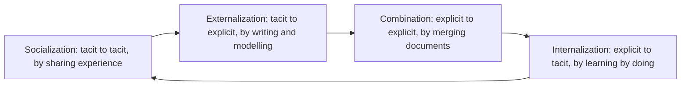
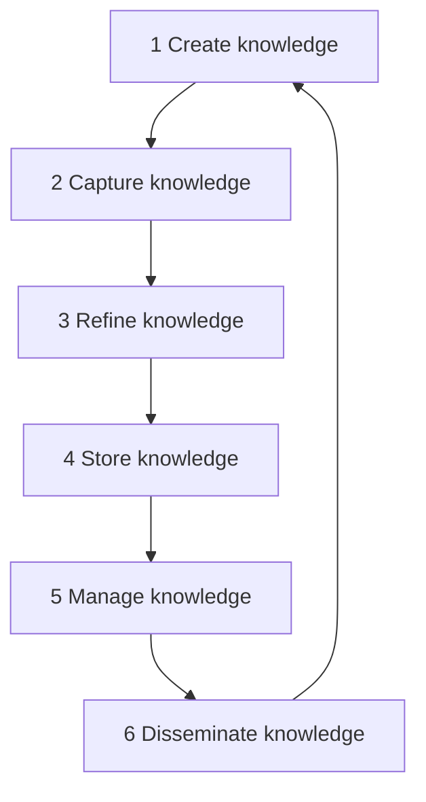
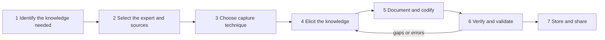

Naye ideas se pehle wo purane ideas jo aapko chahiye. Agar aapko pata hain to agle section pe jao.

## The basics first

- **Data** raw facts hain jinka koi matlab attach nahi hota, jaise "38.5".
- **Information** wo data hai jo context mein rakha gaya ho taaki uska matlab bane: "patient ka temperature 38.5 °C hai".
- **Knowledge** wo information hai jo experience aur samajh ke saath mili ho, taaki aapko pata ho ki kya karna hai: "in symptoms ke saath 38.5 °C ka matlab aksar infection hota hai, isliye blood test karwao".
- Ye teen, aur upar wisdom, aksar **DIKW pyramid** (data, information, knowledge, wisdom) ki tarah banaye jaate hain. Har level apne neeche wale level se banta hai. <Cite id="knowledge-management-wiki-dikw" />
- **Knowledge worker** wo hai jiska main kaam knowledge use aur create karna hai, jaise engineer, doctor, analyst ya teacher. <Cite id="knowledge-management-wiki-knowledge-worker" />
- **Repository** (ya knowledge base) ek central store hai, aam taur pe database ya document system, jahan organization apna knowledge rakhta hai taaki log use search kar sakein.

## What knowledge management is and why it is needed

<Box kind="definition">

**Knowledge management (KM)** processes aur tools ka wo set hai jisse organization apne knowledge ko identify, create, capture, organize, store, share aur use karta hai, taaki sahi knowledge sahi insaan tak sahi time pe pahunche. <Cite id="knowledge-management-gfg-intro" /> <Cite id="knowledge-management-ibm" />

</Box>

Ye syllabus <Syl m="2" /> ka section 2.2 hai, aur ye usi module mein data management aur business intelligence ke saath aata hai. Data management data ko sambhalta hai; KM us cheez ko sambhalta hai jo log us data ko use karne aur business chalane ke baare mein *jaante* hain. <Cite id="knowledge-management-rainer-mis" />

**Ye kyun zaroori hai (kaun si problem solve karta hai).**

1. **Knowledge darwaze se bahar chala jaata hai.** Jab koi experienced employee retire ya resign karta hai, to saalon ka know-how uske saath chala jaata hai, agar pehle share nahi kiya gaya. Wikipedia ise *knowledge loss* kehta hai. <Cite id="knowledge-management-wiki-km" />
2. **Wheel dobara banana.** KM ke bina ek team ek problem solve karti hai aur doosre shehar ki doosri team wahi problem zero se dobara solve karti hai.
3. **Slow decisions.** Log information dhoondhne mein ya us ek insaan ko dhoondhne mein time waste karte hain jise jawab pata hai. <Cite id="knowledge-management-ibm" />
4. **Knowledge ek competitive asset hai.** Products copy ho sakte hain, par firm ka know-how copy karna mushkil hai. Laudon aur Laudon knowledge ko digital firm ka key asset maante hain. <Cite id="knowledge-management-laudon-mis" />

**Everyday analogy.** Ek family recipe socho. Agar dadi use kabhi likhti nahi aur kisi ko sikhati nahi, to recipe unke saath khatam ho jaati hai. KM wo aadat hai jisme saath mein khana banaate hain, recipe card likhte hain, use recipe box mein rakhte hain aur har cousin ko copy dete hain.

KM early 1990s mein ek recognized discipline bana. <Cite id="knowledge-management-wiki-km" />

## Types of knowledge: tacit and explicit

<Box kind="definition">

**Explicit knowledge** ko shabdon, numbers ya diagrams mein daal kar record kiya ja sakta hai: manuals, reports, procedures, databases, patents. <Cite id="knowledge-management-wiki-explicit" />

**Tacit knowledge** experience se bana personal know-how hai. Ye logon ke dimaag aur haathon mein rehta hai aur ise likhna mushkil hai: ek senior engineer ko kharab machine ka andaaza, ek salesperson ko ye samajh ki client kab sign karne ko ready hai. <Cite id="knowledge-management-wiki-tacit" />

</Box>

**Analogy.** Cycling manual explicit knowledge hai. Cycle pe balance banana tacit knowledge hai: aap din bhar manual padh sakte ho aur phir bhi gir sakte ho. Cycle chalana tacit knowledge ka classic example hai. <Cite id="knowledge-management-wiki-tacit" />

Kuch sources, jaise IBM, ek teesra kind add karte hain, **implicit knowledge**: wo know-how jo abhi likha nahi gaya par likha *ja sakta* hai, jaise wo unwritten steps jo ek team hamesha follow karti hai. <Cite id="knowledge-management-ibm" /> Zyadatar MU answers ko sirf tacit aur explicit chahiye.

| Point | Tacit knowledge | Explicit knowledge |
|---|---|---|
| Where it lives | Logon ke dimaag, skills aur habits mein | Documents, databases, manuals mein |
| Can it be written down? | Mushkil ya sirf aadha | Haan, aasaani se |
| How it is shared | Face to face, mentoring, saath kaam karke | Padhkar, e-mail, search, repositories |
| Speed and cost of sharing | Slow, costly, trust chahiye | Fast aur sasta |
| Example | Doctor ka diagnostic judgment | Hospital ki treatment guideline |
| Main risk | Insaan chala jaaye to lost | Maintain na ho to outdated ho jaata hai |

<Cite id="knowledge-management-tp-tacit-explicit" />

Wikipedia **embedded** knowledge (processes ya systems mein bana hua, jaise software mein coded rules) aur **embodied** knowledge (sharir ki seekhi hui skill) ka bhi zikr karta hai. <Cite id="knowledge-management-wiki-km" />

<Box kind="pitfall">

Tacit aur explicit do alag dabbe nahi hain jinke beech koi link na ho. Ye ek doosre mein badalte rehte hain. Ye kaise hota hai, uski standard picture neeche wala SECI model hai.

</Box>

## The four modes of knowledge conversion (SECI model)

Ikujiro Nonaka ne SECI model lagbhag 1990 mein develop kiya, aur baad mein Hirotaka Takeuchi ke saath refine hua. Ye batata hai ki knowledge tacit aur explicit ke beech chaar tareeke se convert hota hai. <Cite id="knowledge-management-wiki-seci" /> Nonaka ka Harvard Business Review article "The Knowledge-Creating Company" company examples ke saath wahi tacit aur explicit ke beech ki movement samjhata hai. <Cite id="knowledge-management-nonaka-hbr" />

**1. Socialization (tacit to tacit).** Log experience seedha share karte hain dekhkar, nakal karke aur saath practice karke. Kuch likha nahi jaata. *Example:* ek apprentice master craftsman ke bagal mein kaam karta hai; ek naya nurse night shifts mein senior nurse ko shadow karta hai. *Analogy:* mummy ke bagal mein kitchen mein khade hokar khana banana seekhna.

**2. Externalization (tacit to explicit).** Personal know-how ko words, models, pictures ya metaphors mein daala jaata hai taaki doosre use kar sakein. Ye aksar sabse mushkil aur sabse valuable step hota hai. *Example:* ek senior engineer bees saal ke experience se troubleshooting guide likhta hai; ek team project ke baad "lessons learned" record karti hai. *Analogy:* aakhirkar dadi ki recipe card pe likh lena.

**3. Combination (explicit to explicit).** Maujooda explicit pieces ko collect, sort aur merge karke naya, zyada complete explicit knowledge banaya jaata hai, aam taur pe databases aur networks se. *Example:* branch sales reports ko mila kar ek national report banana; kai alag manuals se company wiki banana. *Analogy:* poori family ke recipe cards ko ek cookbook mein jama karna.

**4. Internalization (explicit to tacit).** Insaan explicit knowledge padhta ya sikhta hai aur practice se use apni skill bana leta hai. *Example:* ek naya employee hafton tak manual follow karta hai jab tak procedure uski aadat na ban jaaye; training simulations. *Analogy:* cookbook se itni baar khana banana ki ab use kholne ki zaroorat hi nahi.

**The spiral.** Internalization ke baad insaan ke paas ab richer tacit knowledge hai, jo wo phir socialization se share karta hai. To chaaron modes ek continuous spiral banate hain, aur har round mein knowledge badhta hai. Nonaka aur Konno ne baad mein **Ba** ka idea add kiya, ek shared space (physical, virtual ya mental) jahan ye conversion hota hai, jaise meeting room, online forum ya shared project. <Cite id="knowledge-management-wiki-seci" />

| Mode | From → To | How | Typical tool or setting |
|---|---|---|---|
| Socialization | Tacit → Tacit | Shared experience, observation | Apprenticeship, on-the-job training, meetings |
| Externalization | Tacit → Explicit | Articulating, writing, modelling | Interviews, lessons-learned documents, FAQs |
| Combination | Explicit → Explicit | Collecting and merging | Databases, intranets, reports, wikis |
| Internalization | Explicit → Tacit | Learning by doing | Training, manuals, simulations, e-learning |

<Box kind="exam">

"Types of knowledge aur four modes of conversion" ke liye: tacit aur explicit ko ek-ek example ke saath define karo, SECI cycle draw karo, phir har mode ko uske "from → to", kaise hota hai aur ek example ke saath explain karo. End mein spiral wala idea likho.

</Box>

## The knowledge management life cycle

**KM life cycle** (ya KM cycle) un steps ka sequence hai jisse knowledge organization mein guzarta hai, create hone se use hone tak. Rainer aur co-authors chhe steps batate hain, aur cycle repeat hoti hai kyunki knowledge purana ho jaata hai aur naya knowledge aata rehta hai. <Cite id="knowledge-management-rainer-mis" />

1. **Create.** Naya knowledge tab aata hai jab log kaam karne ke naye tareeke dhoondhte hain ya know-how develop karte hain, ya jab knowledge bahar se aata hai (consultants, partners, research). *Example:* ek support engineer ek common fault ka tez fix dhoondh leta hai.
2. **Capture.** Naye knowledge ko valuable pehchaan kar ek reasonable form mein record karna padta hai. *Example:* engineer ka interview hota hai aur fix likh liya jaata hai.
3. **Refine.** Knowledge ko context mein rakha jaata hai taaki wo actionable ho. Yahan insaan ki insights (tacit side) facts ke saath record hoti hain. *Example:* ye likhna ki fix kab chalta hai, kab nahi, aur kyun.
4. **Store.** Useful knowledge ko ek reasonable format mein knowledge repository mein rakha jaata hai jahan organization ke doosre log pahunch sakein. *Example:* article ko tags ke saath support knowledge base mein daalna.
5. **Manage.** Library ki books ki tarah, knowledge ko current rakhna padta hai: regularly review karo ki wo ab bhi accurate aur relevant hai ya nahi, aur nahi ho to hata do ya update karo.
6. **Disseminate.** Knowledge ko useful format mein organization ke har us insaan ko available karaya jaata hai jise zaroorat ho, kahin bhi aur kabhi bhi. *Example:* matching complaint log hote hi article apne aap dikh jaata hai.

**Analogy.** Ek library: books likhi jaati hain (create), library unhe chunti hai (capture), catalogue banati hai (refine), shelf pe rakhti hai (store), kharab ya purani copies badalti hai (manage) aur readers ko deti hai (disseminate). Phir readers nayi books likhte hain.

**Other KM cycle models.** Alag authors steps ko alag naam dete hain, to agar aapki reference book mein doosre words ho to ghabrao mat. TutorialsPoint chaar well-known models ka summary deta hai: <Cite id="knowledge-management-tp-cycle" />

| Model | Steps |
|---|---|
| Wiig (1993) | Build, hold, pool, apply knowledge |
| Meyer and Zack (1996) | Acquisition, refinement, storage and retrieval, distribution, presentation and use |
| Bukowitz and Williams (2000) | Get, use, learn, contribute |
| McElroy (2003) | Problem claim formulation, knowledge claim formulation, knowledge claim evaluation, knowledge integration |

Laudon aur Laudon ek chhoti **knowledge management value chain** batate hain: knowledge acquisition, knowledge storage, knowledge dissemination aur knowledge application. <Cite id="knowledge-management-laudon-mis" /> Ye sab models alag words mein ek hi baat kehte hain: knowledge lo, use usable banao, rakho, share karo, use karo, aur repeat karo.

<Box kind="exam">

"Illustrate the KM life cycle" (10 marks) ke liye: KM aur life cycle define karo, six-step loop draw karo, har step ek line aur ek example ke saath explain karo, likho ki Wiig aur Zack jaise doosre authors ke similar models hain, aur end mein likho ki ye cycle kyun hai.

</Box>

## Knowledge capture: the steps

**Knowledge capture** wo process hai jisme experts, documents aur past work se knowledge, khaaskar tacit knowledge, bahar nikaala jaata hai aur use explicit, usable form mein badla jaata hai jo store aur share ho sake. Expert-systems ki language mein isi activity ko **knowledge acquisition** ya knowledge elicitation kehte hain, aur ye karne wala insaan **knowledge engineer** kehlata hai. <Cite id="knowledge-management-wiki-acquisition" /> <Cite id="knowledge-management-wiki-engineering" />

**Ye kyun zaroori hai.** Capture wo step hai jo knowledge ko darwaze se bahar jaane se bachata hai. Ye sabse mushkil step bhi hai, kyunki experts aksar samjha nahi paate ki wo kya karte hain; unhe bas "pata hota hai".

**Analogy.** Ek journalist jo cookbook ke liye famous chef ka interview leta hai: chef kabhi kuch naapta nahi, to journalist ko dekhna padta hai, poochna padta hai "aapne ye kyun kiya?", likhna padta hai aur phir chef se draft check karwana padta hai.

1. **Identify the knowledge to capture.** Decide karo ki kaun sa problem area ya process important hai, aur kaun sa knowledge critical ya risk mein hai (jaise ek insaan ke paas hai jo retire hone wala hai).
2. **Select the experts and sources.** Un logon ko chuno jinke paas sach mein know-how hai, saath mein existing documents, past project files aur cases. Rapport banao aur purpose samjhao, kyunki jo expert khatre mein mehsoos karta hai ("kya mujhe replace kar denge?") wo khul ke share nahi karega.
3. **Choose the capture technique.** Knowledge ke kind ke hisaab se method chuno (neeche table dekho). Tacit skill ke liye aksar observation ya interviews chahiye; group knowledge ke liye brainstorming ya Delphi method.
4. **Elicit the knowledge.** Sessions chalao: sawaal poocho, expert ko kaam karte dekho, unhe zor se sochne (think aloud) ko kaho. Permission leke record karo taaki kuch na chhute.
5. **Document and codify.** Raw notes ko structured, explicit form mein badlo: rules ("agar ye, to wo karo"), procedures, decision trees, cases, FAQs ya concept maps.
6. **Verify and validate.** Result expert ko aur doosre experts ko dikhao. Verification check karta hai ki sahi record hua; validation check karta hai ki real cases pe sach mein kaam karta hai. Gaps fix karo aur zaroorat ho to elicitation dobara karo.
7. **Store and share.** Checked knowledge ko repository ya knowledge-based system mein rakho, tags ke saath taaki log dhoondh sakein, aur use review mein rakho.

**Common capture techniques.**

| Technique | How it works | Best for |
|---|---|---|
| Interviews (unstructured, semi-structured, structured) | Knowledge engineer expert se sawaal poochta hai, open-ended se lekar fixed list tak | Zyadatar situations, sabse common method |
| On-site observation | Expert ko real job karte dekho aur har action note karo | Hands-on skills jinhe batana mushkil hai |
| Protocol analysis (think-aloud) | Expert problem solve karte waqt har soch zor se bolta hai; recording analyse hoti hai | Decision ke reasoning steps <Cite id="knowledge-management-wiki-protocol" /> |
| Brainstorming | Group bina criticism ke jaldi bahut ideas nikaalta hai, phir sort karta hai | Kai experts se ideas jama karna <Cite id="knowledge-management-wiki-brainstorming" /> |
| Delphi method | Experts rounds mein questionnaires bharte hain, anonymous group summary dekhte hain aur revise karte hain, jab tak opinions paas na aa jaayein | Forecasts aur judgments jahan experts door door hain <Cite id="knowledge-management-wiki-delphi" /> |
| Repertory grid | Expert apni khud ki opposite qualities ke pairs pe items ko rate karta hai, aur ek grid banta hai ki wo cheezon mein farak kaise karta hai | Expert ke chhupe distinctions saamne laana <Cite id="knowledge-management-wiki-repgrid" /> |
| Concept mapping | Concepts ko nodes aur relations ko labelled links ki tarah draw karo | Dikhana ki ideas kaise jude hain <Cite id="knowledge-management-wiki-concept-map" /> |
| Stories and lessons learned | Past projects mein kya sahi ya galat hua, uske accounts jama karo | Projects aur incidents ka experience |

Wikipedia structured interviews, protocol analysis, card sorting aur repertory grids ko manual knowledge acquisition techniques batata hai, aur machine learning, data mining aur natural language processing ko automated techniques. <Cite id="knowledge-management-wiki-acquisition" />

<Box kind="pitfall">

Books "steps of knowledge capture" ki ek fixed list pe agree nahi karti. Kuch chaar steps deti hain, kuch saat. Examiners koi bhi sensible sequence accept karte hain jo ye cover kare: kya capture karna hai, kisse, kaun si technique, eliciting, recording, expert se check karna aur storing. Step number ratta mat maro; logic yaad rakho.

</Box>

## Knowledge management systems and tools

**Knowledge management system (KMS)** wo information technology hai jo KM cycle ko support karti hai: ye logon ko knowledge create, store, find aur share karne mein help karti hai. <Cite id="knowledge-management-wiki-km-software" />

**Two strategies.** Organizations do strategies mein se ek ki taraf jhukte hain: <Cite id="knowledge-management-wiki-km" />

| Point | Codification strategy | Personalization strategy |
|---|---|---|
| Idea | Knowledge likho aur reuse ke liye store karo | Logon ko jodo taaki wo aapas mein baat kar sakein |
| Knowledge type | Zyadatar explicit | Zyadatar tacit |
| Technology role | Bada: databases, repositories, search | Chhota: directories, video calls, forums |
| Example | Reusable proposal templates aur solution documents | Expert directory, mentoring, communities of practice |

**Laudon's three kinds of KM systems.** Laudon aur Laudon inhe aise group karte hain: <Cite id="knowledge-management-laudon-mis" />

1. **Enterprise-wide KM systems:** company-wide efforts jo documents aur knowledge collect, store aur share karte hain, jaise content management systems, knowledge repositories, expertise-location systems aur collaboration tools.
2. **Knowledge work systems:** knowledge workers jaise engineers aur scientists ke liye specialized systems, jaise CAD (computer-aided design) aur virtual-reality tools.
3. **Intelligent techniques:** tools jo knowledge capture ya discover karte hain, jaise expert systems, case-based reasoning, data mining aur neural networks. **Expert system** ek expert ke knowledge ko rules ki tarah store karta hai aur use advice dene mein use karta hai. <Cite id="knowledge-management-wiki-expert-system" />

**Common tools.** TutorialsPoint authoring aur annotation tools, data mining aur knowledge discovery tools, templates, blogs, aur groupware aur collaborative tools jaise shared calendars, wikis, chat aur video meetings batata hai. <Cite id="knowledge-management-tp-tools" /> Do people-centred tools bhi important hain:

- **Communities of practice:** wo groups jinke log ek profession ya interest share karte hain aur regularly ek doosre se seekhte hain, jaise company ke saare data scientists ka internal forum. <Cite id="knowledge-management-wiki-cop" />
- **Best practices:** wo methods jo achhe results dene ke liye proven hain, record kiye gaye taaki doosre copy kar sakein. <Cite id="knowledge-management-wiki-best-practice" />

## Benefits of knowledge management

1. **Better aur faster decisions**, kyunki current aur past knowledge aasaani se mil jaata hai. <Cite id="knowledge-management-ibm" />
2. **Search mein kam time waste** aur kam repeated work, to zyada efficiency. <Cite id="knowledge-management-gfg-intro" />
3. **Knowledge bacha rehta hai** jab employees chhodte hain ya role badalte hain (organizational memory). <Cite id="knowledge-management-ibm" />
4. **Zyada innovation**, kyunki shared ideas mil kar naye products aur processes banate hain. <Cite id="knowledge-management-gfg-intro" />
5. **Better customer service**, kyunki staff past cases aur solutions dekh sakta hai.
6. **Naye staff ki faster training**, kyunki jo unhe chahiye uska bahut kuch pehle se record hai.

## Challenges of knowledge management in different businesses

KM aasaan lagta hai, par kai projects fail hote hain. Reasons zyadatar logon aur culture ke hain, technology ke nahi.

1. **Unwillingness to share.** Employees ko lag sakta hai "knowledge hi power hai" aur share karne se unki value kam ho jaayegi. Technology ye fix nahi kar sakti; organization ko aisa culture banana padta hai jo sharing ko reward kare. <Cite id="knowledge-management-tp-challenges" />
2. **Tacit knowledge capture karna mushkil hai.** Experts aksar apna judgment explain nahi kar paate, isliye bahut valuable knowledge system tak pahunchta hi nahi. <Cite id="knowledge-management-ibm" />
3. **Knowledge ko accurate aur current rakhna.** Repositories purane ya galat content se bhar jaate hain aur log unpe trust karna chhod dete hain. Wikis jaise aasaani se edit hone wale tools review na ho to misinformation phaila sakte hain. <Cite id="knowledge-management-tp-challenges" /> <Cite id="knowledge-management-ibm" />
4. **Security versus sharing.** Sensitive knowledge (designs, client data, strategy) restricted hona chahiye, jabki KM chahta hai ki knowledge door tak share ho. Sahi balance banana mushkil hai. <Cite id="knowledge-management-tp-challenges" /> <Cite id="knowledge-management-wiki-km" />
5. **Value naapna.** Knowledge pe number lagana mushkil hai, isliye ye prove karna mushkil hai ki KM project ne paisa vasool kiya. <Cite id="knowledge-management-tp-challenges" />
6. **Technology aur change ke saath chalna.** Tools aur organizational structures badalte rehte hain, aur knowledge ko phir bhi logon tak jaldi pahunchna hai. <Cite id="knowledge-management-tp-challenges" />
7. **Leadership aur adoption.** Tools tabhi kaam karte hain jab log use karein; KM ko aise leaders chahiye jo doosron ko contribute karne ke liye manayein. <Cite id="knowledge-management-tp-challenges" /> <Cite id="knowledge-management-ibm" />
8. **Information overload.** Bahut zyada stored content se sahi item dhoondhna mushkil ho jaata hai.

**Alag businesses mein challenges kaise dikhte hain.** "Challenges in different business" wale sawaal mein upar ke points ko kuch kinds ke organizations pe apply karna hota hai. Ye illustrations hain, survey findings nahi:

| Business | Typical KM challenge |
|---|---|
| Manufacturing | Shop-floor skills tacit hain aur retirement ke paas senior workers ke paas hain |
| IT and consulting | Project knowledge teams mein bikhra hota hai aur staff ke projects badalne ya chhodne pe kho jaata hai |
| Banking and finance | Strict confidentiality aur regulation limit karte hain ki kya share ho sakta hai |
| Healthcare | Clinical knowledge tez badalta hai aur purani guidance patients ko nuksan pahuncha sakti hai; patient privacy sharing ko limit karti hai |
| Supply chains across many firms | Koi ek owner ya hierarchy nahi, to partners khul ke share nahi karte <Cite id="knowledge-management-wiki-km" /> |
| Multinational firms | Alag languages, cultures aur time zones sharing ko slow kar dete hain |

<Box kind="intuition">

Lagbhag har KM challenge ek sawaal pe wapas aata hai: *ek busy insaan apna time apna knowledge share karne mein kyun lagaye?* Achha KM iska jawab culture, recognition, aasaan tools aur clear rules se deta hai ki kya share ho sakta hai.

</Box>

## Where this was asked

| If the question says | What to write | Seen as |
|---|---|---|
| "Illustrate the Knowledge Management life cycle" | KM define karo, six-step loop draw karo (create, capture, refine, store, manage, disseminate), har step ki ek line aur ek example, doosre models ka zikr, cycle kyun hai | <PYQ id="2023-05-ce/q5a" /> |
| "Different types of knowledge and four modes of knowledge conversion" | Tacit versus explicit table aur examples ke saath, SECI cycle diagram, har mode "from → to", method aur example ke saath, spiral | <PYQ id="2023-05-ce/q5b" /> |
| "Challenges faced by Knowledge management in different business" | KM ki short definition, paanch ya chhe challenges (sharing culture, tacit knowledge, outdated content, security, value naapna, adoption), business-wise examples table | <PYQ id="2023-12-ce/q1a" /> |
| "Steps involved in knowledge capturing" | Knowledge capture ki definition, seven-step flow diagram, har step explained, techniques table (interviews, observation, protocol analysis, brainstorming, Delphi, repertory grid) | <PYQ id="2023-12-ce/q6a" /> <PYQ id="2024-12-ce/q4b" /> |

## Quick revision

- Data → information → knowledge: knowledge wo information hai jisme experience hai aur jo batati hai ki kaise act karna hai.
- KM: knowledge ko identify, create, capture, organize, store, share aur use karo taaki sahi insaan ko sahi time pe mile.
- Why: knowledge loss rokna, repeated work bachana, faster decisions, competitive advantage.
- Tacit: dimaag mein, likhna mushkil, saath kaam karke share hota hai. Explicit: likha hua, share karna aasaan.
- SECI (Nonaka): Socialization T→T, Externalization T→E, Combination E→E, Internalization E→T; spiral ki tarah repeat hota hai; Ba shared space hai.
- KM life cycle (Rainer): create, capture, refine, store, manage, disseminate, phir wapas create. Laudon ki value chain: acquire, store, disseminate, apply.
- Knowledge capture: knowledge identify, expert select, technique choose, elicit, document, expert se verify, store.
- Capture techniques: interviews, observation, protocol analysis, brainstorming, Delphi, repertory grid, concept maps.
- KMS: codification (documents store karo) versus personalization (logon ko jodo). Laudon: enterprise-wide KM, knowledge work systems, intelligent techniques.
- Challenges: sharing culture, tacit knowledge, outdated content, security, value naapna, adoption, overload.
