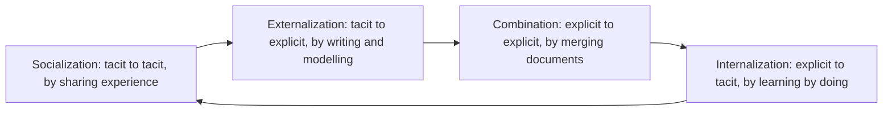
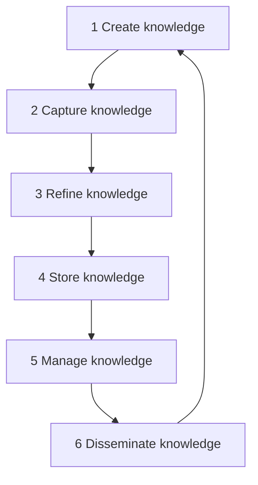
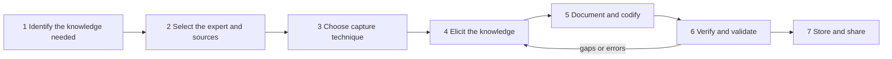

Before the new ideas, here are the old ones you need. If you already know them, skip to the next section.

## The basics first

- **Data** are raw facts with no meaning attached, for example "38.5".
- **Information** is data placed in context so it means something: "the patient's temperature is 38.5 °C".
- **Knowledge** is information combined with experience and understanding so that you know what to do: "38.5 °C with these symptoms usually means an infection, so order a blood test".
- These three, plus wisdom on top, are often drawn as the **DIKW pyramid** (data, information, knowledge, wisdom). Each level is built from the one below it. <Cite id="knowledge-management-wiki-dikw" />
- A **knowledge worker** is someone whose main job is to use and create knowledge, such as an engineer, doctor, analyst or teacher. <Cite id="knowledge-management-wiki-knowledge-worker" />
- A **repository** (or knowledge base) is a central store, usually a database or document system, where an organization keeps what it knows so people can search it.

## What knowledge management is and why it is needed

<Box kind="definition">

**Knowledge management (KM)** is the set of processes and tools an organization uses to identify, create, capture, organize, store, share and use its knowledge, so that the right knowledge reaches the right person at the right time. <Cite id="knowledge-management-gfg-intro" /> <Cite id="knowledge-management-ibm" />

</Box>

This is syllabus <Syl m="2" />, section 2.2, and it sits next to data management and business intelligence in the same module. Data management looks after the data; KM looks after what people *know* about using that data and running the business. <Cite id="knowledge-management-rainer-mis" />

**Why it is needed (the problem it solves).**

1. **Knowledge walks out of the door.** When an experienced employee retires or resigns, years of know-how leave with them unless it was shared first. Wikipedia calls this *knowledge loss*. <Cite id="knowledge-management-wiki-km" />
2. **Reinventing the wheel.** Without KM, one team solves a problem and another team, in another city, solves the same problem again from zero.
3. **Slow decisions.** People waste time searching for information or for the one person who knows the answer. <Cite id="knowledge-management-ibm" />
4. **Knowledge is a competitive asset.** Products can be copied, but the know-how of a firm is hard to copy. Laudon and Laudon treat knowledge as a key asset of the digital firm. <Cite id="knowledge-management-laudon-mis" />

**Everyday analogy.** Think of a family recipe. If grandmother never writes it down and never teaches anyone, the recipe is lost with her. KM is the habit of cooking together, writing the recipe card, keeping it in a recipe box and handing copies to every cousin.

KM became a recognized discipline in the early 1990s. <Cite id="knowledge-management-wiki-km" />

## Types of knowledge: tacit and explicit

<Box kind="definition">

**Explicit knowledge** can be put into words, numbers or diagrams and recorded: manuals, reports, procedures, databases, patents. <Cite id="knowledge-management-wiki-explicit" />

**Tacit knowledge** is personal know-how built from experience. It lives in people's heads and hands and is hard to write down: a senior engineer's feel for a faulty machine, a salesperson's sense of when a client is ready to sign. <Cite id="knowledge-management-wiki-tacit" />

</Box>

**Analogy.** A cycling manual is explicit knowledge. Actually balancing on a bicycle is tacit knowledge: you can read the manual all day and still fall off. Riding a bike is the classic example of tacit knowledge. <Cite id="knowledge-management-wiki-tacit" />

Some sources, such as IBM, add a third kind, **implicit knowledge**: know-how that is not yet written down but *could* be, for example the unwritten steps a team always follows. <Cite id="knowledge-management-ibm" /> Most MU answers only need tacit and explicit.

| Point | Tacit knowledge | Explicit knowledge |
|---|---|---|
| Where it lives | In people's minds, skills and habits | In documents, databases, manuals |
| Can it be written down? | Hard or only partly | Yes, easily |
| How it is shared | Face to face, mentoring, working together | Reading, e-mail, search, repositories |
| Speed and cost of sharing | Slow, costly, needs trust | Fast and cheap |
| Example | A doctor's diagnostic judgment | A hospital's treatment guideline |
| Main risk | Lost when the person leaves | Becomes outdated if not maintained |

<Cite id="knowledge-management-tp-tacit-explicit" />

Wikipedia also mentions **embedded** knowledge (built into processes or systems, such as rules coded into software) and **embodied** knowledge (a learned skill of the body). <Cite id="knowledge-management-wiki-km" />

<Box kind="pitfall">

Tacit and explicit are not two separate boxes with no link between them. They keep turning into each other. The SECI model below is the standard picture of how that happens.

</Box>

## The four modes of knowledge conversion (SECI model)

Ikujiro Nonaka developed the SECI model around 1990, and it was later refined with Hirotaka Takeuchi. It describes four ways knowledge is converted between tacit and explicit. <Cite id="knowledge-management-wiki-seci" /> Nonaka's Harvard Business Review article "The Knowledge-Creating Company" explains the same movement between tacit and explicit knowledge with company examples. <Cite id="knowledge-management-nonaka-hbr" />

**1. Socialization (tacit to tacit).** People share experience directly by watching, imitating and practising together. Nothing is written down. *Example:* an apprentice works next to a master craftsman; a new nurse shadows a senior nurse on night shifts. *Analogy:* learning to cook by standing next to your mother in the kitchen.

**2. Externalization (tacit to explicit).** Personal know-how is put into words, models, pictures or metaphors so that others can use it. This is often the hardest and most valuable step. *Example:* a senior engineer writes a troubleshooting guide from twenty years of experience; a team records "lessons learned" after a project. *Analogy:* finally writing grandmother's recipe on a card.

**3. Combination (explicit to explicit).** Existing explicit pieces are collected, sorted and merged into new, more complete explicit knowledge, usually with databases and networks. *Example:* combining branch sales reports into one national report; building a company wiki from many separate manuals. *Analogy:* collecting recipe cards from the whole family into one cookbook.

**4. Internalization (explicit to tacit).** A person reads or is taught explicit knowledge and, through practice, makes it their own skill. *Example:* a new employee follows the manual for weeks until the procedure becomes second nature; training simulations. *Analogy:* cooking from the cookbook so many times that you no longer need to open it.

**The spiral.** After internalization, the person now has richer tacit knowledge, which they share again through socialization. So the four modes form a continuous spiral, and knowledge grows each time round. Nonaka and Konno later added the idea of **Ba**, a shared space (physical, virtual or mental) where this conversion happens, such as a meeting room, an online forum or a shared project. <Cite id="knowledge-management-wiki-seci" />

| Mode | From → To | How | Typical tool or setting |
|---|---|---|---|
| Socialization | Tacit → Tacit | Shared experience, observation | Apprenticeship, on-the-job training, meetings |
| Externalization | Tacit → Explicit | Articulating, writing, modelling | Interviews, lessons-learned documents, FAQs |
| Combination | Explicit → Explicit | Collecting and merging | Databases, intranets, reports, wikis |
| Internalization | Explicit → Tacit | Learning by doing | Training, manuals, simulations, e-learning |

<Box kind="exam">

For "types of knowledge and four modes of conversion": define tacit and explicit with one example each, draw the SECI cycle, then explain each mode with its "from → to", how it happens and one example. Finish with the spiral idea.

</Box>

## The knowledge management life cycle

The **KM life cycle** (or KM cycle) is the sequence of steps through which knowledge moves in an organization, from being created to being used. Rainer and co-authors describe six steps, and the cycle repeats because knowledge goes out of date and new knowledge keeps appearing. <Cite id="knowledge-management-rainer-mis" />

1. **Create.** New knowledge appears when people find new ways of doing things or develop know-how, or when knowledge is brought in from outside (consultants, partners, research). *Example:* a support engineer discovers a faster fix for a common fault.
2. **Capture.** The new knowledge must be recognized as valuable and recorded in a reasonable form. *Example:* the engineer is interviewed and the fix is written up.
3. **Refine.** The knowledge is placed in context so that it is actionable. This is where the human insights (tacit side) are recorded along with the facts. *Example:* adding when the fix works, when it does not, and why.
4. **Store.** Useful knowledge is put in a reasonable format in a knowledge repository that others in the organization can reach. *Example:* adding the article to the support knowledge base with tags.
5. **Manage.** Like books in a library, the knowledge must be kept current: reviewed regularly to check it is still accurate and relevant, and removed or updated when it is not.
6. **Disseminate.** The knowledge is made available, in a useful format, to anyone in the organization who needs it, anywhere and at any time. *Example:* the article appears automatically when a matching complaint is logged.

**Analogy.** A library: books are written (create), the library selects them (capture), catalogues them (refine), shelves them (store), replaces damaged or outdated copies (manage) and lends them out (disseminate). Readers then write new books.

**Other KM cycle models.** Different authors name the steps differently, so do not be surprised if your reference book uses other words. TutorialsPoint summarizes four well-known models: <Cite id="knowledge-management-tp-cycle" />

| Model | Steps |
|---|---|
| Wiig (1993) | Build, hold, pool, apply knowledge |
| Meyer and Zack (1996) | Acquisition, refinement, storage and retrieval, distribution, presentation and use |
| Bukowitz and Williams (2000) | Get, use, learn, contribute |
| McElroy (2003) | Problem claim formulation, knowledge claim formulation, knowledge claim evaluation, knowledge integration |

Laudon and Laudon describe a shorter **knowledge management value chain**: knowledge acquisition, knowledge storage, knowledge dissemination and knowledge application. <Cite id="knowledge-management-laudon-mis" /> All these models say the same thing in different words: get knowledge, make it usable, keep it, share it, use it, and repeat.

<Box kind="exam">

For "Illustrate the KM life cycle" (10 marks): define KM and the life cycle, draw the six-step loop, explain each step with one line and one example, mention that other authors such as Wiig and Zack use similar models, and end with why it is a cycle.

</Box>

## Knowledge capture: the steps

**Knowledge capture** is the process of drawing out knowledge, especially tacit knowledge, from experts, documents and past work, and turning it into an explicit, usable form that can be stored and shared. In expert-systems language the same activity is called **knowledge acquisition** or knowledge elicitation, and the person who does it is a **knowledge engineer**. <Cite id="knowledge-management-wiki-acquisition" /> <Cite id="knowledge-management-wiki-engineering" />

**Why it matters.** Capture is the step that saves knowledge from walking out of the door. It is also the hardest step, because experts often cannot easily explain what they do; they "just know".

**Analogy.** A journalist interviewing a famous chef for a cookbook: the chef never measures anything, so the journalist must watch, ask "why did you do that?", write it down and then ask the chef to check the draft.

1. **Identify the knowledge to capture.** Decide which problem area or process matters, and which knowledge is critical or at risk (for example, held by one person who is about to retire).
2. **Select the experts and sources.** Choose the people who really have the know-how, plus existing documents, past project files and cases. Build rapport and explain the purpose, because an expert who feels threatened ("will I be replaced?") will not share freely.
3. **Choose the capture technique.** Pick the method that fits the kind of knowledge (see the table below). Tacit skill usually needs observation or interviews; group knowledge suits brainstorming or the Delphi method.
4. **Elicit the knowledge.** Run the sessions: ask questions, watch the expert at work, ask them to think aloud. Record (with permission) so nothing is lost.
5. **Document and codify.** Turn the raw notes into structured, explicit form: rules ("if this, then do that"), procedures, decision trees, cases, FAQs or concept maps.
6. **Verify and validate.** Show the result to the expert and to other experts. Verification checks it was recorded correctly; validation checks it actually works on real cases. Fix gaps and repeat elicitation if needed.
7. **Store and share.** Put the checked knowledge in the repository or knowledge-based system, tagged so people can find it, and keep it under review.

**Common capture techniques.**

| Technique | How it works | Best for |
|---|---|---|
| Interviews (unstructured, semi-structured, structured) | The knowledge engineer asks the expert questions, from open-ended to a fixed list | Most situations, the most common method |
| On-site observation | Watch the expert doing the real job and note each action | Hands-on skills that are hard to describe |
| Protocol analysis (think-aloud) | The expert solves a problem while speaking every thought aloud; the recording is analysed | Reasoning steps in a decision <Cite id="knowledge-management-wiki-protocol" /> |
| Brainstorming | A group generates many ideas quickly without criticism, then sorts them | Gathering ideas from several experts <Cite id="knowledge-management-wiki-brainstorming" /> |
| Delphi method | Experts answer questionnaires in rounds, see the anonymous group summary and revise, until opinions converge | Forecasts and judgments where experts are spread out <Cite id="knowledge-management-wiki-delphi" /> |
| Repertory grid | The expert rates items on their own pairs of opposite qualities, building a grid of how they tell things apart | Revealing hidden distinctions an expert uses <Cite id="knowledge-management-wiki-repgrid" /> |
| Concept mapping | Draw the concepts as nodes and the relations as labelled links | Showing how ideas connect <Cite id="knowledge-management-wiki-concept-map" /> |
| Stories and lessons learned | Collect accounts of what went right or wrong in past projects | Experience from projects and incidents |

Wikipedia lists structured interviews, protocol analysis, card sorting and repertory grids as manual knowledge acquisition techniques, and machine learning, data mining and natural language processing as automated ones. <Cite id="knowledge-management-wiki-acquisition" />

<Box kind="pitfall">

Books do not agree on one fixed list of "steps of knowledge capture". Some give four steps, some seven. Examiners accept any sensible sequence that covers: what to capture, from whom, which technique, eliciting, recording, checking with the expert and storing. Do not memorize a step number; memorize the logic.

</Box>

## Knowledge management systems and tools

A **knowledge management system (KMS)** is the information technology that supports the KM cycle: it helps people create, store, find and share knowledge. <Cite id="knowledge-management-wiki-km-software" />

**Two strategies.** Organizations lean towards one of two strategies: <Cite id="knowledge-management-wiki-km" />

| Point | Codification strategy | Personalization strategy |
|---|---|---|
| Idea | Write knowledge down and store it for reuse | Connect people so they can talk to each other |
| Knowledge type | Mostly explicit | Mostly tacit |
| Technology role | Large: databases, repositories, search | Smaller: directories, video calls, forums |
| Example | Reusable proposal templates and solution documents | Expert directory, mentoring, communities of practice |

**Laudon's three kinds of KM systems.** Laudon and Laudon group them as: <Cite id="knowledge-management-laudon-mis" />

1. **Enterprise-wide KM systems:** company-wide efforts to collect, store and share documents and knowledge, such as content management systems, knowledge repositories, expertise-location systems and collaboration tools.
2. **Knowledge work systems:** specialized systems for knowledge workers such as engineers and scientists, for example CAD (computer-aided design) and virtual-reality tools.
3. **Intelligent techniques:** tools that capture or discover knowledge, such as expert systems, case-based reasoning, data mining and neural networks. An **expert system** stores an expert's knowledge as rules and uses it to give advice. <Cite id="knowledge-management-wiki-expert-system" />

**Common tools.** TutorialsPoint lists authoring and annotation tools, data mining and knowledge discovery tools, templates, blogs, and groupware and collaborative tools such as shared calendars, wikis, chat and video meetings. <Cite id="knowledge-management-tp-tools" /> Two people-centred tools are also important:

- **Communities of practice:** groups of people who share a profession or interest and learn from each other regularly, such as an internal forum of all the company's data scientists. <Cite id="knowledge-management-wiki-cop" />
- **Best practices:** methods proven to give good results, recorded so others can copy them. <Cite id="knowledge-management-wiki-best-practice" />

## Benefits of knowledge management

1. **Better and faster decisions**, because current and past knowledge is easy to find. <Cite id="knowledge-management-ibm" />
2. **Less time wasted searching** and less repeated work, so higher efficiency. <Cite id="knowledge-management-gfg-intro" />
3. **Knowledge is kept** when employees leave or change roles (organizational memory). <Cite id="knowledge-management-ibm" />
4. **More innovation**, because shared ideas combine into new products and processes. <Cite id="knowledge-management-gfg-intro" />
5. **Better customer service**, because staff can see past cases and solutions.
6. **Faster training of new staff**, since much of what they need is already recorded.

## Challenges of knowledge management in different businesses

KM sounds simple, but many projects fail. The reasons are mostly about people and culture, not technology.

1. **Unwillingness to share.** Employees may feel "knowledge is power" and fear losing their value if they share it. Technology cannot fix this; the organization must build a culture that rewards sharing. <Cite id="knowledge-management-tp-challenges" />
2. **Tacit knowledge is hard to capture.** Experts often cannot explain their judgment, so much valuable knowledge never reaches the system. <Cite id="knowledge-management-ibm" />
3. **Keeping knowledge accurate and current.** Repositories fill with outdated or wrong content, and people stop trusting them. Easily edited tools such as wikis can spread misinformation if not reviewed. <Cite id="knowledge-management-tp-challenges" /> <Cite id="knowledge-management-ibm" />
4. **Security versus sharing.** Sensitive knowledge (designs, client data, strategy) must be restricted, yet KM wants knowledge shared widely. Getting the balance right is hard. <Cite id="knowledge-management-tp-challenges" /> <Cite id="knowledge-management-wiki-km" />
5. **Measuring value.** It is hard to put a number on knowledge, so it is hard to prove that a KM project paid off. <Cite id="knowledge-management-tp-challenges" />
6. **Keeping up with technology and change.** Tools and organizational structures keep changing, and knowledge must still reach people quickly. <Cite id="knowledge-management-tp-challenges" />
7. **Leadership and adoption.** Tools work only if people use them; KM needs leaders who persuade others to contribute. <Cite id="knowledge-management-tp-challenges" /> <Cite id="knowledge-management-ibm" />
8. **Information overload.** Too much stored content makes the right item hard to find.

**How the challenges look in different businesses.** The question "challenges in different business" wants you to apply the points above to a few kinds of organization. These are illustrations, not survey findings:

| Business | Typical KM challenge |
|---|---|
| Manufacturing | Shop-floor skills are tacit and held by senior workers close to retirement |
| IT and consulting | Project knowledge is scattered across teams and lost when staff move between projects or leave |
| Banking and finance | Strict confidentiality and regulation limit what can be shared |
| Healthcare | Clinical knowledge changes fast and outdated guidance can harm patients; patient privacy limits sharing |
| Supply chains across many firms | No single owner or hierarchy, so partners do not share freely <Cite id="knowledge-management-wiki-km" /> |
| Multinational firms | Different languages, cultures and time zones make sharing slow |

<Box kind="intuition">

Almost every KM challenge comes back to one question: *why would a busy person spend time sharing what they know?* Good KM answers it with culture, recognition, easy tools and clear rules about what may be shared.

</Box>

## Where this was asked

| If the question says | What to write | Seen as |
|---|---|---|
| "Illustrate the Knowledge Management life cycle" | Define KM, draw the six-step loop (create, capture, refine, store, manage, disseminate), one line and one example per step, mention other models, why it is a cycle | <PYQ id="2023-05-ce/q5a" /> |
| "Different types of knowledge and four modes of knowledge conversion" | Tacit versus explicit with the table and examples, the SECI cycle diagram, each mode with "from → to", method and example, the spiral | <PYQ id="2023-05-ce/q5b" /> |
| "Challenges faced by Knowledge management in different business" | Short definition of KM, five or six challenges (sharing culture, tacit knowledge, outdated content, security, measuring value, adoption), the business-wise examples table | <PYQ id="2023-12-ce/q1a" /> |
| "Steps involved in knowledge capturing" | Definition of knowledge capture, the seven-step flow diagram, each step explained, the techniques table (interviews, observation, protocol analysis, brainstorming, Delphi, repertory grid) | <PYQ id="2023-12-ce/q6a" /> <PYQ id="2024-12-ce/q4b" /> |

## Quick revision

- Data → information → knowledge: knowledge is information plus experience that tells you how to act.
- KM: identify, create, capture, organize, store, share and use knowledge so the right person gets it at the right time.
- Why: stop knowledge loss, avoid repeated work, faster decisions, competitive advantage.
- Tacit: in heads, hard to write, shared by working together. Explicit: written, easy to share.
- SECI (Nonaka): Socialization T→T, Externalization T→E, Combination E→E, Internalization E→T; repeats as a spiral; Ba is the shared space.
- KM life cycle (Rainer): create, capture, refine, store, manage, disseminate, then back to create. Laudon's value chain: acquire, store, disseminate, apply.
- Knowledge capture: identify knowledge, select expert, choose technique, elicit, document, verify with expert, store.
- Capture techniques: interviews, observation, protocol analysis, brainstorming, Delphi, repertory grid, concept maps.
- KMS: codification (store documents) versus personalization (connect people). Laudon: enterprise-wide KM, knowledge work systems, intelligent techniques.
- Challenges: sharing culture, tacit knowledge, outdated content, security, measuring value, adoption, overload.
