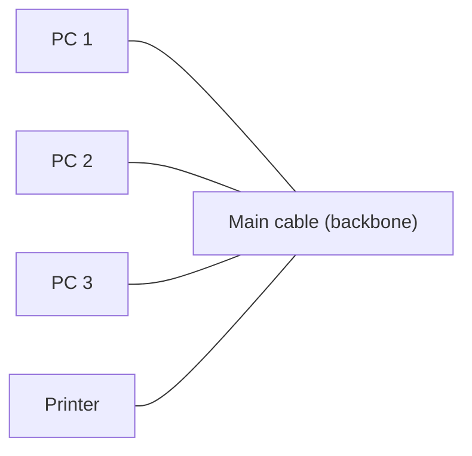
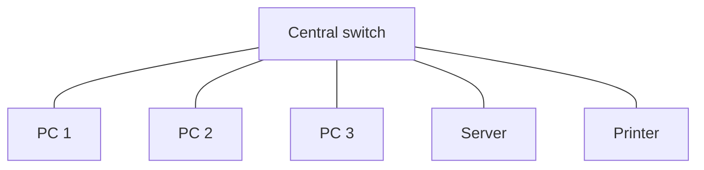
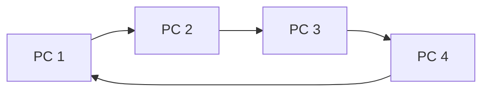
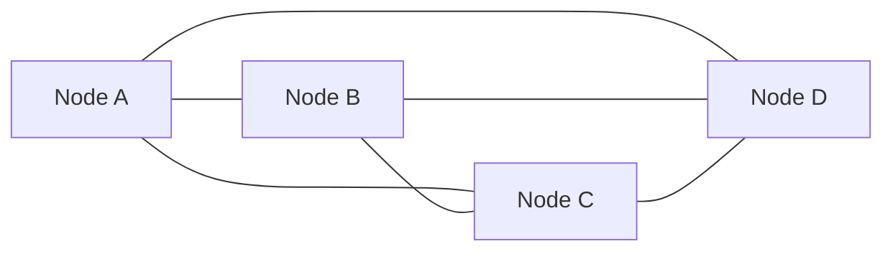
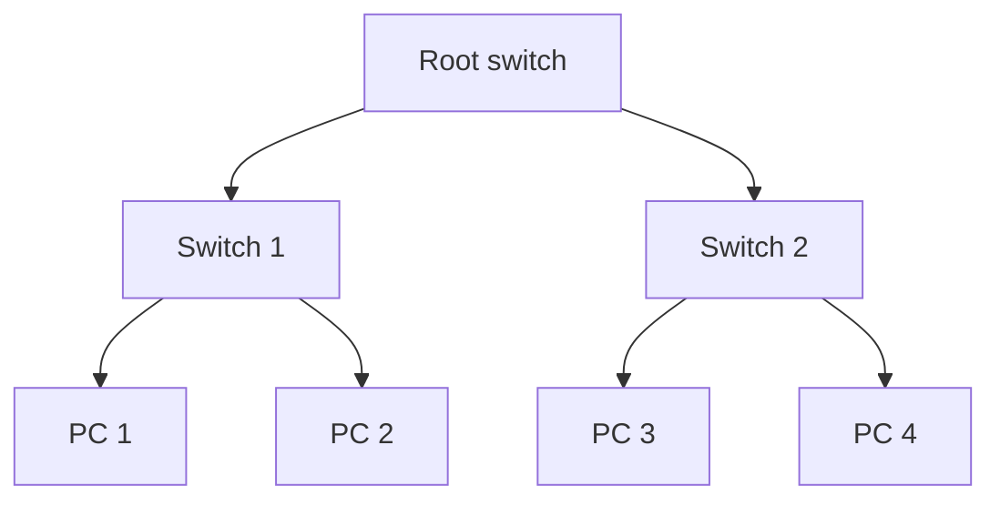
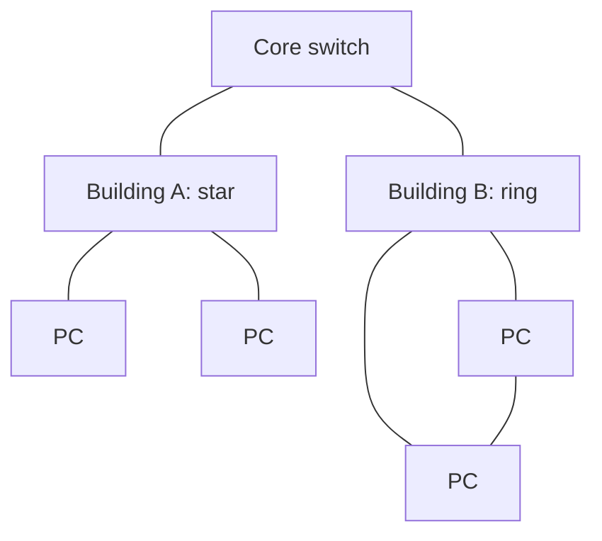
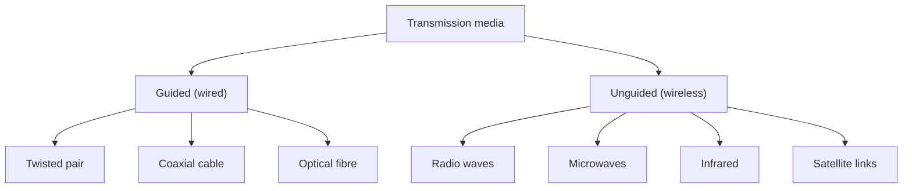

Networks shuru karne se pehle kuch basic ideas chahiye. Agar aapko aate hain, to aage badh jao.

## Pehle basics

- **Data** raw facts hain, jaise numbers ya text. **Signal** wo tarika hai jisme data travel karta hai: copper wire mein electricity, glass fibre mein light, ya hawa mein radio waves.
- **Node** network ka koi bhi device hai: computer, phone, printer ya server. **Server** wo computer hai jo dusron ko (jinhe **clients** kehte hain) service deta hai (files, web pages, email).
- **Bandwidth** ye hai ki ek link ek second mein kitna data le jaa sakta hai (jaise 100 Mbps). **Range** ye hai ki signal kitni door tak jaa sakta hai, uske baad wo bahut kamzor ho jaata hai.
- **Protocol** baat karne ke agreed rules ka set hai, ek common language ki tarah. Ethernet, Wi-Fi aur TCP/IP protocols hain. <Cite id="networks-wireless-gfg-basics" />

## Computer network kya hai aur kyun zaroori hai

<Box kind="definition">

**Computer network** computers aur dusre devices ka set hai jo cables ya wireless links se jude hote hain, taaki wo data exchange kar sakein aur files, printers aur Internet connection jaise resources share kar sakein. <Cite id="networks-wireless-rainer-iis" /> <Cite id="networks-wireless-wiki-computer-network" /> <Cite id="networks-wireless-ibm-networking" />

</Box>

Ye syllabus <Syl m="5" />, section 5.1 hai (computer networks, wired and wireless technology).

**Ye kyun zaroori hai (kaunsi problem solve karta hai).** Network ke bina har computer ek alag island hota hai. Har ek ko apna printer chahiye, har file ki apni copy chahiye, aur staff data pen drive mein leke ghoomta. Network se kai log ek resource share karte hain, same data pe kaam karte hain aur turant baat kar sakte hain. <Cite id="networks-wireless-gfg-importance" /> <Cite id="networks-wireless-laudon-mis" />

**Roz ki analogy.** Network ek city ke road system jaisa hai. Computers ghar hain, cables aur radio links sadkein hain, aur data traffic hai. Achhi sadkein (bandwidth) aur clear rules (protocols) se traffic sahi ghar tak jaldi pahunchta hai. <Cite id="networks-wireless-tp-network-types" />

## Computer networks ki applications

<PYQ id="2023-12-ce/q1d" /> mein ye poochha gaya hai. Inhe aath points ki list ki tarah yaad karo, har ek ke saath example. <Cite id="networks-wireless-gfg-importance" /> <Cite id="networks-wireless-ibm-networking" /> <Cite id="networks-wireless-gfg-basics" />

1. **Resource sharing.** Kai users ek printer, scanner, storage drive ya software licence share karte hain, jisse paisa bachta hai. Example: college lab ke saare computers ek printer use karte hain.
2. **Information sharing aur access.** Files aur databases server pe rehte hain aur sabko wahi latest copy dikhti hai. Example: bank branch central database se customer ka balance padhti hai.
3. **Communication.** Email, chat, voice aur video calls. Example: Infosys ke Pune aur London ke staff video meeting karte hain.
4. **E-commerce aur online services.** Websites, payments aur order tracking sab networks pe chalte hain. Example: Amazon, Flipkart aur UPI payments.
5. **Cloud computing aur remote work.** Staff ghar se office systems ya cloud applications mein login karta hai. Example: Zomato ka delivery app apne cloud servers se baat karta hai.
6. **Banking aur finance.** ATMs, net banking aur card payments bank ke central system se jude hote hain. Example: SBI ka ATM network.
7. **Education aur entertainment.** Online classes, video streaming aur games. Example: NPTEL lectures, Netflix.
8. **Backup, security aur control.** Data dusri machine pe copy hota hai, aur administrator ek jagah se sab users ke liye rules aur passwords set kar sakta hai.

Network ke **disadvantages** bhi hain: set-up aur maintenance cost, ek failure se kai users ek saath ruk sakte hain, aur virus ya hacker ek device se baaki sab tak jaldi phail sakta hai.

## Network devices

Kuch devices har diagram mein aate hain, isliye har ek ka kaam jaano. <Cite id="networks-wireless-gfg-devices" />

| Device | What it does | Everyday picture |
| --- | --- | --- |
| Network card (NIC) | Ek computer ko network se jodta hai | Ghar ka darwaza |
| Hub | Data ko saare connected devices ko repeat karta hai (purana, simple) | Loudspeaker: sab sab kuch sunte hain |
| Switch | Data sirf usi device ko bhejta hai jiske liye hai | Postman jo ek hi darwaze pe deliver karta hai |
| Router | Alag networks ko jodta hai (jaise aapka LAN aur Internet) aur raasta chunta hai | Traffic junction |
| Access point | Wireless devices ko wired network se jodta hai | Building ka Wi-Fi tower |
| Modem | Signals ko convert karta hai taaki wo phone, cable ya fibre line pe travel kar sakein | Border pe translator |

## Size ke hisaab se network ke types

<Box kind="definition">

Networks ko unke cover kiye gaye area ke hisaab se classify karte hain. **PAN** ek insaan ke devices cover karta hai, **LAN** ek building ya campus, **MAN** ek city aur **WAN** ek country ya poori duniya. <Cite id="networks-wireless-gfg-area-types" /> <Cite id="networks-wireless-tp-network-types" />

</Box>

| Point | PAN | LAN | MAN | WAN |
| --- | --- | --- | --- | --- |
| Full form | Personal Area Network | Local Area Network | Metropolitan Area Network | Wide Area Network |
| Area | Lagbhag 10 m | Ek building ya campus | Ek city | Country ya duniya |
| Speed | Low se medium | High | Medium se high | Kam, links pe depend karta hai |
| Owner | Ek insaan | Ek organisation | Ek company ya city | Kai organisations, telecom firms |
| Example | Phone with Bluetooth earbuds | College computer lab | Cable TV ya city-wide bank network | Internet, poore India mein bank ka network |

<Cite id="networks-wireless-gfg-area-types" /> <Cite id="networks-wireless-tp-network-types" />

**Internet, intranet aur extranet.** **Internet** public worldwide network of networks hai jo sabke liye khula hai. **Intranet** ek firm ke andar ka private network hai jo Internet technology (web pages, email) use karta hai, par sirf uske apne staff ke liye khula hai, jaise company ka HR portal. **Extranet** wo intranet hai jise firm control ke saath bahar walon, jaise suppliers, partners ya customers, ke liye kholti hai, jaise Walmart apne suppliers ko stock levels dekhne deta hai. <Cite id="networks-wireless-wiki-intranet" /> <Cite id="networks-wireless-wiki-extranet" /> <Cite id="networks-wireless-rainer-iis" />

## Network topology

<PYQ id="2025-05-ce/q1c" /> mein ye poochha gaya hai.

<Box kind="definition">

**Topology** wo tarika hai jisme network ke devices (nodes) arrange aur connect kiye jaate hain. Ise physical layout (cables kaise jaati hain) ya logical layout (data kaise behta hai) ki tarah dikha sakte hain. <Cite id="networks-wireless-wiki-topology" /> <Cite id="networks-wireless-ibm-topology" /> <Cite id="networks-wireless-gfg-topology" />

</Box>

Main topologies bus, star, ring, mesh, tree aur hybrid hain. <Cite id="networks-wireless-tp-topologies" />

<Cite id="networks-wireless-gfg-topology" loc="diagram" />

| Topology | How it is connected | Advantages | Disadvantages |
| --- | --- | --- | --- |
| Bus | Saare devices ek shared main cable pe | Sasta, kam cable, chhota network extend karna easy | Ek cable break se sab band; users zyada to slow; fault dhoondhna mushkil |
| Star | Har device central switch ya hub se jura | Device add ya remove karna easy; kharab cable sirf ek device ko affect karta hai; fault finding easy | Central device fail to sab band; bus se zyada cable chahiye |
| Ring | Devices band loop mein, har ek ke do neighbours | Data ka orderly flow; token ring mein collision nahi; sabko barabar access | Ek break ya ek device off to ring ruk sakta hai (double ring ko chhodkar); naya device jodna slow |
| Mesh | Har device kai ya sabhi dusron se jura | Bahut reliable; kai paths; fault isolate karna easy | Bahut mehnga; bahut cables aur ports; set-up mushkil. Full mesh ko n(n-1)/2 links chahiye |
| Tree | Stars ek parent device se levels mein jude | Groups mein grow aur manage karna easy; bade campus ke liye achha | Root pe depend; zyada cable; root fail to network toot jaata hai |
| Hybrid | Do ya zyada topologies mili hui | Flexible, asli zaroorat ke hisaab se, grow kar sakta hai | Design karna complex, maintenance mehnga |

<Cite id="networks-wireless-gfg-topology" /> <Cite id="networks-wireless-tp-topologies" /> <Cite id="networks-wireless-ibm-topology" />

Mesh row ke liye links ka count ek chhota formula hai: 4 devices ke saath $\frac{4 \times 3}{2} = 6$ links, jo mesh diagram ki chhe lines se match karta hai. 10 devices ke saath $\frac{10 \times 9}{2} = 45$ links honge, isiliye full mesh kam use hota hai aur mainly core links ke liye hota hai.

**Kahan kaun sa use hota hai.** College lab ya office aam taur pe **star** use karte hain (ek room ke liye ek switch). Internet backbone aur kai WANs reliability ke liye **partial mesh** use karte hain. Bada campus network aksar **tree ya hybrid** hota hai. Purane Ethernet LANs **bus** use karte the, aur kuch purane systems **ring**. <Cite id="networks-wireless-wiki-topology" />

<Box kind="pitfall">

Physical aur logical topology ko mix mat karo. Wi-Fi network physically star hai (saare devices ek access point se baat karte hain), bhale hi radio waves har direction mein phailti hain. Exam mein topology ka naam likho, draw karo, aur kam se kam do advantages aur do disadvantages do.

</Box>

## Transmission media

**Transmission media** wo raasta hai jis pe signal travel karta hai. Ye ya to **guided** (wired: signal cable follow karta hai) ya **unguided** (wireless: signal hawa ya space mein phailta hai) hota hai. <Cite id="networks-wireless-gfg-guided-unguided" /> <Cite id="networks-wireless-gfg-transmission-media" />

## Wired technology

Wired network mein devices physical cable se jude hote hain. <Cite id="networks-wireless-gfg-wired-wireless" />

| Cable | What it is | Speed and distance | Typical use |
| --- | --- | --- | --- |
| Twisted pair (UTP/STP) | Copper wires ke jode jo interference kam karne ke liye twist kiye hote hain | Common Ethernet cabling ek segment mein 100 m tak jaati hai, gigabit speeds aur usse zyada tak | Office aur home LANs, phone lines |
| Coaxial cable | Copper core, uske upar insulating layer aur metal shield | Twisted pair se zyada bandwidth, lambi distance | Cable TV, cable pe broadband |
| Optical fibre | Patle glass strands jo light ke pulses le jaate hain | Bahut high speed, bahut lambi distance, electrical interference se affect nahi, tap karna mushkil | Internet backbone, undersea cables, cities ke beech links |

<Cite id="networks-wireless-gfg-transmission-media" /> <Cite id="networks-wireless-wiki-optical-fiber" /> <Cite id="networks-wireless-tp-wireless-transmission" />

**Ethernet** wired LAN banane ka standard tarika hai. Ye IEEE 802.3 standards family se define hota hai aur college lab ya office ki cable yahi use karti hai. <Cite id="networks-wireless-ieee-8023" /> <Cite id="networks-wireless-cisco-wifi" />

**Wired ke advantages:** high aur steady speed, low delay, zyada secure (sunne ke liye plug in karna padega), kam interference, reliable. **Disadvantages:** cables bichhane mein paisa aur mehnat lagti hai, devices free move nahi kar sakte, naya point jodne ke liye aur cabling chahiye, aur cables kat ya kharab ho sakti hain.

## Wireless technology

Wireless network mein data hawa mein electromagnetic waves ki tarah travel karta hai, devices ke beech koi cable nahi hoti. <Cite id="networks-wireless-wiki-wireless-network" /> <Cite id="networks-wireless-tp-wireless-transmission" />

**Wireless transmission ke types.**

- **Radio waves.** Har direction mein jaati hain aur deewaron se nikal jaati hain. Wi-Fi, Bluetooth, FM radio aur mobile phones mein use hoti hain.
- **Microwaves.** Patli beams jinhe do towers ke beech clear line of sight chahiye. Mobile networks aur point-to-point links mein use hoti hain.
- **Infrared.** Bahut chhoti range aur deewaron se ruk jaati hai. TV remotes mein use hoti hai.
- **Satellite.** Orbit mein satellite signals ko bahut lambi distance tak relay karta hai, isliye door-door ki jagah bhi coverage milti hai. <Cite id="networks-wireless-tp-wireless-transmission" /> <Cite id="networks-wireless-gfg-guided-unguided" />

| Technology | Range | What it is used for | Example |
| --- | --- | --- | --- |
| NFC (Near Field Communication) | Lagbhag 4 cm | Tap-to-pay, ticket aur ID cards | Shop mein phone se payment <Cite id="networks-wireless-wiki-nfc" /> |
| Bluetooth | Lagbhag 10 m (class 2) | Personal devices ke beech chhote links (PAN) | Phone se earbuds, smartwatch <Cite id="networks-wireless-bluetooth-sig" /> <Cite id="networks-wireless-wiki-bluetooth" /> |
| Wi-Fi (IEEE 802.11) | Indoors kuch dus metres | Wireless LAN: laptops aur phones ko network aur Internet access dena | Campus Wi-Fi, home router <Cite id="networks-wireless-ieee-80211" /> <Cite id="networks-wireless-wiki-wifi" /> <Cite id="networks-wireless-cisco-wifi" /> |
| Cellular (3G, 4G, 5G) | Ek cell mein kilometres; kai cells se poori city | Mobile phones aur mobile data | Jio aur Airtel networks <Cite id="networks-wireless-wiki-cellular" /> |
| Satellite | Lagbhag poori dharti | Remote areas, ships, aircraft, broadcast | Satellite Internet, GPS-linked services <Cite id="networks-wireless-wiki-satellite" /> |

**Cellular short mein kaise kaam karta hai.** Area ko **cells** mein baanta jaata hai, har cell ko ek base station (tower) serve karta hai. Jaise aap move karte ho, phone ek cell se dusre cell mein handover ho jaata hai, aur door-door ke cells mein wahi frequencies dobara use ho sakti hain. <Cite id="networks-wireless-wiki-cellular" />

**Wireless ke advantages:** mobility (range mein kahin bhi use karo), jaldi aur sasta set-up, users add karna easy, aisi jagah chalta hai jahan cable bichhana mushkil hai. **Disadvantages:** achhi cable se slow aur kam steady, deewaron aur dusre devices se interference, chhoti range, aur security risk zyada kyunki range mein koi bhi sunne ki koshish kar sakta hai, isliye encryption aur strong passwords chahiye. <Cite id="networks-wireless-gfg-wired-wireless" /> <Cite id="networks-wireless-wiki-wireless-network" />

## Wired versus wireless technology

<PYQ id="2022-12-ce/q1e" /> mein ye poochha gaya hai.

| Point | Wired | Wireless |
| --- | --- | --- |
| Medium | Physical cable (copper ya fibre) | Hawa (radio, microwave, infrared, satellite) |
| Speed | High aur steady | Aam taur pe kam, distance aur noise ke saath badalti hai |
| Mobility | Socket se fixed | Range ke andar free move kar sakte hain |
| Installation | Slow aur mehnga: cables bichhani padti hain | Fast aur sasta: bas access point lagao |
| Reliability | High, kam interference | Deewaron, mausam aur dusre devices se affect hota hai |
| Security | Behtar: physical access chahiye | Kamzor: signal intercept ho sakta hai, isliye encryption chahiye |
| Cost to expand | Har naye point ke liye aur cable | Naye user ke liye kam extra cost |
| Standard | Ethernet (IEEE 802.3) | Wi-Fi (IEEE 802.11), Bluetooth, cellular |
| Example | LAN socket pe office desktop | Campus Wi-Fi pe phone |

<Cite id="networks-wireless-gfg-wired-wireless" /> <Cite id="networks-wireless-gfg-guided-unguided" /> <Cite id="networks-wireless-wiki-wireless-network" />

Practice mein firms dono use karti hain. Servers aur core links speed aur reliability ke liye wired hote hain; staff ke phones aur laptops convenience ke liye Wi-Fi se jude hote hain. <Cite id="networks-wireless-rainer-iis" /> <Cite id="networks-wireless-cisco-wifi" />

## Real examples

| Firm | How networks show up |
| --- | --- |
| Infosys | Har campus building mein wired LAN, staff devices ke liye Wi-Fi, aur campuses aur client sites ko jodne wala private WAN. |
| SBI | Bahut bada WAN branches, ATMs aur data centres ko jodta hai, har link pe strict security ke saath. |
| Amazon | Data centres ke beech fibre links, aur warehouses ke andar wireless scanners aur Wi-Fi. |
| Zomato / Swiggy | Delivery partners ke phones company ke cloud servers se baat karne ke liye cellular 4G/5G use karte hain. |
| Walmart | Extranet suppliers ko apne products ka stock aur sales dekhne deta hai. |

Ye well-known public practices hain jo general terms mein likhi gayi hain; exact internal networks publish nahi hote.

## Past-paper answers: kya likhna hai

- <PYQ id="2022-12-ce/q1e" /> (5 marks, wireless aur wired technologies ka difference): dono ka one-line meaning, phir upar wali comparison table 6 se 8 rows ke saath, aur ek example.
- <PYQ id="2023-12-ce/q1d" /> (5 marks, computer networks ki applications): short definition, phir aathon applications ek-ek example ke saath, aur disadvantages pe ek line.
- <PYQ id="2025-05-ce/q1c" /> (5 marks, topology aur uske types advantages aur disadvantages ke saath): topology ki definition, jitne types draw kar sako (kam se kam star, bus, ring, mesh) unka chhota labelled diagram, aur advantages aur disadvantages ki table.

<Box kind="exam">

Exam mein English mein likho: "A computer network is a group of interconnected computers and devices that share data and resources through wired or wireless links. Wired uses cables such as twisted pair or fibre and is fast and secure; wireless uses radio waves and is mobile and easy to install."

</Box>

## One-line conclusion

Network devices ko jodta hai taaki wo data aur resources share kar sakein; uska size (PAN se WAN), shape (topology) aur medium (wired cable ya wireless waves) uski speed, cost, reach aur security decide karte hain, aur firms reliability aur mobility dono ke liye wired aur wireless ko mila kar use karti hain.
