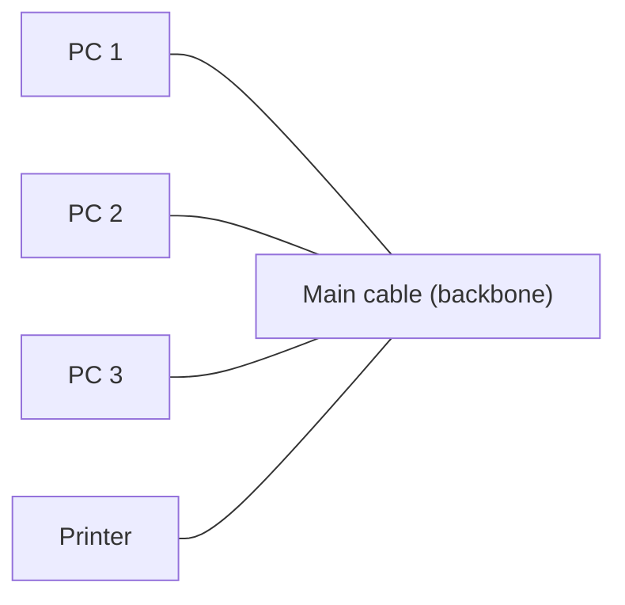
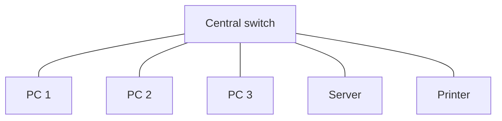
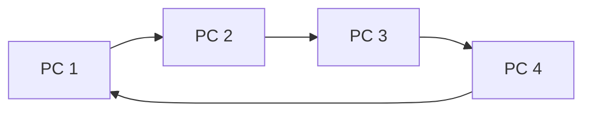
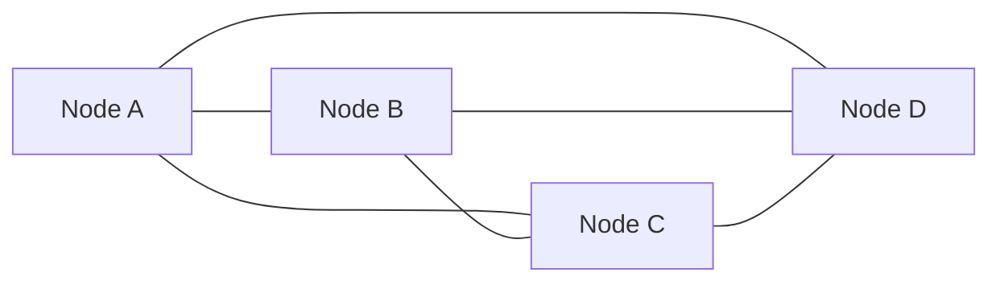
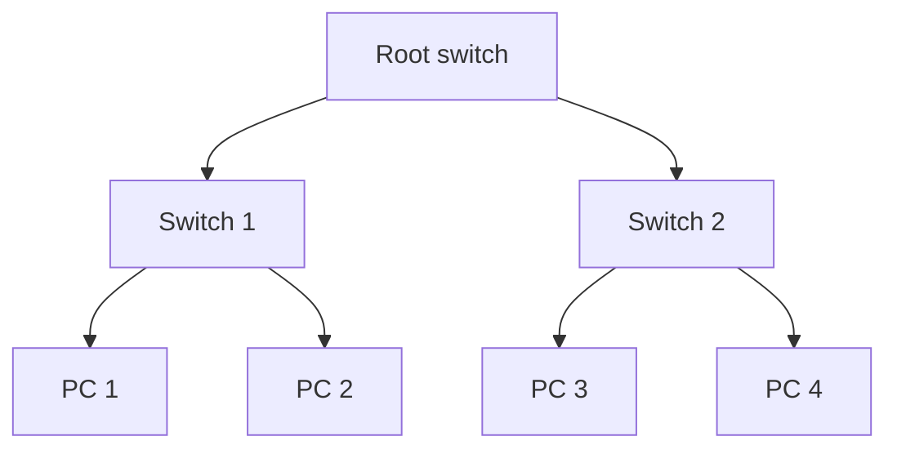
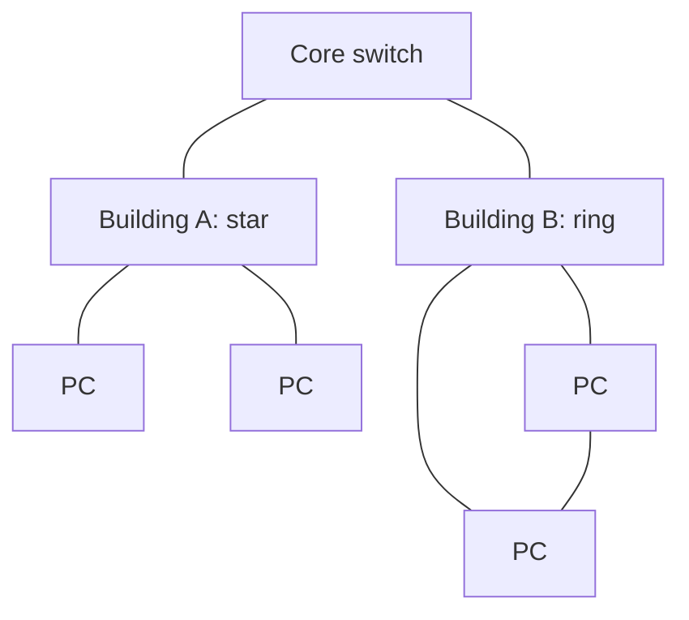
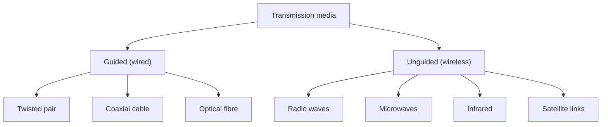

Before networks themselves, here are the few ideas you need. If you know them, skip ahead.

## The basics first

- **Data** is raw facts such as numbers or text. A **signal** is how data travels: as electricity in a copper wire, as light in a glass fibre, or as radio waves in the air.
- A **node** is any device on a network: a computer, phone, printer or server. A **server** is a computer that gives a service (files, web pages, email) to others, called **clients**.
- **Bandwidth** is how much data a link can carry per second (for example 100 Mbps). **Range** is how far a signal can travel before it becomes too weak.
- A **protocol** is an agreed set of rules for talking, like a common language. Ethernet, Wi-Fi and TCP/IP are protocols. <Cite id="networks-wireless-gfg-basics" />

## What a computer network is and why it is needed

<Box kind="definition">

A **computer network** is a set of computers and other devices connected by cables or wireless links so that they can exchange data and share resources such as files, printers and an Internet connection. <Cite id="networks-wireless-rainer-iis" /> <Cite id="networks-wireless-wiki-computer-network" /> <Cite id="networks-wireless-ibm-networking" />

</Box>

This is syllabus <Syl m="5" />, section 5.1 (computer networks, wired and wireless technology).

**Why it is needed (the problem it solves).** Without a network, every computer is an island. Each would need its own printer, its own copy of every file, and staff would carry data on pen drives. A network lets many people share one resource, work on the same data and talk instantly. <Cite id="networks-wireless-gfg-importance" /> <Cite id="networks-wireless-laudon-mis" />

**Everyday analogy.** A network is like the road system of a city. Computers are the houses, cables and radio links are the roads, and the data is the traffic. Good roads (bandwidth) and clear rules (protocols) let traffic reach the right house quickly. <Cite id="networks-wireless-tp-network-types" />

## Applications of computer networks

<PYQ id="2023-12-ce/q1d" /> asks for these. Learn them as a list of eight points, each with an example. <Cite id="networks-wireless-gfg-importance" /> <Cite id="networks-wireless-ibm-networking" /> <Cite id="networks-wireless-gfg-basics" />

1. **Resource sharing.** Many users share one printer, scanner, storage drive or software licence, which saves money. Example: all computers in a college lab use one printer.
2. **Information sharing and access.** Files and databases sit on a server and everyone sees the same, latest copy. Example: a bank branch reads a customer's balance from the central database.
3. **Communication.** Email, chat, voice and video calls. Example: Infosys staff in Pune and London hold a video meeting.
4. **E-commerce and online services.** Websites, payments and order tracking all run over networks. Example: Amazon, Flipkart and UPI payments.
5. **Cloud computing and remote work.** Staff log in to office systems or cloud applications from home. Example: Zomato's delivery app talking to its cloud servers.
6. **Banking and finance.** ATMs, net banking and card payments connect to the bank's central system. Example: SBI's ATM network.
7. **Education and entertainment.** Online classes, video streaming and games. Example: NPTEL lectures, Netflix.
8. **Backup, security and control.** Data is copied to another machine, and an administrator can set rules and passwords for all users from one place.

A network also brings **disadvantages**: set-up and maintenance cost, a failure can stop many users at once, and a virus or hacker can spread quickly from one device to all the others.

## Network devices

A few devices appear in every diagram, so know what each does. <Cite id="networks-wireless-gfg-devices" />

| Device | What it does | Everyday picture |
| --- | --- | --- |
| Network card (NIC) | Connects one computer to the network | The door of the house |
| Hub | Repeats data to all connected devices (old, simple) | A loudspeaker: everyone hears everything |
| Switch | Sends data only to the device it is meant for | A postman delivering to one door |
| Router | Joins different networks (for example your LAN to the Internet) and chooses the path | A traffic junction |
| Access point | Lets wireless devices join a wired network | A Wi-Fi tower for the building |
| Modem | Converts signals so they can travel over a phone, cable or fibre line | A translator at the border |

## Types of network by size

<Box kind="definition">

Networks are classified by the area they cover. **PAN** covers one person's devices, **LAN** a building or campus, **MAN** a city and **WAN** a country or the world. <Cite id="networks-wireless-gfg-area-types" /> <Cite id="networks-wireless-tp-network-types" />

</Box>

| Point | PAN | LAN | MAN | WAN |
| --- | --- | --- | --- | --- |
| Full form | Personal Area Network | Local Area Network | Metropolitan Area Network | Wide Area Network |
| Area | About 10 m | One building or campus | A city | Country or world |
| Speed | Low to medium | High | Medium to high | Lower, depends on links |
| Owner | One person | One organisation | A company or the city | Many organisations, telecom firms |
| Example | Phone with Bluetooth earbuds | College computer lab | Cable TV or a city-wide bank network | The Internet, a bank's network across India |

<Cite id="networks-wireless-gfg-area-types" /> <Cite id="networks-wireless-tp-network-types" />

**Internet, intranet and extranet.** The **Internet** is the public worldwide network of networks open to everyone. An **intranet** is a private network inside one firm that uses Internet technology (web pages, email) but is open only to its own staff, for example a company's HR portal. An **extranet** is an intranet that a firm opens in a controlled way to outsiders such as suppliers, partners or customers, for example Walmart letting its suppliers see stock levels. <Cite id="networks-wireless-wiki-intranet" /> <Cite id="networks-wireless-wiki-extranet" /> <Cite id="networks-wireless-rainer-iis" />

## Network topology

<PYQ id="2025-05-ce/q1c" /> asks for this.

<Box kind="definition">

**Topology** is the way the devices (nodes) of a network are arranged and connected. It can be shown as a physical layout (how the cables run) or a logical layout (how data flows). <Cite id="networks-wireless-wiki-topology" /> <Cite id="networks-wireless-ibm-topology" /> <Cite id="networks-wireless-gfg-topology" />

</Box>

The main topologies are bus, star, ring, mesh, tree and hybrid. <Cite id="networks-wireless-tp-topologies" />

<Cite id="networks-wireless-gfg-topology" loc="diagram" />

| Topology | How it is connected | Advantages | Disadvantages |
| --- | --- | --- | --- |
| Bus | All devices on one shared main cable | Cheap, uses little cable, easy to extend a small network | One cable break stops all; slow when many users; hard to find faults |
| Star | Every device linked to a central switch or hub | Easy to add or remove devices; a faulty cable affects only one device; easy fault finding | Central device failure stops everything; needs more cable than bus |
| Ring | Devices in a closed loop, each with two neighbours | Orderly data flow; no collision in token ring; equal access | One break or one off device can stop the ring (unless double ring); slow to add devices |
| Mesh | Every device linked to many or all others | Very reliable; many paths; easy to isolate a fault | Very costly; many cables and ports; hard to set up. Full mesh needs n(n-1)/2 links |
| Tree | Stars joined to a parent device in levels | Easy to grow and manage in groups; good for large campuses | Depends on the root; more cable; a root failure splits the network |
| Hybrid | Two or more topologies combined | Flexible, fits the real need, can grow | Complex to design, costly to maintain |

<Cite id="networks-wireless-gfg-topology" /> <Cite id="networks-wireless-tp-topologies" /> <Cite id="networks-wireless-ibm-topology" />

For the mesh row, the link count is a short formula: with 4 devices, $\frac{4 \times 3}{2} = 6$ links, which matches the six lines in the mesh diagram. With 10 devices it would be $\frac{10 \times 9}{2} = 45$ links, which is why full mesh is rare and used mainly for core links.

**Where each is used.** A college lab or office usually uses a **star** (one switch per room). The Internet backbone and many WANs use **partial mesh** for reliability. A large campus network is often a **tree or hybrid**. Old Ethernet LANs used **bus**, and some older systems used **ring**. <Cite id="networks-wireless-wiki-topology" />

<Box kind="pitfall">

Do not mix up physical and logical topology. A Wi-Fi network is physically a star (all devices talk to one access point), even though the radio waves spread in all directions. In the exam, name the topology, draw it, and give at least two advantages and two disadvantages.

</Box>

## Transmission media

**Transmission media** is the path the signal travels on. It is either **guided** (wired: the signal follows a cable) or **unguided** (wireless: the signal spreads through air or space). <Cite id="networks-wireless-gfg-guided-unguided" /> <Cite id="networks-wireless-gfg-transmission-media" />

## Wired technology

In a wired network, devices are joined by physical cable. <Cite id="networks-wireless-gfg-wired-wireless" />

| Cable | What it is | Speed and distance | Typical use |
| --- | --- | --- | --- |
| Twisted pair (UTP/STP) | Pairs of copper wires twisted together to cut interference | Common Ethernet cabling reaches up to 100 m per segment, up to gigabit speeds and more | Office and home LANs, phone lines |
| Coaxial cable | A copper core inside an insulating layer and a metal shield | Higher bandwidth than twisted pair, longer distance | Cable TV, broadband over cable |
| Optical fibre | Thin glass strands that carry pulses of light | Very high speed, very long distance, not affected by electrical interference, hard to tap | Internet backbone, undersea cables, links between cities |

<Cite id="networks-wireless-gfg-transmission-media" /> <Cite id="networks-wireless-wiki-optical-fiber" /> <Cite id="networks-wireless-tp-wireless-transmission" />

**Ethernet** is the standard way to build a wired LAN. It is defined by the IEEE 802.3 family of standards and is what the cable in a college lab or office uses. <Cite id="networks-wireless-ieee-8023" /> <Cite id="networks-wireless-cisco-wifi" />

**Advantages of wired:** high and steady speed, low delay, more secure (someone must plug in to listen), little interference, reliable. **Disadvantages:** cables cost money and effort to lay, devices cannot move freely, adding a new point means more cabling, and cables can be cut or damaged.

## Wireless technology

In a wireless network, data travels as electromagnetic waves through the air, with no cable between devices. <Cite id="networks-wireless-wiki-wireless-network" /> <Cite id="networks-wireless-tp-wireless-transmission" />

**Types of wireless transmission.**

- **Radio waves.** Travel in all directions and pass through walls. Used by Wi-Fi, Bluetooth, FM radio and mobile phones.
- **Microwaves.** Narrow beams that need a clear line of sight between two towers. Used in mobile networks and point-to-point links.
- **Infrared.** Very short range and blocked by walls. Used in TV remotes.
- **Satellite.** A satellite in orbit relays signals over very long distances, so even remote places get coverage. <Cite id="networks-wireless-tp-wireless-transmission" /> <Cite id="networks-wireless-gfg-guided-unguided" />

| Technology | Range | What it is used for | Example |
| --- | --- | --- | --- |
| NFC (Near Field Communication) | About 4 cm | Tap-to-pay, ticket and ID cards | Paying with a phone at a shop <Cite id="networks-wireless-wiki-nfc" /> |
| Bluetooth | About 10 m (class 2) | Short links between personal devices (a PAN) | Phone to earbuds, smartwatch <Cite id="networks-wireless-bluetooth-sig" /> <Cite id="networks-wireless-wiki-bluetooth" /> |
| Wi-Fi (IEEE 802.11) | Tens of metres indoors | Wireless LAN: giving laptops and phones network and Internet access | Campus Wi-Fi, home router <Cite id="networks-wireless-ieee-80211" /> <Cite id="networks-wireless-wiki-wifi" /> <Cite id="networks-wireless-cisco-wifi" /> |
| Cellular (3G, 4G, 5G) | Kilometres per cell; whole cities with many cells | Mobile phones and mobile data | Jio and Airtel networks <Cite id="networks-wireless-wiki-cellular" /> |
| Satellite | Almost the whole earth | Remote areas, ships, aircraft, broadcast | Satellite Internet, GPS-linked services <Cite id="networks-wireless-wiki-satellite" /> |

**How cellular works in short.** The area is divided into **cells**, each served by a base station (tower). As you move, the phone is handed over from one cell to the next, and the same frequencies can be reused in cells that are far apart. <Cite id="networks-wireless-wiki-cellular" />

**Advantages of wireless:** mobility (use anywhere in range), quick and cheap to set up, easy to add users, works where laying cable is hard. **Disadvantages:** slower and less steady than a good cable, interference from walls and other devices, shorter range, and a higher security risk because anyone in range can try to listen, so it needs encryption and strong passwords. <Cite id="networks-wireless-gfg-wired-wireless" /> <Cite id="networks-wireless-wiki-wireless-network" />

## Wired versus wireless technology

<PYQ id="2022-12-ce/q1e" /> asks for this.

| Point | Wired | Wireless |
| --- | --- | --- |
| Medium | Physical cable (copper or fibre) | Air (radio, microwave, infrared, satellite) |
| Speed | High and steady | Usually lower and varies with distance and noise |
| Mobility | Fixed to a socket | Free to move within range |
| Installation | Slow and costly: cables must be laid | Fast and cheap: fit an access point |
| Reliability | High, little interference | Affected by walls, weather and other devices |
| Security | Better: needs physical access | Weaker: signal can be intercepted, so needs encryption |
| Cost to expand | More cable for each new point | Little extra cost for a new user |
| Standard | Ethernet (IEEE 802.3) | Wi-Fi (IEEE 802.11), Bluetooth, cellular |
| Example | Office desktop on a LAN socket | Phone on campus Wi-Fi |

<Cite id="networks-wireless-gfg-wired-wireless" /> <Cite id="networks-wireless-gfg-guided-unguided" /> <Cite id="networks-wireless-wiki-wireless-network" />

In practice, firms use both. Servers and core links are wired for speed and reliability; staff phones and laptops connect by Wi-Fi for convenience. <Cite id="networks-wireless-rainer-iis" /> <Cite id="networks-wireless-cisco-wifi" />

## Real examples

| Firm | How networks show up |
| --- | --- |
| Infosys | Wired LAN in each campus building, Wi-Fi for staff devices, and a private WAN joining campuses and client sites. |
| SBI | A huge WAN joins branches, ATMs and data centres, with strict security on every link. |
| Amazon | Fibre links between data centres, and wireless scanners and Wi-Fi inside its warehouses. |
| Zomato / Swiggy | Delivery partners' phones use cellular 4G/5G to talk to the company's cloud servers. |
| Walmart | An extranet lets suppliers see stock and sales of their products. |

These are well-known public practices described in general terms; the exact internal networks are not published.

## Past-paper answers: what to write

- <PYQ id="2022-12-ce/q1e" /> (5 marks, difference between wireless and wired technologies): one-line meaning of each, then the comparison table above with six to eight rows, and one example.
- <PYQ id="2023-12-ce/q1d" /> (5 marks, applications of computer networks): short definition, then the eight applications with an example each, and one line on disadvantages.
- <PYQ id="2025-05-ce/q1c" /> (5 marks, topology and its types with advantages and disadvantages): definition of topology, a small labelled diagram for each type you can draw (at least star, bus, ring, mesh), and the advantages and disadvantages table.

<Box kind="exam">

Write this in the exam: "A computer network is a group of interconnected computers and devices that share data and resources through wired or wireless links. Wired uses cables such as twisted pair or fibre and is fast and secure; wireless uses radio waves and is mobile and easy to install."

</Box>

## One-line conclusion

A network joins devices so they can share data and resources; its size (PAN to WAN), shape (topology) and medium (wired cable or wireless waves) decide its speed, cost, reach and security, and firms mix wired and wireless to get both reliability and mobility.
