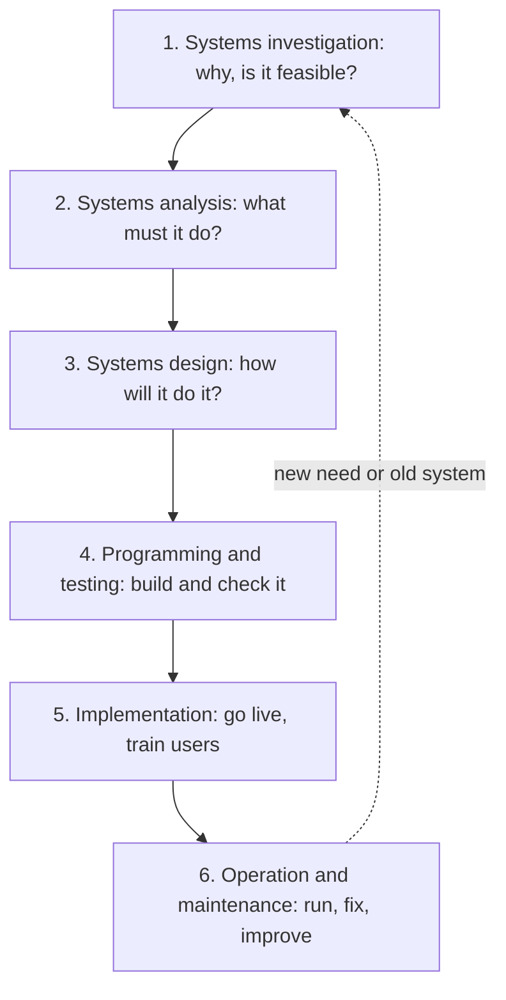
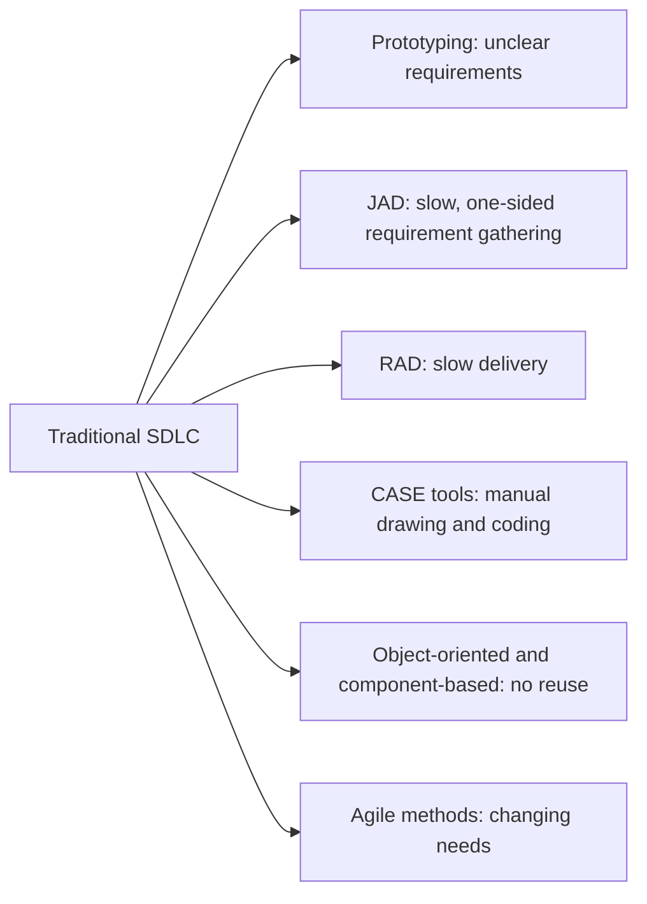
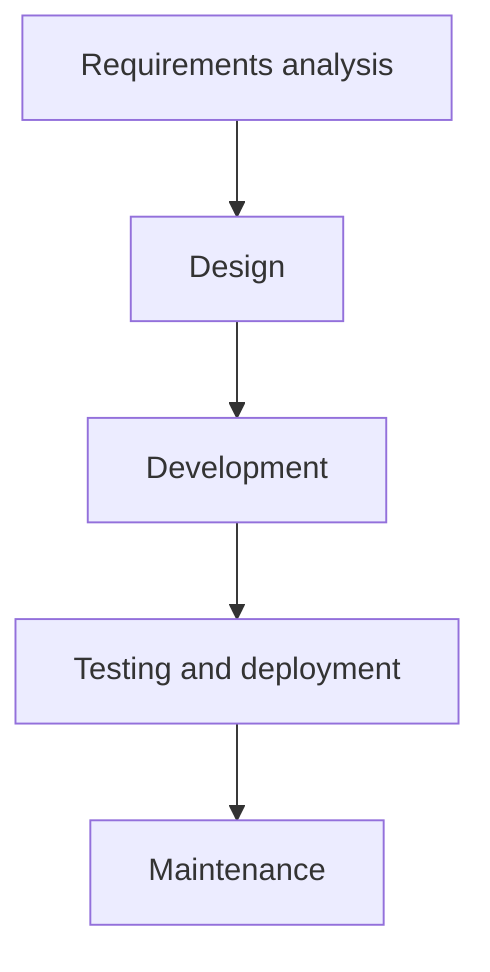
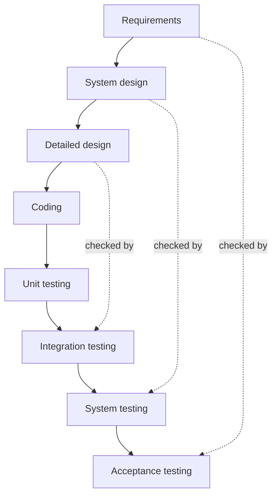
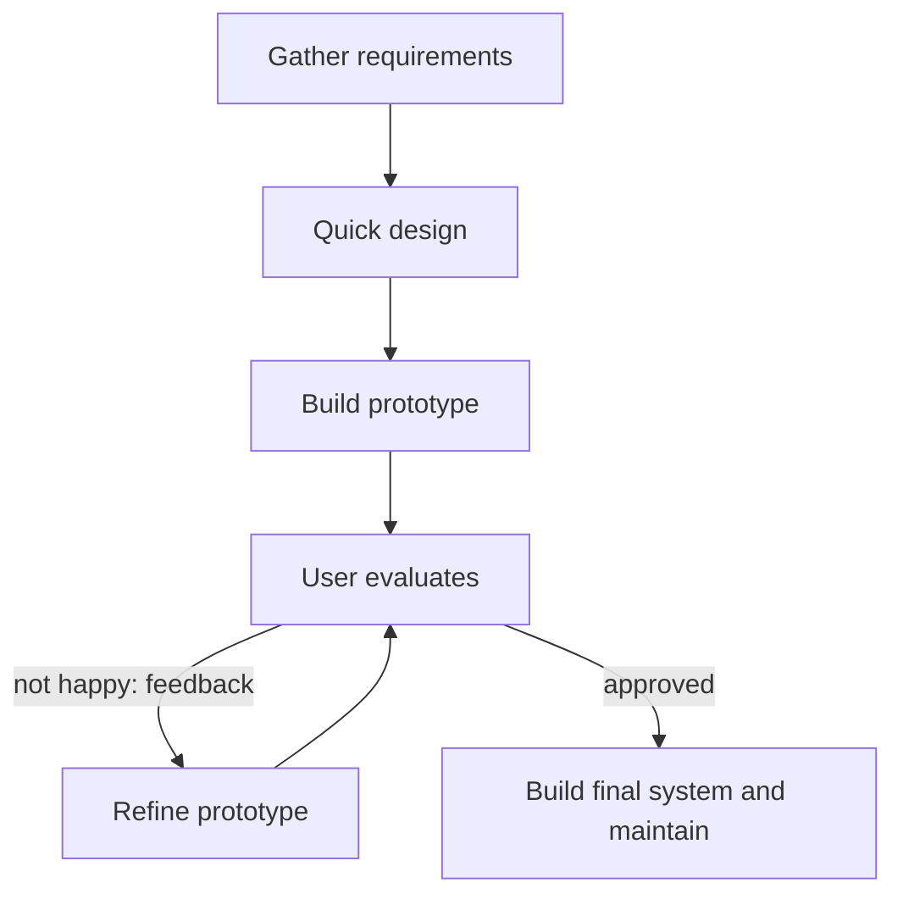
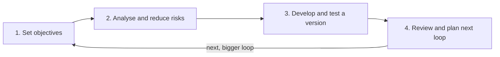
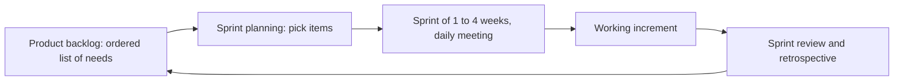

Topic shuru karne se pehle kuch basic ideas. Agar aapko ye pata hain to aage badh jao.

## Pehle basics

- **Information system (IS)** matlab people, hardware, software, data aur procedures jo milkar information collect, store aur share karte hain. **Application** software ka wo hissa hai jo ek kaam karta hai, jaise payroll ya order tracking.
- **User** wo hai jo system ke saath kaam karta hai. **Stakeholder** wo hai jispe system ka asar padta hai: users, managers, customers, IT team.
- **Requirement** wo cheez hai jo system ko karni hi hai ya jo rule follow karna hai, jaise "app ko live delivery status dikhana chahiye".
- **Programming** matlab code likhna. **Testing** matlab system chalakar mistakes (bugs) dhoondhna, real users ke dekhne se pehle.
- **Life cycle** un stages ka set hai jinse koi cheez janm se retirement tak guzarti hai. System ek idea se paida hota hai, banta hai, use hota hai, repair hota hai aur aakhir mein replace ho jaata hai.
- **Legacy system** matlab purana system jo abhi bhi business chala raha hai par jisse badalna mushkil hai.

## Firms ko systems lene ka planned tareeka kyun chahiye

Naya system paisa kharch karta hai, mahine leta hai aur bahut logon ko touch karta hai. Plan ke bina projects late ho jaate hain, promise se zyada cost karte hain, ya aisi cheez banate hain jo kisi ko chahiye hi nahi thi. Planned method ye pakka karta hai ki sahi problem solve ho, cost justify ho, kaam clear order mein ho, aur result live jaane se pehle test ho. <Cite id="it-impact-society-rainer-iis7" /> <Cite id="note-sdlc-ibm-sdlc" />

Ye note syllabus <Syl m="6" />, section 6.3 cover karta hai: information systems aur applications acquire karna, aur alag-alag system development life cycle models.

## Information systems aur applications acquire karna

Firm application kai tareeke se le sakti hai. Isse **make-or-buy decision** kehte hain. <Cite id="it-impact-society-rainer-iis7" /> <Cite id="it-impact-society-laudon-mis" />

1. **Ready-made package kharidna** (off-the-shelf software, COTS bhi kehte hain). Vendor ne ise pehle hi bahut customers ke liye bana rakha hai. Example: dukaan accounts ke liye Tally kharidti hai, ya badi firm ERP ke liye SAP kharidti hai. <Cite id="note-sdlc-wiki-cots" />
2. **Lease ya rent karna** (software as a service, SaaS). Firm monthly fee deti hai aur internet pe use karti hai; vendor ise chalata hai. Example: CRM ke liye Salesforce.
3. **In-house banana.** Firm ki apni IT team custom system likhti hai. Example: Flipkart ya Zomato apne core apps khud banate hain, kyunki app hi unka business hai.
4. **Vendor se custom development / outsourcing.** Bahar ki company fee leke system banati ya chalati hai. Example: bank Infosys ya TCS se system banwata ya maintain karwata hai. <Cite id="note-sdlc-wiki-outsourcing" />
5. **Open source.** Free software jiska code koi bhi padh aur badal sakta hai. Firm licence cost bachati hai par support ke liye skilled staff chahiye.
6. **End-user development.** Staff khud spreadsheets ya low-code tools se chhote tools banate hain. <Cite id="note-sdlc-wiki-enduser" />

| Route | Speed | Cost at start | Fit to your needs | Control | Main risk |
| --- | --- | --- | --- | --- | --- |
| Buy package | Fast | Medium | Medium (process ko fit karna padta hai) | Low | Vendor lock-in, extra features jo chahiye nahi |
| Lease / SaaS | Fastest | Low | Medium | Low | Chalu fee, data vendor ke paas |
| Build in-house | Slow | High | Best | Full | Time aur cost over-run, skilled team chahiye |
| Outsource custom build | Medium | High | Good | Medium | Kharab communication, vendor pe dependence |
| Open source | Medium | Licence low, support cost | Medium | High | Support aur security community ya apne staff pe |
| End-user | Fast | Very low | Sirf chhoti needs ke liye | Local | Errors, koi standard nahi, maintain karna mushkil |

**Planning aur cost justify karna.** Choose karne se pehle firm **business case** likhti hai: kaunsi problem solve ho rahi hai aur kya benefit hai? Wo **tangible** costs aur benefits (hardware, licences, salaries, bacha hua time, extra sales, jo rupees mein ginne ja sakte hain) ko **intangible** wale (better customer satisfaction, better decisions, jo real hain par ginna mushkil) se compare karti hai. Wo **total cost of ownership (TCO)** dekhti hai: sirf purchase price nahi, balki saalon mein training, support, upgrades aur running cost bhi. <Cite id="it-impact-society-rainer-iis7" />

## System development kya hai?

<Box kind="definition">

**System development** wo process hai jisme naya information system banaya jaata hai ya mojooda system badla jaata hai taaki wo business ki needs poori kare. **System development life cycle (SDLC)** ise karne ka traditional, step-by-step structure hai: phases ka set, har ek ke apne tasks aur outputs, jo project ko pehle idea se running aur maintained system tak le jaate hain. <Cite id="note-sdlc-wiki-sdlc" /> <Cite id="note-sdlc-gfg-sdlc" /> <Cite id="note-sdlc-aws-sdlc" />

</Box>

**Kaun hissa leta hai.** Users aur managers (unhe business need pata hai), systems analysts (wo need study karke solution design karte hain), programmers (code likhte hain), testers, database aur network staff, aur ek project manager jo time aur cost dekhta hai. **Systems analyst** business logon aur technical logon ke beech ka bridge hai. <Cite id="note-sdlc-tpt-sdlc" />

## SDLC ke phases

Rainer aur Prince six phases batate hain. Doosri books kuch phases ko merge ya rename karti hain (jaise popular sites pe "planning, analysis, design, development, testing, deployment, maintenance"), par ideas wahi hain. <Cite id="it-impact-society-rainer-iis7" /> <Cite id="note-sdlc-ibm-sdlc" />

### 1. Systems investigation

Asli problem ya opportunity pata karo aur decide karo ki aage badhna hai ya nahi. Output hai **feasibility study** aur go / no-go decision. <Cite id="note-sdlc-wiki-feasibility" />

- **Technical feasibility:** kya hum ise apni technology aur skills se (ya jo mil sakein) bana sakte hain?
- **Economic feasibility:** kya benefits costs se zyada honge? (cost-benefit analysis)
- **Behavioural (organisational) feasibility:** kya log ise accept karke use karenge, ya virodh karenge?

Kai books **legal** aur **schedule** feasibility bhi jodti hain.

### 2. Systems analysis

Current system ko study karo aur likho ki naye system ko exactly kya karna hai. Analyst users ke interviews leta hai, kaam observe karta hai, forms aur reports padhta hai aur **requirements** collect karta hai. Main output **requirements document** hai (system requirements specification bhi kehte hain). Analysts **data flow diagrams** (DFDs) banate hain jo dikhate hain ki data processes, stores aur logon ke beech kaise move karta hai, aur **entity-relationship diagrams** jo dikhate hain ki kaunsa data rakha jaata hai. <Cite id="note-sdlc-wiki-dfd" /> <Cite id="note-sdlc-wiki-erd" />

### 3. Systems design

Decide karo ki system requirements ko **kaise** poora karega. Ye blueprint hai. Ismein screens aur reports (user interface), database, processing logic, hardware aur network, aur security controls aate hain. Output **design specification** hai. **Logical design** batata hai system kya karta hai, technology ka naam liye bina; **physical design** batata hai kaunsa hardware aur software use hoga. Object-oriented designs UML diagrams se banaye jaate hain. <Cite id="note-sdlc-wiki-uml" />

### 4. Programming and testing

Programmers design se code likhte hain. Phir kai levels pe test hota hai:

- **Unit testing:** har chhota piece akela.
- **Integration testing:** pieces saath kaam karte hue.
- **System testing:** poora system requirements ke against.
- **User acceptance testing (UAT):** real users confirm karte hain ki jo maanga tha wahi mila.

### 5. Implementation

System ko real use mein daalo. Staff ko train karte hain, purane system se data move karte hain, aur firm **conversion method** choose karti hai:

| Method | How it works | Good | Bad |
| --- | --- | --- | --- |
| Parallel | Purana aur naya kuch time saath chalte hain | Sabse safe; results compare ho sakte hain | Double kaam aur cost |
| Direct (cut-over) | Purana band, naya ek saath chalu | Sabse sasta aur fast | Sabse risky; fallback nahi |
| Pilot | Naya system pehle ek branch ya team pe chalta hai | Problems chhote level pe milti hain | Overall slow; kuch time do systems |
| Phased | Naya system module by module aata hai | Risk baant jaata hai; seekhna easy | Time lagta hai; purane aur naye ko connect karna padta hai |

### 6. Operation and maintenance

System roz use hota hai. **Maintenance** ise chalta rakhta hai: bugs theek karna (corrective), naye rules ya platforms ke hisaab se badalna (adaptive), features jodna (perfective) aur aage ki problems rokna (preventive). Maintenance ka cost saalon mein aksar original build se zyada hota hai. **Post-implementation review** check karta hai ki project ne goals poore kiye ya nahi. Jab system bahut purana ho jaata hai, naya cycle shuru hota hai.

**Example: hospital appointment app.**

| Phase | What happens |
| --- | --- |
| Investigation | Patients ghanton line mein lagte hain. Management poochta hai: kya app isse theek kar sakta hai? Feasibility: technically haan, cost Rs 20 lakh hai jabki staff ka time bachega, doctors ready hain. Approved. |
| Analysis | Analysts receptionists aur doctors ka interview lete hain. Requirements: slot book, cancel, SMS reminder, doctor ki daily list. DFD banta hai. |
| Design | Screens, appointment database, aur rules (ek patient double book nahi kar sakta) design hote hain. |
| Programming and testing | App code hota hai; unit, integration aur user acceptance tests chalte hain. |
| Implementation | Staff train hota hai. Pehle ek department mein pilot, phir sab mein phased. |
| Maintenance | SMS timing ka bug theek hota hai; agle saal video-consult feature jodta hai. |

## Wo tools jo traditional SDLC ko augment karte hain

Traditional SDLC **slow aur rigid** hai: users system ko sirf aakhir mein dekhte hain, aur project ke late hisse mein changes costly hote hain. Development ko tez, sasta ya users ki need ke kareeb banane ke liye kai tools aur methods ya to isme jode jaate hain, ya iske kuch hisson ki jagah use hote hain. Rainer aur Prince inhe alternative methods aur tools ki tarah list karte hain. <Cite id="it-impact-society-rainer-iis7" /> <Cite id="it-impact-society-laudon-mis" />

1. **Prototyping.** System ke ek hisse ka quick, chhota, working model banao, users ko dikhao, feedback lo aur improve karo. Isse misunderstandings jaldi pakde jaate hain. Prototype phenk diya ja sakta hai ya badhakar final system ban sakta hai. *Analogy: building banne se pehle architect ka 3D model ya sample flat.* <Cite id="note-sdlc-wiki-prototyping" /> <Cite id="note-sdlc-gfg-prototype" />
2. **Joint application design (JAD).** Group workshop jisme users, managers aur analysts facilitator ke saath baithte hain aur kai alag interviews ki jagah kuch dinon mein requirements aur design pe agree karte hain. Time bachta hai aur jhagda kam hota hai. <Cite id="note-sdlc-wiki-jad" />
3. **Rapid application development (RAD).** Ek method jo prototyping, JAD, CASE tools aur reusable parts ko short fixed time-boxes ke saath milati hai, taaki working system saal ki jagah hafton ya kuch mahino mein mil jaye. <Cite id="note-sdlc-wiki-rad" />
4. **Computer-aided software engineering (CASE) tools.** Software jo developers ki madad karta hai: diagrams banana, requirements ka central repository rakhna, code aur documentation generate karna, aur consistency check karna. *Upper CASE* tools analysis aur design support karte hain; *lower CASE* tools coding aur testing; *integrated CASE* dono. Benefit: kam manual kaam aur better documentation. Limit: cost aur seekhne mein time. <Cite id="note-sdlc-wiki-case" />
5. **Object-oriented (OO) development aur component-based development.** System **objects** (Customer ya Order jaisi cheezein jo data aur actions rakhti hain) aur reusable **components** se banta hai. Reuse se time bachta hai aur bugs kam hote hain. UML aam drawing language hai. <Cite id="note-sdlc-wiki-uml" />
6. **Agile methods.** System ko chhote cycles (sprints) mein banao, har baar ek working hissa do, aur badalti requirements ka swagat karo. Neeche agile model dekho. <Cite id="note-sdlc-wiki-agile" />
7. **End-user development.** Users spreadsheets, reporting tools ya low-code platforms se apne chhote applications khud banate hain. Ye fast aur sasta hai, par errors, security holes aur "shadow IT" se bachne ke liye control chahiye. <Cite id="note-sdlc-wiki-enduser" />

| Tool | Main benefit | Main limit |
| --- | --- | --- |
| Prototyping | Users ko jaldi kuch dikhta hai; kam misunderstandings | Users quick model ko finished system samajh sakte hain; documentation kamzor |
| JAD | Requirements pe tez agreement | Saare key logon ka ek saath free hona zaroori; dominant person steer kar sakta hai |
| RAD | Fast delivery | Skilled developers aur committed users chahiye; bahut bade systems ke liye nahi |
| CASE | Kam manual kaam, better documentation | Costly; staff ko seekhna padta hai |
| OO / components | Reuse aur change easy | Skill chahiye; pehle achha design zaroori |
| Agile | Change handle karta hai; frequent delivery | Active user involvement chahiye; price aur scope fix karna mushkil |
| End-user development | Fast, sasta, need ke kareeb | Errors, weak security, koi standard nahi |

## SDLC models

**Model** batata hai ki phases kis order mein aur kitni baar kiye jaate hain. <Cite id="note-sdlc-gfg-sdlc" /> <Cite id="note-sdlc-tpt-sdlc" />

### Waterfall model

Phases **ek ke baad ek** line mein hote hain, aur har ek pura aur approved hona chahiye tabhi agla shuru hota hai, jaise paani seedhiyon se girta hai. Ye upar wala plain SDLC hai, ek baar kiya hua. <Cite id="note-sdlc-wiki-waterfall" /> <Cite id="note-sdlc-gfg-waterfall" />

- **Good:** simple, manage karna easy, har stage pe clear documents, fixed aur achhe se samjhi needs ke liye theek.
- **Bad:** users ko aakhir tak kuch nahi dikhta; late requirements change karna costly; working product late milta hai; risk late pata chalta hai.
- **Use when:** requirements clear aur stable hon, jaise payroll system jo fixed rules follow karta hai.

<Cite id="note-sdlc-gfg-waterfall" loc="diagram" />

### V-model

Waterfall ka extension. "V" ke left side ke har development phase ka ek matching **test phase** right side pe hota hai, jo saath mein plan hota hai: requirements ke saath acceptance testing, design ke saath system testing, detailed design ke saath integration testing, coding ke saath unit testing. <Cite id="note-sdlc-wiki-vmodel" />

- **Good:** testing pehle se plan hoti hai; jahan mistakes costly hon wahan theek (banking, medical, railway signalling).
- **Bad:** waterfall jitna hi rigid; koi early working version nahi.

### Prototype model

Rough requirements se ek quick prototype se shuru karo, users ko try karne do, baar-baar refine karo jab tak wo khush na ho jayein, phir final system banao. <Cite id="note-sdlc-wiki-prototyping" /> <Cite id="note-sdlc-gfg-prototype" />

- **Good:** unclear requirements saaf karta hai; users involved feel karte hain; early feedback.
- **Bad:** lamba kheench sakta hai; users final system jaldi expect kar sakte hain; documentation kamzor.
- **Use when:** users dekhe bina bata nahi paate ki unhe kya chahiye, jaise naye mobile app screen ka design.

<Cite id="note-sdlc-gfg-prototype" loc="diagram" />

### Spiral model

**Barry Boehm** ne (1986) propose kiya. Project ek spiral mein ghoomta hai, aur har loop mein chaar steps hain: (1) objectives set karo, (2) **risks** identify karke kam karo, (3) develop aur test karo, (4) review karke agla loop plan karo. Har loop ek zyada complete version deta hai. <Cite id="note-sdlc-wiki-spiral" /> <Cite id="note-sdlc-gfg-spiral" />

- **Good:** risk jaldi handle hota hai; bade, costly, uncertain projects ke liye theek; changes allowed hain.
- **Bad:** skilled risk analysis chahiye; costly; chhote projects ke liye mushkil; control na ho to khatam hi na ho.
- **Use when:** bada project jisme bade risks hon, jaise air-traffic control ya defence system.

### Iterative aur incremental models

System ko **hisson** mein banao. **Incremental** model mein pehla working piece (jaise login aur booking) deliver hota hai, phir aur pieces jodte jaate hain. **Iterative** model mein ek rough poora system banta hai aur phir round by round improve hota hai. Zyada-tar modern models (spiral, RAD, agile) dono hote hain.

### RAD model

Short time-boxed cycles mein develop karo, prototypes, JAD workshops, CASE tools aur reusable components use karke, users ke heavy involvement ke saath. Aam taur pe system modules mein baant diya jaata hai jo chhoti teams parallel mein banati hain. <Cite id="note-sdlc-wiki-rad" />

- **Good:** bahut fast delivery; strong user involvement; changes easy.
- **Bad:** skilled log aur committed users chahiye; bahut bade ya high-risk systems ke liye theek nahi.

### Agile model

Agile kaam karne ka tareeka hai, jo **Agile Manifesto** (2001) mein likha hai. Ye individuals aur interactions ko processes aur tools se, working software ko heavy documentation se, customer collaboration ko contract negotiation se, aur change ka jawab dene ko plan follow karne se zyada value deta hai. System ek se chaar hafte ke short cycles mein banta hai jinhe **sprints** kehte hain (Scrum mein), har ek ek working, usable increment pe khatam hota hai. <Cite id="note-sdlc-agile-manifesto" /> <Cite id="note-sdlc-wiki-agile" /> <Cite id="note-sdlc-wiki-scrum" /> <Cite id="note-sdlc-scrumguide" />

**Scrum** mein **product owner** kaam ki prioritised list (product backlog) rakhta hai, **Scrum Master** team ko method follow karne mein madad karta hai, aur **developers** build karte hain. Team har sprint plan karti hai, roz chhoti meeting karti hai, aakhir mein result dikhati hai (sprint review) aur phir improve kaise karein ye discuss karti hai (retrospective).

- **Good:** badalti needs handle karta hai; frequent working software; customer se kareeb contact; early value.
- **Bad:** cost aur date fix karna mushkil; active users chahiye; documentation patla ho sakta hai; team door-door ya inexperienced ho to kamzor.
- **Use when:** needs unclear hon ya aksar badalti hon, jaise food-delivery app jo har kuch hafte mein features jodta hai.
- **DevOps** ek kadam aur aage jaata hai: development aur operations teams milkar kaam karti hain, automatic testing aur release ke saath, taaki changes users tak jaldi aur safely pahunchein. <Cite id="note-sdlc-wiki-devops" />

### Models ki comparison

| Point | Waterfall | V-model | Prototype | Spiral | RAD | Agile |
| --- | --- | --- | --- | --- | --- | --- |
| Order of work | Ek pass, line mein | Ek pass, har phase ke saath test | Baar-baar build aur review | Risk check ke saath repeated loops | Short time-boxed cycles | Short sprints |
| Requirements | Pehle se fixed | Pehle se fixed | Try karke milti hain | Har loop mein evolve | Users ke saath, fast | Kabhi bhi change allowed |
| User involvement | Start aur end | Start aur end | High | Medium | High | Bahut high, poore time |
| First working version | Late | Late | Early (mock) | Pehle loops ke baad | Early | Pehle ya doosre sprint mein |
| Risk handling | Late | Late | Medium | Strong, built in | Medium | Early feedback se kam |
| Documentation | Heavy | Heavy | Light | Medium | Light | Light |
| Best for | Stable, small se medium | High-safety systems | Unclear user needs | Bade risky projects | Quick business apps | Badalti needs, products |

### Model kaise choose karein

| Situation | Sensible choice |
| --- | --- |
| Needs clear aur fixed, change kam | Waterfall ya V-model |
| Mistakes bahut costly hon | V-model ya spiral |
| Users bata nahi paate unhe kya chahiye | Prototype ya RAD |
| Bada, risky, lamba project | Spiral |
| Needs aksar badalti hain, product badhta rehta hai | Agile (DevOps ke saath) |

<Box kind="pitfall">

"Waterfall bura hai aur agile achha hai" mat likho. Har ek alag situation ke liye theek hai. Agile mein bhi planning aur testing chahiye, aur waterfall abhi bhi fixed-scope kaam ke liye use hota hai. Likho ki kaunsa model kis case mein kyun suit karta hai. Ye bhi note karo ki secure development practices har model pe lagu hoti hain; NIST ka Secure Software Development Framework unhe list karta hai. <Cite id="note-sdlc-nist-ssdf" />

</Box>

## Real examples

| Firm | How it relates |
| --- | --- |
| Flipkart, Zomato, Swiggy | Apps in-house banate hain aur chhote changes aksar release karte hain, agile tareeke se, kyunki app hi business hai. |
| Amazon | Kaam ko chhoti teams mein baant ke production pe bahut aksar release karta hai, DevOps practices use karke. |
| Infosys, TCS | Outsourcing vendors: banks, airlines aur retailers ke liye systems banate aur maintain karte hain. |
| Tally, SAP | Packaged software jo firm banane ki jagah kharid sakti hai. |
| Salesforce | SaaS CRM jo firms apna banane ki jagah rent karti hain. |
| Government payroll ya tax software | Fixed rules, isliye waterfall ya V-model heavy testing ke saath. |

## Past-paper answers: kya likhna hai

- <PYQ id="2023-12-ce/q5b" /> (10 marks, SDLC ke phases example ke saath explain karo): one-line definition, six-phase diagram, har phase ki do-teen lines outputs ke saath, feasibility types, conversion table, hospital-app example, phir SDLC ki limits aur one-line conclusion.
- <PYQ id="2025-05-ce/q1d" /> (5 marks, system development ka overview): system development aur SDLC ki definition, planned approach kyun chahiye, phases ek-ek line mein, system kaise acquire hota hai (buy, lease, build, outsource), aur kaun hissa leta hai.
- <PYQ id="2023-05-ce/q1c" />, <PYQ id="2024-12-ce/q1c" /> aur <PYQ id="2025-05-ce/q1e" /> (5 marks, traditional SDLC ko augment karne wale tools): ek line ki traditional SDLC slow aur rigid kyun hai, phir tools (prototyping, JAD, RAD, CASE, object-oriented, agile, end-user development) har ek ka one-line purpose, aur benefit aur limit table. 5 marks ke liye pehle paanch chuno aur ek example do.

<Box kind="exam">

Agar question "SDLC models" ya "compare" maange, to model comparison table bhi likho. Agar sirf "tools that augment the SDLC" maange, to saare models mat likho; tools ke naam aur har ek kya theek karta hai wo likho.

</Box>

## One-line conclusion

SDLC firm ko aisa system lene ka planned, step-by-step tareeka deta hai jo uski need se fit ho, aur uske aas-paas ke tools aur models (prototype, RAD, CASE, spiral, agile) firm ko planning aur speed ya flexibility ke beech trade karne dete hain, ye is pe depend karta hai ki project kitna clear aur kitna risky hai.
