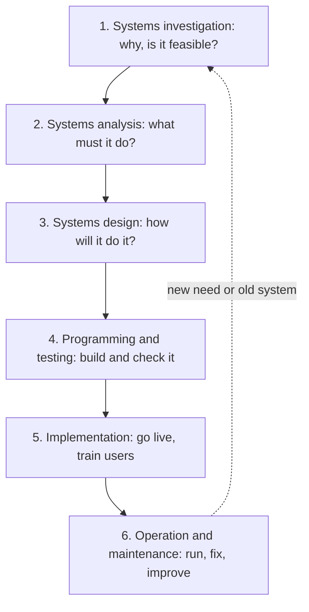
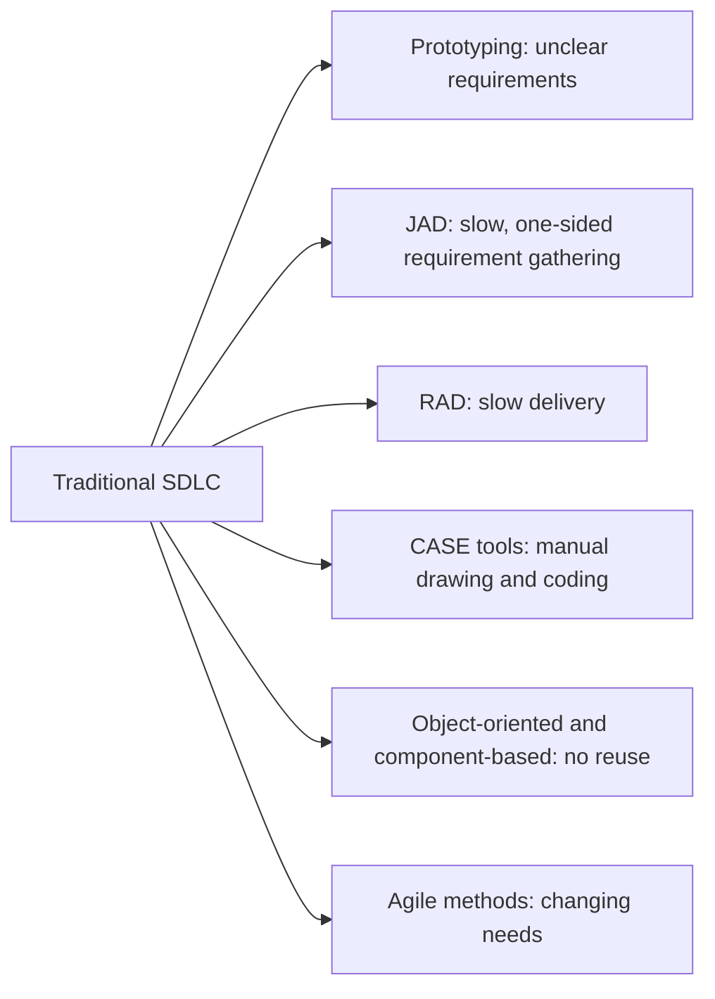
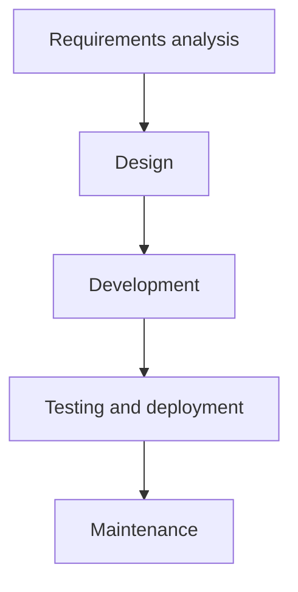
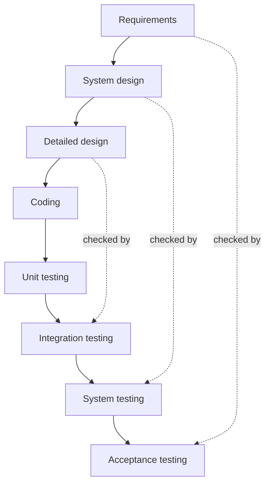
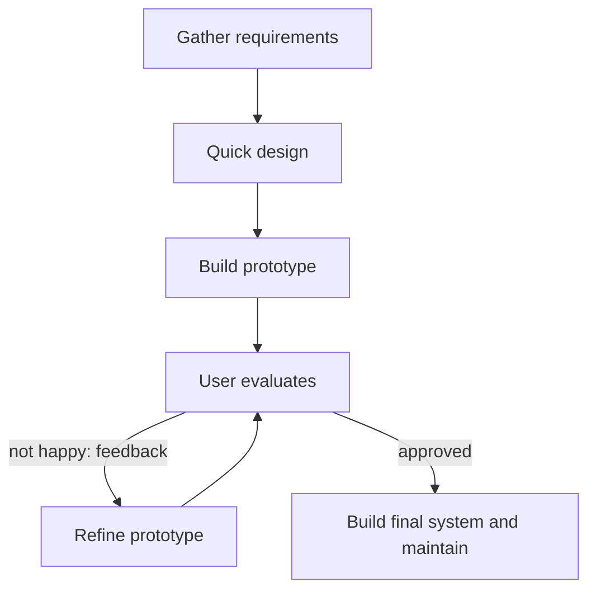
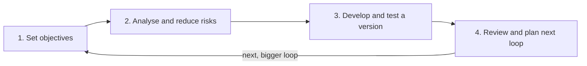
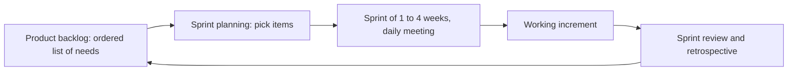

Before the topic itself, here are the few ideas you need. If you know them, skip ahead.

## The basics first

- An **information system (IS)** is people, hardware, software, data and procedures working together to collect, store and share information. An **application** is the software part that does one job, such as payroll or order tracking.
- A **user** is anyone who works with the system. A **stakeholder** is anyone affected by it: users, managers, customers, the IT team.
- A **requirement** is something the system must do or a rule it must follow, for example "the app must show live delivery status".
- **Programming** means writing the code. **Testing** means running the system to find mistakes (bugs) before real users do.
- A **life cycle** is the set of stages something goes through from birth to retirement. A system is born from an idea, is built, is used, is repaired and finally is replaced.
- **Legacy system** means an old system that still runs the business but is hard to change.

## Why firms need a planned way to get systems

A new system costs money, takes months and touches many people. Without a plan, projects finish late, cost more than promised, or build something nobody wanted. A planned method makes sure the right problem is solved, the cost is justified, the work is done in a clear order, and the result is tested before it goes live. <Cite id="it-impact-society-rainer-iis7" /> <Cite id="note-sdlc-ibm-sdlc" />

This note covers syllabus <Syl m="6" />, section 6.3: acquiring information systems and applications, and the various system development life cycle models.

## Acquiring information systems and applications

A firm can get an application in several ways. This is the **make-or-buy decision**. <Cite id="it-impact-society-rainer-iis7" /> <Cite id="it-impact-society-laudon-mis" />

1. **Buy a ready-made package** (also called off-the-shelf software, COTS). The vendor already built it for many customers. Example: a shop buys Tally for accounts, or a large firm buys SAP for ERP. <Cite id="note-sdlc-wiki-cots" />
2. **Lease or rent it** (software as a service, SaaS). The firm pays a monthly fee and uses it over the internet; the vendor runs it. Example: Salesforce for CRM.
3. **Build it in-house.** The firm's own IT team writes a custom system. Example: Flipkart or Zomato build their core apps themselves, because the app is their business.
4. **Custom development by a vendor / outsourcing.** An outside company builds or runs the system for a fee. Example: a bank asks Infosys or TCS to build or maintain a system. <Cite id="note-sdlc-wiki-outsourcing" />
5. **Open source.** Free software whose code anyone can read and change. The firm saves licence cost but needs skilled staff for support.
6. **End-user development.** Staff build small tools themselves with spreadsheets or low-code tools. <Cite id="note-sdlc-wiki-enduser" />

| Route | Speed | Cost at start | Fit to your needs | Control | Main risk |
| --- | --- | --- | --- | --- | --- |
| Buy package | Fast | Medium | Medium (change your process to fit) | Low | Vendor lock-in, extra features you do not need |
| Lease / SaaS | Fastest | Low | Medium | Low | Ongoing fee, data held by vendor |
| Build in-house | Slow | High | Best | Full | Over-run in time and cost, needs skilled team |
| Outsource custom build | Medium | High | Good | Medium | Poor communication, dependence on vendor |
| Open source | Medium | Low licence, support cost | Medium | High | Support and security depend on community or own staff |
| End-user | Fast | Very low | Only for small needs | Local | Errors, no standards, hard to maintain |

**Planning and justifying the cost.** Before choosing, the firm writes a **business case**: what problem is being solved and what is the benefit? It compares **tangible** costs and benefits (hardware, licences, salaries, saved time, extra sales, which can be counted in rupees) with **intangible** ones (better customer satisfaction, better decisions, which are real but hard to count). It looks at the **total cost of ownership (TCO)**: not just the purchase price but also training, support, upgrades and running cost over the years. <Cite id="it-impact-society-rainer-iis7" />

## What is system development?

<Box kind="definition">

**System development** is the process of building a new information system or changing an existing one so that it meets the needs of the business. The **system development life cycle (SDLC)** is the traditional, step-by-step structure for doing it: a set of phases, each with its own tasks and outputs, that take a project from the first idea to a running and maintained system. <Cite id="note-sdlc-wiki-sdlc" /> <Cite id="note-sdlc-gfg-sdlc" /> <Cite id="note-sdlc-aws-sdlc" />

</Box>

**Who takes part.** Users and managers (they know the business need), systems analysts (they study the need and design the solution), programmers (they write the code), testers, database and network staff, and a project manager who watches time and cost. The **systems analyst** is the bridge between the business people and the technical people. <Cite id="note-sdlc-tpt-sdlc" />

## The phases of the SDLC

Rainer and Prince describe six phases. Other books merge or rename some of them (for example "planning, analysis, design, development, testing, deployment, maintenance" on popular sites), but the ideas are the same. <Cite id="it-impact-society-rainer-iis7" /> <Cite id="note-sdlc-ibm-sdlc" />

### 1. Systems investigation

Find out the real problem or opportunity and decide whether to go ahead. The output is a **feasibility study** and a go / no-go decision. <Cite id="note-sdlc-wiki-feasibility" />

- **Technical feasibility:** can we build it with the technology and skills we have or can get?
- **Economic feasibility:** will the benefits be more than the costs? (cost-benefit analysis)
- **Behavioural (organisational) feasibility:** will people accept and use it, or resist it?

Many books also add **legal** and **schedule** feasibility.

### 2. Systems analysis

Study the current system and write down exactly what the new one must do. The analyst interviews users, observes work, reads forms and reports, and collects **requirements**. The main output is the **requirements document** (also called the system requirements specification). Analysts draw **data flow diagrams** (DFDs), which show how data moves between processes, stores and people, and **entity-relationship diagrams** that show what data is kept. <Cite id="note-sdlc-wiki-dfd" /> <Cite id="note-sdlc-wiki-erd" />

### 3. Systems design

Decide **how** the system will meet the requirements. This is the blueprint. It covers the screens and reports (user interface), the database, the processing logic, the hardware and network, and security controls. The output is the **design specification**. A **logical design** says what the system does without naming technology; a **physical design** says which hardware and software will be used. Object-oriented designs are drawn with UML diagrams. <Cite id="note-sdlc-wiki-uml" />

### 4. Programming and testing

Programmers write the code from the design. Then it is tested at several levels:

- **Unit testing:** each small piece alone.
- **Integration testing:** pieces working together.
- **System testing:** the whole system against the requirements.
- **User acceptance testing (UAT):** real users confirm it does what they asked for.

### 5. Implementation

Put the system into real use. Staff are trained, data is moved from the old system, and the firm chooses a **conversion method**:

| Method | How it works | Good | Bad |
| --- | --- | --- | --- |
| Parallel | Old and new run together for a while | Safest; results can be compared | Double work and cost |
| Direct (cut-over) | Switch off old, switch on new at once | Cheapest and fastest | Most risky; no fallback |
| Pilot | New system runs first at one branch or team | Problems found on a small scale | Slower overall; two systems for a time |
| Phased | New system introduced module by module | Risk spread out; easy to learn | Takes long; old and new must connect |

### 6. Operation and maintenance

The system is used daily. **Maintenance** keeps it working: fixing bugs (corrective), adapting to new rules or platforms (adaptive), adding features (perfective) and preventing future problems (preventive). Maintenance often costs more over the years than the original build. A **post-implementation review** checks whether the project met its goals. When the system is too old, a new cycle begins.

**Example: a hospital appointment app.**

| Phase | What happens |
| --- | --- |
| Investigation | Patients queue for hours. Management asks: can an app fix this? Feasibility: yes technically, cost is Rs 20 lakh against saved staff time, doctors are willing. Approved. |
| Analysis | Analysts interview receptionists and doctors. Requirements: book slot, cancel, SMS reminder, doctor's daily list. DFD drawn. |
| Design | Screens, appointment database, and rules (one patient cannot double book) are designed. |
| Programming and testing | The app is coded; unit, integration and user acceptance tests are run. |
| Implementation | Staff trained. Pilot in one department, then phased to all. |
| Maintenance | A bug in SMS timing is fixed; a new video-consult feature is added next year. |

## Tools that augment the traditional SDLC

The traditional SDLC is **slow and rigid**: users see the system only at the end, and changes late in the project are expensive. Several tools and methods are added to it, or used instead of parts of it, to make development faster, cheaper or closer to what users want. Rainer and Prince list these as alternative methods and tools. <Cite id="it-impact-society-rainer-iis7" /> <Cite id="it-impact-society-laudon-mis" />

1. **Prototyping.** Build a quick, small, working model of part of the system, show it to users, collect feedback, and improve it. This finds misunderstandings early. A prototype may be thrown away or grown into the final system. *Analogy: an architect's 3D model or a sample flat shown before the building is built.* <Cite id="note-sdlc-wiki-prototyping" /> <Cite id="note-sdlc-gfg-prototype" />
2. **Joint application design (JAD).** A group workshop where users, managers and analysts sit together, led by a facilitator, and agree requirements and design in a few days instead of many separate interviews. It saves time and cuts disagreement. <Cite id="note-sdlc-wiki-jad" />
3. **Rapid application development (RAD).** A method that combines prototyping, JAD, CASE tools and reusable parts, with short fixed time-boxes, to deliver a working system in weeks or a few months rather than a year. <Cite id="note-sdlc-wiki-rad" />
4. **Computer-aided software engineering (CASE) tools.** Software that helps the developers: drawing diagrams, keeping a central repository of requirements, generating code and documentation, and checking consistency. *Upper CASE* tools support analysis and design; *lower CASE* tools support coding and testing; *integrated CASE* tools cover both. Benefit: less manual work and better documentation. Limit: cost and a learning curve. <Cite id="note-sdlc-wiki-case" />
5. **Object-oriented (OO) development and component-based development.** The system is built from **objects** (things like Customer or Order that hold data and actions) and reusable **components**. Reuse saves time and gives fewer bugs. UML is the usual drawing language. <Cite id="note-sdlc-wiki-uml" />
6. **Agile methods.** Build the system in short cycles (sprints), deliver a working part each time, and welcome changing requirements. See the agile model below. <Cite id="note-sdlc-wiki-agile" />
7. **End-user development.** Users build their own small applications with spreadsheets, reporting tools or low-code platforms. It is fast and cheap, but needs control to avoid errors, security holes and "shadow IT". <Cite id="note-sdlc-wiki-enduser" />

| Tool | Main benefit | Main limit |
| --- | --- | --- |
| Prototyping | Users see something early; fewer misunderstandings | Users may think the quick model is the finished system; poor documentation |
| JAD | Fast agreement on requirements | Needs all key people free at the same time; a dominant person can steer it |
| RAD | Fast delivery | Needs skilled developers and committed users; not for very large systems |
| CASE | Less manual work, better documentation | Costly; staff must learn it |
| OO / components | Reuse and easy change | Takes skill; good design needed first |
| Agile | Handles change; frequent delivery | Needs active user involvement; hard to fix price and scope |
| End-user development | Fast, cheap, close to the need | Errors, weak security, no standards |

## SDLC models

A **model** says in what order and how often the phases are done. <Cite id="note-sdlc-gfg-sdlc" /> <Cite id="note-sdlc-tpt-sdlc" />

### Waterfall model

Phases are done **one after another** in a line, and each must be finished and approved before the next starts, like water falling down steps. It is the plain SDLC above, done once. <Cite id="note-sdlc-wiki-waterfall" /> <Cite id="note-sdlc-gfg-waterfall" />

- **Good:** simple, easy to manage, clear documents at every stage, suits fixed and well-understood needs.
- **Bad:** users see nothing until the end; changing requirements later is costly; a working product comes late; risk is found late.
- **Use when:** requirements are clear and stable, for example a payroll system that must follow fixed rules.

<Cite id="note-sdlc-gfg-waterfall" loc="diagram" />

### V-model

An extension of waterfall. Every development phase on the left of the "V" has a matching **test phase** on the right, planned at the same time: requirements with acceptance testing, design with system testing, detailed design with integration testing, coding with unit testing. <Cite id="note-sdlc-wiki-vmodel" />

- **Good:** testing is planned early; suits systems where mistakes are costly (banking, medical, railway signalling).
- **Bad:** as rigid as waterfall; no early working version.

### Prototype model

Start with a quick prototype from rough requirements, let users try it, refine it again and again until they are happy, then build the final system. <Cite id="note-sdlc-wiki-prototyping" /> <Cite id="note-sdlc-gfg-prototype" />

- **Good:** clears unclear requirements; users feel involved; early feedback.
- **Bad:** can drag on; users may expect the final system very soon; weak documentation.
- **Use when:** users cannot say what they want until they see it, for example a new mobile app screen design.

<Cite id="note-sdlc-gfg-prototype" loc="diagram" />

### Spiral model

Proposed by **Barry Boehm** (1986). The project goes round a spiral, and each loop has four steps: (1) set objectives, (2) identify and reduce **risks**, (3) develop and test, (4) review and plan the next loop. Each loop yields a more complete version. <Cite id="note-sdlc-wiki-spiral" /> <Cite id="note-sdlc-gfg-spiral" />

- **Good:** risk is handled early; suits large, costly, uncertain projects; changes are allowed.
- **Bad:** needs skilled risk analysis; costly; hard for small projects; may never end if not controlled.
- **Use when:** a large project with big risks, such as an air-traffic control or defence system.

### Iterative and incremental models

Build the system in **parts**. In the **incremental** model, a first working piece (say login and booking) is delivered, then more pieces are added. In the **iterative** model, a rough whole is built and then improved round by round. Most modern models (spiral, RAD, agile) are both.

### RAD model

Develop in short time-boxed cycles using prototypes, JAD workshops, CASE tools and reusable components, with heavy user involvement. Usually the system is split into modules built in parallel by small teams. <Cite id="note-sdlc-wiki-rad" />

- **Good:** very fast delivery; strong user involvement; changes are easy.
- **Bad:** needs skilled people and committed users; unsuitable for very large or high-risk systems.

### Agile model

Agile is a way of working, written down in the **Agile Manifesto** (2001), which values individuals and interactions over processes and tools, working software over heavy documentation, customer collaboration over contract negotiation, and responding to change over following a plan. The system is built in short cycles of one to four weeks called **sprints** (in Scrum), each ending with a working, usable increment. <Cite id="note-sdlc-agile-manifesto" /> <Cite id="note-sdlc-wiki-agile" /> <Cite id="note-sdlc-wiki-scrum" /> <Cite id="note-sdlc-scrumguide" />

In **Scrum**, a **product owner** keeps a prioritised list of work (the product backlog), a **Scrum Master** helps the team follow the method, and the **developers** build. The team plans each sprint, meets briefly every day, shows the result at the end (sprint review) and then discusses how to improve (retrospective).

- **Good:** copes with changing needs; frequent working software; close customer contact; early value.
- **Bad:** hard to fix cost and date; needs active users; documentation can be thin; weak when the team is spread out or inexperienced.
- **Use when:** needs are unclear or change often, for example a food-delivery app that adds features every few weeks.
- **DevOps** goes one step further: development and operations teams work together with automatic testing and release so that changes reach users quickly and safely. <Cite id="note-sdlc-wiki-devops" />

### Comparison of the models

| Point | Waterfall | V-model | Prototype | Spiral | RAD | Agile |
| --- | --- | --- | --- | --- | --- | --- |
| Order of work | One pass, in a line | One pass, test paired with each phase | Repeated build and review | Repeated loops with risk check | Short time-boxed cycles | Short sprints |
| Requirements | Fixed up front | Fixed up front | Found by trying | Evolve each loop | Found with users, fast | Change allowed any time |
| User involvement | Start and end | Start and end | High | Medium | High | Very high, throughout |
| First working version | Late | Late | Early (a mock) | After first loops | Early | Within the first sprint or two |
| Risk handling | Late | Late | Medium | Strong, built in | Medium | Early feedback reduces it |
| Documentation | Heavy | Heavy | Light | Medium | Light | Light |
| Best for | Stable, small to medium | High-safety systems | Unclear user needs | Large risky projects | Quick business apps | Changing needs, products |

### Choosing a model

| Situation | Sensible choice |
| --- | --- |
| Needs clear and fixed, low change | Waterfall or V-model |
| Mistakes would be very costly | V-model or spiral |
| Users cannot describe what they want | Prototype or RAD |
| Large, risky, long project | Spiral |
| Needs change often, product keeps growing | Agile (with DevOps) |

<Box kind="pitfall">

Do not say "waterfall is bad and agile is good". Each fits a different situation. Agile still needs planning and testing, and waterfall is still used for fixed-scope work. Say which model suits which case and why. Also note that secure development practices apply to every model; NIST's Secure Software Development Framework lists them. <Cite id="note-sdlc-nist-ssdf" />

</Box>

## Real examples

| Firm | How it relates |
| --- | --- |
| Flipkart, Zomato, Swiggy | Build apps in-house and release small changes often, in an agile way, because the app is the business. |
| Amazon | Splits work into small teams and releases to production very often, using DevOps practices. |
| Infosys, TCS | Outsourcing vendors: they build and maintain systems for banks, airlines and retailers. |
| Tally, SAP | Packaged software a firm can buy instead of building. |
| Salesforce | SaaS CRM that firms rent instead of building their own. |
| Government payroll or tax software | Fixed rules, so waterfall or V-model with heavy testing. |

## Past-paper answers: what to write

- <PYQ id="2023-12-ce/q5b" /> (10 marks, explain the phases of the SDLC with example): one-line definition, the six-phase diagram, two to three lines per phase with outputs, the feasibility types, the conversion table, the hospital-app example, then limits of the SDLC and one-line conclusion.
- <PYQ id="2025-05-ce/q1d" /> (5 marks, overview of system development): definition of system development and SDLC, why a planned approach is needed, the phases in one line each, how the system is acquired (buy, lease, build, outsource), and who takes part.
- <PYQ id="2023-05-ce/q1c" />, <PYQ id="2024-12-ce/q1c" /> and <PYQ id="2025-05-ce/q1e" /> (5 marks, tools that augment the traditional SDLC): one line on why the traditional SDLC is slow and rigid, then the tools (prototyping, JAD, RAD, CASE, object-oriented, agile, end-user development) each with a one-line purpose, and the benefit and limit table. For 5 marks pick the first five and give one example.

<Box kind="exam">

If a question asks "SDLC models" or "compare", also include the model comparison table. If it only asks for "tools that augment the SDLC", do not write all the models; name the tools and what each fixes.

</Box>

## One-line conclusion

The SDLC gives a firm a planned, step-by-step way to get a system that fits its need, and the tools and models around it (prototype, RAD, CASE, spiral, agile) let the firm trade planning against speed and flexibility, depending on how clear and how risky the project is.
