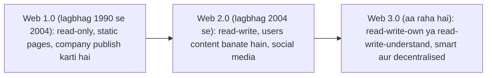
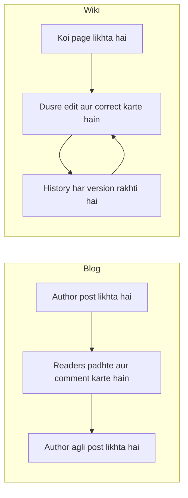
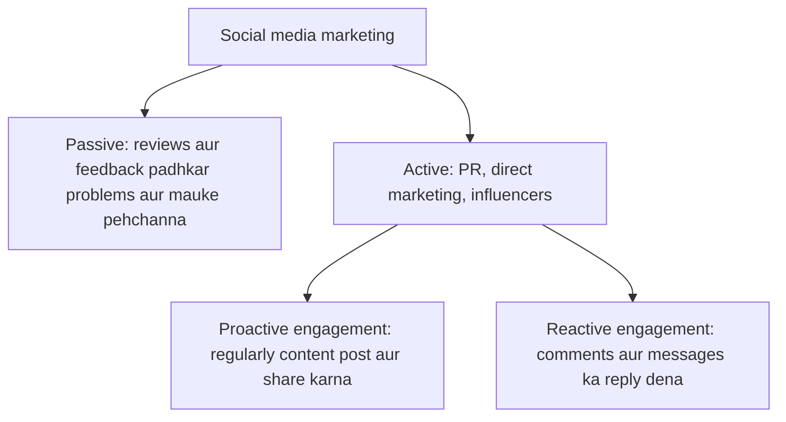
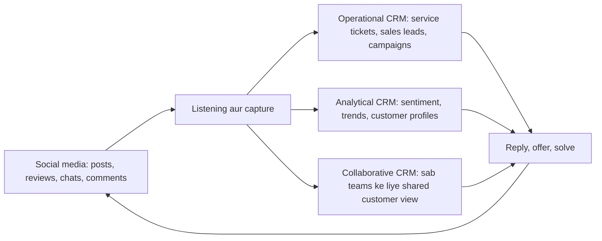
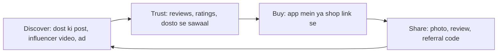
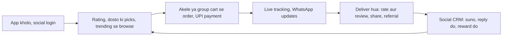

Naye ideas se pehle wo purane ideas jo tumhe chahiye. Agar pata hai to seedha agle section pe jao.

## Basics pehle

- **Web** (World Wide Web) pages aur services ka collection hai jisse tum **browser** ke through pahunchte ho. **Web server** pages store karta hai aur jab tum maango to browser ko bhej deta hai.
- **Website** related pages ka group hai, jaise company ka home page aur product pages.
- **Content** wo sab hai jo log web pe padhte ya dekhte hain: text, photos, videos, reviews. **User-generated content (UGC)** wo content hai jo users khud banate hain, jaise product review, tweet ya YouTube video.
- **Social network** wo website ya app hai jahan log profile banate hain, dusron se connect hote hain (friends, followers, colleagues) aur unke saath cheezein share karte hain. Examples: Facebook, Instagram, LinkedIn. <Cite id="social-computing-wiki-sns" />
- **Social media** un sab sites aur apps ka bada naam hai jahan log content banate, share karte aur baat karte hain.
- **Mobile commerce (m-commerce)** matlab phone se buying-selling. Ye module 4 ka alag topic hai aur e-commerce note mein hai.

## Social computing kya hai aur kyun zaroori hai

<Box kind="definition">

**Social computing** computers, internet aur software ka use hai jo social behaviour ko support karta hai: log connect hote hain, share karte hain, milkar kaam karte hain aur group mein content banate hain. Social computing mein users sirf readers nahi hote; wo content banate, rate karte, edit karte aur phailate hain. <Cite id="social-computing-wiki-social-computing" /> <Cite id="it-impact-society-rainer-iis7" />

</Box>

Ye syllabus <Syl m="4" />, section 4.1 (social computing, Web 2.0 aur 3.0) aur 4.2 (business aur shopping mein social computing) hai.

**Ye kyun zaroori hai (kaunsi problem solve hoti hai).** Purane web pe company ek page publish karti thi aur visitor sirf padh sakta tha. Sawaal poochne, opinion share karne ya ye jaanne ka aasaan tareeka nahi tha ki dusre log kya sochte hain. Social computing logon ko awaaz deta hai aur business ko sunne ka tareeka, yaani ye one-way communication ki problem solve karta hai. <Cite id="social-computing-wiki-web2" />

**Roz ka example.** Purana web college gate ka notice board hai: office notice lagata hai aur tum padhte ho. Social computing college canteen hai: sab baat karte hain, behas karte hain, best dish recommend karte hain aur kharab wali se bachne ko kehte hain. Smart business canteen mein baith ke sunta hai.

## Web 1.0, Web 2.0 aur Web 3.0

Web kai stages mein bada hua hai. Har stage ko "version" kehte hain, par numbers bolne ka tareeka hain, software release nahi. Tim O'Reilly ne 2004-2005 mein "Web 2.0" term popular kiya, un sites ke liye jo apne users pe depend karti hain. <Cite id="social-computing-oreilly-web2" /> <Cite id="social-computing-wiki-web2" />

**Web 1.0, read-only web.** Pages static hain, yaani sabke liye same aur sirf owner badalta hai. Kuch log publish karte hain, bahut log padhte hain. Examples: shuruaati company brochure sites, early Yahoo directory pages. Dial-up internet common tha, isliye pages halke hote the. <Cite id="social-computing-gfg-web-versions" />

**Web 2.0, read-write aur social web.** Users padh bhi sakte hain, likh bhi sakte hain: post, comment, like, upload, edit aur share. Pages bina reload hue respond karte hain, **Ajax** jaisi technologies ki wajah se (page background mein chhota data fetch karne ka tareeka). Site ek platform hai aur users ka content hi value hai. Examples: Facebook, YouTube, Wikipedia, Twitter (X), Instagram, Flipkart reviews. <Cite id="social-computing-wiki-ajax" /> <Cite id="social-computing-oreilly-web2" />

**Web 3.0, agla web.** Iski ek agreed definition nahi hai. Term do tarah se use hota hai:

1. **Semantic Web** (Tim Berners-Lee ka idea): data clear *meaning* ke saath publish hota hai, taaki machines bhi, sirf insaan nahi, use samajh aur jod sakein. Tab "next Friday Goa ki Rs 5000 se sasti flights" jaisi search ka jawab kai sites ka data jodkar diya ja sakta hai. W3C iske standards banata hai. <Cite id="social-computing-wiki-semantic-web" /> <Cite id="social-computing-w3c-semantic-web" />
2. **Web3** (decentralised web): **blockchain** (kai computers dwara rakha shared record jise badalna bahut mushkil hai) pe bana web ka vision, jahan users apna data, identity aur crypto tokens jaise digital assets khud own karte hain, kuch badi companies nahi. Examples: Ethereum applications, NFTs. Critics kehte hain ki iska bahut hissa abhi hype hai ya practice mein bahut centralised hai. <Cite id="social-computing-wiki-web3" /> <Cite id="social-computing-ethereum-web3" />

Dono meanings **AI** bhi use karte hain taaki tumhe jo dikhe wo personalised ho, aur dono abhi develop ho rahe hain. <Cite id="social-computing-av-web2-web3" />

| Point | Web 1.0 | Web 2.0 | Web 3.0 |
|---|---|---|---|
| Nickname | Read-only web | Read-write, social web | Read-write-own, smart aur decentralised web |
| Content kaun banata hai | Kuch publishers | Users aur companies milkar | Users, machines aur AI ki madad se |
| Pages | Static | Dynamic, interactive | Intelligent, personalised |
| Data control | Site owner | Badi platforms (Facebook, Google) | User (Web3 view mein) |
| Main technology | HTML, simple servers | Ajax, JavaScript, blogs, wikis, social networks, cloud | Semantic tags, AI, blockchain, smart contracts |
| Communication | One-way | Two-way, many-to-many | Machine-to-machine aur peer-to-peer bhi |
| Examples | Early company brochure sites, Yahoo directory | Facebook, YouTube, Wikipedia, Amazon reviews | Semantic search, Ethereum apps, smart assistants |
| Weak point | Interaction nahi | Privacy loss, data platforms ke paas | Complex, slow, abhi early, rules unclear |

<Cite id="social-computing-gfg-web-versions" /> <Cite id="social-computing-av-web2-web3" />

<Box kind="exam">

"Differentiate Web 2.0 and Web 3.0" ke liye 6 se 8 rows likho (content, data ka control, technology, intelligence, interaction, examples, limits), phir ek line: "Web 2.0 made the web social; Web 3.0 aims to make it meaningful and user-owned." "Web 1.0, 2.0, 3.0 with example" ke liye upar wali three-column table use karo aur har column ka ek real example do. <PYQ id="2022-12-ce/q1c" /> <PYQ id="2023-12-ce/q6b" />

</Box>

## Social computing ke tools

Ye wo building blocks hain jo businesses aur log use karte hain. Inme se zyadatar Web 2.0 tools hain.

| Tool | Kya hai | Business example |
|---|---|---|
| **Blog** | Dated posts ki website, newest pehle, aam taur pe ek author, neeche comments | Company blog jo naye products samjhata hai; food blogger jo restaurants review karta hai |
| **Microblog** | Bahut chhoti posts (Twitter/X, Threads) | Zomato aur Indian Railways ka public mein customers ko reply karna |
| **Wiki** | Pages jo allowed log edit kar sakte hain; har change history mein save hota hai | Wikipedia; internal procedures ke liye company wiki |
| **Social network** | Profiles aur connections | Hiring ke liye LinkedIn; brands ke liye Facebook pages |
| **Messaging apps** | Chat, calls aur groups | Customers ko jawab dene ke liye WhatsApp Business |
| **Media sharing** | Photo aur video sites | YouTube pe brand channel |
| **RSS feed** | Feed jo kai sites ki nayi posts ek reader mein laati hai | News aur blog readers |
| **Mashup** | Page jo do ya zyada services ka data jodta hai | Property site jo listings Google map pe dikhati hai |
| **Crowdsourcing** | Badi bheed se ideas, kaam ya paise maangna | Lego Ideas, Dell IdeaStorm, Wikipedia khud |
| **Tagging (folksonomy)** | Users items pe apne keywords lagate hain | Hashtags, photos pe tags |
| **Reviews aur ratings** | Customers products ko score dete hain | Amazon aur Flipkart ratings |

Tools ke sources: <Cite id="social-computing-wiki-blog" /> <Cite id="social-computing-wiki-microblogging" /> <Cite id="social-computing-wiki-wiki" /> <Cite id="social-computing-wiki-rss" /> <Cite id="social-computing-wiki-mashup" /> <Cite id="social-computing-wiki-crowdsourcing" /> <Cite id="social-computing-wiki-folksonomy" />

### Blogs vs wikis

Dono Web 2.0 publishing tools hain, par alag kaam ke liye bane hain.

| Point | Blog | Wiki |
|---|---|---|
| Authors | Ek person ya chhoti team | Bahut contributors |
| Main text kaun edit karta hai | Sirf author; readers comment likhte hain | Permission wala koi bhi kisi bhi page ko edit kar sakta hai |
| Order | Dated posts, newest pehle | Linked pages, date order nahi |
| Voice | Personal opinion aur kahani | Neutral, shared knowledge |
| Purpose | Batana, marketing, following banana | Milkar knowledge ka bhandar banana |
| Version history | Main feature nahi | Har edit save hota hai aur undo ho sakta hai |
| Business application | News share karne aur customers laane ke liye company blog | Internal wiki jahan staff manuals, FAQs aur project notes rakhta hai |
| Examples | WordPress aur Blogger blogs | Wikipedia, Confluence |

To "Are blogs and wikis different?" ka jawab hai haan: blog *batane* ke liye hai, wiki *milkar banane* ke liye. <Cite id="social-computing-wiki-blog" /> <Cite id="social-computing-wiki-wiki" /> <PYQ id="2024-05-ce/q1d" />

## Businesses ko social computing kyun chahiye

<Box kind="definition">

Business ke liye social computing matlab social tools use karna taaki customers tak pahunche, unki suney, unhe business mein involve kare aur firm ke andar behtar kaam kare. <Cite id="it-impact-society-rainer-iis7" /> <Cite id="it-impact-society-laudon-mis" />

</Box>

Business ko ye kyun chahiye:

1. **Customers pehle se wahan hain.** Zyadatar customers social media pe ghante bitate hain, to jo firm wahan nahi hai wo dikhti hi nahi.
2. **Sasta reach.** Print ya TV ke muqable ek page, post ya video kam kharch mein hazaaron logon tak pahunch jaata hai. <Cite id="social-computing-wiki-smm" />
3. **Two-way conversation.** Firm complaints aur tareef ek saath sunti hai aur jaldi jawab de sakti hai.
4. **Word of mouth se trust.** Log advertisements se zyada dusre customers pe bharosa karte hain. Reviews, ratings aur recommendations wo trust laate hain.
5. **Free market research.** Posts, polls aur comments dikhate hain ki customers kya chahte hain, price ya naye product pe unka reaction kya hai, aur competitors kya kar rahe hain.
6. **Naye ideas (crowdsourcing).** Customers products suggest karte hain aur vote dete hain. *Example:* Lego Ideas fans ke designs ko asli sets banata hai. <Cite id="social-computing-wiki-crowdsourcing" />
7. **Behtar customer service aur loyalty.** Public mein jaldi reply aur online communities customers ko rokti hain.
8. **Hiring aur employer image.** LinkedIn firms ko staff dhundhne mein aur candidates ko firms jaanchne mein madad karta hai.
9. **Firm ke andar teamwork aur knowledge sharing.** Enterprise chat tools, wikis aur forums staff ko know-how share karne dete hain.
10. **Speed.** News, offers aur fixes minutes mein phail jaate hain.
11. **Competition.** Rivals ye tools use karte hain, to jo firm ignore kare wo peeche reh jaati hai.

<Box kind="exam">

"What is the need of social computing for businesses?" ke liye likho: definition, purani one-way problem, phir 6 se 8 reasons (reach, two-way talk, trust, research, ideas, service, hiring, internal teamwork), har ek ke saath company example, ho sake to chhota diagram, aur ek line ka conclusion ki risks ke liye policy chahiye. <PYQ id="2022-12-ce/q5a" />

</Box>

## Marketing, customer service aur CRM mein social computing

### Marketing

**Social media marketing (SMM)** matlab social platforms se product ya brand ka promotion: posts, ads, videos, influencers aur contests. Iske achhe points: kam cost, age, city aur interests se precise targeting, aur naapne layak results (likes, shares, clicks, sales). <Cite id="social-computing-wiki-smm" /> Example: Zomato ke funny posts aur memes users share karte hain, to brand ko free reach milti hai.

<Cite id="social-computing-wiki-smm" loc="diagram" />

### Customer service

<Box kind="intuition">

Social media account ab wo "complaint desk" hai jo poori duniya dekh sakti hai. Public mein jaldi aur politely diya gaya reply har dusre customer ko dikhata hai ki firm parwah karti hai.

</Box>

Social computing customer service ko in tareekon se badal raha hai:

1. **Tez, public support.** Customers problem tweet karte hain aur firm reply karti hai. *Example:* Indian Railways ke passengers train aur coach ki problems X pe uthate hain aur railway ke service accounts reply karte hain. Airlines aur banks bhi aisa hi karte hain.
2. **24 x 7 help chatbots se** WhatsApp, Messenger aur websites pe, order status jaise simple sawalon ke liye. SBI aur dusre banks balance aur mini-statement ke liye WhatsApp banking chalate hain.
3. **Customer communities aur forums** jahan dusre customers sawaalon ke jawab dete hain, isse support team ka load kam hota hai.
4. **Listening (social monitoring).** Firm apne naam ko search karti hai aur complaints dhundh leti hai, chahe kisi ne tag na kiya ho.
5. **Self-help content,** jaise FAQs, how-to videos aur wikis.
6. **Feedback loop.** Reviews aur complaints batate hain ki product mein kya theek karna hai.
7. **Personal touch.** Staff customer ki pichli posts dekh sakta hai aur friendly tareeke se jawab de sakta hai.

Nuksaan: kharab jawab sabko dikhta hai, turant reply ki expectation badi hai, aur messages ki sankhya zyada hai. <Cite id="social-computing-wiki-social-crm" /> <PYQ id="2023-05-ce/q1d" /> <PYQ id="2024-12-ce/q1d" />

### CRM mein social computing ka role

CRM (customer relationship management) agle note ka poora topic hai: yahan sirf uska social computing se link chahiye. Chhote mein, CRM customer ke saath har contact ko manage karne ka tareeka hai, taaki customer bana rahe aur zyada bike. Ye teen type ka hai: **operational** (sales, marketing aur service automation), **analytical** (customer data ka analysis) aur **collaborative** (customer information departments aur partners ke beech share karna).

**Social CRM** isme social media jodta hai. Firm ab sirf messages *push* nahi karti; customer ke saath two-way, public conversation karti hai. <Cite id="social-computing-wiki-social-crm" />

- **Operational CRM:** social media pe complaint service ticket ban jaati hai; price poochne wala sales lead ban jaata hai; campaigns social channels pe chalte hain.
- **Analytical CRM:** posts aur reviews ka analysis sentiment (positive ya negative), popular topics aur customer segments ke liye hota hai.
- **Collaborative CRM:** sales, service aur marketing teeno ek hi customer conversations dekhte hain.

<Box kind="exam">

"What is CRM? Give its types and the role of SC on CRM" ke liye CRM ki chhoti definition, teen types, phir ye section likho: social CRM, upar ka diagram aur har type pe ek line. <PYQ id="2022-12-ce/q3a" />

</Box>

## Social commerce aur social shopping (4.2)

<Box kind="definition">

**Social commerce** wo e-commerce hai jo social media aur logon ki opinion aur actions (sharing, recommending, rating, group buying) use karta hai, taaki customers products dhundh sakein, chun sakein aur kharid sakein. Shopping social environment ke andar hoti ya usse influence hoti hai. <Cite id="social-computing-wiki-social-commerce" /> <Cite id="it-impact-society-rainer-iis7" />

</Box>

**Social shopping** buyer ki side hai: saath mein shopping, jahan dost aur ajnabi opinions, lists aur deals share karte hain. <Cite id="social-computing-wiki-social-shopping" />

**Social commerce ke forms**

1. **Social platforms ke andar kharidna:** Instagram aur Facebook Shops, "buy" buttons.
2. **Shopping sites pe reviews, ratings aur recommendations** (Amazon, Flipkart, Myntra).
3. **Group buying aur deals:** buyers judte hain aur kam price unlock hota hai.
4. **Resellers dwara social selling:** Meesho jaise apps ke sellers products WhatsApp aur Facebook pe share karte hain.
5. **Influencer aur live shopping:** koi video pe product dikhata hai aur viewers kharidte hain.
6. **Referral programmes:** code share karo aur dono ko reward milta hai.

### Customers ko social commerce ke benefits

1. **Trust aur confidence.** Asli buyers ke reviews aur ratings kharab products se bachate hain.
2. **Behtar choice aur discovery.** Recommendations, trending lists aur dosto ki posts wo products dikhati hain jo buyer ne search nahi kiye the.
3. **Kam price.** Group deals, referral rewards aur community mein share kiye gaye coupons.
4. **Convenience.** Discover, poochna aur kharidna ek hi app mein, bina site badle.
5. **Two-way help.** Buyer seller ya dusre buyers se sawaal pooch sakta hai aur jaldi jawab pa sakta hai.
6. **Personalised offers** interests aur pichli activity ke hisaab se.
7. **Maza aur awaaz.** Dosto ke saath shopping, polls aur live shows; customers apna experience share bhi kar sakte hain.
8. **Kam risk.** Asli users ki photos aur videos dikhate hain ki product real life mein kaisa dikhta hai.
9. **Purchase ke baad support.** Communities aur brand pages problems ka jawab dete hain.

### Business ke liye benefits aur limits

Benefits: kam cost ka marketing, trust ki wajah se zyada sales conversion, customers dwara free promotion, direct feedback. Limits: fake ya paid reviews, privacy ki chinta, platform ke rules pe nirbharta, bure reviews ka phailna, aur kai channels pe nazar rakhne ki zaroorat. <Cite id="social-computing-wiki-social-commerce" /> <PYQ id="2025-05-ce/q3b" />

| Point | Traditional e-commerce | Social commerce |
|---|---|---|
| Shuruat | Customer product search karta hai | Customer ko wo un logon se milta hai jinhe wo follow karta hai |
| Trust ka source | Brand aur seller ka description | Dusre customers aur dost |
| Sale kahan hoti hai | Shopping site | Social app, ya usse link |
| Communication | Zyadatar seller se customer ko | Many-to-many conversation |
| Marketing | Paid ads, search | Sharing, influencers, community |
| Example | Amazon product page | Instagram shop, WhatsApp pe Meesho resellers |

## Business ko social computing ke risks

Social computing isliye powerful hai kyunki wo open aur tez hai, aur wahi uska khatra bhi hai.

| Risk | Kya hota hai | Example |
|---|---|---|
| **Reputation ko nuksaan** | Ek kharab post, video ya review firm ke react karne se pehle lakhon tak phail jaata hai | 2009 mein ek musician ka video "United Breaks Guitars" kharab hue luggage pe phaila aur airline ki image ko nuksaan hua |
| **Hacked ya fake accounts** | Hacker firm ke naam se jhooti news post karta hai, ya koi brand ki copy banata hai | 2013 mein Associated Press ka Twitter account hack hua aur dhamake ki jhooti report post hui, share prices thodi der ke liye gire |
| **Privacy aur data loss** | Customer ya staff data collect, misuse ya leak hota hai; fine lag sakta hai | Cambridge Analytica case, jisme Facebook users ka data theek consent ke bina liya gaya |
| **Security threats** | Phishing links, malware aur scams social messages se phailte hain; staff ko dhokhe se passwords dene pe majboor kiya ja sakta hai | Messaging apps pe bheje gaye fake "offer" links |
| **Confidential information leak** | Employee koi secret, naye product ki photo ya client ka naam post kar deta hai | Employee ek unreleased design share kar deta hai |
| **Legal aur intellectual property problems** | Copyright ka ulanghan, defamation, ads mein jhooti claims, influencers ke rules | Kisi ki photo bina permission use karna |
| **Fake aur paid reviews** | Customers gumrah hote hain aur trust girta hai | Competitors ka fake reviews daalna |
| **Productivity loss** | Staff kaam ke time social sites pe waqt barbaad karta hai | Office hours mein scrolling |
| **Control ka khona aur trolling** | Koi bhi kuch bhi keh sakta hai, gaali ya afwaah bhi | Brand ad ke neeche hate comments |
| **Cost aur effort** | Staff, tools aur lagataar monitoring chahiye | 24 x 7 social media team |

**Risks kaise kam karein.** Staff ke liye **social media policy** likho, unhe train karo, strong passwords aur two-factor login ke saath official verified accounts use karo, mentions monitor karo, jaldi aur imaandari se reply karo, privacy laws follow karo, aur crisis plan rakho. <Cite id="social-computing-wiki-social-crm" /> <Cite id="it-impact-society-laudon-mis" />

<Box kind="pitfall">

Sirf risks mat likho. 10 marks ke answer mein kam se kam chhe risks chahiye, har ek ke saath real example aur business pe asar, phir unhe control karne ki chhoti list.

</Box>

<PYQ id="2024-05-ce/q5a" />

## Social computing se M-commerce mein delivery application ka plan

Ye "develop the plan" wala sawaal hai, to ise saaf parts wale chhote project plan ki tarah likho. Socho ek food ya grocery delivery app (Zomato ya Swiggy jaisa) jo shuru se hi social banaya gaya ho.

**1. Aim.** Ek mobile app jo food ya groceries deliver kare aur social features se customers laaye, trust banaye aur marketing cost kam kare.

**2. Target users.** Shahar ke students, working log aur families; restaurants aur local shops; delivery partners.

**3. Social computing features**

- **Social login se aasaan sign-up** (Google, Facebook) aur phone number, lamba form nahi.
- **Photos ke saath ratings aur reviews** restaurants, dishes aur delivery partners ke liye.
- **Share aur refer:** dish ya order WhatsApp aur Instagram pe share karo, aur referral code dono ko discount deta hai.
- **Group ordering aur bill splitting:** dost ek cart mein dishes daalte hain aur apna hissa pay karte hain.
- **WhatsApp pe order updates aur support** aur app ke andar chatbot help.
- **Community:** food blog aur short video feed, "foodie" followers, Q&A section.
- **Crowdsourced ideas aur polls:** users naye cuisines ya areas ke liye vote karte hain.
- **Location sharing aur live tracking** dost ke saath share ("mera order 5 minute door hai").
- **Reviewers ke liye loyalty points aur badges.**
- **Social CRM:** X aur Instagram pe mentions monitor karo aur complaints ka jaldi jawab do.

**4. M-commerce parts.** Paas ki shops dhundhne ke liye phone location (GPS), mobile payment (UPI, cards, wallets), offers aur order status ke liye push notifications, aur chhoti screens aur kamzor network pe chalne wala design.

**5. Plan ke steps (phases)**

1. Social media listening se market aur competitors ko study karo.
2. App screens aur social features design karo.
3. App banao, restaurant side aur delivery side, secure payment ke saath.
4. Chhote group (beta) ke saath test karo aur unse feedback lo.
5. Influencers aur referral offers ke saath ek area mein launch karo.
6. Results track karo aur naye areas mein badho.

**6. Revenue.** Restaurants se commission, delivery fees, restaurants ka paid promotion aur free delivery ke subscription plans.

**7. Success ke measures.** Downloads, per user orders, repeat orders, ratings, referrals ki sankhya, complaints pe response time.

**8. Risks aur controls.** Fake reviews (verify karo ki reviewer ne order kiya tha), privacy (consent lo, location data protect karo), food safety complaints ka viral hona (jaldi refund aur reply), payment fraud (secure gateways), aur late delivery (partners ka sahi allotment). <Cite id="social-computing-wiki-social-commerce" /> <Cite id="social-computing-wiki-smm" />

<PYQ id="2023-12-ce/q2a" />

## WhatsApp aur Telegram ki tulna

Dono messaging apps hain, jo social computing ka bahut common tool hain. Wo mainly privacy design aur data storage mein alag hain. Neeche ke numbers apps ke update hone par badal sakte hain, isliye unhe "about" ke saath likho aur asli exam mein latest check karo.

| Parameter | WhatsApp | Telegram |
|---|---|---|
| Owner | Meta | Telegram Messenger (Pavel Durov ne founded) |
| Multimedia | Photos, videos, voice notes, documents, calls aur video calls, status updates | Wahi sab, plus bade files, channels, bots, polls, stickers aur animated emoji |
| File size | Per file 2 GB tak | Per file 2 GB tak (paid users ke liye zyada) |
| Group size | Ek group mein 1,024 log tak (pehle 512), aur Communities kai groups jodti hain | Groups bahut bade ho sakte hain (200,000 members tak), aur channels mein member limit nahi |
| Security aur privacy | Chats aur calls ke liye end-to-end encryption by default on | Cloud chats aapke device aur Telegram servers ke beech encrypted hain; end-to-end encryption sirf optional Secret Chats mein |
| Storage | Chats mainly aapke phone pe store hoti hain (Google Drive ya iCloud backup optional) | Chats Telegram ke cloud mein store hoti hain, to sab devices pe milti hain aur phone ke saath khoti nahi |
| Data usage | Moderate; calls ke liye low-data setting aur media auto-download control | Moderate; detailed auto-download aur cache controls |
| Notifications | Chat-wise mute, custom tones, important message highlights | Chat-wise mute, custom tones, scheduled aur silent messages |
| Identity | Phone number aapki ID hai aur groups ke logon ko dikhta hai (privacy settings se limit ho sakta hai) | Phone number chhupa sakte hain; usernames use ho sakte hain |
| Business use | WhatsApp Business app aur API, catalogues, kuch countries mein payments | Broadcasting aur automation ke liye channels aur bots |
| Multi-device | Phone plus companion devices | Kai devices pe poori tarah independent use |

<Cite id="social-computing-wiki-whatsapp" /> <Cite id="social-computing-wiki-telegram" /> <Cite id="social-computing-telegram-faq" /> <Cite id="social-computing-whatsapp-2gb" /> <Cite id="social-computing-whatsapp-communities" /> <Cite id="e-commerce-whatsapp-security" />

**Conclusion.** WhatsApp personal aur customer chats ke liye simple, private default hai. Telegram bade groups, channels, bade files aur bots ke liye strong hai, par uski normal chats end-to-end encrypted nahi hain. <PYQ id="2023-05-ce/q1b" /> <PYQ id="2024-12-ce/q1b" />

## Social computing ke advantages aur disadvantages (summary)

| Advantages | Disadvantages |
|---|---|
| Wide, sasta reach | Privacy loss aur data misuse |
| Customers ke saath two-way conversation | Jhooti news aur bure reviews ka tez phailna |
| Free market research aur ideas | Security attacks (phishing, hacking) |
| Reviews se trust | Fake aur paid reviews |
| Behtar teamwork aur knowledge sharing | Staff ka waqt barbaad |
| Chhote businesses ko compete karne mein madad | Platforms aur unke rules pe nirbharta |

## Quick exam map

| Agar sawaal kehta hai... | Likho... | Past paper |
|---|---|---|
| "Difference between Web 2.0 and Web 3.0" (5 marks) | Dono ki definition, 6 se 8 row table, examples, Web 3.0 ke do meanings pe ek line | <PYQ id="2022-12-ce/q1c" /> |
| "Compare Web 1.0, 2.0, 3.0 with example" (10 marks) | Mermaid stage diagram, examples ke saath 3-column table, har ke features, limits, conclusion | <PYQ id="2023-12-ce/q6b" /> |
| "Blogs and wikis different?" (5 marks) | Definitions, comparison table, har ka ek business application | <PYQ id="2024-05-ce/q1d" /> |
| "Need of social computing for businesses" (10 marks) | Definition, solve hui problem, examples ke saath 6 se 8 reasons, tools, risks ek line mein | <PYQ id="2022-12-ce/q5a" /> |
| "How is social computing inspiring customer service?" (5 marks) | Tez public support, chatbots, communities, listening, self-help, feedback; example, drawback | <PYQ id="2023-05-ce/q1d" /> <PYQ id="2024-12-ce/q1d" /> |
| "CRM types and role of SC on CRM" (10 marks) | CRM definition, 3 types, social CRM, diagram, examples | <PYQ id="2022-12-ce/q3a" /> |
| "Benefits of social commerce to customers" (10 marks) | Definition, loop diagram, examples ke saath 8 se 9 benefits, limits | <PYQ id="2025-05-ce/q3b" /> |
| "Risks of social computing to business" (10 marks) | Real examples ke saath kam se kam 6 risks ki table, phir controls | <PYQ id="2024-05-ce/q5a" /> |
| "Plan for a delivery app in M-commerce using SC" (10 marks) | Aim, users, social features, m-commerce parts, diagram, phases, revenue, measures, risks | <PYQ id="2023-12-ce/q2a" /> |
| "WhatsApp versus Telegram" (5 marks) | Multimedia, security, privacy, storage, data, notifications pe comparison table; ek line ka verdict | <PYQ id="2023-05-ce/q1b" /> <PYQ id="2024-12-ce/q1b" /> |
