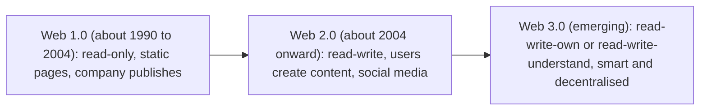
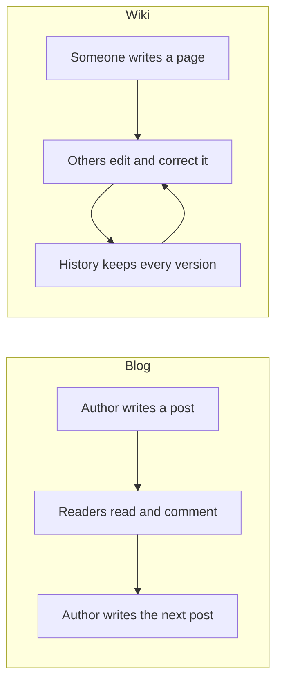
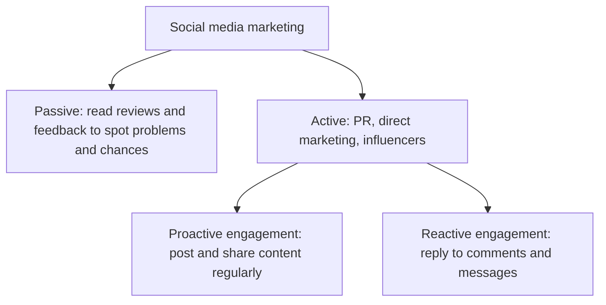
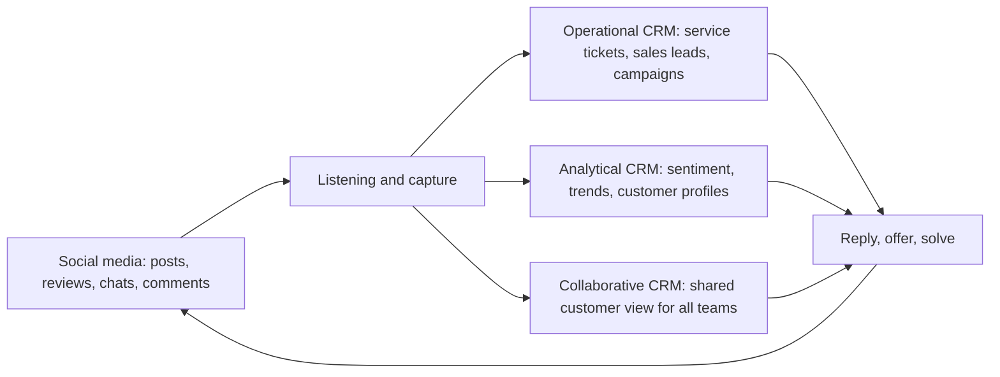
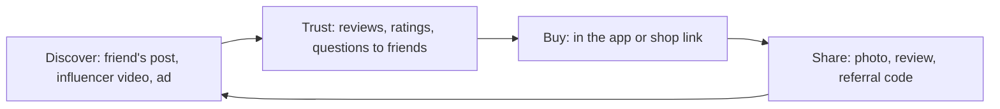
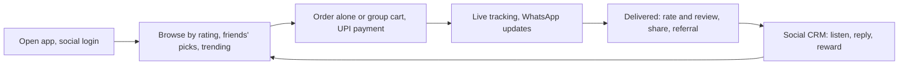

Before the new ideas, here are the old ones you need. If you already know them, skip to the next section.

## The basics first

- The **web** (World Wide Web) is the collection of pages and services you reach through a **browser**. A **web server** stores the pages and sends them to your browser when you ask.
- A **website** is a group of related pages, for example a company's home page and product pages.
- **Content** is whatever people read or watch on the web: text, photos, videos, reviews. **User-generated content (UGC)** is content made by the users themselves, such as a product review, a tweet or a YouTube video.
- A **social network** is a website or app where people create a profile, connect with others (friends, followers, colleagues) and share things with them. Examples: Facebook, Instagram, LinkedIn. <Cite id="social-computing-wiki-sns" />
- **Social media** is the wider word for all the sites and apps where people create and share content and talk to each other.
- **Mobile commerce (m-commerce)** means buying and selling through a phone. It is a separate topic in module 4 and is covered in the e-commerce note.

## What social computing is and why it matters

<Box kind="definition">

**Social computing** is the use of computers, the internet and software to support social behaviour: people connecting, sharing, working together and making content as a group. In social computing the users are not only readers; they create, rate, edit and spread the content. <Cite id="social-computing-wiki-social-computing" /> <Cite id="it-impact-society-rainer-iis7" />

</Box>

This is syllabus <Syl m="4" />, section 4.1 (social computing, Web 2.0 and 3.0) and 4.2 (social computing in business and shopping).

**Why it is needed (the problem it solves).** On the old web, a company published a page and the visitor could only read it. There was no easy way to ask a question, share an opinion or find out what other people thought. Social computing gives people a voice and gives a business a way to listen, so it solves the one-way communication problem. <Cite id="social-computing-wiki-web2" />

**Everyday analogy.** The old web is a notice board at a college gate: the office puts up a notice and you read it. Social computing is the college canteen: everyone talks, argues, recommends the best dish and warns about the bad one. A smart business sits in the canteen and listens.

## Web 1.0, Web 2.0 and Web 3.0

The web has grown in stages. Each stage is called a "version", but the numbers are a way of speaking, not software releases. Tim O'Reilly made the term "Web 2.0" popular in 2004-2005 to describe sites that depend on their users. <Cite id="social-computing-oreilly-web2" /> <Cite id="social-computing-wiki-web2" />

**Web 1.0, the read-only web.** Pages are static, which means the same for everyone and changed only by the owner. A few people publish, many people read. Examples: early company brochure sites, early Yahoo directory pages. Dial-up internet was common, so pages were light. <Cite id="social-computing-gfg-web-versions" />

**Web 2.0, the read-write and social web.** Users can write as well as read: post, comment, like, upload, edit and share. Pages respond without reloading, because of technologies such as **Ajax** (a way for a page to fetch small pieces of data in the background). The site is a platform and the users' content is the value. Examples: Facebook, YouTube, Wikipedia, Twitter (X), Instagram, Flipkart reviews. <Cite id="social-computing-wiki-ajax" /> <Cite id="social-computing-oreilly-web2" />

**Web 3.0, the next web.** There is no single agreed definition. The term is used in two ways:

1. **The Semantic Web** (Tim Berners-Lee's idea): data is published with a clear *meaning*, so that machines, not only humans, can understand and connect it. A search for "flights to Goa cheaper than Rs 5000 next Friday" can then be answered by combining data from many sites. The W3C develops its standards. <Cite id="social-computing-wiki-semantic-web" /> <Cite id="social-computing-w3c-semantic-web" />
2. **Web3** (the decentralised web): a vision of a web built on **blockchain** (a shared record kept by many computers and very hard to change), where users own their data, identity and digital assets such as crypto tokens, instead of a few big companies owning them. Examples: Ethereum applications, NFTs. Critics say much of it is still hype or very centralised in practice. <Cite id="social-computing-wiki-web3" /> <Cite id="social-computing-ethereum-web3" />

Both meanings also use **AI** to personalise what you see, and both are still developing. <Cite id="social-computing-av-web2-web3" />

| Point | Web 1.0 | Web 2.0 | Web 3.0 |
|---|---|---|---|
| Nickname | Read-only web | Read-write, social web | Read-write-own, smart and decentralised web |
| Who makes the content | A few publishers | Users and companies together | Users, with machines and AI helping |
| Pages | Static | Dynamic, interactive | Intelligent, personalised |
| Data control | Site owner | Big platforms (Facebook, Google) | User (in the Web3 view) |
| Main technology | HTML, simple servers | Ajax, JavaScript, blogs, wikis, social networks, cloud | Semantic tags, AI, blockchain, smart contracts |
| Communication | One-way | Two-way, many-to-many | Machine-to-machine and peer-to-peer too |
| Examples | Early company brochure sites, the Yahoo directory | Facebook, YouTube, Wikipedia, Amazon reviews | Semantic search, Ethereum apps, smart assistants |
| Weak point | No interaction | Privacy loss, data owned by platforms | Complex, slow, still early, unclear rules |

<Cite id="social-computing-gfg-web-versions" /> <Cite id="social-computing-av-web2-web3" />

<Box kind="exam">

For "Differentiate Web 2.0 and Web 3.0" write 6 to 8 rows (content, control of data, technology, intelligence, interaction, examples, limits), then one line: "Web 2.0 made the web social; Web 3.0 aims to make it meaningful and user-owned." For "Web 1.0, 2.0, 3.0 with example", use the three-column table above and give one real example per column. <PYQ id="2022-12-ce/q1c" /> <PYQ id="2023-12-ce/q6b" />

</Box>

## Tools of social computing

These are the building blocks that businesses and people use. Most of them are Web 2.0 tools.

| Tool | What it is | Business example |
|---|---|---|
| **Blog** | A website of dated posts, newest first, usually from one author, with comments below | A company blog explaining new products; a food blogger reviewing restaurants |
| **Microblog** | Very short posts (Twitter/X, Threads) | Zomato and Indian Railways replying to customers in public |
| **Wiki** | Pages that anyone allowed can edit; every change is saved in a history | Wikipedia; a company wiki for internal procedures |
| **Social network** | Profiles plus connections | LinkedIn for hiring; Facebook pages for brands |
| **Messaging apps** | Chat, calls and groups | WhatsApp Business to answer customers |
| **Media sharing** | Photo and video sites | A brand channel on YouTube |
| **RSS feed** | A feed that delivers new posts from many sites to one reader | News and blog readers |
| **Mashup** | A page that combines data from two or more services | A property site putting listings on a Google map |
| **Crowdsourcing** | Asking a large crowd to give ideas, work or money | Lego Ideas, Dell IdeaStorm, Wikipedia itself |
| **Tagging (folksonomy)** | Users label items with their own keywords | Hashtags, tags on photos |
| **Reviews and ratings** | Customers score products | Amazon and Flipkart ratings |

Sources for the tools: <Cite id="social-computing-wiki-blog" /> <Cite id="social-computing-wiki-microblogging" /> <Cite id="social-computing-wiki-wiki" /> <Cite id="social-computing-wiki-rss" /> <Cite id="social-computing-wiki-mashup" /> <Cite id="social-computing-wiki-crowdsourcing" /> <Cite id="social-computing-wiki-folksonomy" />

### Blogs versus wikis

Both are Web 2.0 publishing tools, but they are made for different jobs.

| Point | Blog | Wiki |
|---|---|---|
| Authors | One person or a small team | Many contributors |
| Who edits the main text | Only the author; readers write comments | Anyone with permission can edit any page |
| Order | Dated posts, newest first | Linked pages, no date order |
| Voice | Personal opinion and story | Neutral, shared knowledge |
| Purpose | Telling, marketing, building a following | Building a body of knowledge together |
| Version history | Not the main feature | Every edit is saved and can be undone |
| Business application | A company blog to share news and attract customers | An internal wiki where staff keep manuals, FAQs and project notes |
| Examples | WordPress and Blogger blogs | Wikipedia, Confluence |

So the answer to "Are blogs and wikis different?" is yes: a blog is about *telling*, a wiki is about *building together*. <Cite id="social-computing-wiki-blog" /> <Cite id="social-computing-wiki-wiki" /> <PYQ id="2024-05-ce/q1d" />

## Why businesses need social computing

<Box kind="definition">

For a business, social computing means using social tools to reach customers, listen to them, involve them in the business and work better inside the firm. <Cite id="it-impact-society-rainer-iis7" /> <Cite id="it-impact-society-laudon-mis" />

</Box>

The reasons a business needs it:

1. **Customers are already there.** Most of your customers spend hours on social media, so a firm that is absent is invisible.
2. **Cheaper reach.** A page, a post or a video can reach thousands of people at a small cost compared with print or TV. <Cite id="social-computing-wiki-smm" />
3. **Two-way conversation.** The firm hears complaints and praise at once and can answer quickly.
4. **Trust through word of mouth.** People believe other customers more than advertisements. Reviews, ratings and recommendations carry that trust.
5. **Free market research.** Posts, polls and comments show what customers want, how they react to a price or a new product, and what competitors are doing.
6. **New ideas (crowdsourcing).** Customers suggest and vote on products. *Example:* Lego Ideas turns fan designs into real sets. <Cite id="social-computing-wiki-crowdsourcing" />
7. **Better customer service and loyalty.** Fast public replies and online communities keep customers.
8. **Hiring and employer image.** LinkedIn helps firms find staff and candidates check firms.
9. **Teamwork and knowledge sharing inside the firm.** Enterprise chat tools, wikis and forums help staff share know-how.
10. **Speed.** News, offers and fixes spread in minutes.
11. **Competition.** Rivals use these tools, so a firm that ignores them loses ground.

<Box kind="exam">

For "What is the need of social computing for businesses?" write: definition, the old one-way problem, then 6 to 8 reasons (reach, two-way talk, trust, research, ideas, service, hiring, internal teamwork), each with a company example, a small diagram if you can, and a one-line conclusion about the risks that need a policy. <PYQ id="2022-12-ce/q5a" />

</Box>

## Social computing in marketing, customer service and CRM

### Marketing

**Social media marketing (SMM)** is promoting a product or brand using social platforms: posts, ads, videos, influencers and contests. Its good points are low cost, precise targeting by age, city and interests, and results you can measure (likes, shares, clicks, sales). <Cite id="social-computing-wiki-smm" /> Example: Zomato's funny posts and memes get shared by users, so the brand gets free reach.

<Cite id="social-computing-wiki-smm" loc="diagram" />

### Customer service

<Box kind="intuition">

The social media account is now the "complaint desk" that the whole world can see. A quick, polite reply in public shows every other customer that the firm cares.

</Box>

Social computing is changing customer service in these ways:

1. **Fast, public support.** Customers tweet a problem and the firm replies. *Example:* Indian Railways passengers raise train and coach problems on X, and the railway's service accounts reply. Airlines and banks do the same.
2. **24 x 7 help with chatbots** on WhatsApp, Messenger and websites for simple questions such as order status. SBI and other banks run WhatsApp banking for balance and mini-statement requests.
3. **Customer communities and forums** where other customers answer questions, which reduces the load on the support team.
4. **Listening (social monitoring).** The firm searches for its name and finds complaints even when nobody tags it.
5. **Self-help content,** such as FAQs, how-to videos and wikis.
6. **Feedback loop.** Reviews and complaints show what to fix in the product.
7. **Personal touch.** Staff can see a customer's earlier posts and answer in a friendly way.

The drawbacks: a bad answer is seen by everyone, expectations of instant reply are high, and the volume of messages is large. <Cite id="social-computing-wiki-social-crm" /> <PYQ id="2023-05-ce/q1d" /> <PYQ id="2024-12-ce/q1d" />

### Role of social computing in CRM

CRM (customer relationship management) is the full topic of the next note: here we only need its link with social computing. In short, CRM is a way of managing every contact with a customer to keep the customer and sell more. It is of three types: **operational** (sales, marketing and service automation), **analytical** (analysing customer data) and **collaborative** (sharing customer information between departments and with partners).

**Social CRM** adds social media to this. The firm no longer only *pushes* messages; it has a two-way, public conversation with the customer. <Cite id="social-computing-wiki-social-crm" />

- **Operational CRM:** a complaint on social media becomes a service ticket; a person asking about prices becomes a sales lead; campaigns are run on social channels.
- **Analytical CRM:** posts and reviews are analysed for sentiment (positive or negative), popular topics and customer segments.
- **Collaborative CRM:** sales, service and marketing all see the same customer conversations.

<Box kind="exam">

For "What is CRM? Give its types and the role of SC on CRM" write a short definition of CRM, the three types, then this section: social CRM, the diagram above and one line on each type. <PYQ id="2022-12-ce/q3a" />

</Box>

## Social commerce and social shopping (4.2)

<Box kind="definition">

**Social commerce** is e-commerce that uses social media and the opinions and actions of people (sharing, recommending, rating, group buying) to help customers find, choose and buy products. The shopping happens, or is influenced, inside the social environment. <Cite id="social-computing-wiki-social-commerce" /> <Cite id="it-impact-society-rainer-iis7" />

</Box>

**Social shopping** is the buyer's side of it: shopping together, with friends and strangers sharing opinions, lists and deals. <Cite id="social-computing-wiki-social-shopping" />

**Forms of social commerce**

1. **Buying inside social platforms:** Instagram and Facebook Shops, "buy" buttons.
2. **Reviews, ratings and recommendations** on shopping sites (Amazon, Flipkart, Myntra).
3. **Group buying and deals:** buyers join to unlock a lower price.
4. **Social selling by resellers:** sellers on apps such as Meesho share products through WhatsApp and Facebook.
5. **Influencer and live shopping:** a person shows the product on video and viewers buy.
6. **Referral programmes:** share a code and both get a reward.

### Benefits of social commerce to customers

1. **Trust and confidence.** Reviews and ratings from real buyers help avoid bad products.
2. **Better choice and discovery.** Recommendations, trending lists and friends' posts show products the buyer would not have searched for.
3. **Lower price.** Group deals, referral rewards and coupons shared by the community.
4. **Convenience.** Discover, ask and buy in the same app, without switching sites.
5. **Two-way help.** The buyer can ask the seller or other buyers a question and get a quick answer.
6. **Personalised offers** based on interests and past activity.
7. **Fun and a voice.** Shopping with friends, polls and live shows; customers can also share their experience.
8. **Less risk.** Seeing photos and videos from real users shows how the product looks in real life.
9. **Support after purchase.** Communities and brand pages answer problems.

### Benefits and limits for the business

Benefits: low-cost marketing, higher sales conversion because of trust, free promotion by customers, direct feedback. Limits: fake or paid reviews, privacy worries, dependence on a platform's rules, bad reviews spreading, and the need to watch many channels. <Cite id="social-computing-wiki-social-commerce" /> <PYQ id="2025-05-ce/q3b" />

| Point | Traditional e-commerce | Social commerce |
|---|---|---|
| Starting point | Customer searches for a product | Customer discovers it through people they follow |
| Source of trust | Brand and the seller's description | Other customers and friends |
| Where the sale happens | The shopping site | The social app, or a link from it |
| Communication | Mostly from seller to customer | Many-to-many conversation |
| Marketing | Paid ads, search | Sharing, influencers, community |
| Example | Amazon product page | Instagram shop, Meesho resellers on WhatsApp |

## Risks of social computing to business

Social computing is powerful because it is open and fast, and that is also its danger.

| Risk | What happens | Example |
|---|---|---|
| **Damage to reputation** | One bad post, video or review spreads to millions before the firm can react | In 2009 a musician's video "United Breaks Guitars" about damaged luggage spread widely and hurt the airline's image |
| **Hacked or fake accounts** | A hacker posts false news in the firm's name, or someone copies the brand | In 2013 the Associated Press Twitter account was hacked and posted a false report of an explosion, and share prices briefly fell |
| **Privacy and data loss** | Customer or staff data is collected, misused or leaked; fines may follow | The Cambridge Analytica case, in which data of Facebook users was harvested without proper consent |
| **Security threats** | Phishing links, malware and scams spread through social messages; staff may be tricked into giving passwords | Fake "offer" links sent through messaging apps |
| **Leak of confidential information** | An employee posts a secret, a photo of a new product or a client name | An employee shares an unreleased design |
| **Legal and intellectual property problems** | Copyright breach, defamation, false claims in ads, rules on influencers | Using someone's photo without permission |
| **Fake and paid reviews** | Customers are misled and trust falls | Competitors posting false reviews |
| **Loss of productivity** | Staff waste working time on social sites | Scrolling during office hours |
| **Loss of control and trolling** | Anyone can say anything, including abuse or rumours | Hate comments under a brand ad |
| **Cost and effort** | Needs staff, tools and constant monitoring | A 24 x 7 social media team |

**How to reduce the risks.** Write a **social media policy** for staff, train them, use official verified accounts with strong passwords and two-factor login, monitor mentions, reply quickly and honestly, follow privacy laws, and keep a crisis plan. <Cite id="social-computing-wiki-social-crm" /> <Cite id="it-impact-society-laudon-mis" />

<Box kind="pitfall">

Do not write only the risks. A 10-mark answer needs at least six risks, each with a real example and the effect on the business, then a short list of how to control them.

</Box>

<PYQ id="2024-05-ce/q5a" />

## Plan for a delivery application in M-commerce using social computing

This is a "develop the plan" question, so answer it as a short project plan with clear parts. Think of a food or grocery delivery app (like Zomato or Swiggy) that is built to be social from the start.

**1. Aim.** A mobile app that delivers food or groceries and uses social features to attract customers, build trust and cut marketing cost.

**2. Target users.** Students, working people and families in a city; restaurants and local shops; delivery partners.

**3. Social computing features**

- **Easy sign-up with a social login** (Google, Facebook) and phone number, so no long form.
- **Ratings and reviews with photos** for restaurants, dishes and delivery partners.
- **Share and refer:** share a dish or order to WhatsApp and Instagram, and a referral code gives a discount to both people.
- **Group ordering and bill splitting:** friends add dishes to one cart and pay their share.
- **Order updates and support on WhatsApp** and chatbot help inside the app.
- **Community:** a food blog and short video feed, "foodie" followers, a Q&A section.
- **Crowdsourced ideas and polls:** users vote for new cuisines or areas to open.
- **Location sharing and live tracking** shared with a friend ("my order is 5 minutes away").
- **Loyalty points and badges** for reviewers.
- **Social CRM:** monitor mentions on X and Instagram and answer complaints quickly.

**4. M-commerce parts.** Phone location (GPS) for finding nearby shops, mobile payment (UPI, cards, wallets), push notifications for offers and order status, and a design that works on small screens and weak networks.

**5. Steps in the plan (phases)**

1. Study the market and competitors using social media listening.
2. Design the app screens and the social features.
3. Build the app, the restaurant side and the delivery side, with secure payment.
4. Test with a small group (a beta) and collect feedback from them.
5. Launch in one area with influencers and referral offers.
6. Track results and grow to new areas.

**6. Revenue.** Commission from restaurants, delivery fees, paid promotion of restaurants and subscription plans for free delivery.

**7. Measures of success.** Downloads, orders per user, repeat orders, ratings, number of referrals, response time to complaints.

**8. Risks and controls.** Fake reviews (verify that the reviewer ordered), privacy (ask consent, protect location data), food safety complaints going viral (a quick refund and reply), payment fraud (use secure gateways), and late delivery (a fair allotment of partners). <Cite id="social-computing-wiki-social-commerce" /> <Cite id="social-computing-wiki-smm" />

<PYQ id="2023-12-ce/q2a" />

## WhatsApp and Telegram compared

Both are messaging apps, which are a very common social computing tool. They differ mainly in privacy design and in how they store data. The numbers below can change as the apps update, so quote them as "about" and check the latest in a real exam answer.

| Parameter | WhatsApp | Telegram |
|---|---|---|
| Owner | Meta | Telegram Messenger (founded by Pavel Durov) |
| Multimedia | Photos, videos, voice notes, documents, calls and video calls, status updates | Same, plus large files, channels, bots, polls, stickers and animated emoji |
| File size | Up to 2 GB per file | Up to 2 GB per file (more for paid users) |
| Group size | A group can hold up to 1,024 people (earlier 512), and Communities link many groups | Groups can be very large (up to 200,000 members), and channels have no member limit |
| Security and privacy | End-to-end encryption on by default for chats and calls | Cloud chats are encrypted between your device and Telegram's servers; end-to-end encryption only in optional Secret Chats |
| Storage | Chats are stored mainly on your phone (optional backup to Google Drive or iCloud) | Chats are stored in Telegram's cloud, so they are available on all devices and not lost with the phone |
| Data usage | Moderate; has a low-data setting for calls and media auto-download control | Moderate; has detailed auto-download and cache controls |
| Notifications | Per chat mute, custom tones, important message highlights | Per chat mute, custom tones, scheduled and silent messages |
| Identity | Your phone number is your ID and is visible to people in your groups (privacy settings can limit this) | Phone number can be hidden; usernames can be used |
| Business use | WhatsApp Business app and API, catalogues, payments in some countries | Channels and bots for broadcasting and automation |
| Multi-device | Phone plus companion devices | Full independent use on many devices |

<Cite id="social-computing-wiki-whatsapp" /> <Cite id="social-computing-wiki-telegram" /> <Cite id="social-computing-telegram-faq" /> <Cite id="social-computing-whatsapp-2gb" /> <Cite id="social-computing-whatsapp-communities" /> <Cite id="e-commerce-whatsapp-security" />

**Conclusion.** WhatsApp is the simple, private default for personal and customer chats. Telegram is stronger for large groups, channels, big files and bots, but its normal chats are not end-to-end encrypted. <PYQ id="2023-05-ce/q1b" /> <PYQ id="2024-12-ce/q1b" />

## Advantages and disadvantages of social computing (summary)

| Advantages | Disadvantages |
|---|---|
| Wide, cheap reach | Privacy loss and data misuse |
| Two-way conversation with customers | Fast spread of false news and bad reviews |
| Free market research and ideas | Security attacks (phishing, hacking) |
| Trust through reviews | Fake and paid reviews |
| Better teamwork and knowledge sharing | Time wasted by staff |
| Helps small businesses compete | Dependence on platforms and their rules |

## Quick exam map

| If the question says... | Write... | Past paper |
|---|---|---|
| "Difference between Web 2.0 and Web 3.0" (5 marks) | Definition of each, 6 to 8 row table, examples, one line on the two meanings of Web 3.0 | <PYQ id="2022-12-ce/q1c" /> |
| "Compare Web 1.0, 2.0, 3.0 with example" (10 marks) | Mermaid stage diagram, 3-column table with examples, features of each, limits, conclusion | <PYQ id="2023-12-ce/q6b" /> |
| "Blogs and wikis different?" (5 marks) | Definitions, comparison table, one business application each | <PYQ id="2024-05-ce/q1d" /> |
| "Need of social computing for businesses" (10 marks) | Definition, problem solved, 6 to 8 reasons with examples, tools, risks in one line | <PYQ id="2022-12-ce/q5a" /> |
| "How is social computing inspiring customer service?" (5 marks) | Fast public support, chatbots, communities, listening, self-help, feedback; example, drawback | <PYQ id="2023-05-ce/q1d" /> <PYQ id="2024-12-ce/q1d" /> |
| "CRM types and role of SC on CRM" (10 marks) | CRM definition, 3 types, social CRM, diagram, examples | <PYQ id="2022-12-ce/q3a" /> |
| "Benefits of social commerce to customers" (10 marks) | Definition, loop diagram, 8 to 9 benefits with examples, limits | <PYQ id="2025-05-ce/q3b" /> |
| "Risks of social computing to business" (10 marks) | Table of at least 6 risks with real examples, then controls | <PYQ id="2024-05-ce/q5a" /> |
| "Plan for a delivery app in M-commerce using SC" (10 marks) | Aim, users, social features, m-commerce parts, diagram, phases, revenue, measures, risks | <PYQ id="2023-12-ce/q2a" /> |
| "WhatsApp versus Telegram" (5 marks) | Comparison table on multimedia, security, privacy, storage, data, notifications; one-line verdict | <PYQ id="2023-05-ce/q1b" /> <PYQ id="2024-12-ce/q1b" /> |
