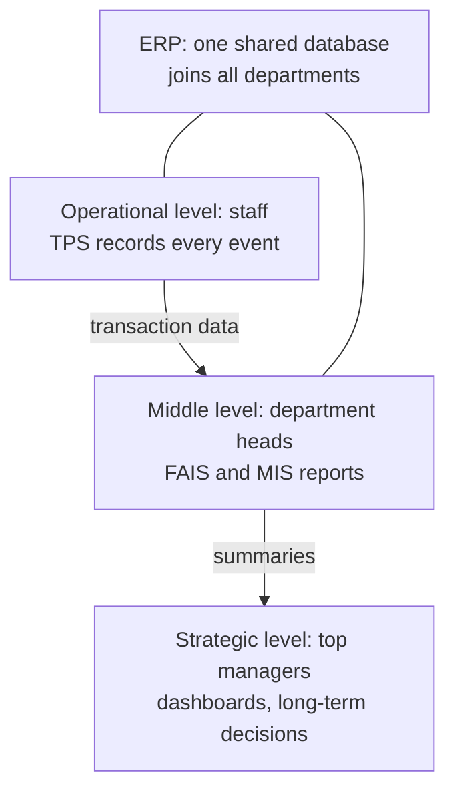
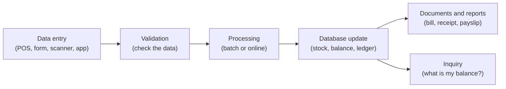
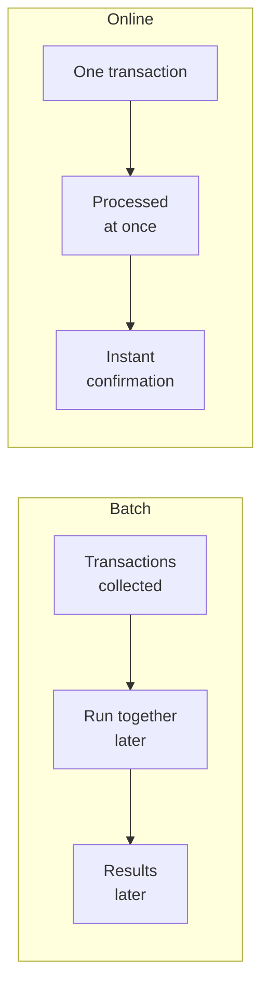
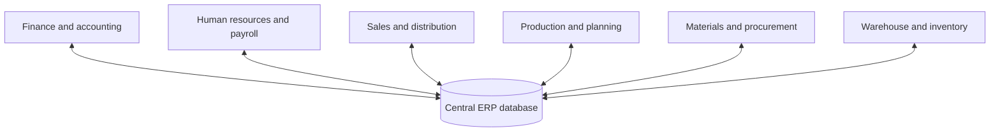
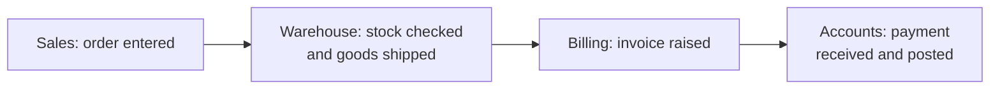
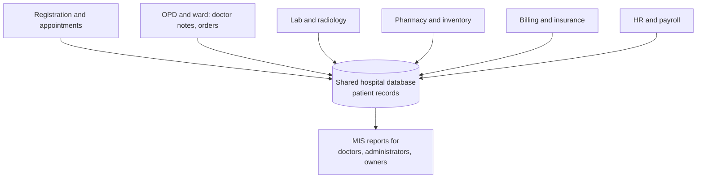

Topic shuru karne se pehle kuch basic ideas. Agar aapko ye aate hain to aage badh jao.

## The basics first

- **Transaction** ek business event hai jise record karna zaroori hai: customer shirt kharidta hai, bank customer cash nikalta hai, student fee bharta hai, worker ko salary milti hai. <Cite id="note-tps-fais-erp-wiki-tps" />
- **Data** raw facts hain (item, price, date). **Information** wo data hai jo useful form mein aa gaya (is mahine ki total sales). System pehle ko doosre mein badalta hai.
- **Database** data ka organised store hai jise kai programs share kar sakte hain.
- **Business process** steps ki series hai jo ek business result deti hai, jaise "order lo, pack karo, ship karo, paisa collect karo". <Cite id="note-tps-fais-erp-wiki-bpm" />
- **Functional area** firm ka ek department hai jo ek tarah ka kaam karta hai: accounting, finance, production and operations, marketing, human resources. <Cite id="note-tps-fais-erp-wiki-functional-area" />
- **Management levels:** operational (roz ka staff, supervisors), middle ya tactical (department heads) aur strategic (top managers).

Ye note syllabus <Syl m="6" />, sections 6.1 (transaction processing systems aur functional area information systems) aur 6.2 (ERP aur ERP support of business processes) cover karta hai. SDLC (section 6.3) alag note mein hai.

## Information systems inside an organisation

Firm ke paas ek system nahi hota. Kai systems hote hain, alag levels pe, aur wo ek doosre ko feed karte hain. <Cite id="crm-rainer-iis" /> <Cite id="crm-laudon-mis" />

**Everyday analogy.** Ek school socho. Jo clerk har fee receipt likhta hai wo TPS hai. Accounts head jo mahine ka fee report banata hai wo FAIS hai. Principal ka ek single register jise clerk, accounts, exam cell aur library sab padhte hain, wo ERP ka idea hai.

## Transaction processing system (TPS)

<Box kind="definition">

**Transaction processing system (TPS)** ek information system hai jo business ke routine transactions, jaise sales, payments, bookings aur payroll, ko capture, process, store aur report karta hai, taaki firm ke records hamesha up to date rahein. <Cite id="note-tps-fais-erp-wiki-tps" /> <Cite id="note-tps-fais-erp-includehelp-tps" /> <Cite id="crm-rainer-iis" />

</Box>

**Ye kyun zaroori hai.** Baaki saare systems sahi records pe depend karte hain. TPS ke bina sales haath se likhni padengi, stock count galat hoga, aur managers ke paas report karne ke liye kuch bharosemand nahi hoga. TPS saare upar ke systems (FAIS, MIS, ERP, decision support) ka main data source hai. <Cite id="it-impact-society-tp-mis" />

### How a TPS works

1. **Data entry.** Event ko point-of-sale machine, barcode scanner, web form ya mobile app capture karta hai.
2. **Validation.** System data check karta hai (valid account number, enough balance) aur errors reject karta hai.
3. **Processing.** Transaction turant (online) ya baad mein group mein (batch) process hoti hai.
4. **Database update.** Stock, balances aur ledgers badal jaate hain.
5. **Documents and reports.** Bills, receipts, payslips aur daily summaries bante hain. Users **inquiries** bhi kar sakte hain.

### Batch and online processing

<Figure caption="Kaam same, timing alag. Batch us kaam ke liye effort bachata hai jo ruk sakta hai, online turant answer deta hai.">

</Figure>

| Point | Batch processing | Online (real-time) processing |
|---|---|---|
| Timing | Collect hoti hain, baad mein group mein process | Har transaction turant process |
| Result | Turant nahi milta | Instant confirmation |
| Cost and effort | Sasta, bade routine jobs ke liye efficient | Always-on, tez systems chahiye |
| Example | Monthly payroll, bank interest posting | ATM withdrawal, train ya movie ticket booking, online shopping order |

<Cite id="note-tps-fais-erp-wiki-batch" /> <Cite id="note-tps-fais-erp-wiki-oltp" />

### Characteristics of a good TPS

- **Speed and high volume:** har second bahut saari chhoti transactions handle karta hai.
- **Accuracy and data integrity:** koi transaction khoti nahi, do baar apply nahi hoti, aur adhoori nahi rehti. Databases ye **ACID** rules se karte hain: atomic (all or nothing), consistent, isolated aur durable. <Cite id="note-tps-fais-erp-wiki-acid" />
- **Availability:** hamesha up rehna chahiye, kyunki TPS band hua to business ruk jaata hai.
- **Security and audit trail:** har change log hota hai aur sirf authorised log transactions enter kar sakte hain.
- **Predefined, structured inputs:** users fixed forms bharte hain, free-style queries nahi. <Cite id="note-tps-fais-erp-wiki-tps" />

### Examples

| Firm | TPS transaction |
|---|---|
| Amazon, Flipkart | Order place karna aur pay karna, stock update hona |
| SBI | ATM withdrawal aur UPI transfer se account balance update |
| Zomato | Order, payment aur delivery-partner payout records |
| Walmart ya Mumbai supermarket | Billing counter pe barcode sale se stock kam hona |
| Infosys | Staff ki monthly payroll aur attendance entries |

Ye well-known public use ke tarike hain; exact internal systems published nahi hain.

### Advantages and limits

- **Advantages:** fast aur accurate records, kam paperwork, baaki saare systems ke liye facts ka ek source, audit aur legal records ko support karta hai.
- **Limits:** ye sirf record karta hai ki kya hua. Ye khud analyse, predict ya decision support nahi karta. Failure se business ruk jaata hai, aur use hamesha available rakhne ka cost zyada hai.

## Functional area information systems (FAIS)

<Box kind="definition">

**Functional area information system (FAIS)** ek functional area (department) ko information deta hai taaki wo plan, control aur decide kar sake, aur is tarah us area ki efficiency aur effectiveness badhta hai. Har FAIS mainly TPS ka collect kiya data use karta hai. <Cite id="crm-rainer-iis" /> <Cite id="note-tps-fais-erp-wiki-mis" /> <Cite id="it-impact-society-gfg-mis" />

</Box>

Paanch classic FAIS hain: accounting, finance, production and operations management (POM), marketing aur human resources. Akele FAIS ki problem ye hai ki har ek ek department ke liye bana hai, to data repeat hota hai aur departments ke beech match nahi karta. ERP isi ka solution hai.

### Types of support given by each FAIS (10-mark question, do baar poocha gaya)

| FAIS | What it supports | Examples |
|---|---|---|
| **Accounting IS** | Paise ke saare events record aur report karta hai. General ledger, accounts payable aur receivable, billing, payroll aur budgets rakhta hai. Financial statements banata hai. Auditing, internal control aur cost accounting mein help karta hai | AIS vendor ko pay karne se pehle invoice, goods receipt aur purchase order match karta hai <Cite id="note-tps-fais-erp-wiki-ais" /> |
| **Finance IS** | Paise ke aane aur jaane ko manage karta hai. Cash management, investment decisions, budgeting, financial forecasting aur analysis, credit aur risk, financial markets aur rates ka access | Firm agli quarter ka cash forecast karti hai aur decide karti hai ki extra cash kahan invest kare |
| **Production and operations management (POM) IS** | Goods banane ya services dene ko plan aur control karta hai. Inventory control, purchasing aur supplier management, production planning aur scheduling (MRP), quality control, maintenance, logistics, process design | Material requirements planning batata hai ki kya kab kharidna aur banana hai <Cite id="note-tps-fais-erp-wiki-mrp" /> |
| **Marketing IS** | Product, price, place aur promotion ko support karta hai. Market research, customer data, sales forecasting, sales tracking, pricing, advertising results, order aur customer service | Flipkart dekhta hai ki kaun se offers kis city mein sales badhate hain |
| **Human resources IS** | Logon ko manage karta hai. Recruitment, records, payroll aur benefits, attendance aur leave, training, performance appraisal, workforce planning, rules aur compliance | HRIS payslips deta hai aur training aur leave track karta hai <Cite id="note-tps-fais-erp-wiki-hris" /> |

<Cite id="crm-rainer-iis" /> <Cite id="it-impact-society-tp-mis" /> <Cite id="note-tps-fais-erp-wiki-functional-area" />

### Reports produced by FAIS

FAIS managers ko teen main tarah ke reports dete hain. <Cite id="crm-rainer-iis" /> <Cite id="note-tps-fais-erp-wiki-mis" />

| Report type | What it is | Example |
|---|---|---|
| **Routine report** | Fixed schedule pe, fixed format mein banta hai | Daily sales summary, monthly payroll register |
| **Ad hoc (on-demand) report** | Manager ke maangne pe, kisi special need ke liye banta hai | Pichle hafte ek city mein ek product ki sales |
| **Exception report** | Sirf tab banta hai jab koi value limit cross kare | Reorder level se kam stock wale items, credit limit se upar ke accounts |

Ad hoc reports ke common forms: **drill-down** (total se uske peeche ke detail tak jaana), **key-indicator** (kuch key numbers, jaise cash on hand ya daily sales) aur **comparative** (is saal versus pichla saal, ya ek branch versus doosri).

### FAIS and ERP reports compared (10-mark question)

| Point | FAIS reports | ERP reports |
|---|---|---|
| Scope | Ek department | Poora firm, departments ke beech |
| Data source | Department ka apna database | Sabke liye ek shared database |
| Types | Routine, ad hoc (drill-down, key-indicator, comparative), exception | Wahi types, lekin har ek finance, stock, sales aur HR ko saath mila sakta hai |
| View | Tasveer ka ek hissa. Departments ke numbers alag ho sakte hain | Ek version of the truth |
| Timing | Aksar periodic (daily, monthly) | Real-time ya near real-time |
| Example | Marketing system ka sales report | Ek report jo order, uski stock position, delivery aur payment status saath dikhata hai |

Dono same report types use karte hain. Fark ye hai ki ERP reports integrated hote hain aur hamesha consistent rehte hain. <Cite id="note-tps-fais-erp-tp-erp" />

## Enterprise resource planning (ERP)

<Box kind="definition">

**Enterprise resource planning (ERP)** ek integrated, real-time software system hai, ek shared database pe bana, jo poore organisation ke core business processes (finance, HR, supply chain, manufacturing, sales) ko support karta hai aur har department ko wahi data dekhne aur use karne deta hai. <Cite id="crm-rainer-iis" /> <Cite id="note-tps-fais-erp-wiki-erp" /> <Cite id="note-tps-fais-erp-tp-erp" /> <Cite id="note-tps-fais-erp-oracle-erp" />

</Box>

**Ye kyun zaroori hai.** Jab har department apna system rakhta hai, to wahi customer ya item kai baar store hota hai, numbers match nahi karte, orders dobara type hote hain, aur koi poori tasveer nahi dekh sakta. ERP sab kuch ek jagah rakhta hai, to data ek baar enter hota hai aur sab use karte hain. <Cite id="note-tps-fais-erp-sap-india" />

**Short history.** ERP factories mein **material requirements planning (MRP)** se nikla, jise **MRP II** (capacity aur finance add) tak badhaya gaya, phir 1990s mein ERP bana jab finance, HR aur maintenance jude. Baad mein "ERP II" ne web, customers aur suppliers add kiye, aur aaj kai ERPs cloud pe chalte hain. <Cite id="note-tps-fais-erp-wiki-mrp" /> <Cite id="note-tps-fais-erp-wiki-erp" />

### How ERP works

### Main ERP modules

| Module | What it handles |
|---|---|
| Finance and accounting | General ledger, payables, receivables, costing, budgets |
| Human resources | Recruitment, payroll, attendance, training |
| Sales and distribution | Quotations, orders, billing, delivery |
| Procurement and materials | Purchase orders, vendors, goods receipt |
| Production and planning | Bill of materials, scheduling, quality |
| Inventory and warehouse | Stock levels, movements, reordering |
| Supply chain and CRM (kai products mein) | Suppliers, logistics, customer data |

<Cite id="note-tps-fais-erp-tp-erp" /> <Cite id="note-tps-fais-erp-wiki-erp" /> <Cite id="note-tps-fais-erp-ms-erp" />

### How ERP supports business processes

**Business process** aam taur pe departments ke beech se guzarta hai. ERP poore process ko ek system pe follow karta hai aur har step agle ko trigger karta hai. Do standard examples: <Cite id="crm-rainer-iis" />

- **Order-to-cash (fulfilment):** customer order, stock check, pick aur ship, invoice, payment receive, ledger update.
- **Procure-to-pay (procurement):** need raise hoti hai, vendor ko purchase order jaata hai, goods receive hote hain, invoice ko order aur receipt se match karte hain, payment hota hai.

Data shared hone se warehouse ko order tabhi dikh jaata hai jab sales use enter karta hai, aur accounts ko shipment tabhi dikh jaata hai jab warehouse confirm karta hai.

### Implementation approaches

- **Big bang:** poore firm ko ek date pe naye ERP pe switch kar do. Tez, lekin risky.
- **Phased:** module by module ya site by site go live karo. Safer, lekin slow aur purane systems se temporary links chahiye.
- **Parallel:** purana aur naya system kuch time saath chalao, phir purana hata do. Safe, lekin kaam double.

Typical steps: plan karo aur product chuno, business processes map aur redesign karo, configure aur customise karo, data migrate karo, users ko train karo, test karo, go live aur support. Key risks: kamzor planning, process change ki kam samajh, aur zyada customisation. <Cite id="note-tps-fais-erp-wiki-erp" /> Deployment on-premises (firm ke apne servers) ya cloud (vendor host karta hai, subscription pe) ho sakta hai. <Cite id="note-tps-fais-erp-ms-erp" />

### Advantages and drawbacks of ERP (10-mark question)

| Advantages | Drawbacks |
|---|---|
| Ek shared database ek version of the truth deta hai | Bahut zyada cost: licences, hardware, consultants, training |
| Data ek baar enter hota hai, to duplicate kaam aur errors kam | Lamba aur complex implementation, aksar kai mahine ya saal |
| Real-time reports aur tez, behtar decisions | Firm ko aksar software ke hisaab se apne processes badalne padte hain |
| Departments ka coordination behtar, delivery aur cycle times chhote | Staff resistance aur heavy training ki zaroorat |
| Inventory, cost aur cash control behtar | Zyada customisation se delays aur bugs |
| Customer service aur forecasting behtar | Doosre systems se link karna mushkil; ek vendor pe dependence |
| Standard, secure aur auditable processes | Fail hua to poora firm affected; benefits dikhne mein time lagta hai |
| Firm ke saath scale hota hai | Kharab data quality sab jagah copy ho jaati hai |

<Cite id="note-tps-fais-erp-tpoint-erp-adv" /> <Cite id="note-tps-fais-erp-tp-erp" /> <Cite id="note-tps-fais-erp-wiki-erp" /> <Cite id="note-tps-fais-erp-sap-india" />

### Real examples

| Firm or product | Use |
|---|---|
| SAP, Oracle, Microsoft Dynamics | Bade aur mid-size firms ke leading ERP products <Cite id="note-tps-fais-erp-wiki-sap" /> |
| Bade manufacturers aur retailers jaise Walmart | Stores, warehouses, suppliers aur finance ko ek planning system pe jodte hain |
| IT services firms jaise Infosys | Dono: finance aur HR ke liye ERP internally use karte hain, aur clients ko implement karne mein help karte hain |
| E-commerce firms jaise Amazon ya Flipkart | Apne bade order, stock aur finance systems chalate hain jo ERP wala kaam karte hain |

Ye general, well-known uses hain; kisi ek firm ke exact internal systems public nahi hain.

## TPS, FAIS, MIS and ERP compared

| Point | TPS | FAIS | ERP |
|---|---|---|---|
| Main job | Routine events record karna | Department ko planning aur control ke liye information dena | Saare departments ke processes integrate karna |
| Level | Operational | Middle management | Operational se strategic |
| Scope | Ek event ya function | Ek department | Poora firm |
| Output | Receipts, bills, daily lists | Routine, ad hoc, exception reports | Integrated, real-time reports |
| Database | Aksar har function ka alag | Har department ka | Ek shared database |

ERP versus CRM: ERP back-office processes (accounts, procurement, HR) cover karta hai aur CRM front-office customer kaam (sales, marketing, service). Kai ERPs ab CRM features bhi dete hain. <Cite id="crm-gfg-erp-vs-crm" />

## Example MIS for a hospital (10-mark question)

**Hospital MIS** hospital ke har hisse se data collect karta hai aur use reports mein badalta hai jo doctors, nurses aur managers ki help karte hain. TPS part events record karta hai (registration, billing). FAIS parts department ke hisaab se report karte hain. ERP-style shared database mein ek patient record rehta hai. <Cite id="it-impact-society-tp-mis" /> <Cite id="note-tps-fais-erp-wiki-mis" />

| Module | Transactions (TPS) | Reports (MIS) |
|---|---|---|
| Registration and appointments | Patient registration, booking | Daily OPD count, waiting time |
| Clinical (OPD, IPD, ward) | Admission, diagnosis, treatment, discharge | Bed occupancy, average stay, disease trends |
| Laboratory and radiology | Test orders and results | Tests per day, turnaround time |
| Pharmacy and stores | Issue of drugs, purchase | Stock below reorder level, expiry alerts (exception) |
| Billing and finance | Bills, insurance claims, payments | Revenue per department, pending claims |
| Human resources | Duty roster, attendance, payroll | Staff per shift, overtime |

**Benefits:** ek patient record, kam errors, tez billing, beds aur staff ka behtar use, behtar decisions. **Challenges:** patient data privacy, cost, staff training, aur emergency mein system downtime (backup chahiye).

## Past-paper answers: what to write

- <PYQ id="2022-12-ce/q4a" /> (10 marks, TPS aur ERP pe short notes): TPS ke liye definition, paanch activities diagram ke saath, batch versus online, aur ek example. ERP ke liye definition, module diagram, modules aur benefits.
- <PYQ id="2023-05-ce/q3b" /> (10 marks, FAIS aur ERP ke report types compare karo): teen report types ki table, phir FAIS versus ERP reports ki table.
- <PYQ id="2024-05-ce/q4b" /> (10 marks, ERP ke advantages aur drawbacks): ek line mein definition, phir advantages aur drawbacks table, ek firm example ke saath.
- <PYQ id="2024-12-ce/q5a" /> aur <PYQ id="2025-05-ce/q2a" /> (10 marks, paanch FAIS ka support): FAIS define karo, phir paanch-row support table.
- <PYQ id="2022-12-ce/q5b" /> (10 marks, hospital ke liye MIS banao): hospital diagram, module table aur benefits.

<Box kind="exam">

Exam mein English mein likho: "A TPS records routine business transactions, a FAIS turns that data into reports for one department, and an ERP integrates all departments on one shared database so that the whole firm works from one version of the truth."

</Box>

## One-line conclusion

TPS business ko record karta hai, functional area systems har department pe report karte hain, aur ERP sabko ek database pe jodta hai, jo integrated, real-time information deta hai, lekin high cost aur mushkil implementation ke saath.
