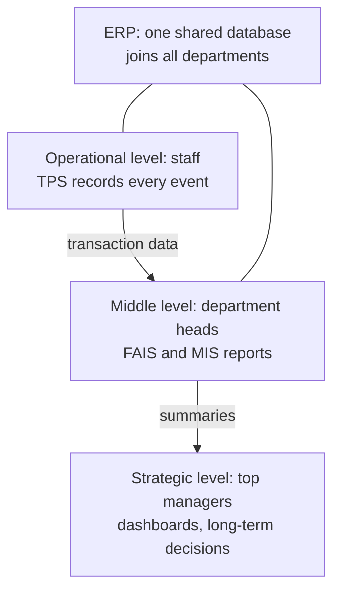
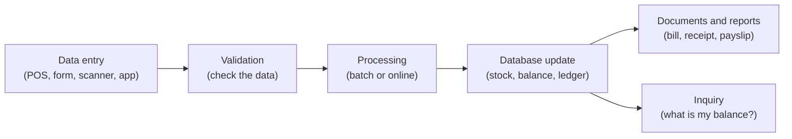
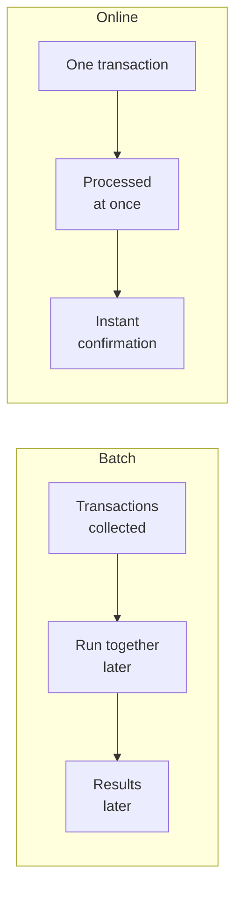
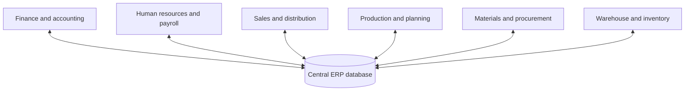
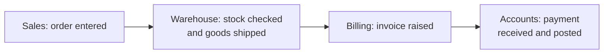
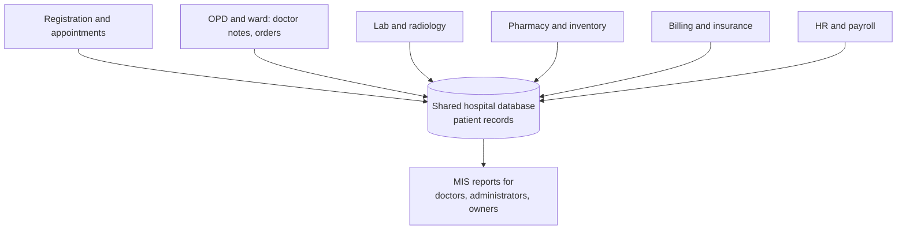

Before the topic itself, here are the few ideas you need. If you know them, skip ahead.

## The basics first

- A **transaction** is one business event that must be recorded: a customer buys a shirt, a bank customer withdraws cash, a student pays a fee, a worker is paid. <Cite id="note-tps-fais-erp-wiki-tps" />
- **Data** is raw facts (item, price, date). **Information** is data put in a useful form (total sales this month). A system turns the first into the second.
- A **database** is an organised store of data that many programs can share.
- A **business process** is a series of steps that gets one business result, for example "take an order, pack it, ship it, collect the money". <Cite id="note-tps-fais-erp-wiki-bpm" />
- A **functional area** is one department of a firm that does one kind of work: accounting, finance, production and operations, marketing, human resources. <Cite id="note-tps-fais-erp-wiki-functional-area" />
- **Management levels:** operational (day-to-day staff, supervisors), middle or tactical (department heads) and strategic (top managers).

This note covers syllabus <Syl m="6" />, sections 6.1 (transaction processing systems and functional area information systems) and 6.2 (ERP and ERP support of business processes). SDLC (section 6.3) is in its own note.

## Information systems inside an organisation

A firm does not have one system. It has several, at different levels, and they feed each other. <Cite id="crm-rainer-iis" /> <Cite id="crm-laudon-mis" />

**Everyday analogy.** Think of a school. The clerk who writes each fee receipt is the TPS. The accounts head who prepares the monthly fee report is a FAIS. The principal's single register that the clerk, accounts, exam cell and library all read from is the ERP idea.

## Transaction processing system (TPS)

<Box kind="definition">

A **transaction processing system (TPS)** is an information system that captures, processes, stores and reports the routine transactions of a business, such as sales, payments, bookings and payroll, so that the firm's records are always up to date. <Cite id="note-tps-fais-erp-wiki-tps" /> <Cite id="note-tps-fais-erp-includehelp-tps" /> <Cite id="crm-rainer-iis" />

</Box>

**Why it is needed.** Every other system depends on correct records. Without a TPS, sales would be written by hand, stock counts would be wrong, and managers would have nothing reliable to report on. The TPS is the main source of data for all higher systems (FAIS, MIS, ERP, decision support). <Cite id="it-impact-society-tp-mis" />

### How a TPS works

1. **Data entry.** The event is captured by a point-of-sale machine, barcode scanner, web form or mobile app.
2. **Validation.** The system checks the data (valid account number, enough balance) and rejects errors.
3. **Processing.** The transaction is processed at once (online) or later in a group (batch).
4. **Database update.** Stock, balances and ledgers are changed.
5. **Documents and reports.** Bills, receipts, payslips and daily summaries are produced. Users can also make **inquiries**.

### Batch and online processing

<Figure caption="Same job, two timings. Batch saves effort for work that can wait, online gives an instant answer.">

</Figure>

| Point | Batch processing | Online (real-time) processing |
|---|---|---|
| Timing | Collected, processed later in a group | Each transaction processed at once |
| Result | Not available immediately | Instant confirmation |
| Cost and effort | Cheaper, efficient for large routine jobs | Needs always-on, faster systems |
| Example | Monthly payroll, bank interest posting | ATM withdrawal, train or movie ticket booking, online shopping order |

<Cite id="note-tps-fais-erp-wiki-batch" /> <Cite id="note-tps-fais-erp-wiki-oltp" />

### Characteristics of a good TPS

- **Speed and high volume:** handles very many small transactions every second.
- **Accuracy and data integrity:** no transaction is lost, applied twice or half-done. Databases do this with the **ACID** rules: atomic (all or nothing), consistent, isolated and durable. <Cite id="note-tps-fais-erp-wiki-acid" />
- **Availability:** must stay up, because a down TPS stops the business.
- **Security and audit trail:** every change is logged and only authorised people can enter transactions.
- **Predefined, structured inputs:** users enter fixed forms, not free-style queries. <Cite id="note-tps-fais-erp-wiki-tps" />

### Examples

| Firm | TPS transaction |
|---|---|
| Amazon, Flipkart | Placing and paying for an order, updating stock |
| SBI | ATM withdrawal and UPI transfer updating the account balance |
| Zomato | Order, payment and delivery-partner payout records |
| Walmart or a Mumbai supermarket | A barcode sale at the billing counter reducing stock |
| Infosys | Monthly payroll and attendance entries for staff |

These are well-known public kinds of use; the exact internal systems are not published.

### Advantages and limits

- **Advantages:** fast and accurate records, less paperwork, one source of facts for all other systems, supports audit and legal records.
- **Limits:** it only records and reports what happened. It does not analyse, predict or support a decision on its own. A failure stops business, and cost of keeping it always available is high.

## Functional area information systems (FAIS)

<Box kind="definition">

A **functional area information system (FAIS)** supports one functional area (a department) by giving it information to plan, control and decide, and so raises that area's efficiency and effectiveness. Each FAIS mainly uses data collected by the TPS. <Cite id="crm-rainer-iis" /> <Cite id="note-tps-fais-erp-wiki-mis" /> <Cite id="it-impact-society-gfg-mis" />

</Box>

The five classic FAIS are accounting, finance, production and operations management (POM), marketing and human resources. The problem with them alone is that each is built for one department, so data is repeated and does not match across departments. ERP is the fix.

### Types of support given by each FAIS (a 10-mark question, asked twice)

| FAIS | What it supports | Examples |
|---|---|---|
| **Accounting IS** | Records and reports all money events. Keeps the general ledger, accounts payable and receivable, billing, payroll and budgets. Produces financial statements. Helps with auditing and internal control, and cost accounting | An AIS matches an invoice, goods receipt and purchase order before paying a vendor <Cite id="note-tps-fais-erp-wiki-ais" /> |
| **Finance IS** | Manages money coming in and going out. Cash management, investment decisions, budgeting, financial forecasting and analysis, credit and risk, access to financial markets and rates | A firm forecasts cash for the next quarter and decides where to invest surplus cash |
| **Production and operations management (POM) IS** | Plans and controls making goods or delivering services. Inventory control, purchasing and supplier management, production planning and scheduling (MRP), quality control, maintenance, logistics, process design | Material requirements planning works out what to buy and when to make a product <Cite id="note-tps-fais-erp-wiki-mrp" /> |
| **Marketing IS** | Supports product, price, place and promotion. Market research, customer data, sales forecasting, sales tracking, pricing, advertising results, order and customer service | Flipkart studying which offers raise sales in which city |
| **Human resources IS** | Manages people. Recruitment, records, payroll and benefits, attendance and leave, training, performance appraisal, workforce planning, rules and compliance | A HRIS gives payslips and tracks training and leave <Cite id="note-tps-fais-erp-wiki-hris" /> |

<Cite id="crm-rainer-iis" /> <Cite id="it-impact-society-tp-mis" /> <Cite id="note-tps-fais-erp-wiki-functional-area" />

### Reports produced by FAIS

FAIS give managers three main kinds of reports. <Cite id="crm-rainer-iis" /> <Cite id="note-tps-fais-erp-wiki-mis" />

| Report type | What it is | Example |
|---|---|---|
| **Routine report** | Produced on a fixed schedule in a fixed format | Daily sales summary, monthly payroll register |
| **Ad hoc (on-demand) report** | Produced when a manager asks, for a special need | Sales of one product in one city last week |
| **Exception report** | Produced only when a value crosses a limit | Items with stock below the reorder level, accounts over their credit limit |

Ad hoc reports have common forms: **drill-down** (go from a total to the detail behind it), **key-indicator** (a few key numbers, such as cash on hand or daily sales) and **comparative** (this year against last year, or one branch against another).

### FAIS and ERP reports compared (a 10-mark question)

| Point | FAIS reports | ERP reports |
|---|---|---|
| Scope | One department | Whole firm, across departments |
| Data source | The department's own database | One shared database for all |
| Types | Routine, ad hoc (drill-down, key-indicator, comparative), exception | The same types, but each can combine finance, stock, sales and HR together |
| View | Part of the picture. Numbers may differ between departments | One version of the truth |
| Timing | Often periodic (daily, monthly) | Real-time or near real-time |
| Example | The sales report from the marketing system | A report showing the order, its stock position, its delivery and its payment status together |

Both use the same report types. The difference is that ERP reports are integrated and always consistent. <Cite id="note-tps-fais-erp-tp-erp" />

## Enterprise resource planning (ERP)

<Box kind="definition">

**Enterprise resource planning (ERP)** is an integrated, real-time software system, built on one shared database, that supports the core business processes of a whole organisation (finance, HR, supply chain, manufacturing, sales) and lets every department see and use the same data. <Cite id="crm-rainer-iis" /> <Cite id="note-tps-fais-erp-wiki-erp" /> <Cite id="note-tps-fais-erp-tp-erp" /> <Cite id="note-tps-fais-erp-oracle-erp" />

</Box>

**Why it is needed.** When every department keeps its own system, the same customer or item is stored several times, numbers do not match, orders are re-typed, and nobody can see the full picture. ERP puts everything in one place so data is entered once and used by all. <Cite id="note-tps-fais-erp-sap-india" />

**A short history.** ERP grew out of **material requirements planning (MRP)** in factories, which was extended to **MRP II** (adds capacity and finance), then to ERP in the 1990s when finance, HR and maintenance were added. Later "ERP II" added the web, customers and suppliers, and today many ERPs run in the cloud. <Cite id="note-tps-fais-erp-wiki-mrp" /> <Cite id="note-tps-fais-erp-wiki-erp" />

### How ERP works

### Main ERP modules

| Module | What it handles |
|---|---|
| Finance and accounting | General ledger, payables, receivables, costing, budgets |
| Human resources | Recruitment, payroll, attendance, training |
| Sales and distribution | Quotations, orders, billing, delivery |
| Procurement and materials | Purchase orders, vendors, goods receipt |
| Production and planning | Bill of materials, scheduling, quality |
| Inventory and warehouse | Stock levels, movements, reordering |
| Supply chain and CRM (in many products) | Suppliers, logistics, customer data |

<Cite id="note-tps-fais-erp-tp-erp" /> <Cite id="note-tps-fais-erp-wiki-erp" /> <Cite id="note-tps-fais-erp-ms-erp" />

### How ERP supports business processes

A **business process** usually crosses departments. ERP follows the whole process on one system and each step triggers the next. Two standard examples: <Cite id="crm-rainer-iis" />

- **Order-to-cash (fulfilment):** customer order, check stock, pick and ship, invoice, receive payment, update the ledger.
- **Procure-to-pay (procurement):** a need is raised, purchase order is sent to a vendor, goods are received, the invoice is matched with the order and receipt, payment is made.

Because the data is shared, the warehouse sees the order the moment sales enters it, and accounts sees the shipment the moment the warehouse confirms it.

### Implementation approaches

- **Big bang:** switch the whole firm to the new ERP on one date. Quick, but risky.
- **Phased:** go live module by module or site by site. Safer, but slower and needs temporary links to the old systems.
- **Parallel:** run the old and new systems together for a while, then drop the old. Safe but doubles the work.

Typical steps: plan and choose the product, map and redesign business processes, configure and customise, migrate data, train users, test, go live and support. Key risks are weak planning, poor understanding of process change, and too much customisation. <Cite id="note-tps-fais-erp-wiki-erp" /> Deployment can be on-premises (the firm's own servers) or cloud (hosted by the vendor, paid as a subscription). <Cite id="note-tps-fais-erp-ms-erp" />

### Advantages and drawbacks of ERP (a 10-mark question)

| Advantages | Drawbacks |
|---|---|
| One shared database gives one version of the truth | Very high cost: licences, hardware, consultants, training |
| Data entered once, so less duplicate work and fewer errors | Long and complex implementation, often many months or years |
| Real-time reports and faster, better decisions | The firm often has to change its processes to fit the software |
| Departments coordinate better, shorter delivery and cycle times | Staff resistance and heavy training needs |
| Better inventory, cost and cash control | Heavy customisation causes delays and bugs |
| Better customer service and forecasting | Hard to link with other systems; dependence on one vendor |
| Standard, secure and auditable processes | If it fails, the whole firm is affected; benefits take time to appear |
| Scales with the firm | Poor data quality is copied everywhere |

<Cite id="note-tps-fais-erp-tpoint-erp-adv" /> <Cite id="note-tps-fais-erp-tp-erp" /> <Cite id="note-tps-fais-erp-wiki-erp" /> <Cite id="note-tps-fais-erp-sap-india" />

### Real examples

| Firm or product | Use |
|---|---|
| SAP, Oracle, Microsoft Dynamics | Leading ERP products used by large and mid-size firms <Cite id="note-tps-fais-erp-wiki-sap" /> |
| Large manufacturers and retailers such as Walmart | Link stores, warehouses, suppliers and finance on one planning system |
| IT services firms such as Infosys | Both use ERP internally for finance and HR, and help clients implement it |
| E-commerce firms such as Amazon or Flipkart | Run their own large order, stock and finance systems which do the work an ERP does |

These are general, well-known uses; the exact internal systems of any one firm are not public.

## TPS, FAIS, MIS and ERP compared

| Point | TPS | FAIS | ERP |
|---|---|---|---|
| Main job | Record routine events | Give a department information for planning and control | Integrate all departments' processes |
| Level | Operational | Middle management | Operational to strategic |
| Scope | Single event or function | One department | Whole firm |
| Output | Receipts, bills, daily lists | Routine, ad hoc, exception reports | Integrated, real-time reports |
| Database | Often separate per function | Per department | One shared database |

ERP versus CRM: ERP covers back-office processes (accounts, procurement, HR) and CRM covers front-office customer work (sales, marketing, service). Many ERPs now include CRM features. <Cite id="crm-gfg-erp-vs-crm" />

## Example MIS for a hospital (a 10-mark question)

A **hospital MIS** collects data from every part of the hospital and turns it into reports that help doctors, nurses and managers. The TPS part records events (registration, billing). The FAIS parts report by department. An ERP-style shared database holds one patient record. <Cite id="it-impact-society-tp-mis" /> <Cite id="note-tps-fais-erp-wiki-mis" />

| Module | Transactions (TPS) | Reports (MIS) |
|---|---|---|
| Registration and appointments | Patient registration, booking | Daily OPD count, waiting time |
| Clinical (OPD, IPD, ward) | Admission, diagnosis, treatment, discharge | Bed occupancy, average stay, disease trends |
| Laboratory and radiology | Test orders and results | Tests per day, turnaround time |
| Pharmacy and stores | Issue of drugs, purchase | Stock below reorder level, expiry alerts (exception) |
| Billing and finance | Bills, insurance claims, payments | Revenue per department, pending claims |
| Human resources | Duty roster, attendance, payroll | Staff per shift, overtime |

**Benefits:** one patient record, fewer errors, faster billing, better use of beds and staff, better decisions. **Challenges:** patient data privacy, cost, staff training, and system downtime in an emergency (needs backup).

## Past-paper answers: what to write

- <PYQ id="2022-12-ce/q4a" /> (10 marks, short notes on TPS and ERP): for TPS give the definition, the five activities with the diagram, batch versus online, and an example. For ERP give the definition, the module diagram, the modules and benefits.
- <PYQ id="2023-05-ce/q3b" /> (10 marks, compare the report types of FAIS and ERP): the three report types table, then the FAIS versus ERP reports table.
- <PYQ id="2024-05-ce/q4b" /> (10 marks, advantages and drawbacks of ERP): definition in a line, then the advantages and drawbacks table with a firm example.
- <PYQ id="2024-12-ce/q5a" /> and <PYQ id="2025-05-ce/q2a" /> (10 marks, support given by the five FAIS): define a FAIS, then the five-row support table.
- <PYQ id="2022-12-ce/q5b" /> (10 marks, create an MIS for a hospital): the hospital diagram, the module table and the benefits.

<Box kind="exam">

Write this in the exam: "A TPS records routine business transactions, a FAIS turns that data into reports for one department, and an ERP integrates all departments on one shared database so that the whole firm works from one version of the truth."

</Box>

## One-line conclusion

The TPS records the business, the functional area systems report on each department, and ERP joins them all on one database, which gives integrated, real-time information at the price of high cost and hard implementation.
