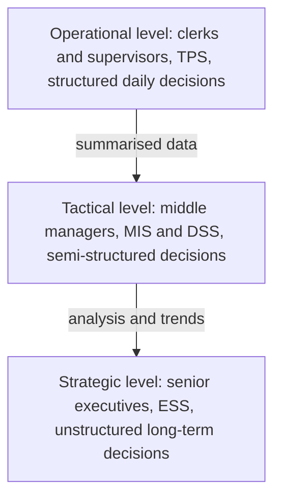

**In simple words:** business mein managers ke teen levels hote hain, aur har level ko alag tarah ka information system chahiye. Is stack ko MIS hierarchy kehte hain. Decision Support System (DSS) beech mein baithta hai aur managers ko "what if" sawaalon ke jawab dene mein madad karta hai. <Cite id="is-fundamentals-gfg-types" />

**Is hierarchy mein DSS:** DSS ek interactive computer system hai jo data, analytical models aur easy interface ko jod kar managers ko semi-structured aur unstructured decisions lene mein madad karta hai. Ye manager ki madad karta hai; manager ki jagah decide nahi karta. <Cite id="is-fundamentals-wiki-dss" />

**Components:** (1) internal aur external data ka database, (2) model base jaise forecasting aur simulation, (3) menus aur graphs wala user interface. <Cite id="is-fundamentals-tp-dss" />

**DSS pe comment**

- **Strengths:** tez aur behtar decisions, managers alternatives compare kar sakte hain, poorly structured problems handle hoti hain. <Cite id="is-fundamentals-gfg-dss" />
- **Limits:** achha data aur achhe models chahiye, banana costly hai, managers model pe zyada bharosa kar sakte hain.
- **MIS se compare:** MIS fixed, regular reports deta hai; DSS naye sawaalon ka jawab on demand deta hai.

**Example:** Amazon ki pricing team DSS se test karti hai "agar price 5 percent kam karein to kya hoga", price badalne se pehle.

**Conclusion:** hierarchy manager ke hisaab se system match karti hai, aur DSS wo tool hai jo middle level pe data ko choices mein badalta hai.
