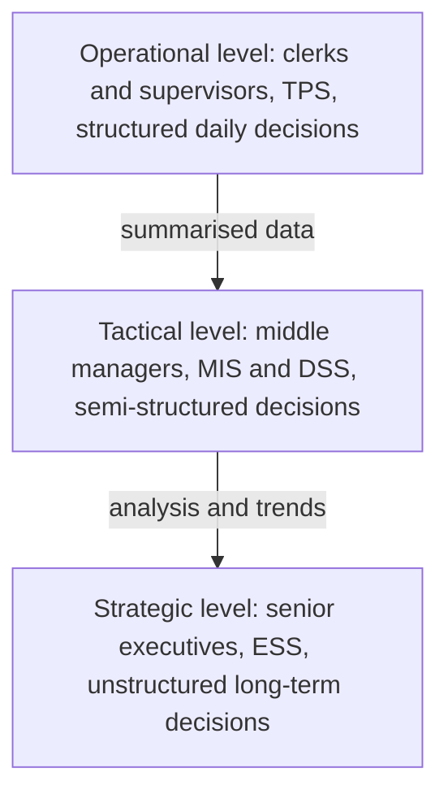

**In simple words:** a business has three levels of managers, and each level needs a different kind of information system. This stack is the MIS hierarchy. The Decision Support System (DSS) sits in the middle and helps managers answer "what if" questions. <Cite id="is-fundamentals-gfg-types" />

**DSS in this hierarchy:** a DSS is an interactive computer system that helps managers make semi-structured and unstructured decisions by combining data, analytical models and an easy interface. It supports the manager; it does not decide for them. <Cite id="is-fundamentals-wiki-dss" />

**Components:** (1) database of internal and external data, (2) model base such as forecasting and simulation, (3) user interface with menus and graphs. <Cite id="is-fundamentals-tp-dss" />

**Comment on DSS**

- **Strengths:** faster and better decisions, lets managers compare alternatives, handles poorly structured problems. <Cite id="is-fundamentals-gfg-dss" />
- **Limits:** needs good data and good models, costly to build, managers may trust the model too much.
- **Compared with MIS:** MIS gives fixed, regular reports; DSS answers new questions on demand.

**Example:** an Amazon pricing team uses a DSS to test "what if we cut the price by 5 percent" before changing it.

**Conclusion:** the hierarchy matches system to manager, and DSS is the tool that turns data into choices at the middle level.
