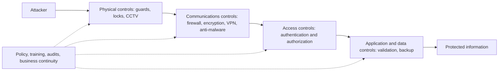

**In simple words:** security control ek safeguard hai jo threat ko rokta hai, pakadta hai, ya damage kam karta hai. Controls ko do tareeke se group kar sakte hain: wo kya karte hain, aur wo kis cheez se bane hain. Company kai controls ek ke upar ek lagati hai, taaki ek fail ho to agla phir bhi protect kare. <Cite id="note-information-security-wiki-controls" />

**Definition:** security control koi bhi safeguard, rule ya tool hai jo information aur information systems ke threat ko prevent, detect ya uska effect kam karne ke liye use hota hai. <Cite id="note-information-security-nist-800-53" />

**Ye kyun zaroori hai:** hackers, malware, theft, human error aur aag jaise threats confidentiality, integrity aur availability ko nuksaan pahuncha sakte hain. Controls us risk ko kam karte hain.

**A. Function ke hisaab se control ke types (control kya karta hai)** <Cite id="note-information-security-tp-ism" />

| Type | Kaam | Examples |
|---|---|---|
| Preventive | Incident hone se pehle rokna | Locks, firewall, passwords, encryption, patching |
| Deterrent | Logon ko koshish karne se rokna | Warning signs, CCTV, penalties, security policy |
| Detective | Jo incident ho raha hai ya hua hai use pakadna | Intrusion detection, log monitoring, audits |
| Corrective | Damage theek karke normal kaam wapas laana | Backup se restore, malware hatana, recovery plan |

**B. Nature ke hisaab se control ke types (kis cheez se bana hai)**

| Type | Kya hai | Examples |
|---|---|---|
| Physical | Buildings aur equipment ki suraksha | Guards, ID cards, door locks, server-room access, fire safety |
| Technical (logical) | Software aur hardware protection | Authentication, firewall, antivirus, encryption, VPN |
| Administrative | Rules, log aur process | Security policy, staff training, separation of duties, incident plan |
| Legal | Laws aur contracts | IT Act 2000, data protection rules |

**Layers kaise kaam karti hain:** Rainer aur Prince controls ko physical, access, communications, business continuity aur audit controls mein group karte hain. Access controls check karte hain ki aap kaun ho (authentication, jaise password plus OTP) aur aap kya kar sakte ho (authorization). Communications controls network pe data ko protect karte hain. Business continuity controls jaise backup aur disaster recovery plan incident ke baad business ko chalaye rakhte hain. Audit controls check karte hain ki baaki controls kaam kar rahe hain. <Cite id="note-information-security-ibm-infosec" />

**Example:** SBI jaisa bank guards aur CCTV (physical), OTP login aur encryption (technical), staff training aur security policy (administrative), aur doosri site pe backup (corrective) use karta hai.

**Limitation:** koi bhi control perfect nahi hota, aur strong controls mehenge hote hain aur kaam slow kar sakte hain, isliye firm risk, cost aur ease of use ka balance banati hai.

**Conclusion:** achhi security physical, technical aur administrative layers mein preventive, detective aur corrective controls ko milati hai.
