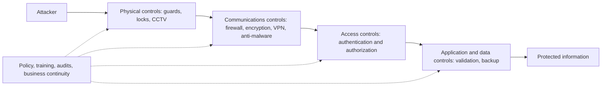

**In simple words:** a security control is a safeguard that stops a threat, spots it, or reduces the damage. Controls can be grouped by what they do and by what they are made of. A company stacks several of them so that if one fails, the next one still protects. <Cite id="note-information-security-wiki-controls" />

**Definition:** a security control is any safeguard, rule or tool used to prevent, detect or reduce the effect of a threat to information and information systems. <Cite id="note-information-security-nist-800-53" />

**Why it is needed:** threats such as hackers, malware, theft, human error and fire can harm confidentiality, integrity and availability. Controls reduce that risk.

**A. Types of control by function (what the control does)** <Cite id="note-information-security-tp-ism" />

| Type | Job | Examples |
|---|---|---|
| Preventive | Stop an incident before it happens | Locks, firewall, passwords, encryption, patching |
| Deterrent | Discourage people from trying | Warning signs, CCTV, penalties, security policy |
| Detective | Find an incident that is happening or happened | Intrusion detection, log monitoring, audits |
| Corrective | Fix damage and restore normal work | Restore from backup, remove malware, recovery plan |

**B. Types of control by nature (what it is made of)**

| Type | What it is | Examples |
|---|---|---|
| Physical | Protects buildings and equipment | Guards, ID cards, door locks, server-room access, fire safety |
| Technical (logical) | Software and hardware protection | Authentication, firewall, antivirus, encryption, VPN |
| Administrative | Rules, people and process | Security policy, staff training, separation of duties, incident plan |
| Legal | Laws and contracts | IT Act 2000, data protection rules |

**How the layers work:** Rainer and Prince group controls as physical, access, communications, business continuity and audit controls. Access controls check who you are (authentication, for example password plus OTP) and what you may do (authorization). Communications controls protect data on the network. Business continuity controls such as backup and a disaster recovery plan keep the business running after an incident. Audit controls check that the rest are working. <Cite id="note-information-security-ibm-infosec" />

**Example:** a bank like SBI uses guards and CCTV (physical), OTP login and encryption (technical), staff training and a security policy (administrative), and backups at another site (corrective).

**Limitation:** no control is perfect, and strong controls cost money and can make work slower, so a firm balances risk, cost and ease of use.

**Conclusion:** good security combines preventive, detective and corrective controls across physical, technical and administrative layers.
