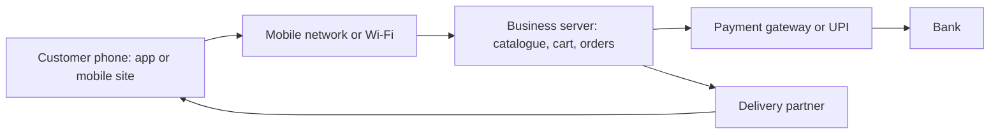

**In simple words:** mobile commerce (m-commerce) matlab mobile phone ya tablet se apps ya mobile websites ke through kharidna, bechna aur payment karna. Ola pe cab book karna, Zomato pe khana order karna ya UPI se pay karna, sab m-commerce hai. <Cite id="e-commerce-investopedia-mcommerce" />

**Definition:** m-commerce goods aur services ki buying aur selling, aur usse jude payments hain, jo smartphones jaise wireless handheld devices pe hote hain. Ye e-commerce ka ek subset hai. <Cite id="e-commerce-wiki-mcommerce" />

**Ye kyun zaroori hai:** lagbhag har kisi ke paas phone hai, isliye business customers tak kabhi bhi aur kahin bhi pahunch sakta hai, chhote shehron mein bhi.

**Applications:** mobile shopping (Amazon, Flipkart), food aur grocery delivery (Zomato, Swiggy), mobile banking aur UPI payments, ticket booking (IRCTC), cab booking, aur location-based offers. <Cite id="e-commerce-gfg-ecom-vs-mcom" /> <Cite id="e-commerce-wiki-upi" />

**Advantages:** kabhi bhi, kahin bhi use, quick payment, personal aur location-aware offers, push notifications, aur wide reach.

**m-commerce ne jo naye challenges laaye hain**

| Challenge | Problem kyun hai | Possible solution |
|---|---|---|
| Small screen | Kam products dikhte hain, lambe forms bharna mushkil | Simple design, kam steps, one-tap pay |
| Weak ya slow network | Pages aur payments fail ho jaate hain | Light apps, offline cart, safe retry |
| Security and fraud | Phone kho jaana, fake apps, public Wi-Fi | App lock, OTP, biometrics, encryption |
| Privacy | Location aur contacts bahut personal hain | Permission maango, kam data lo |
| Kai devices aur systems | Android, iOS, kai screen sizes | Responsive design aur wide testing |
| Payment failures | Paisa kat gaya par order nahi hua | Reliable gateway, quick refunds |
| Delivery pressure | Fast-delivery promises se logistics pe dabav | Local hubs, route planning |
| Law and standards | Data aur payments ke rules badalte rehte hain | Compliance rules follow karo |

<Cite id="e-commerce-wiki-mobile-payment" />

**Example:** Zomato order ke liye achhi app screen, chalta network, safe UPI payment, location sharing aur rider chahiye, isliye upar ke saare challenges ek hi order mein dikhte hain.

**Conclusion:** m-commerce business ki reach badhata hai, par customer ka trust jeetne ke liye firms ko security, usability, network aur privacy ki problems solve karni padti hain.
