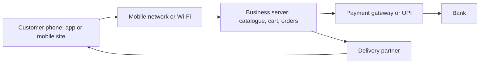

**In simple words:** mobile commerce (m-commerce) means buying, selling and paying using a mobile phone or tablet, through apps or mobile websites. Booking a cab on Ola, ordering food on Zomato or paying by UPI are all m-commerce. <Cite id="e-commerce-investopedia-mcommerce" />

**Definition:** m-commerce is the buying and selling of goods and services, and the related payments, over wireless handheld devices such as smartphones. It is a subset of e-commerce. <Cite id="e-commerce-wiki-mcommerce" />

**Why it is needed:** almost everyone carries a phone, so a business can reach customers anytime and anywhere, even in small towns.

**Applications:** mobile shopping (Amazon, Flipkart), food and grocery delivery (Zomato, Swiggy), mobile banking and UPI payments, ticket booking (IRCTC), cab booking, and location-based offers. <Cite id="e-commerce-gfg-ecom-vs-mcom" /> <Cite id="e-commerce-wiki-upi" />

**Advantages:** anytime and anywhere use, quick payment, personal and location-aware offers, push notifications, and wide reach.

**New challenges that m-commerce has introduced**

| Challenge | Why it is a problem | Possible answer |
|---|---|---|
| Small screen | Few products are visible and long forms are hard to fill | Simple design, fewer steps, one-tap pay |
| Weak or slow network | Pages and payments fail | Light apps, offline cart, safe retry |
| Security and fraud | Lost phones, fake apps, public Wi-Fi | App lock, OTP, biometrics, encryption |
| Privacy | Location and contacts are very personal | Ask permission, collect little |
| Many devices and systems | Android, iOS, many screen sizes | Responsive design and wide testing |
| Payment failures | Money deducted but order not placed | Reliable gateway, quick refunds |
| Delivery pressure | Fast-delivery promises strain logistics | Local hubs, route planning |
| Law and standards | Rules on data and payments keep changing | Follow compliance rules |

<Cite id="e-commerce-wiki-mobile-payment" />

**Example:** a Zomato order depends on a good app screen, a working network, safe UPI payment, location sharing and a rider, so each challenge above appears in one order.

**Conclusion:** m-commerce widens business reach, but firms must solve security, usability, network and privacy problems to earn customer trust.
