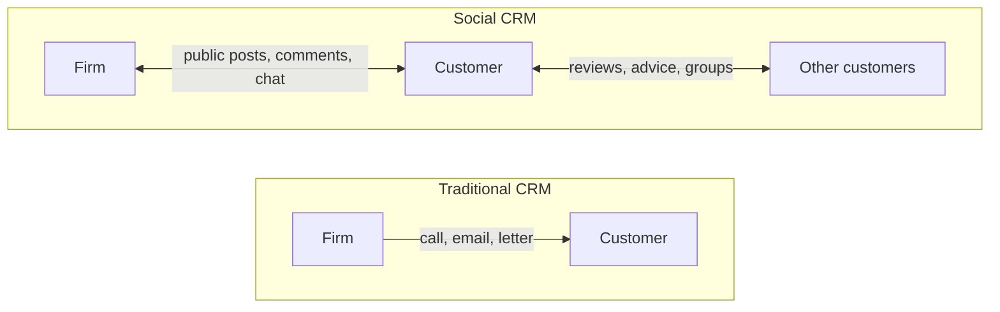

**In simple words:** CRM (Customer Relationship Management) har customer ko achhe se jaanne aur achhe se treat karne ka tareeka hai, jismein business ke saath uske saare contacts ka ek shared record hota hai. Achha dukaandaar aapka naam aur pasand yaad rakhta hai; CRM ye lakhon customers ke liye karta hai. <Cite id="crm-gfg-intro" />

**Definition:** CRM ek strategy hai, jise software support karta hai, jo company ke current aur future customers ke saath saare dealings ko manage karti hai, taaki service, loyalty aur sales behtar ho. <Cite id="crm-ibm" />

**Ye kyun zaroori hai:** purana customer rakhna naya dhundhne se sasta padta hai, aur customer data aksar sales, support aur marketing mein bikhra hota hai. CRM use ek jagah jama karta hai.

**CRM ke types** <Cite id="crm-tpoint-types" /> <Cite id="crm-rainer-iis" />

| Type | Main aim | Typical tools | Example |
|---|---|---|---|
| Operational | Roz ka customer kaam smoothly chalana | Sales force automation, ticketing, call centre, chat | Flipkart support ticket mein aapke pichhle orders dikhte hain |
| Analytic | Data se customers ko samajhna | Segmentation, data mining, dashboards | Amazon "customers also bought" |
| Marketing | Campaigns se customers jeetna aur rakhna | Email tools, offers, loyalty programmes | Zomato ka regular users ko lunch offer |
| Collaborative | Teams aur partners ke beech customer data share karna | Shared portals, common customer record | Car maker, dealer aur service centre ek hi history dekhte hain |

**CRM mein Social Computing (SC) ka role**

Social CRM social media jaise Facebook, X, Instagram, WhatsApp aur review sites ko CRM channel ki tarah use karta hai. Firm sirf messages nahi bhejti; wo sunti hai, public mein reply karti hai aur in contacts ko CRM record mein daalti hai. <Cite id="crm-wiki-social-crm" />

SC CRM ki kaise madad karta hai:

1. **Faster support:** customer airline ya bank ko complaint tweet karta hai aur jaldi public reply milta hai, jisse trust banta hai.
2. **Listening:** reviews, ratings aur hashtags batate hain ki log kya pasand ya napasand karte hain, mehenge survey ke bina.
3. **Customers ek doosre ki madad karte hain:** forums aur communities sawaalon ke jawab dete hain aur support cost kam karte hain.
4. **Personal marketing:** public interests se person ke hisaab ke offers ban sakte hain.
5. **Early warning:** bahut saare gusse wale posts problem badhne se pehle signal de dete hain.

**Risks:** kharab experience public mein tezi se failta hai, private data leak ho sakta hai, aur fake reviews gumraah kar sakte hain.

**Example:** Zomato, Swiggy aur IndiGo roz X pe customers ko public mein jawab dete hain.

**Conclusion:** CRM customers ko paas rakhta hai, aur social computing is relationship ko two-way, faster aur zyada public bana deta hai.
