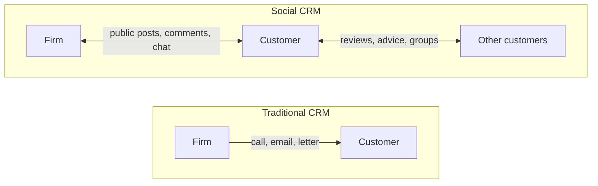

**In simple words:** CRM (Customer Relationship Management) is a way of knowing every customer well and treating them well, using one shared record of all their contacts with the business. A good shopkeeper remembers your name and what you like; CRM does this for millions of customers. <Cite id="crm-gfg-intro" />

**Definition:** CRM is a strategy, supported by software, for managing all of a company's dealings with current and future customers in order to improve service, loyalty and sales. <Cite id="crm-ibm" />

**Why it is needed:** keeping an old customer costs less than finding a new one, and customer data is often scattered across sales, support and marketing. CRM gathers it in one place.

**Types of CRM** <Cite id="crm-tpoint-types" /> <Cite id="crm-rainer-iis" />

| Type | Main aim | Typical tools | Example |
|---|---|---|---|
| Operational | Run daily customer work smoothly | Sales force automation, ticketing, call centre, chat | Flipkart support ticket shows your past orders |
| Analytic | Understand customers from data | Segmentation, data mining, dashboards | Amazon "customers also bought" |
| Marketing | Win and keep customers with campaigns | Email tools, offers, loyalty programmes | Zomato lunch offer to regular users |
| Collaborative | Share customer data across teams and partners | Shared portals, common customer record | Car maker, dealer and service centre see one history |

**Role of Social Computing (SC) in CRM**

Social CRM uses social media such as Facebook, X, Instagram, WhatsApp and review sites as a CRM channel. The firm does not only send messages; it listens, replies in public and records these contacts in the CRM record. <Cite id="crm-wiki-social-crm" />

How SC helps CRM:

1. **Faster support:** a customer tweets a complaint to an airline or bank and gets a quick public reply, which builds trust.
2. **Listening:** reviews, ratings and hashtags show what people like or dislike, without a costly survey.
3. **Customers help each other:** forums and communities answer questions and lower support cost.
4. **Personal marketing:** public interests allow offers that fit the person.
5. **Early warning:** many angry posts signal a problem before it grows.

**Risks:** a bad experience spreads publicly and fast, private data can leak, and fake reviews can mislead.

**Example:** Zomato, Swiggy and IndiGo answer customers publicly on X every day.

**Conclusion:** CRM keeps customers close, and social computing makes that relationship two-way, faster and more public.
