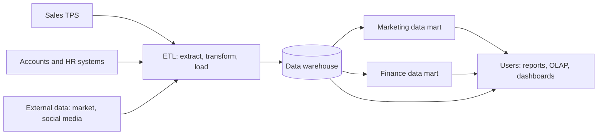

**In simple words:** data warehouse poori company ke cleaned data ka ek bada store hai, jo analysis ke liye rakha jaata hai. Data mart uska ek chhota hissa hai jo ek department ke liye hota hai. Warehouse ko hotel chain ka central kitchen samjho aur har data mart ko ek restaurant ka counter. <Cite id="data-management-gfg-dw-vs-dm" />

**Data warehouse:** kai sources ke current aur historical data ka central store, jo analysis aur decisions ke liye organised hota hai. Bill Inmon ne ise subject-oriented, integrated, time-variant aur non-volatile bataya (data add hota hai, badla ya delete nahi hota). <Cite id="data-management-tp-dwh-overview" />

**Ye kyun zaroori hai:** live billing databases pe heavy analysis chalane se asli customers ke liye system slow ho jaata hai, aur data kai systems mein alag formats mein bikhra hota hai. Warehouse use ek jagah copy karta hai jo analysis ke liye bana hai.

**Data mart:** ek chhota data warehouse jo ek subject ya department pe focus karta hai, jaise marketing ya finance. Ismein sirf wahi data hota hai jo us group ko chahiye, isliye ye sasta, jaldi banne wala aur quick query wala hota hai. Types: dependent (warehouse se bana), independent (seedha sources se bana) aur hybrid. <Cite id="data-management-ibm-data-mart" />

**Data warehouse versus data mart** <Cite id="data-management-gfg-data-warehousing" />

| Point | Data warehouse | Data mart |
|---|---|---|
| Scope | Poora organisation, kai subjects | Ek department ya subject |
| Size | Bada | Chhota |
| Sources | Kai source systems | Kam sources ya warehouse |
| Time and cost | Lamba aur zyada | Kam time, kam cost |
| Users | Kai groups | Ek group |
| Design | Aam taur pe top-down | Aksar bottom-up |

**Big Data kaise generate hota hai, iske do examples** <Cite id="data-management-wiki-big-data" />

1. **Retail transactions:** Wikipedia pe diye figures ke hisaab se Walmart ek ghante mein 1 million se zyada customer transactions handle karta hai. Har bill, item aur payment data badhata hai.
2. **Social media:** Facebook ya Instagram pe har like, share, comment aur photo store hota hai, aur Wikipedia ke mutabik Facebook ke paas users ki tens of billions photos hain. Aisa hi data Amazon ya Flipkart pe e-commerce clicks se aata hai.

Ye teen V's dikhate hain: bada volume, high velocity aur wide variety (text, photos, numbers).

**Conclusion:** warehouse company-wide view deta hai, marts har team ko fast aur focused view dete hain, aur big data wo raw material hai jo dono mein jaata hai.
